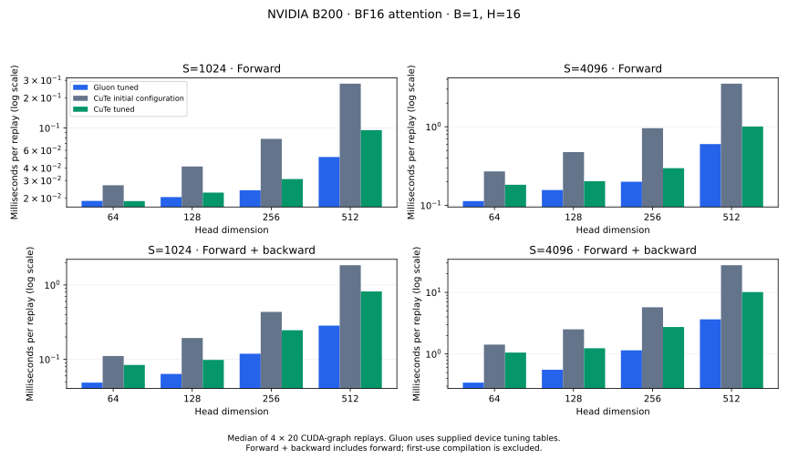
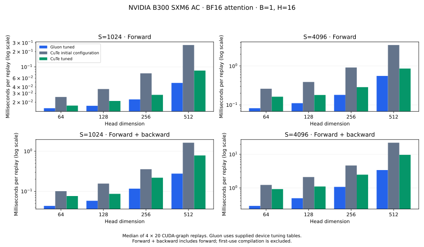
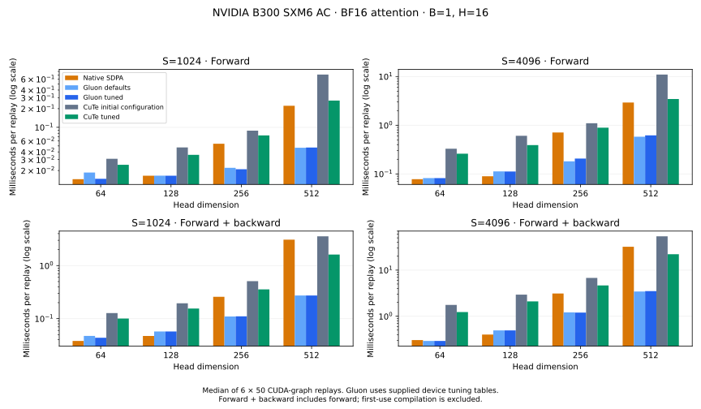
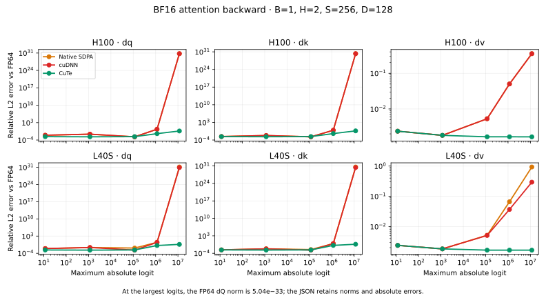

# KohakuFA-CuTe

CuTe attention for Ada, Hopper, and Blackwell, with stable backward calculations when attention becomes sharp and logits grow large. Extracted from [SimpleTuner](https://github.com/bghira/SimpleTuner/pull/3256), this implementation brings the precision approach developed by [KohakuFA](https://github.com/KohakuBlueleaf/KohakuFA) to H100, L40S, RTX 5090, B200, and B300, with an additional centered backward calculation that retains saturated tiny gradients.

KohakuFA is the originating work: its investigation identified how attention kernels can produce plausible forward outputs and loss while returning incorrect gradients. Read its [precision analysis](https://github.com/KohakuBlueleaf/KohakuFA/blob/efd5b72622ce04fcafbe6ca3e368649d8b7b9527/docs/precision.md) for the original experiments and derivations. The kernels here were developed in SimpleTuner using NVIDIA's CuTe DSL.

## Install

Install a CUDA-enabled PyTorch 2.11 or newer, then:

```bash
git clone https://github.com/SimpleTuner-io/KohakuFA-CuTe.git
cd KohakuFA-CuTe
python -m pip install '.[cuda]'
```

Python 3.12+, CUTLASS DSL 4.8, TVM FFI 0.1.14+, Triton 3.6+, Ninja, and a C++17 compiler are required for CUDA kernels. The native extension builds on first use. `pip install .` installs the public API without the optional CUDA dependencies, allowing native SDPA selection on CPU/MPS.

```python
import torch
from kohakufa_cute import attention, automatic_scaled_dot_product_attention

q = torch.randn(1, 8, 1024, 64, device="cuda", dtype=torch.bfloat16,
                requires_grad=True)
k = torch.randn_like(q, requires_grad=True)
v = torch.randn_like(q, requires_grad=True)

out = attention(q, k, v)                 # strict CuTe, [B, H, S, D]
out.square().mean().backward()
out = attention(q, k, v, causal=True)    # token causal
out = attention(q, k, v, center_keys=True)  # remove the shared key component in FP32

# PyTorch SDPA arguments; selects native SDPA for unsupported calls.
out = automatic_scaled_dot_product_attention(q, k, v)
compiled = torch.compile(automatic_scaled_dot_product_attention, fullgraph=True)
out = compiled(q, k, v)
```

`attention` and `scaled_dot_product_attention` require supported CUDA inputs and propagate kernel/build errors. `automatic_scaled_dot_product_attention` selects the centered kernels on sm_89/sm_90/sm_100/sm_103/sm_120 and native SDPA otherwise. It never patches PyTorch globally. FP32, dropout, additive masks, unsupported shapes/devices, and missing CUDA dependencies use native SDPA under automatic selection.

Q/K/V use matching FP16 or BF16 dtypes, with equal key/value shapes. Boolean masks use `True` for visible keys and broadcast to `[B, H, Sq, Sk]`; all-hidden rows return zero. `attention` supports implicit GQA and combining `mask` with `causal=True`. The SDPA wrappers require `enable_gqa=True` for differing head counts and causal visibility folded into an explicit boolean mask.

## Why forward correctness is not enough

Attention backward reconstructs probabilities rather than storing the full attention matrix. Small errors in that reconstruction matter most when one key dominates: the query/key gradients subtract nearly equal quantities, even though the forward output still closely resembles the selected value.

The standard positive-scale calculation can be written as:

```text
S = Q @ Kᵀ
c = scale · log₂(e)
m = max(S) per row
log_l = log₂(sum(exp₂((S - m) · c)))
P = exp₂((S - m) · c - log_l)
dP = dO @ Vᵀ
dS = P · (dP - sum(P · dP))
dQ = (dS @ K) · scale
dK = (dSᵀ @ Q) · scale
dV = Pᵀ @ dO
```

Three arithmetic choices can damage this backward calculation:

| Choice | What is lost | CuTe calculation |
| --- | --- | --- |
| Save `c·m + log_l` in one FP32 value | A large maximum can swallow the small normalization term | Save the unscaled maximum and logarithmic normalization separately |
| Scale large scores before subtracting the maximum | Close scores can lose their difference; the maximum can acquire a rounding residual | Subtract the unscaled maximum first, then scale |
| Convert `scale·dS` to a low-precision tensor-core operand | Small derivatives underflow earlier | Convert the unscaled derivative; apply scale after FP32 accumulation |

FP32 intermediates are part of the issue, so changing FP16 inputs to BF16 does not fix it. BF16's wider exponent range helps range, while its shorter mantissa can amplify cancellation. This is relevant wherever a model's attention becomes sharp; diagnosis should compare backward gradients on identical rounded inputs against a stable reference.

### Centered backward and tiny gradients

Ada/Hopper/Blackwell backward uses an output/dO dot product as a centering base, then recomputes the remaining softmax correction in FP32. The base and residual stay separate through the query/key gradient products. The rounded output is not treated as the final correction. This retains the tail contribution when ordinary subtraction would round it away.

The regression suite includes a BF16 saturated lookup whose FP64 query derivative is `1.92874984796e-21`; CuTe returns `1.93229391092e-21`. The reference is also checked against a 100-digit decimal finite difference. This is a more useful check than merely requiring finite gradients: zero is finite too.

### Optional key centering

`attention(..., center_keys=True)` subtracts the mean key over the sequence, separately
for each batch and K/V head, in FP32 before casting once back to the input dtype.
In exact arithmetic this shifts every visible logit in a query row equally, leaving
softmax unchanged, including with boolean masks, causal attention, and GQA. In finite
precision it removes the shared key component from score rounding and the dQ product.
Autograd differentiates through the mean subtraction, including its correction to dK.

This option implements [KohakuFA's October 5 key-centering addition](https://github.com/KohakuBlueleaf/KohakuFA/commit/043d4afe873f5c254dad6d701f7ca70aeb0692be).
It complements the centered backward above and adds a reduction and temporary key
storage on each call. It defaults to `False`; the SDPA-compatible wrappers keep their
existing argument convention.

## KohakuFA and CuTe

| Piece | KohakuFA | KohakuFA-CuTe |
| --- | --- | --- |
| Kernel language | Triton Gluon | NVIDIA CuTe DSL plus a small C++/TVM FFI launcher |
| GPU implementation | Blackwell tcgen05/TMA | Ada/Blackwell warp MMA, Hopper WGMMA/TMA, and producer/consumer tcgen05/TMEM paths on B200/B300 |
| Large-logit arithmetic | Separate statistics, shift before scale, late gradient scaling | Same approach, with centered FP32 residual correction on Ada/Hopper/Blackwell |
| Masks | Boolean masks can be packed once and reused | Tiles classified on every call, including CUDA graph replay |
| PyTorch integration | Custom operators with autograd | Native eager autograd; custom operators for compiled training |
| Packed variable length / frame-causal API | Dedicated APIs | Boolean masks express frame visibility; no packed-varlen API |
| Supported head dimensions | Up to 512 | 1–512, including tails and GQA |

B200, B300, and RTX Blackwell use the same centered backward precision contract. Eligible B200/B300 layouts use native tcgen05 products in a shared producer/consumer pipeline, with separate loader, matrix, softmax and correction workers. B200 uses software TMEM row reductions; B300 can use hardware load reductions. Short sequences retain their previous measured stage tables. Explicit boolean masks and layouts that cannot use TMA retain their previous paths. Ada, Hopper and RTX 5090 keep their existing kernel configurations. [Pipeline notes](results/blackwell-pipeline/README.md) describe the upstream architectural reference, dispatch crossovers, paired measurements and remaining Gluon gap.

B200 and B300 use fused probability/dS consumers on 128-column backward tiles, following KohakuFA's ALIAS worker arrangement while retaining FP32 probabilities for the centered correction. The [paired B200 measurements](results/blackwell-fused-backward/README.md) show D512 dense BF16 forward plus backward falling from 10.09 to 6.33 ms at S=4096, with the original Gluon kernel still faster overall. B300 selects the wider table after paired MIG validation; [the dispatch report](results/sm103-wide-backward/README.md) records the measured benefit and the full-device measurement limit. The [scheduling audit](results/attention-diagnostics/README.md) compares saved CUDA launch timelines and the upstream source, identifies repeated backward work, and records the profiling evidence still needed.

### Upstream published results

[KohakuFA's README](https://github.com/KohakuBlueleaf/KohakuFA/tree/efd5b72622ce04fcafbe6ca3e368649d8b7b9527#precision) reports the following worst-layer dK relative errors against FP64 on pretrained DINOv3 ViT-B/16, using B300:

| Input dtype | cuDNN SDPA | FlashAttention-4 | KohakuFA | Correct-kernel floor |
| --- | ---: | ---: | ---: | ---: |
| FP16 | 5.4e-2 | 5.5e-2 | 2.2e-3 | 2.1e-3 |
| BF16 | 5.0e-1 | 5.0e-1 | 9.5e-3 | 9.3e-3 |

Its [B300 speed results](https://github.com/KohakuBlueleaf/KohakuFA/tree/efd5b72622ce04fcafbe6ca3e368649d8b7b9527#speed) report dense forward/backward at 2k tokens as 2.7× FlashAttention-2, with token-causal forward/backward 4–12% behind the fastest cuDNN/FA4 path. Upstream numbers are published results; H100/L40S numbers are our measurements, with device, dtype, shape, and measurement type attached to each table.

### H100 and L40S attention measurements

Results and reproduction commands are recorded in [results/README.md](results/README.md). Forward/backward times include forward and exclude first-use compilation.

BF16 dense attention, batch 1, 16 heads. Median CUDA-graph replay time over six rotating-order repetitions, 100 timed replays per sample. `fwd+bwd` includes forward. Full forward timings and per-repetition samples are in the linked JSON.

| GPU | Tokens | Head dim | Native fwd+bwd (ms) | cuDNN fwd+bwd (ms) | CuTe fwd+bwd (ms) | CuTe / native |
| --- | ---: | ---: | ---: | ---: | ---: | ---: |
| H100 | 1024 | 64 | 0.0526 | 0.0527 | 0.0687 | 1.31× |
| H100 | 1024 | 128 | 0.0772 | 0.0771 | 0.0903 | 1.17× |
| H100 | 1024 | 256 | 0.1990 | 0.1992 | 0.3577 | 1.80× |
| H100 | 4096 | 64 | 0.5742 | 0.5630 | 0.8665 | 1.51× |
| H100 | 4096 | 128 | 0.9274 | 0.9634 | 1.3003 | 1.40× |
| H100 | 4096 | 256 | 2.4692 | 2.4793 | 4.7097 | 1.91× |
| L40S | 1024 | 64 | 0.0992 | 0.1156 | 0.1264 | 1.27× |
| L40S | 1024 | 128 | 0.1918 | 0.1971 | 0.2381 | 1.24× |
| L40S | 1024 | 256 | 0.5381 | — | 0.6788 | 1.26× |
| L40S | 4096 | 64 | 1.2418 | 1.2777 | 1.9111 | 1.54× |
| L40S | 4096 | 128 | 2.7209 | 2.8219 | 3.5472 | 1.30× |
| L40S | 4096 | 256 | 7.8879 | — | 10.5166 | 1.33× |

A dash indicates that cuDNN did not provide a kernel for that timing call. Source data: [H100](results/h100-speed.json), [L40S](results/l40s-speed.json).

### RTX 5090 attention measurements

The [SDPA comparison and profiling followup](results/sm120-sdpa-comparison/README.md)
records actual PyTorch backend selection, matching-source PTX and native SASS,
and newer backward layouts. The table below retains the original tuning run.

BF16 dense attention, batch 1, 16 heads, median of three rotating-order CUDA-graph
repetitions with 50 timed replays per sample. Forward/backward includes forward;
compilation is excluded. The before column is revision `8dfecf2`, whose sm_120
backward did not use the centered residual calculation.

| Tokens | Head dim | Native fwd+bwd (ms) | CuTe before (ms) | CuTe centered/tuned (ms) | Speedup |
| --- | --- | --- | --- | --- | --- |
| 1024 | 64 | 0.1026 | 0.1722 | 0.1436 | 1.20× |
| 1024 | 128 | 0.2024 | 0.3220 | 0.2807 | 1.15× |
| 1024 | 256 | 0.5229 | 0.7078 | 0.7538 | 0.94× |
| 1024 | 512 | 5.2516 | 6.0339 | 3.8388 | 1.57× |
| 4096 | 64 | 1.4229 | 2.1956 | 1.8499 | 1.19× |
| 4096 | 128 | 2.6592 | 4.3849 | 3.6935 | 1.19× |
| 4096 | 256 | 5.9185 | 10.2814 | 10.6575 | 0.96× |
| 4096 | 512 | 48.8145 | 98.4573 | 65.1682 | 1.51× |

Forward alone improves 1.08–3.34× over that baseline. Full forward/backward improves
at head dimensions 64, 128, and 512; dimension 256 is 4–7% slower with the stronger
backward calculation. Native SDPA is still faster on several shapes. These are
attention-call timings rather than full training-step timings.

The RTX 5090 GPU suite passes 53 tests, with the MPS-only test skipped. It covers
FP16/BF16 precision, tiny gradients, masks, GQA, eager/compiled backward, checkpointed
LoRA optimizer updates, streams, and graph replay. See [results/README.md](results/README.md#rtx-5090-sm_120)
for precision results, configuration selection, environment, and reproduction commands.
Source data: [before](results/rtx5090-baseline-speed.json), [centered/tuned](results/rtx5090-speed.json),
[causal](results/rtx5090-causal-speed.json), [validation](results/rtx5090-validation.json).

### Blackwell backward register pressure

Smaller TMEM output windows, delayed V reads and later probability packing reduce
forward-plus-backward latency by **2.0–8.0% across 32 paired cases** on the 18-SM
B300 MIG. BF16, B=1/H=16/S=4096, milliseconds including forward:

| D | Causal | Main `e44d114` | Selected | Gluon |
| --- | :---: | ---: | ---: | ---: |
| 64 | no | 3.7699 | 3.5726 | 1.9779 |
| 128 | no | 4.7204 | 4.4751 | 3.3706 |
| 256 | no | 9.9434 | 9.7445 | 7.7442 |
| 512 | no | 29.6360 | 28.7521 | 24.8142 |
| 512 | yes | 16.8629 | 16.4429 | 13.6534 |

All 128 candidate samples match main outputs and gradients bitwise. Gluon remains
faster overall. The [backward register report](results/blackwell-backward-registers/README.md)
contains the full matrix, emitted-code comparisons, Nsight traces and measured
fused-backward experiments. Physical B200 and full-device B300 performance remain
unmeasured for this change.

### B300 MIG transfer and scheduling follow-up

After [adjacent D512 gradient slices](results/blackwell-slice-scheduling/README.md),
wider D512 forward transfers, narrow correction windows, compact backward loader
loops, and causal query ordering provide another measured improvement. BF16,
B=1/H=16/S=4096, on the same 18-SM B300 MIG:

| D | Causal | Scheduling baseline `8a6c561` | Selected fwd+bwd (ms) | Gluon (ms) |
| --- | :---: | ---: | ---: | ---: |
| 256 | no | 10.2445 | 9.9677 | 7.7479 |
| 512 | no | 30.9804 | 29.5940 | 24.8158 |
| 512 | yes | 18.9109 | 16.8667 | 13.6344 |

D512 causal forward alone improves from 3.9859 to 2.6344 ms, versus Gluon's
3.0043 ms. Gluon still leads forward plus backward. All 72 candidate samples
match the scheduling baseline bitwise. The [follow-up report](results/blackwell-transfer-scheduling/README.md)
contains the full matrix, precision checks, emitted-code comparisons, and Nsight
timelines. Full-device B200/B300 performance remains unmeasured for this change.

### Earlier B300 MIG code generation and tensor-memory dS

On the B300 MIG 1g.34gb (18 SMs), paired FP32 arithmetic, wider resident D128
products, tensor-memory dS, and forward row-inverse reuse reduce latency in all
18 paired cases by 7.8–15.5%. BF16, B=1/H=16/S=4096, forward plus backward
milliseconds including forward:

| D | Main before this change | After codegen change | Gluon |
| --- | ---: | ---: | ---: |
| 64 | 4.1924 | 3.7701 | 1.9808 |
| 128 | 5.5563 | 4.7166 | 3.3701 |
| 256 | 11.6911 | 10.2516 | 7.8095 |
| 512 | 38.7051 | 33.6753 | 24.9089 |

The centered gradient correction and FP32 probabilities are retained. Gluon
remains faster overall. These are MIG results, not full-device B200/B300 timings.
The [code generation report](results/blackwell-codegen/README.md) contains
216 paired samples, precision and graph checks, complete PTX/SASS comparisons,
Nsight kernel timelines, and the rejected register-allocation/cache experiments.

### Earlier B300 MIG probability-tile measurements

On a B300 MIG 1g.34gb (18 SMs), classifying fully visible backward tiles once
removes repeated bounds predicates while preserving the FP32 exponent formula
and centered correction. Paired outputs and all gradients match the original
source bit for bit. BF16, B=1/H=16/S=4096, 128-column table, forward plus backward
milliseconds including forward:

| D | Before | After | Gluon |
| --- | ---: | ---: | ---: |
| 64 | 5.6374 | 4.1928 | 1.9761 |
| 128 | 6.5813 | 5.5562 | 3.3707 |
| 256 | 13.7632 | 11.5494 | 7.7511 |
| 512 | 40.3273 | 38.3358 | 24.8099 |

The 128-column policy improves all 18 paired dense/causal comparisons. The
64-column policy improves 16 of 18, with two short D512 cases about 0.6–0.8%
slower. These are partition measurements, not full-B200/B300 speed claims.
[Measurement notes](results/blackwell-probability-tiles/README.md) include
360 graph-verified samples, bitwise checks, source-level barrier intervals and
rejected operand-buffer experiments. The D128 key/value matrix warp's median
P-ready wait falls from 52.3% to 2.2% of its instrumented interval; D512 still
spends substantial time inside operand-ready waits.

### B200 fused backward measurements

Further B200 tuning widens backward to 128-column score tiles and fuses probability
and dS consumers, with 32-column dP loads to limit live intermediates. These
measurements compare the preceding pipeline with the final B200 defaults on the
same host. B=1/H=16/S=4096, dense BF16; median forward-plus-backward milliseconds
from four rotating-order repetitions of 20 CUDA-graph replays, including forward.

| Head dim | Previous pipeline | Fused consumers | Gluon | Less CuTe time |
| --- | ---: | ---: | ---: | ---: |
| 64 | 1.051 | 0.848 | 0.341 | 19.4% |
| 128 | 1.233 | 1.000 | 0.557 | 18.9% |
| 256 | 2.763 | 2.075 | 1.153 | 24.9% |
| 512 | 10.085 | 6.333 | 3.671 | 37.2% |

All 32 BF16/FP16 dense/causal timing cases improve over the preceding pipeline,
by 4.6–41.2%. Gluon remains faster overall. The [measurement notes](results/blackwell-fused-backward/README.md)
include source references, raw repetitions, the unchanged large-logit precision
behavior and the experiments that were excluded. At the time of those full-device measurements, B300 retained the shared pipeline
configuration below.

### Shared Blackwell pipeline baseline

The producer/consumer port follows the original KohakuFA scheduling architecture.
Dense BF16, B=1/H=16, S=4096; milliseconds for forward plus backward, including
forward. Each report rotates three backends across four repetitions of 20 graph
replays. Previous CuTe uses the preceding production stage table with the final
arithmetic helpers; this is a paired configuration comparison.

| GPU | Head dim | Previous CuTe | Pipeline | Gluon | CuTe speedup |
| --- | ---: | ---: | ---: | ---: | ---: |
| B200 | 64 | 1.420 | 1.055 | 0.342 | 1.35× |
| B200 | 128 | 2.516 | 1.237 | 0.555 | 2.03× |
| B200 | 256 | 5.727 | 2.740 | 1.145 | 2.09× |
| B200 | 512 | 27.623 | 10.098 | 3.648 | 2.74× |
| B300 | 64 | 1.228 | 0.925 | 0.292 | 1.33× |
| B300 | 128 | 2.104 | 1.103 | 0.493 | 1.91× |
| B300 | 256 | 4.654 | 2.482 | 1.074 | 1.88× |
| B300 | 512 | 22.145 | 9.658 | 3.400 | 2.29× |

The new forward is about 3.5× faster at D512 on B200 and 4.0× faster on B300.
Gluon remains faster overall. [Pipeline notes](results/blackwell-pipeline/README.md)
include both dtypes, causal attention, short-sequence crossovers, FP64 precision,
source hashes and the remaining architectural differences.





### Earlier B200 attention measurements

One B200, BF16, B=1 and H=16. Milliseconds for forward plus backward, including
forward; median of six repetitions with 50 CUDA-graph replays. Both projects are
tuned on this device. Gluon uses upstream `0c5ede6` with the disclosed
[B200 compatibility patch](results/b200-upstream-sm100.patch).

| Sequence | Head dim | CuTe initial configuration | CuTe tuned | Gluon tuned |
| ---: | ---: | ---: | ---: | ---: |
| 4096 | 64 | 1.83 | 1.42 | 0.344 |
| 4096 | 128 | 3.07 | 2.52 | 0.568 |
| 4096 | 256 | 7.02 | 5.76 | 1.31 |
| 4096 | 512 | 54.6 | 27.7 | 3.71 |

Across S=1024/4096 and D=64/128/256/512, CuTe tuning improves complete dense BF16
forward/backward by 1.36× geometrically, with a largest gain of 1.97×.
Tuned Gluon is 2.38–7.46× faster than tuned CuTe on this grid.
The CuTe defaults come from 452 accuracy-gated trials. The 512-wide forward stage
uses native tcgen05 score products and double-buffered TMA; backward retains the
centered warp-MMA calculation.


At the D=128 BF16 stress endpoint, identical rounded inputs produce the following
relative gradient errors against centered FP64:

| Kernel | dQ | dK | dV |
| --- | ---: | ---: | ---: |
| Native SDPA | 1.36e+35 | 3.99e+34 | 0.468 |
| Gluon | 6.43e+30 | 2.16e+30 | 0.00165 |
| CuTe | 0.432 | 0.432 | 0.00165 |

The FP64 dQ norm is 5.04e-33; CuTe retains a nonzero
derivative with cosine 0.9999987, while its relative error remains
0.432. The [measurement notes](results/README.md#b200-sm_100)
include FP16 underflow limits, both dtypes' dense/causal timings, before/after precision
sweeps, the upstream tuning tables, and source/patch provenance.

### Earlier B300 attention measurements

One B300 (sm_103), BF16, B=1/H=16, contiguous BHSD inputs. Median milliseconds
for forward plus backward, including forward, from six repetitions of 50
CUDA-graph replays. Gluon uses unmodified upstream `0c5ede6`, retuned on the matching
dense shapes.

| Sequence | Head dim | CuTe initial configuration | CuTe tuned | Gluon tuned |
| ---: | ---: | ---: | ---: | ---: |
| 4096 | 64 | 1.76 | 1.23 | 0.291 |
| 4096 | 128 | 2.94 | 2.1 | 0.493 |
| 4096 | 256 | 6.77 | 4.65 | 1.2 |
| 4096 | 512 | 54 | 22.1 | 3.5 |

Across S=1024/4096 and D=64/128/256/512, complete dense BF16 forward/backward
improves 1.56× geometrically over the initial centered port, with a largest
gain of 2.45×. Gluon remains 2.30–6.31× faster on this grid.
The B300 table selects native tcgen05/TMEM and warp-MMA paths separately per stage;
[measurement notes](results/README.md#b300-sm_103) record the selections, both dtypes,
causal comparisons, and precision limits.



### Large-logit precision measured here

BF16, `[1, 2, 256, 128]`, seeded synthetic inputs, maximum absolute logit approximately `1.16e7`. Relative L2 error against centered FP64 backward:

| GPU | Kernel | dQ | dK | dV |
| --- | --- | ---: | ---: | ---: |
| H100 | Native SDPA | 5.51e+30 | 1.86e+30 | 0.355 |
| H100 | cuDNN | 5.51e+30 | 1.86e+30 | 0.355 |
| H100 | CuTe | 0.432 | 0.432 | 0.00165 |
| L40S | Native SDPA | 1.29e+31 | 3.89e+30 | 0.934 |
| L40S | cuDNN | 7.66e+30 | 2.35e+30 | 0.294 |
| L40S | CuTe | 0.432 | 0.432 | 0.00165 |

All three forward output errors are zero at this point, while their backward errors differ dramatically. The FP64 dQ norm is `5.04e-33`, so a spurious derivative produces a very large relative error. CuTe retains a nonzero derivative with cosine approximately `0.999999`; its relative error is still `0.432`. The JSON includes reference norms, norm ratios, and absolute errors for the full sweep rather than only this endpoint.



Precision source data: [H100](results/h100-precision.json), [L40S](results/l40s-precision.json).

### SimpleTuner training-block measurements

These are full compiled transformer-block optimizer steps, including LoRA and activation checkpointing, measured before extraction with the same kernel implementation. H100, BF16, 4096 image tokens, LoRA rank 16, learning rate zero; 20 warmup steps, 100 timed steps, and 12 rotating-order repetitions. Native SDPA is the baseline.

| Block | Native SDPA | Automatic CuTe | Step-time change |
| --- | ---: | ---: | ---: |
| Flux | 10.640 ms | 11.477 ms | +7.9% |
| MiniMax-H3 | 24.206 ms | 25.668 ms | +6.0% |

The stronger gradient calculation has a throughput cost on these blocks. SimpleTuner accepts that cost for its automatic training default. These timings hold weights fixed for matched performance measurements; optimizer-update correctness is tested separately.

## Reproduce

```bash
python -m unittest discover -v -f
python -m benchmarks.precision --dtype bf16 --seq 256 --dim 128 \
  --backends auto cudnn kohakufa-cute --output results/precision.json
python -m benchmarks.speed --dtype bf16 --seq 1024 4096 --dim 64 128 256 \
  --output results/speed.json
```

The precision sweep uses FP64 analytical backward with a centered correction, on exactly the same rounded Q/K/V and upstream gradient. It reports output and dQ/dK/dV relative error, norm ratio, cosine, and finiteness. Timings replay CUDA graphs and rotate backend order between repetitions. Add `--backends ... kohakufa` to run an installed upstream KohakuFA on a supported device.

Tests cover masks and all-hidden rows, GQA, arbitrary head tails, signed/zero scales, noncontiguous storage, large logits, saturated tiny gradients, eager/compiled backward, checkpointed LoRA optimizer updates, concurrent streams, cache release, and mutable masks during CUDA graph replay.

## License and attribution

The extracted SimpleTuner implementation is [AGPL-3.0-or-later](LICENSE). NVIDIA CUTLASS and FlashAttention helper adaptations retain their BSD notices in [NOTICE](NOTICE) and [LICENSES/BSD-3-Clause.txt](LICENSES/BSD-3-Clause.txt). KohakuFA receives credit for the precision investigation and approach; its Gluon kernels are not bundled here.
