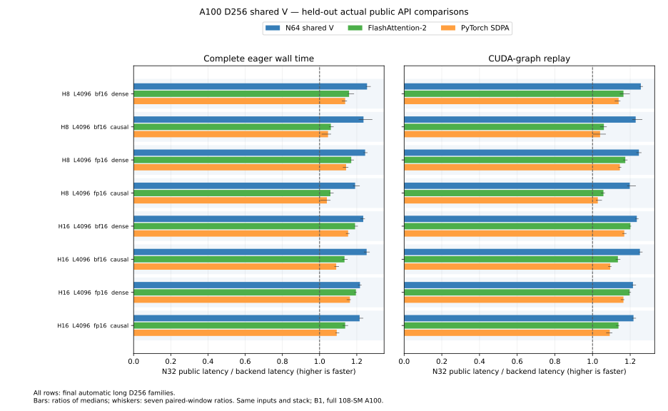

# A100 long D256: shared V and wider key tiles

The long D256 path uses an A100-sized backward schedule: M64/N64, shared V,
one Q stage and one dO stage, with score/KV/dQ warp ownership 4/1/2.
Causal calls interleave four heads; dense calls keep group 1. Automatic selection
remains batch1/H8 or H16/S4096 on the qualified full 108-SM A100 stack.
H16/S1024 retains the earlier N32 schedule. Other shapes and explicit inference
keep their preceding behavior.

On the held-out actual public API comparison, all eight backward and joint
cases beat both standalone FA2 and SDPA in complete eager and graph latency.
This covers both BF16/FP16 and dense/causal visibility. The same inputs and
software stack are used in each process; the device is a full A100-SXM4-40GB,
108 SMs, with a 350 W limit. The qualified dependency installation is unchanged.

| Phase | Eager over N32 | Graph over N32 | Graph over FA2 | Graph over SDPA |
| --- | ---: | ---: | ---: | ---: |
| Forward | 0.985× | 0.987× | 0.987× | 0.999× |
| Backward | 1.321× | 1.325× | 1.118× | 1.154× |
| Joint | 1.231× | 1.231× | 1.080× | 1.111× |

These are geometric means over the eight measured cases. No forward speedup
is claimed: its geometry and representative loaded SASS are unchanged, while
its measured ratios retain the small regressions shown above. Values below1
mean the comparison backend remains faster.



The [compact result](../results/a100-d256-shared-v.json) retains all 48 held-out
rows and all 32 selection-study rows, seven timing samples, interned resources
and per-head error summaries, source/library hashes and loaded-code evidence.
This is a separate follow-up; the [original N32 study](a100-d256-training.md),
its 144 rows and its reference-order failure/diagnosis remain intact. Speedups
from the two studies are not multiplied into a new same-process claim.

## Why this schedule

The actually launched FA2 D256 backward on A100 uses traits
`256,64,64,8,4,2,2,false,true`: shared V and no double buffering, 147456 launched
shared bytes, 255 registers and no reported local storage. Its official launch
source explicitly chooses this shared-V N64 design when at least 144 KiB is
available. The N32/resident-V design is its fallback for smaller shared-memory
budgets.

The selection study tested N32/resident-V against N64/shared-V, isolated KV1
versus FA2's KV2 ownership, and compared causal head groups 1/4. All six controls
passed resource, math, changed-graph and memory checks before timing. KV1 was
selected uniformly, with causal group 4; the slight FP16-only KV2 advantage in
some causal selection rows did not become a dtype-specific preset. Group 4
regressed with N32 and improved N64, so it is not applied indiscriminately.

An earlier N64/resident-V control was a different design: its representative
BF16 dense joint call took 122.40 ms versus 9.51 ms for N32. CUDA reported 32
registers and 4120 local bytes for that N64 kernel. The new shared-V candidate
retains that negative result; tile width alone did not predict performance. The
earlier local-storage behavior was observed, not isolated as a single cause.

For these full tiles, doubling N halves the number of key-tile CTAs and the
repeated Q/dO staging passes. Each CTA covers twice the key work before adding
to dQ, reducing the number of dQ atomic updates. Keeping V separately in shared
memory also avoids the resident-V prologue's aliased Q/V buffer transition.
These are source-level consequences; they are not measurements of DRAM traffic,
cache-hit rate or stall percentages.

The actual launched shared-memory total rises from 91,136 to 148,480 bytes,
within the measured 166,912-byte opt-in block limit. Representative causal main
kernels keep 255 registers. CUDA-reported local storage is 32 bytes for N32,
versus 24 BF16 /72 FP16 bytes for N64 in the captured H8/H16 cases. A higher
local-storage count alone did not predict latency.

Loaded whole-function SASS contains 160 HMMA instructions for N32 and 320 for
N64, consistent with twice the key work per CTA and half as many CTAs. Both
list 64 dQ reduction instructions per CTA; their per-call counts change with
the grid. The static barrier counts are 9/7 and async-copy counts 44/52.
Prologue and loop instructions have different execution counts, so these
static totals are not runtime percentages. Hardware stall/cache/traffic counters
were not collected for this follow-up. The retained representative code is
actual loaded SASS; missing packaged PTX is recorded, not treated as a successful
PTX disassembly.

## Qualification and reproduction

All seven GPU method files and the selected G1/G4 configurations match the
resource/math/memcheck-qualified selection snapshot byte-for-byte. The release
then passed eight actual public correctness/statistic cases, 16 changed poisoned
graph replays, race/sync/init checks for both groups, 48 held-out actual API timing
rows and 16 unique loaded-image associations. The 20 public-capture code files
and all 51 selection-capture code files are copied off-host and SHA-verified.
The compact result references 33 unique files, including representative actual
FA2 code from the separate selection capture.

The arithmetic is unchanged: P converts once to the input dtype before dS,
dS converts once, products/gradients accumulate in FP32, delta uses the actual
rounded O, and dQ/dK scale after accumulation. The 1% BF16 /0.5% FP16 per-head
norm gates are unchanged. The earlier common-offset reference diagnosis is
preserved; neither tolerances nor default precision increased.

Selection used seed 4441 and the final public evaluation used seed 4493.
Forward runs under NoGrad; eager wall time includes preparation and launch,
while graph replay reports resident CUDA-event time. Backend order rotates
across seven 50 ms measurement windows after 1000 ms warmup.

```sh
python -m benchmarks.compare_attention_variants \
  --operations '[{"label":"n32_public","factory":"benchmarks.a100_shared_api_controls:make_attention","kwargs":{"previous":true}},{"label":"n64_public","factory":"benchmarks.a100_shared_api_controls:make_attention"},{"label":"fa2","backend":"fa2"},{"label":"sdpa","backend":"sdpa"}]' \
  --seq 4096 --dim 256 --heads 16 --dtype bf16 fp16 \
  --phases forward backward joint --visibility dense causal --no-grad-forward \
  --seed 4493 --repeats 7 --warmup-ms 1000 --window-ms 50 \
  --output artifacts/a100-d256-shared-h16.json
```

Repeat with `--heads 8`. These are complete implementation comparisons against
FA2/SDPA; their arithmetic order is not substituted as a numerical oracle.

Held-out joint graph latencies, in milliseconds:

| Heads | Dtype | Visibility | N32 joint ms | N64 joint ms | FA2 joint ms | SDPA joint ms |
| ---: | --- | --- | ---: | ---: | ---: | ---: |
| 8 | bf16 | dense | 4.7495 | 3.7805 | 4.0795 | 4.1712 |
| 8 | bf16 | causal | 2.5190 | 2.0496 | 2.3759 | 2.4217 |
| 8 | fp16 | dense | 4.8899 | 3.9241 | 4.1653 | 4.2704 |
| 8 | fp16 | causal | 2.5715 | 2.1472 | 2.4309 | 2.5014 |
| 16 | bf16 | dense | 9.2520 | 7.4915 | 7.7042 | 7.9180 |
| 16 | bf16 | causal | 4.8970 | 3.9131 | 4.3156 | 4.4768 |
| 16 | fp16 | dense | 9.4881 | 7.8115 | 7.9262 | 8.1509 |
| 16 | fp16 | causal | 5.0303 | 4.1321 | 4.4215 | 4.6089 |
