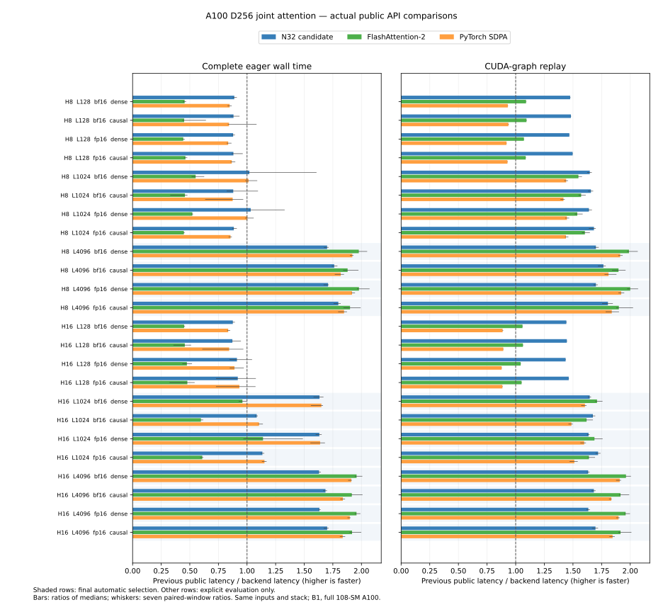

# Original A100 D256 N32 study

The subsequent [shared-V N64 update](a100-d256-shared-v.md) replaces the long
4096-token schedule. This page retains the original N32 evidence and reference
diagnosis without relabelling it as the later measurement.

The full-device A100 path extends to batch1/D256 at H16/S1024 and
H8 or H16/S4096, for dense or causal FP16/BF16 attention. It uses the
same optional runtime installation as the D64/D128 path. Shorter or other lengths and head counts, partial tiles, masks, signed or zero scales, compiled calls and
unsupported runtimes keep the existing native dispatch. Explicit inference
retains its earlier width boundary.

The schedule uses M64/N32 joint backward with resident V, Q1/dO1, 256 threads
and score/KV/dQ warp ownership 4/1/2. Forward uses M64/N64 and 128 threads.
Causal head grouping stays1. This combines the five backward products in one
main loop rather than repeating score/probability work across separate dQ and
dK/dV loops. It preserves input-rounded P before dS, one dS conversion, FP32
products and accumulations, actual rounded O delta, separate raw maximum/log2
normalization and late dQ/dK scaling.

## Reference diagnosis

A directed negative-common-offset fixture exposed a reference execution issue
before publication. Its original CPU-rounded dQ error was 1.0040556%, while
the original CUDA-rounded reference gave 0.2638962%, under the unchanged 1%
BF16 gate. The mathematical FP64 dQ error was 3.3424482%; it describes the
expected rounding floor of this cancellation-sensitive fixture, not a new
requirement to restore discarded P/dS bits.

Both references compute independent IEEE FP32 QK and dP before the prescribed
P/dS conversions. CPU and CUDA GEMMs use different FP32 reduction orders. In
head0, 14965 score entries differed; that changed 14 input-rounded P entries
and 15 input-rounded dS entries. The preserved operands, actual outputs,
statistics and failure report remain retained. No tolerance or kernel precision
was changed.

The explicit `benchmarks.device_rounded_reference` diagnostic preserves the
original CUDA-reference policy: independent per-head IEEE device FP32 QK/dP
and actual-O-derived FP32 delta are transferred to CPU for FP64 normalization
and final products. It never uses the implementation's P or dS as an oracle.
With common intermediates, the CPU and CUDA P/dS and final gradients were
bit-identical for all eight heads of the failing input. Original CPU/CUDA
reference differences, independent mathematical FP64 diagnostics and saved
statistic audits remain recorded. The global `rounded_reference` behavior is
unchanged.

Outside sanitizer instrumentation the explicit helper is checked against the
original CUDA rounded reference. Sanitizer checks retain the implementation's
kernels and the small independent FP32 reference GEMMs, while moving expensive
FP64 reference work to CPU. Output and each gradient retain the existing 1%
BF16 /0.5% FP16 norm gates; directed cases use the declared rounded equations.

## Measurement and qualification

Selection uses the earlier independent seed4271 pilot; final actual API
comparisons use seed4373. Both previous/current API controls execute the same
public API body with isolated selected-entry and schedule modules and loader
caches. The old entry retains native D256 dispatch; the new entry invokes the
cached configured runner. Complete eager wall time and CUDA-event graph replay
are separate boundaries. Forward uses NoGrad; joint includes all gradients.

The broader evaluation passed 34 correctness/reference cases, 16 changing
poisoned graph replays, all four sanitizer tools, 144 actual API timing rows
and 16 unique loaded-kernel associations. All 24 referenced loaded ELF/SASS
files are copied off-host and SHA-verified; this verifies the referenced code,
not a final archive of every campaign artifact. The earlier CPU-reference
failure remains a failed stage and is not relabelled as a pass.

All 12 final automatic families improve forward, backward and joint complete
eager and graph latency over the preceding public path. Geometric speedups:

| Phase | Eager over previous public | Graph over previous public | Graph over FA2 | Graph over SDPA |
| --- | ---: | ---: | ---: | ---: |
| Forward | 1.601× | 1.599× | 1.080× | 1.088× |
| Backward | 1.727× | 1.737× | 0.879× | 0.931× |
| Joint | 1.573× | 1.690× | 0.916× | 0.962× |

Values below1 indicate a remaining backend lead. In particular long D256 still
trails FA2; the N32 path is a measured improvement over native CuTe, not parity
with every competing backend. FA2 and SDPA are complete implementation
comparisons, not isolated pipeline experiments or numerical oracles.



The [retained result](../results/a100-d256-training.json) includes every timing
row and seven window samples, interned resource/source metadata, per-head error
summaries, qualification and loaded-image hashes. Bars use ratios of medians;
whiskers show paired-window variability rather than confidence intervals.

## Short calls and reproduction

The 144-row evaluation also measured H8/H16/S128 and H8/S1024. Its N32 joint
graph won every measured case over previous public dispatch, but complete eager
S128 speed ratios were0.872–0.919, and H8/S1024 causal ratios were0.880–0.885. Those
families retain native automatic dispatch. The high host-call floor is observed;
its cause is unresolved and is not attributed to hardware utilization.

The broad measured entry is retained in
`benchmarks/a100_d256_evaluation_entry.py`; its SHA matches the originally
measured selected entry. Explicit evaluator controls reproduce that envelope:

```sh
python -m benchmarks.compare_attention_variants \
  --operations '[{"label":"previous_public","factory":"benchmarks.a100_d256_evaluation_controls:make_attention","kwargs":{"previous":true}},{"label":"candidate_public","factory":"benchmarks.a100_d256_evaluation_controls:make_attention"},{"label":"fa2","backend":"fa2"},{"label":"sdpa","backend":"sdpa"}]' \
  --seq 128 1024 4096 --dim 256 --heads 16 --dtype bf16 fp16 \
  --phases forward backward joint --visibility dense causal --no-grad-forward \
  --seed 4373 --repeats 7 --warmup-ms 1000 --window-ms 50 \
  --output artifacts/a100-d256-h16.json
```

Repeat with `--heads 8`. The final selector narrows only eligibility; its GPU
methods and native runner remain byte-identical to the qualified broader
candidate. The separate final public selection check passed all five selected/excluded
families, exact kernel symbols and changing poisoned graphs on the rebased
source. Its compiled host library is retained and SHA-verified; the merged A40
and GB10 metadata helpers remain present and reject A100 operands. CPU checks
passed 378 tests total (177 skipped), with all 24 publication-guard tests passing. No D16 or new
explicit-inference width is enabled.
