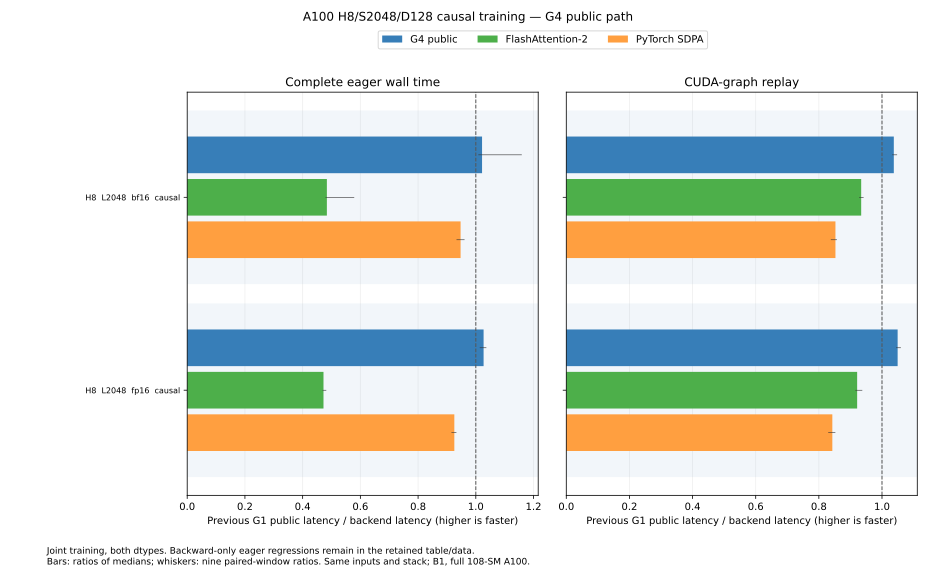

# A100 medium causal work order

The already qualified batch 1/H8/S2048/D128 causal training path uses head group 4.
Only CTA work ordering changes. Eligibility, tile geometry, saved unscaled
maxima/log normalization, input-dtype P and dS conversions, FP32 accumulation,
actual rounded O for delta and late dQ/dK scaling remain unchanged. Other
families keep their existing schedules.

The [retained data](../results/a100-medium-causal-g4.json) includes all 24 rows:
G1/G4/G8 selection, an independent G1/G4 evaluation, and final actual public
APIs. Final evaluation uses seed 839773, separate from selection 839747 and
independent evaluation 839761. Nine rotating 100 ms windows follow compilation
and a one-second warmup. The full A100-SXM4-40GB has 108 SMs and a 350 W limit;
Python 3.13.18, Torch 2.15/CUDA 13.2, CUTLASS DSL 4.8.1 and FA2 2.8.4 match the
preceding medium-family qualification.

Median microseconds, same rounded inputs and process:

| Phase | Boundary | Dtype | G1 public | G4 public | FA2 | SDPA |
| --- | --- | --- | ---: | ---: | ---: | ---: |
| Backward | Graph | BF16 | 251.56 | 238.14 | 237.73 | 268.73 |
| Backward | Graph | FP16 | 252.95 | 232.49 | 244.95 | 275.25 |
| Joint | Graph | BF16 | 337.67 | 325.48 | 361.49 | 396.06 |
| Joint | Graph | FP16 | 341.09 | 324.98 | 370.23 | 404.76 |
| Backward | Complete eager | BF16 | 340.59 | 344.16 | 740.04 | 415.85 |
| Backward | Complete eager | FP16 | 254.17 | 257.00 | 582.29 | 311.43 |
| Joint | Complete eager | BF16 | 546.34 | 534.76 | 1128.90 | 576.75 |
| Joint | Complete eager | FP16 | 535.45 | 521.38 | 1133.91 | 578.48 |

Graph joint time falls 3.6–4.7%, and final complete eager joint falls 2.1–2.6%.
Backward-only eager regresses 1.0–1.1% here, and by about 3–6% in the earlier
evaluations. That tradeoff remains explicit; no eager-backward speedup is
claimed. Individual windows vary, and the preceding independent joint eager
comparison was effectively tied. FA2's eager time includes its host runtime;
its graph results describe the device-path comparison.

## Why test this ordering

The actual main kernel uses 255 registers,164864 dynamic shared-memory bytes
and 256 threads. The driver occupancy query permits one CTA per SM. Its 128
CTAs run on 108 SMs. This resource bound motivated changing the logical order
of different-length causal key tiles; it does not establish utilization or
prove a physical scheduling tail.

Separate Systems captures contain exactly four kernels per joint call.
The profile-only main medians move from 276.8us at G1 to 259.6us at G4, while
forward, preparation and dQ conversion remain nearly unchanged. Instrumented
durations are not substituted for the uninstrumented medians above. G8 is
retained as a control; G16 maps identically to G8 for this batch/head count and
was not duplicated.

The original automatic selection rule rejected every candidate because a
ratio of eager joint medians showed a 0.12% FP16 regression. Yet G4 won all
nine graph windows for both dtypes, and median paired eager ratios slightly
favored G4 for both. The original rejection remains unchanged in the data.
G4 then received separate sanitizer qualification and two independent
evaluations without changing any numerical gate.

## Backward host boundary

A separate BF16 ladder measured retained-output backward through the API,
the native runner, and resident flat launches. The resident control retains
all three preparation/main/dQ kernels, with actual rounded O and independent
per-head accuracy checks, but omits autograd and allocation. It is a
diagnostic boundary rather than the advertised API.

| Boundary | G1 (us) | G4 (us) |
| --- | ---: | ---: |
| Retained-output API backward | 255.59 | 266.06 |
| Retained-output native runner | 265.26 | 265.00 |
| Resident flat launch | 251.12 | 239.69 |

G4's device benefit survives in the resident control. The required native
autograd/allocation/launch path hides it in backward-only eager execution.
The public forward selector is outside that timed backward loop, and native
runner results do not support attributing the discrepancy to that selector.
Systems correlates three launches per backward call across caller/worker
threads; profiler-added CUDA name queries are not blamed on the implementation.
The remaining internal host cost is not isolated to one operation, and no
hardware performance ceiling is claimed.

## Qualification

All three research configurations pass normal and negative-offset cases,
partial lengths 129/257, literal statistics and changed poisoned graph replay
for both dtypes. G4 passes memcheck, racecheck, synccheck and initcheck.
Three fresh final public GPU methods and fallback-mode checks pass. All eight
final public GPU ELF/SASS images match the sanitizer-qualified G4 images
byte for byte, with 36 unique graph-to-loaded-image bindings across the four
implementations. The 43 referenced binary/code files are SHA-verified.

The existing 1% BF16 and 0.5% FP16 per-head component limits remain unchanged;
negative-offset fixtures use the declared rounded equations with actual O,
and mathematical diagnostics remain separate. CPU checks on the integrated main base run 401 tests total
with 191 GPU skips. All 24 publication-guard tests pass.

The retained backward-boundary diagnostic can be rerun with
`python -m benchmarks.profile_a100_medium_backward --output artifacts/bwd-ladder`.
Use `--profile` under Nsight Systems for its separate instrumented run.
