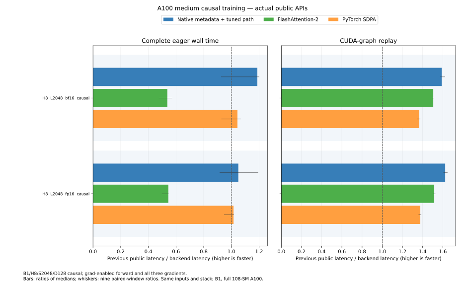

# A100 medium causal training

The tuned public path additionally selects batch 1/H8/S2048/D128 causal
attention when gradient mode is active and Q, K and V all require gradients.
The qualified full-device A100 and pinned optional runtime requirements are
unchanged. NoGrad, inference mode, partial-gradient inputs, forward AD, compiled
calls and incompatible physical layouts retain the preceding dispatch.
Logical negative views use the existing native canonicalization.

This is a dispatch and host-preparation correction for the current cached
native runtime. The previous exclusion came from an older complete-forward
timing boundary. A bounded native metadata check verifies this training
family without repeating the general Python tensor/device inspection.
All other selection paths keep their preceding checks. The forward and
backward GPU methods, selected schedules and arithmetic are
unchanged: separate unscaled maxima/log normalization, input-dtype P before
dS, a single dS conversion, actual rounded O for delta, FP32 products and
late dQ/dK scaling.

## Complete public API performance



The [retained data](../results/a100-medium-causal.json) includes the complete
initial Python-dispatch comparison, the native-metadata comparison, and a
second independent-input factor study. The final study uses seed 839743,
separate from selection 839719 and the initial evaluation 839729. Nine rotating
100 ms windows follow compilation and a one-second warmup. Every operation
uses identical rounded inputs in one process. The device is a full
A100-SXM4-40GB, 108 SMs, with a 350 W limit; Python 3.13.18, Torch 2.15.0/CUDA 13.2,
CUTLASS DSL 4.8.1, TVM FFI 0.1.15.post0 and FA2 2.8.4.

Forward plus all three gradients, median microseconds:

| Boundary | Dtype | Previous public | Current public | FA2 | PyTorch SDPA |
| --- | --- | ---: | ---: | ---: | ---: |
| Complete eager | BF16 | 641.2 | 539.9 | 1193.6 | 614.3 |
| Complete eager | FP16 | 652.5 | 621.3 | 1198.0 | 642.5 |
| Graph replay | BF16 | 542.4 | 341.3 | 360.4 | 396.9 |
| Graph replay | FP16 | 555.5 | 342.2 | 366.7 | 403.5 |

Across these two dtype cases, the geometric speedups are 1.12× over the
previous public API, 2.06× over FA2 and 1.08× over SDPA in complete eager time.
Graph speedups are 1.61×, 1.06× and 1.17× respectively. FA2 eager results include
its host implementation; the graph comparison describes the device path.
Some individual eager paired windows regress. All samples and their ranges
remain in the data and chart; the medians do not establish uniform wins.

The original Python-metadata candidate improved graph time but regressed both
eager joint medians by about 5%. It was retained and investigated rather than
released as an automatic improvement. Systems traces correlate caller and
autograd-worker launches: all 120 profiled joint calls contain four kernels.
The original public path spent more time before the first launch than the
explicit runner, while their GPU work matched. The observed cgroup throttle
counters did not increase during that diagnostic.

The final same-process factor uses isolated pristine API modules and loader
caches to compare the preceding generic public path, the Python-metadata
candidate, and native metadata. Native metadata improves eager joint time
1.12–1.27× over the Python candidate. Their graph ratios are 0.981× and 0.992×;
no GPU scheduling gain is attributed to this host change. All eight public
loaded ELF/SASS images are byte-identical to the earlier sanitizer-qualified
candidate. Before/after Systems captures support the preparation change;
profiler durations are separate from the uninstrumented medians above.
The explicit runner remains a preparation-bypassing diagnostic and is not
substituted for the public API results.

## Qualification and reference policy

Normal inputs retain the independent per-head FP64 output and gradient norm
limits of 1% BF16 and 0.5% FP16. The negative-common-offset fixture uses the
existing directed rounded equations with actual O and those same component
limits. Mathematical FP64 diagnostics are retained separately. The initial
attempt applied the mathematical gate to that directed fixture and recorded
a 2.10% BF16 dQ discrepancy. Its exact failing rounded inputs, outputs,
gradients and source remain preserved. The final BF16 directed diagnostics
reach about 2.35% against mathematical FP64 and 0.40% against the declared
rounded equations. No kernel arithmetic or tolerance changed when aligning
the fixture with the established directed policy.

Three actual public GPU methods check native-metadata selection, literal
saved maxima/log normalization, every gradient, changed and poisoned graph
replay, and logical negative views in each input position. Fallback checks
also exercise NoGrad, inference mode, each partial-gradient combination,
physical views, forward AD and compiled fullgraph output/gradients.
References run on bit-preserving CPU copies so sanitizer instrumentation
remains focused on implementation kernels. An outside-sanitizer CPU/device
reference audit on the identical captured operands passes all 256
head/component/policy comparisons under the corresponding existing norm
limits; FP32 reduction-order differences remain recorded.

All four sanitizer tools pass on the exactly matching deployed GPU images.
After adding only scalar host-metadata checks, the fresh three public methods,
fallback checks, timing references and 36 unique graph-to-loaded-ELF bindings
pass again. Actual separately built host-library hashes, full source hashes,
code resources and SASS identities remain in the data. CPU checks run 384 tests
in total, with 180 GPU skips; all 24 publication-guard tests pass.

## Reproduction

The previous public control loads pristine API and selector sources once,
with independent loader caches. It does not patch shared modules per call.
The initial all-phase comparison below uses grad-enabled training forward
with all three input gradients; it does not measure NoGrad inference. The
independent final joint-only factor also includes `make_python` and
`make_direct`, uses seed 839743 and nine repeats. The data records both
boundaries without substituting the explicit runner for a public call.

```sh
python -m benchmarks.compare_attention_variants \
  --operations '[{"label":"parent_public","factory":"benchmarks.a100_medium_controls:make_parent"},{"label":"public","backend":"cute"},{"label":"fa2","backend":"fa2"},{"label":"sdpa","backend":"sdpa"}]' \
  --seq 2048 --dim 128 --heads 8 --dtype bf16 fp16 \
  --visibility causal --phases forward backward joint \
  --warmup-ms 1000 --window-ms 100 --repeats 7 --seed 839729 \
  --output artifacts/a100-medium-causal.json
```

The subsequent [G4 work-order update](a100-medium-causal-g4.md) improves the
same training family on the device path and records its backward-only eager
tradeoff separately.
