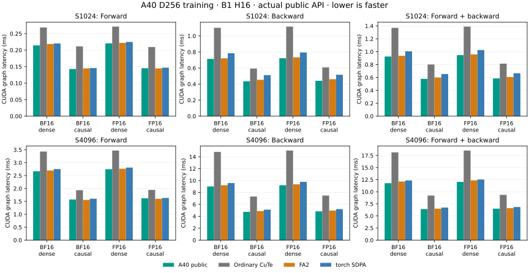

# A40 D256 training

The explicit A40 entry now selects a D256 forward and joint-backward schedule
for contiguous, aligned FP16/BF16 B1/H16 tensors at square sequence lengths 1024
and 4096, dense or causal. Complete graph forward+backward is 1.38–1.54× as fast
as ordinary CuTe and 1.01–1.04× as fast as FA2 in the eight measured cases.
The arithmetic remains [the declared rounded computation](precision.md).

Install the qualified Python 3.13, Torch 2.15.0/CUDA 13.2 stack with
`python -m pip install '.[cuda,sm80-fa4]'`, then use:

```python
from kohakufa_cute.fa4_sm80.a40 import scaled_dot_product_attention

output = scaled_dot_product_attention(q, k, v, is_causal=True)
```

Selection requires the full SM86 A40: 84 SMs and 101376-byte opt-in shared-memory
capacity. Other shapes, masks, GQA, layouts, nonpositive scales and unsupported
runtime conditions retain ordinary CuTe fallbacks. The general attention entry
is unchanged. This change qualifies training; it does not extend the separate
statistics-free native inference mode to D256.



The later [S128 extension](a40-short-d256.md) qualifies the same schedule at
128 tokens; the longer-length measurements below keep their original scope.

## Actual public API measurements

The [report](../results/a40-d256.json) retains all 48 rows: two lengths, two
dtypes, dense/causal visibility, forward/backward/combined, graph/eager. Every
implementation receives identical rounded inputs in the same process. Seven
rotating 100 ms windows follow 300 ms warmup; the held-out input seed 59743 differs
from tuning. Forward retains autograd preparation. Backward graphs retain their
forward-owned tensors; combined rows include forward preparation and gradients.
Eager wall measurements include the public guard and host dispatch.

Graph forward+backward CUDA-event latency, milliseconds:

| Dtype | Length | Visibility | A40 public | Ordinary CuTe | FA2 | torch SDPA |
| --- | ---: | --- | ---: | ---: | ---: | ---: |
| BF16 | 1024 | dense | 0.9251 |1.3701| 0.9361 |1.0061|
| BF16 | 1024 | causal | 0.5792 |0.8018| 0.5999 |0.6541|
| FP16 | 1024 | dense | 0.9471 |1.3889| 0.9575 |1.0260|
| FP16 | 1024 | causal | 0.5861 |0.8146| 0.6075 |0.6662|
| BF16 | 4096 | dense | 11.7732 |18.1496| 12.1297 |12.3360|
| BF16 | 4096 | causal | 6.4154 |9.2154| 6.4931 |6.7299|
| FP16 | 4096 | dense | 12.0443 |18.5297| 12.3590 |12.5344|
| FP16 | 4096 | causal | 6.5044 |9.3594| 6.6051 |6.8393|

Complete eager forward+backward wall latency also improves in all eight cases.
For example, BF16 S1024 dense is 0.9285 ms versus 1.3806 ms ordinary CuTe and
0.9433 ms FA2; BF16 S4096 dense is 11.8123 ms versus 18.1506 ms and 12.1525 ms.
The direct native runner is an additional diagnostic control in the report;
public timings above do not substitute its lower-level timing boundary.

All eight backward graph cases improve over FA2 by 1.0–4.6%. Forward alone is
within roughly 2% of FA2: five wins and three small losses. The combined result
therefore does not establish universal forward dominance. Ordinary CuTe here is
the standard API, rather than a replay of an earlier opt-in entry. FA2 and SDPA
have their own rounding and accumulation policies; these are complete
implementation comparisons, not isolated schedule comparisons.

## Schedule and resource evidence

The forward tile is M64/N64 with shared Q and one stage. The backward tile is
M64/N32, 256 threads, one Q stage and one dO stage, resident V, and score/KV/dQ
MMA warp factors 4/1/2. No kernel arithmetic or shared core implementation changes
are needed: this adds bounded device/width selection for the existing methods.
The native raw D256 allowance requires a full A40 and excludes explicit inference.

Loaded FA2 D256 backward uses the same M64/N32/eight-warp geometry and resident-V
ownership. Its forward uses M64/N64/four warps. The actually loaded CuTe backward
uses 91136 shared bytes, 255 registers and 48 local bytes dense/32 causal; FA2 uses
98304 shared bytes, 255 registers and 24 local bytes. These local allocations are
resource metadata, not measurements of spill time or a percentage of runtime.
The CuTe dQ conversion uses 65536 shared bytes and 48 registers; FA2's conversion
uses 32768 shared bytes and 96 registers. Further conversion work is independent
of this qualified release.

A matched forward-only factor tested N16/N32/N64 with the same backward owner.
N16 uses 49152 shared bytes and 204 registers, allowing a driver resource limit of
two CTAs/SM; N64 uses 98304 bytes and 244 registers, allowing one. Those are resource
limits derived from the actual graph CUfunction, not sampled utilization. N16
still loses substantially on causal work: FP16 S1024 combined graph latency is
0.6954 ms versus 0.5902 ms N32 and 0.5857 ms N64 in the tuning run. Its doubled
key-loop frequency is a design tradeoff; the measurements do not attribute a
runtime percentage to barriers. N64 is the broadly faster control. Higher
resource occupancy alone did not predict the winner.

CUPTI captures bind the exact dense and causal graph symbols to their loaded
ELFs and SASS. The CuTe loaded cubin hashes also match compiler-returned artifacts;
exact-symbol PTX is retained. FA2 captures bind to its mapped extension and
packaged PTX. CuTe targets SM86 and this FA2 build targets SM80, both executing
on the actual SM86 A40. Raw binaries, operands and reports are retained outside
the repository with a per-file SHA256 inventory.

## Correctness and reproducibility

D256 directed qualification passes 53 cases independently for each forward width,
including tails, negative maxima, signed/zero-scale fallbacks, sharp/cancellation
fixtures, literal maxima/logarithmic statistics and changed/poisoned graphs.
N32 and selected N64 pass all four Compute Sanitizer tools. The actual public
source separately passes 24 oracle/dispatch cases, custom positive scales,
negative views, D16/D64/D128/D256/D512 fallbacks, four changed/poisoned graph
cases, and native metadata parity on mutable real tensors.

Actual public memcheck, racecheck, synccheck and initcheck each pass the two
focused S1024 families, BF16 dense and FP16 causal, including changed/poisoned
replay. References run on CPU using identical rounded operands, actual outputs
and unchanged equations. Host API probe diagnostics use `--report-api-errors no`;
device checks remain enabled. Earlier full-suite attempts stopped before math
on a metadata-file lookup error; their failures remain recorded, and the repaired
immutable continuation supplies the passing qualification.

Independent per-head FP64 norms retain 1% BF16 and 0.5% FP16 limits separately for
output/dQ/dK/dV. Directed cases retain the rounded-equation criteria using actual
rounded O; no thresholds, P/dS conversions or FP32 accumulation policies change.
The CPU suite and publication guards also run on the publication source.

```sh
python -m benchmarks.validate_a40_shared --source "$FA_SOURCE" \
  --dimensions 256 --reference-device cpu --output "$CAPTURE_DIR/directed.json"
python -m benchmarks.validate_a40_d256 --output "$CAPTURE_DIR/public.json"
python -m unittest tests.test_a40_shared tests.test_a40_native_predicate -v
python -m benchmarks.compare_attention_variants \
  --operations '[{"label":"public","factory":"benchmarks.a40_shared_candidates:make_attention"},{"label":"cute","backend":"cute"},{"label":"fa2","backend":"fa2"},{"label":"sdpa","backend":"sdpa"}]' \
  --seq 1024 4096 --dim 256 --dtype bf16 fp16 \
  --phases forward backward joint --visibility dense causal \
  --warmup-ms 300 --window-ms 100 --repeats 7 --seed 59743 \
  --output "$CAPTURE_DIR/paired.json"
python -m benchmarks.plot_a40_d256
```

`FA_SOURCE` names the pinned official FlashAttention checkout. All captures go
to an external output directory. The plot uses the checked-in compact report.
