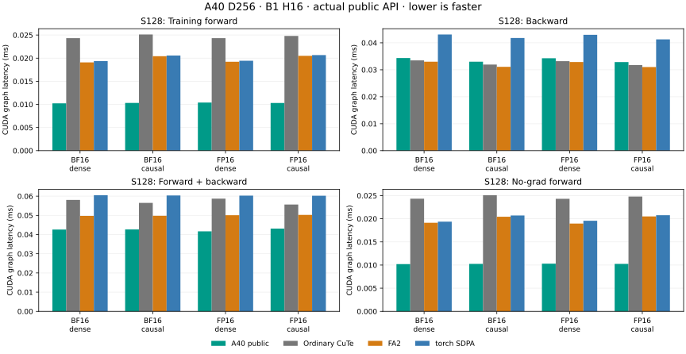

# A40 short D256 attention

The explicit A40 entry now also selects square S128/D256, B1/H16 FP16/BF16
attention, dense or causal. This extends the [qualified D256 path](a40-d256.md)
using its existing M64/N64 forward and resident-V M64/N32 backward. Only live
metadata eligibility changes; the schedule, GPU methods and arithmetic are
unchanged.

Use the same qualified Python 3.13/Torch 2.15.0/CUDA 13.2 installation:

```python
from kohakufa_cute.fa4_sm80.a40 import scaled_dot_product_attention

output = scaled_dot_product_attention(q, k, v, is_causal=True)
```

The full A40 requirement remains SM86/84 SMs/101376-byte shared capacity.
S128 D64/D128, adjacent S127/S129/S512 D256, other head/batch counts and existing
mask/layout/scale/runtime exclusions retain ordinary CuTe fallbacks. S1024 and
S4096 D256 selection is unchanged. No-grad forward uses this public entry's
existing forward path; this does not enable the separate statistics-free native
inference mode for D256.



## Paired public measurements

The [compact report](../results/a40-short-d256.json) contains 24 training rows
(forward/backward/combined, graph/eager, both dtypes and visibility modes), plus
8 separately measured no-grad forward rows. Four implementations alternate in
seven approximately 100 ms windows after 300 ms warmup, on identical rounded
inputs in one qualified stack. Held-out seed 61843 differs from the tuning run.
The ordinary CuTe comparison calls the standard API; it does not replay an
exact parent opt-in entry. FA2 and SDPA retain their own arithmetic policies.

Complete training forward+backward graph CUDA-event latency, microseconds:

| Dtype | Visibility | A40 public | Ordinary CuTe | FA2 | torch SDPA |
| --- | --- | ---: | ---: | ---: | ---: |
| BF16 | dense | 42.61 | 58.03 | 49.71 | 60.51 |
| BF16 | causal | 42.67 | 56.51 | 49.77 | 60.35 |
| FP16 | dense | 41.66 | 58.71 | 50.09 | 60.28 |
| FP16 | causal | 43.11 | 55.63 | 50.23 | 60.21 |

Standalone backward remains about 4–6% slower than FA2 in these four cases;
the larger forward improvement produces the combined win.

Combined graph execution is 1.29–1.41× as fast as ordinary CuTe and 1.17–1.20×
as fast as FA2. Eager execution includes substantial host work: complete public
F+B wall time is 0.326–0.331 ms, versus 0.349–0.356 ms ordinary CuTe,
0.776–0.785 ms FA2 and 0.404–0.413 ms SDPA. Those eager implementation differences
do not establish a device-kernel speedup of the same magnitude.

No-grad forward graph CUDA-event latency, microseconds:

| Dtype | Visibility | A40 public | Ordinary CuTe | FA2 | torch SDPA |
| --- | --- | ---: | ---: | ---: | ---: |
| BF16 | dense | 10.20 | 24.33 | 19.13 | 19.37 |
| BF16 | causal | 10.25 | 25.09 | 20.44 | 20.71 |
| FP16 | dense | 10.30 | 24.32 | 18.95 | 19.57 |
| FP16 | causal | 10.25 | 24.81 | 20.51 | 20.77 |

No-grad graph forward is 2.36–2.45× as fast as ordinary CuTe and 1.84–2.00×
as fast as FA2. Complete eager no-grad forward is 29–31 microseconds, versus
39 microseconds ordinary CuTe and 101–102 microseconds FA2. The report preserves
all samples, graph resources and independent per-head accuracy records. Training
forward and no-grad forward have separate labels and timing boundaries.

## Qualification and limits

The actual public source passes 48 oracle/dispatch cases: independent output,
dQ/dK/dV, saved literal maxima and logarithmic normalization, custom positive
scales, negative Q views, strided incoming dO and adjacent shape/width fallbacks.
Four changed/poisoned graph cases confirm replay reads changing operands;
12 selected forward checks also run under no-grad. Native metadata parity runs
against mutable real tensors. S128 D64/D128 remains unselected.

Memcheck, racecheck, synccheck and initcheck each pass the public S128 BF16 dense
and FP16 causal families with strided dO, no-grad forward and changed/poisoned
replay. References evaluate identical rounded operands on CPU; device kernels
remain instrumented. Host probe diagnostics use `--report-api-errors no` while
device checks remain enabled. These checks supplement the parent schedule's
broader directed and sanitizer qualification.

The declared single-rounded P/dS computation, actual rounded-O delta, FP32
products/accumulation and late gradient scale remain unchanged. Per-head FP64
norm limits remain 1% BF16 and 0.5% FP16 independently for output and each
gradient. No compensation or tolerance changes are introduced.

Four separate captures bind the actual selected S128 dense/causal CuTe and FA2
symbols to loaded ELF/SASS and exact-symbol PTX. CuTe's loaded cubin also matches
the compiler-returned artifact hash. CuTe targets SM86 and this FA2 build targets
SM80 on the same actual A40. Referenced binaries, PTX/SASS, compact reports and
representative raw inputs are copied outside the repository and physically
verified by SHA256; raw captures remain outside the tracked tree.

```sh
python -m benchmarks.validate_a40_short_d256 --output "$CAPTURE_DIR/public.json"
python -m unittest tests.test_a40_shared tests.test_a40_native_predicate -v
python -m benchmarks.plot_a40_d256 --short \
  --input results/a40-short-d256.json --output "$CAPTURE_DIR/chart.svg"
```
