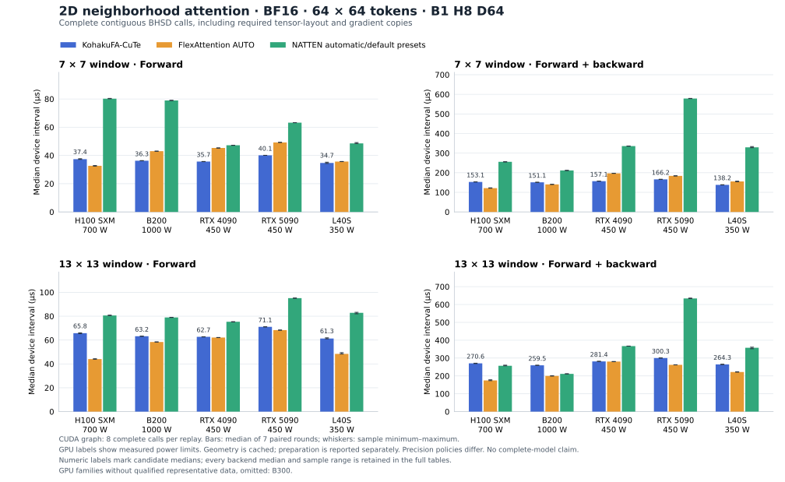

# Neighborhood performance

Historical method labels below describe the recorded campaign. The combined dQ+dK method with column-staged statistics is now the public neighborhood default; see [the current contract](../precision.md#neighborhood-default).

## Measured results

Five full GPUs completed the matrix: 150 implementation/workload rows and 600
phase/mode timing groups, with seven samples per group. Every independent
accuracy gate and changed-input graph check passed. B300 has no measured result:
no rentable single card was available across on-demand, reserved, or interruptible
offers. The campaign leaves it pending rather than renting a multi-card bundle.
GB300 was not counted as B300: NVIDIA lists the 252 GB DGX Station product and
the 288 GB B300 as [distinct products](https://docs.nvidia.com/datacenter/tesla/mig-user-guide/latest/supported-gpus.html),
even though they share a GPU microarchitecture and compute capability. ARM
package support was checked and was not the capacity limitation.



For the predeclared 64 x 64, 7 x 7 window, B1 H8 D64 BF16 case, resident
forward-plus-backward CUDA graph medians were:

| GPU | Candidate, microseconds | FlexAttention | NATTEN automatic preset |
| --- | ---: | ---: | ---: |
| H100 SXM | 153.1 | 121.5 | 255.7 |
| B200 | 151.1 | 140.6 | 211.6 |
| RTX 4090 | 157.1 | 197.0 | 335.9 |
| RTX 5090 | 166.2 | 183.9 | 578.6 |
| L40S | 138.2 | 155.7 | 329.6 |

Performance depends on GPU and window size. In this case FlexAttention had
lower training latency on H100 and B200; the candidate had lower latency on the
three other devices. At window 13, NATTEN had lower training latency than the
candidate on H100 and B200. The [complete tables](neighborhood-performance-tables.md)
retain every geometry, dtype, execution mode, sample range, and comparison;
the [machine-readable summary](neighborhood-performance.json) also retains
preparation costs, source hashes, selected backends and numerical diagnostics.
The [validation record](neighborhood-performance-validation.json) retains stage
exit statuses, qualified source and archive hashes, and resource cleanup status.

These NATTEN measurements use its automatic backend priority and default tile
presets, with native Hopper and Blackwell FNA on the data-center GPUs and
generic CUTLASS FNA on the other three. They do not establish the fastest
possible NATTEN configuration. FlexAttention uses AUTO kernel selection and
`max-autotune-no-cudagraphs`. The BHSD contract includes conversions that would
differ for an application storing its activations natively in BHWD. Eager
intervals include host dispatch and depend on each machine's CPU; graph
intervals amortize replay launch gaps over eight complete calls.

The actual deployed hardware, rather than advertised catalog fields, was:

| GPU | capability | SMs | visible memory, GiB | driver | power limit, W |
| --- | --- | ---: | ---: | --- | ---: |
| H100 SXM | 9.0 | 132 | 79.22 | 615.71.09 | 700 |
| B200 | 10.0 | 148 | 178.34 | 595.71.05 | 1000 |
| RTX 4090 | 8.9 | 128 | 23.52 | 580.105.08 | 450 |
| RTX 5090 | 12.0 | 170 | 31.45 | 615.71.09 | 450 |
| L40S | 8.9 | 142 | 44.47 | 615.71.09 | 350 |

All devices were unpartitioned, with no other compute process at preflight.
The RTX 5090 was configured with a 450 W limit. These results qualify these
deployed machines and runtime versions, without attributing rankings to power
limits or claiming stock-card performance. Each GPU used identical rounded
operands across its three implementations. Across GPUs, configuration and seed
match; bitwise identity of CUDA-generated operands was not established.

Each device also passed the nine-method candidate GPU suite and the two
focused memcheck methods with zero reported errors. The earlier H100 qualification
contains broader sanitizer coverage. These operator checks do not establish
that the entire repository GPU suite passes; its separately retained baseline
failures remain documented in the [neighborhood qualification](neighborhood.md).

Profiler traces verify one candidate forward kernel and six training launches
(four CuTe kernels plus two statistic-gradient fills), versus one and three for
FlexAttention. NATTEN launches ten and twenty-eight on Hopper/Blackwell and
five and thirteen for generic CUTLASS, including required layout and token
permutation work. Graph traces contain exactly eight times the corresponding
eager call count. Profiling is separate from the uninstrumented samples.

Full source, stage receipts, failed infrastructure attempts, raw samples,
traces, compiler/cache binaries and disassembly are retained off-host. Identical
installed NATTEN package files are shared only after every file's inventory and
hash is verified. Selected packaged NATTEN PTX was unavailable; packaged SASS
and compiler/cache disassembly do not imply a CUPTI loaded-module binding.

## Protocol

This campaign compares the explicit neighborhood API, compiled FlexAttention,
and architecture-selected NATTEN in the same process and software stack. It
measures synthetic operator calls, including required layout conversions. It
does not measure an HDiT model, projections, normalization, rotary transforms,
loading, or compilation as part of resident call latency.

The external contract is contiguous `[batch, heads, height*width, 64]` inputs,
output, and each gradient, using identical rounded FP16 or BF16 operands,
stride/dilation one, shifted boundary windows, and scale `0.125`. Each
implementation retains its own internal precision policy. The candidate keeps
the unchanged [default arithmetic](../precision.md). This is a complete
implementation comparison, not an isolated scheduling comparison.

The full matrix contains these five geometries in both dtypes:

| image | window | batch | heads |
| --- | --- | ---: | ---: |
| 32 x 32 | 7 x 7 | 1 | 8 |
| 64 x 64 | 7 x 7 | 1 | 8 |
| 64 x 64 | 13 x 13 | 1 | 8 |
| 128 x 128 | 7 x 7 | 1 | 8 |
| 33 x 49 | 7 x 7 | 2 | 4 |

The timing boundaries are inference forward and forward plus backward using
`torch.autograd.grad`, including contiguous gradient restoration. Eager runs
record CUDA-event time and host wall time separately. CUDA graphs contain eight
complete calls; reported device time is replay time divided by that call count.
Compilation, five warmup calls, capture, changed-input checks, calibration, and
three sustained warmup samples precede measurement. Seven paired rounds rotate
and alternate backend order, targeting 100 ms per sample and retaining every
sample, median, range, and standard deviation. Profiling uses separate calls.
Timed calls repeatedly read the same resident input buffers after warmup; the
changed-input validation runs separately.

NATTEN's BHSD-to-BHWD input copies and BHWD-to-BHSD output/gradient restoration
remain inside each timed call. FlexAttention receives directly enumerated
spatial block lists via the official `BlockMask.from_kv_blocks` factory, with
its exact shifted-window predicate and the factory's backward transpose. There
is no token-level dense mask preparation. Geometry preparation is measured
separately, with three repeated preparation samples and retained storage size;
resident timings reuse this immutable geometry. Preparation-inclusive cold-call
costs and resident costs must be reported separately.

Sparse independent FP64 and rounded-arithmetic probes check output and each
gradient per head at boundary and interior positions on every workload. Key
gradient references include every contributing query, found independently from
forward neighborhoods. The random-workload gates retain 0.5% FP16 and 1% BF16
per-head FP64 norm-error limits. Rounded diagnostics use actual rounded O.
Every graph must read changed Q/K/V/dO and agree with fresh eager execution;
original operands are restored before measurement. Failed, unsupported, or
out-of-memory paths are retained as failures, not timing results.

The pinned shared Linux stack is Python 3.13, PyTorch 2.13.0+cu130, NATTEN
0.21.7+torch2130cu130, CUTLASS DSL 4.8.1, TVM FFI 0.1.15.post0, and CUDA
bindings 13.0.3. PyTorch 2.13 is retained for the newest prebuilt pairing in
[NATTEN's installation documentation](https://natten.org/install/). Its
[backend documentation](https://natten.org/backends/) and
[versioned capability checks](https://github.com/SHI-Labs/NATTEN/blob/v0.21.7/src/natten/backends/configs/checks.py)
describe dedicated Hopper and SM100/103 Blackwell paths; Ada and SM120 use
generic CUTLASS FNA. Actual selected backends and launched kernels are recorded
on each deployed GPU rather than inferred from package names.

Reproduce from the repository root after warming the selected runtime:

```sh
python3 -m benchmarks.benchmark_neighborhood \
    --source-revision "$(git rev-parse HEAD)" \
    --output "$NEIGHBORHOOD_RESULTS/performance.json" \
    --suite full --samples 7 --target-ms 100 --capture-batch 8 --profile
```

Raw captures stay outside the tracked tree. The durable campaign preserves full
source snapshots, exact launch scripts, immutable stage identities and exit
receipts, failed operands, timing samples, eager and graph traces, actual
compiler artifacts, installed NATTEN binaries, and one-second power/clock/
temperature/process observations. Hardware records include actual memory, SM
count, capability, power limits, partitioning and driver versions. Coarse
telemetry does not establish utilization, occupancy, cycle normalization, or a
performance ceiling. Owned machines have bounded lifetimes; complete off-host
archives must verify before destruction.
