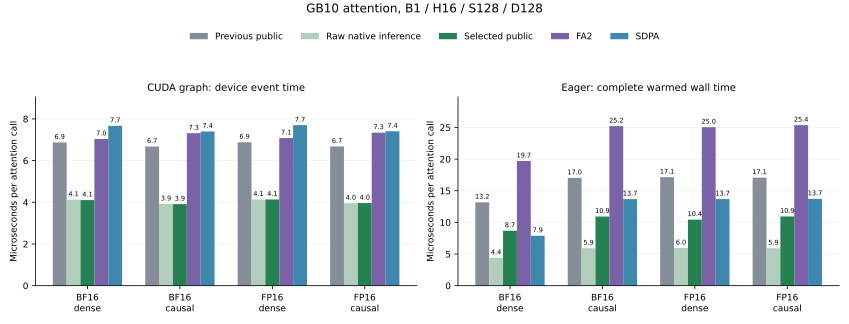

# GB10 forward-only attention

The opt-in `gb10_attention` entry uses the existing native forward-only runner
when a call requests no input gradients. The new measured family is full-device
GB10, B1/H16/D128, FP16 or BF16, equal contiguous aligned Q/K/V shapes, and
S128, S512, S1024 or S4096, dense or causal. BF16 dense S512 retains its
previous normal runner after a consistent small regression in the forward-only
experiment. Training keeps its existing
[schedules and fallback boundary](gb10-shared.md).

```python
import torch
from kohakufa_cute.fa4_sm80 import gb10_attention

with torch.no_grad():
    output = gb10_attention(q, k, v, is_causal=True)
```

Calls with gradient-free inputs can also select this path while grad mode is
enabled. If any input requests gradients in grad mode, the existing training
entry or ordinary CuTe fallback handles the call. `no_grad` and `inference_mode`
retain their usual meaning even when input tensors have `requires_grad=True`.

## Scope and arithmetic

The qualified runtime and full-device checks remain those in
[the installation boundary](gb10-shared.md#qualified-boundary). Masks, dropout,
GQA, other head counts or dimensions, tails, noncontiguous or unaligned inputs,
signed/zero/subnormal scales, deterministic mode and compiled calls retain the
ordinary API or the previously qualified training path. Pending negative views
use the existing canonicalizing path. Forward-AD dual inputs remain explicitly
unsupported by the native forward-only runner. Selected-kernel failures propagate.

The forward-only entry allocates O without constructing an autograd context or
allocating/writing saved maxima and logarithmic normalization. It uses the
existing shifted-score forward arithmetic. No native kernel body changes here;
training continues to preserve the [single-rounded operand contract](precision.md).
The selected forward geometry is M64/N64 except dense S1024/S4096, which uses
M128/N32. All use one forward stage, shared Q and 128 threads.

## Complete-call measurements

The same full 48-SM GB10 process compares the actual public entry with the
previous public GB10 policy, ordinary CuTe, standalone FlashAttention 2.8.4 and
default SDPA on identical rounded inputs. The stack is PyTorch 2.15.0+cu132
with the pinned optional runtime. These are complete implementation comparisons;
FA2 and SDPA retain their own arithmetic policies.

An independent evaluation seed follows geometry selection. Compilation,
allocation warmup and graph construction are outside timing. Each case warms
for one second, then rotates backend order over thirteen 150 ms windows.
Graph measurements capture 32 actual attention calls per replay and divide
event time by that count; eager wall time includes Python selection, allocation
and launch. The compact result retains samples, per-head FP64 output errors,
actual graph node counts, unique kernel descriptors and eager allocation traces.
The benchmark schedule field describes its raw inference control; the compact
summary separately records the actual selected schedule, including the retained
BF16 dense S512 normal path.

| S / visibility | Dtype | Previous graph / selected µs | Selected eager µs | FA2 eager µs | SDPA eager µs |
| --- | --- | ---: | ---: | ---: | ---: |
| 128 / dense | BF16 | 6.87 / 4.11 | 8.68 | 19.70 | 7.88 |
| 128 / causal | BF16 | 6.68 / 3.91 | 10.93 | 25.21 | 13.68 |
| 128 / dense | FP16 | 6.88 / 4.14 | 10.43 | 25.04 | 13.69 |
| 128 / causal | FP16 | 6.68 / 3.96 | 10.94 | 25.37 | 13.72 |
| 1024 / dense | BF16 | 107.82 / 101.71 | 101.83 | 109.60 | 115.23 |
| 1024 / causal | BF16 | 91.26 / 67.53 | 67.30 | 79.97 | 82.36 |
| 1024 / dense | FP16 | 113.45 / 103.49 | 103.45 | 111.18 | 116.89 |
| 1024 / causal | FP16 | 91.81 / 68.77 | 68.68 | 80.47 | 82.93 |

[The compact data](../results/gb10-inference.json) retains every measured family,
including S512/S4096, per-head checks and code hashes.



At S128, public eager latency improves by 1.52–1.64× over the previous explicit
entry. BF16 dense eager is 8.68 µs versus SDPA's 7.88 µs; that exception remains
in the result. Causal S1024 improves by about 1.35× over the previous fallback.
S4096 differences against the preceding explicit entry are small and all
thirteen samples remain available rather than implying a large new gain.

Retaining the BF16 dense S512 normal runner avoids the rejected forward-only
policy, but does not establish unchanged latency: the held-out graph/eager
medians are 28.74/28.95 µs versus 28.34/28.67 µs previously. Its graph kernel
descriptors and 32-node counts match the previous control. The remaining
roughly 1% difference and the full API overhead remain in the data.

The largest short-sequence device gain comes from choosing the shared forward
implementation instead of the previous generic fallback. The matched-geometry
pilot shows that omitting statistics alone changes graph latency only slightly.
Public eager time also includes selector overhead; the retained raw-runner
control makes that cost visible. This is an opt-in attention-call result, with
no complete-model or backward speedup claim.

## Qualification and code evidence

Output checks retain the independent per-head FP64 norm limits of 1% for BF16
and 0.5% for FP16. Actual public calls cover negative score offsets, changed
and poisoned graph inputs/outputs, live grad-mode transitions, single requested
input gradients, view flags and ordinary fallback families. A final compiler
guard bypasses input grad/view inspection before the compiled fallback.

All four Compute Sanitizer tools passed actual-public cases in both dtypes,
short M64/N64 and medium M128/N32, dense and causal, with changed graphs. Their
native/CUDA source is unchanged by the final compiler guard. Exact graph-bound
PTX and loaded SASS are retained for previous/selected/FA2 dense S128/S1024 in
both dtypes. CuTe bindings require a compiler-returned cubin SHA match; FA2
bindings identify its mapped installed extension. Source snapshots, exact
operands, binaries and raw captures remain outside the tracked tree.

At dense S128 the previous generic and selected shared paths both launch
2 × 16 CTAs with 49,152 dynamic shared bytes plus 1,024 static shared bytes.
Selected registers are 168 BF16 / 183 FP16, versus 206 / 202 previously; all
report zero local stack. At S1024 the selected M128/N32 path halves query
CTAs from 16 × 16 to 8 × 16 and uses 250 registers, versus 202 BF16 / 165
FP16 for M64/N64, with the same shared allocation. FA2 uses 65,536 dynamic
plus 1,024 static shared bytes, 255 registers and a 160-byte local stack.
These records describe resource requirements rather than measured occupancy.

For equal steady-loop work of 128 queries × 64 keys, two M64/N64 CTAs and
one M128/N32 CTA executing two N32 iterations have 256 HMMA sites each.
The exact BF16 SASS changes 128-bit LDGSTS sites from 32 to 16 and LDSM
sites from 144 to 96, with four BAR and four DEPBAR sites in either layout.
Total instruction sites increase from 1,054 to 1,152. Prologue and epilogue
are excluded; exact backedge ranges and before/after counts are retained.
FA2 has overlapping branch spans, so its whole-function counts are not
normalized as an equivalent steady loop. Static sites do not measure
transactions, utilization or stall percentages.

## Reproduce

Use the qualified optional runtime and an output directory outside this
checkout:

```sh
python -m benchmarks.validate_gb10_inference \
  --output "$ARTIFACT_DIR/qualification.json"
python -m benchmarks.gb10_inference --graph \
  --output "$ARTIFACT_DIR/graph.json"
python -m benchmarks.gb10_inference \
  --output "$ARTIFACT_DIR/eager.json"
python -m benchmarks.plot_gb10_inference
```

`--smoke` selects the smaller ownership matrix for sanitizer runs. Its reference
calculations use CPU FP64 outside the instrumented GPU implementation.
