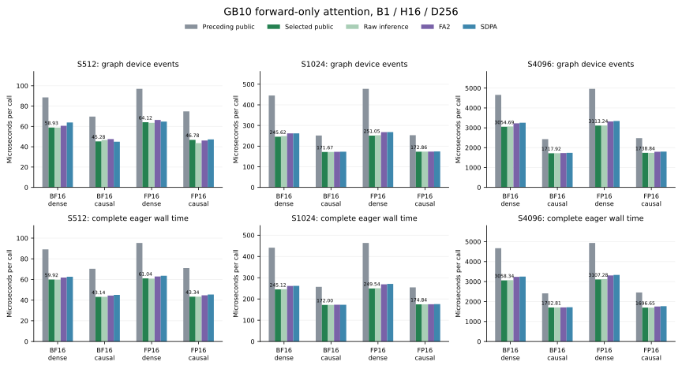

# GB10 long D256 forward-only attention

The explicit `gb10_attention` entry now qualifies B1/H16/D256 at S512, S1024
and S4096, FP16 or BF16, dense or causal, on the full 48-SM GB10. The
[short-width entry](gb10-short-forward.md), D128 policy and training paths remain
available. This is an opt-in attention-call result; default dispatch is unchanged.

M64/N64 with 128 threads handles S512 and causal S1024. M128/N32 with 256
threads handles dense S1024 and S4096 in both visibility modes. All use shared
Q and one forward stage. The native eligibility guards admit only the measured
full-device family. Requested input gradients in grad mode retain the preceding
training/fallback path. Masks, dropout, GQA, tails, other batches/head counts,
unaligned or noncontiguous storage, view flags, unsupported scales, deterministic
mode and compiled calls keep their prior behavior. Forward AD remains an
explicit unsupported error. The D128 BF16 dense S512 normal-runner exception
and H4 FP16 long-causal training policy are retained.

## Why the register partition matters

A private experiment reused the D128 M128/N32/128-thread schedule for D256.
Its output accumulator alone needs 128 × 256 / 128 = 256 FP32 values per
thread. The actual dense code used 255 registers plus 1,496 BF16 / 1,480 FP16
local bytes. It was numerically correct but slow: roughly 1.7 ms at S1024
and 24 ms at S4096. This experimental schedule was never selected publicly.

The supported 256-thread layout has a minimum M tile of 128. Keeping M128/N32
and doubling threads reduces the output accumulator to 128 FP32 values per
thread. Actual dense code uses 247 registers and zero local bytes, with the
same 98,304 dynamic shared bytes. Causal code uses 255 registers/48 local
bytes for BF16, or 253 registers/zero local bytes for FP16. Resource readings
are retained rather than assuming that every variant is spill-free.

Exact loaded SASS separates setup/first key block, the steady key-block loop
and output epilogue. The original dense steady loop has 271 local-load and
224 local-store instruction sites per warp; the 256-thread variant has none.
Matrix work is unchanged after normalizing warp geometry: 256 HMMA sites ×
4 warps versus 128 × 8 per key block. Matrix-load replication differs; these
static counts establish neither fewer transferred bytes nor runtime percentages.
The one-stage source has no separately assigned drain region in this analysis.

A controlled same-process pilot compared both variants with M64/N64/128 and
M64/N32/128, FA2, SDPA and the actual preceding public entry. M64/N32 lost and
was dropped. Broadening retained the original spilled control and the useful
M64 control, then chose the released cases before the held-out public run.
The [compact data](../results/gb10-long-d256.json) keeps the negative results.

## Complete public API measurements

The actual public entry and pristine preceding PR #79 entry run in the same
process on identical rounded inputs. The parent metadata bridge is loaded
separately, so it cannot use the expanded predicate. Raw matched inference,
standalone FA2 2.8.4 and default SDPA share the qualified ARM64 runtime:
Python 3.13.18, PyTorch 2.15.0+cu132 and full GB10 SM121.

Thirteen rounds rotate method order over 150 ms windows after completed
compilation, allocation and execution warmup. Eager wall time includes public
selection, allocation and launch across repeated asynchronous calls, followed
by completion synchronization at each window boundary. CUDA graphs capture 32 real attention calls
per replay and divide device-event time by 32. Reference work, capture
construction and profiling are outside timing. FA2 and SDPA retain their own
arithmetic policies; the released kernel keeps the unchanged
[single-rounded operand contract](precision.md).

| S / visibility | Dtype | Parent graph / selected µs | Parent eager / selected µs | FA2 eager µs | SDPA eager µs |
| --- | --- | ---: | ---: | ---: | ---: |
| 512 / dense | BF16 | 88.54 / 58.93 | 89.15 / 59.92 | 61.90 | 62.65 |
| 512 / causal | BF16 | 69.67 / 45.28 | 70.38 / 43.14 | 44.41 | 45.09 |
| 512 / dense | FP16 | 97.01 / 64.12 | 95.36 / 61.04 | 62.90 | 63.61 |
| 512 / causal | FP16 | 74.81 / 46.78 | 71.05 / 43.34 | 44.66 | 45.46 |
| 1024 / dense | BF16 | 445.45 / 245.62 | 441.34 / 245.12 | 261.18 | 261.80 |
| 1024 / causal | BF16 | 251.34 / 171.67 | 257.09 / 172.00 | 172.94 | 172.82 |
| 1024 / dense | FP16 | 477.79 / 251.05 | 463.69 / 249.54 | 269.05 | 270.89 |
| 1024 / causal | FP16 | 252.88 / 172.86 | 254.60 / 174.84 | 175.34 | 175.95 |
| 4096 / dense | BF16 | 4658.71 / 3054.69 | 4669.62 / 3058.34 | 3235.05 | 3249.74 |
| 4096 / causal | BF16 | 2430.67 / 1717.92 | 2410.09 / 1702.81 | 1706.83 | 1715.97 |
| 4096 / dense | FP16 | 4964.33 / 3113.24 | 4934.19 / 3107.28 | 3305.97 | 3333.51 |
| 4096 / causal | FP16 | 2479.19 / 1738.84 | 2453.39 / 1696.65 | 1752.60 | 1766.32 |

Complete eager calls improve by 1.42–1.86× over the preceding public entry. The full matrix retains ties and losses against FA2/SDPA; the private spill-control ratio is not the public API gain.



All 24 rows, thirteen samples per method, paired comparisons, per-head FP64
errors, actual node counts and deployed-code hashes are retained. The raw
control makes public host overhead visible. These measurements establish no
complete-model or backward speedup.

## Qualification and retained evidence

Actual public calls pass independent per-head FP64 output norm limits of
1% BF16 and 0.5% FP16 on negative score offsets and three changed-input graph
replays with poisoned outputs. They save no autograd tensors in NoGrad mode.
All twelve training cases preserve O/dQ/dK/dV bitwise against the preceding
entry; S512 also checks all four components independently against FP64. Single
requested input gradients, mode transitions, Parameters, identity subclasses,
forward AD, fullgraph compiler fallback, boundary fallbacks and selected-adapter
failure propagation are checked. Independent compiled cases reset Dynamo's
cache between cases, preserving production limits. Legacy D128/H4 training
and all short-width gates pass separately.

All 36 private geometry/shape cases passed memcheck. The original aggregate
racecheck hit its 1,200-second limit after 32 instrumented compatibility
checkpoints; it produced no successful final sanitizer summary. A collective
candidate-only retry was intentionally stopped after a measured dense case
showed that its aggregate cap was too short. Four separate largest S4096
candidate specializations then completed racecheck successfully, followed by
long synccheck and initcheck. The timeout and intentional interruption remain
separate retained attempts, not correctness passes.

Actual selected public cubin hashes match these passed images for every case.
M64 images also match the previously qualified short/focus kernels with all
four tool passes. Source and binary equivalence preserve unchanged GPU
ownership checks; public selection and host behavior are requalified directly.
The exact public and FA2 graph symbols bind to loaded cubins, PTX and SASS,
FA2 uses one kernel per call in this measured long matrix; every observed
symbol is captured. Hardware counters remain
unavailable from the earlier retained GB10 attempt; no utilization, stall or
bandwidth-ceiling claim is made.

Actual graph and eager processes map both current and pristine parent host libraries; inode checks, library bytes and exact build configurations are retained. Complete source snapshots, operands and loaded code are SHA-verified against offhost inventories. CPU checks ran 378 tests: 177 skipped, 201 executed, no failures; 24
publication-guard tests passed separately.

## Reproduce

Use the [qualified optional runtime](gb10-shared.md#qualified-boundary) and an
artifact directory outside the checkout. Prepare the preceding control from
its public revision:

```sh
mkdir -p "$ARTIFACT_DIR/parent"
git show f27c03c:src/kohakufa_cute/native.py > "$ARTIFACT_DIR/parent/parent_native.py"
git show f27c03c:src/kohakufa_cute/native.cpp > "$ARTIFACT_DIR/parent/parent_native.cpp"
git show f27c03c:src/kohakufa_cute/fa4_sm80/gb10.py > "$ARTIFACT_DIR/parent/parent_gb10.py"
python -m benchmarks.validate_gb10_long_d256 \
  --parent-source "$ARTIFACT_DIR/parent" --seed 786431 \
  --output "$ARTIFACT_DIR/qualification.json"
python -m benchmarks.gb10_long_d256 --parent-source "$ARTIFACT_DIR/parent" \
  --seed 786433 --graph --output "$ARTIFACT_DIR/graph.json"
python -m benchmarks.gb10_long_d256 --parent-source "$ARTIFACT_DIR/parent" \
  --seed 786433 --output "$ARTIFACT_DIR/eager.json"
python -m benchmarks.plot_gb10_long_d256
```

The first public timing harness failed before its first window because a CUDA
output reached a CPU reference metric. A new immutable continuation copies
diagnostics to CPU outside timing; runtime/GPU source and passed API gates are
unchanged.
