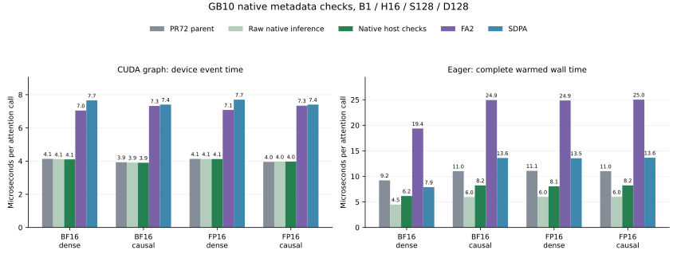

# Native host checks for GB10 inference

The explicit GB10 entry now checks its live tensor metadata through one native
function. Device classification is cached; shape, dtype, strides, alignment,
view flags, requested gradients and the current device are checked on every call.
The preceding [forward-only policy](gb10-inference.md) is retained, including the
BF16 dense S512 normal-runner exception.

The intervention follows the measured public/raw host gap. It adds no attention
arithmetic, GPU kernels or tensor preparation. Existing native runner bodies and
GPU source are unchanged. Global dispatch and training schedules are retained.

## Measured API result

The complete preceding PR #72 Python entry and production entry run in the same
process on identical rounded inputs. The unmodified parent module is loaded in
its original package context. Raw native inference, FA2 and SDPA controls share
the same software stack: full 48-SM GB10, PyTorch 2.15.0+cu132 and the qualified
optional runtime described in [the installation boundary](gb10-shared.md).

A fresh held-out seed follows the private metadata pilot. All sixteen
B1/H16/D128 cases cover S128/S512/S1024/S4096, BF16/FP16 and dense/causal
visibility. Thirteen rounds rotate backend order over 150 ms windows after
completed warmup. Eager wall time includes selection, allocation and launch.
CUDA graphs capture 32 actual calls per replay; event time is divided by 32.
Compilation, reference checks, capture construction and profiling are outside
the timed windows.

| Dtype / visibility, S128 | Parent eager µs | Native checks µs | Raw inference µs | SDPA µs |
| --- | ---: | ---: | ---: | ---: |
| BF16 / dense | 9.22 | 6.16 | 4.49 | 7.89 |
| BF16 / causal | 11.02 | 8.24 | 5.95 | 13.60 |
| FP16 / dense | 11.08 | 8.06 | 5.99 | 13.55 |
| FP16 / causal | 11.02 | 8.24 | 6.00 | 13.65 |



Production S128 eager calls are 1.34–1.50× faster than the preceding public
entry and beat SDPA in all four measured short cases. The cold-CPU guard adds
work beyond the private pilot, so these final production measurements are the
reported result. Raw inference remains 1.7–2.3 µs below the full public call;
this change does not remove every host cost.

All samples, paired reversals and per-head errors remain in
[the compact data](../results/gb10-native-metadata.json). Longer cases retain
small differences and regressions; the complete matrix is the record.
These are attention-call measurements, with no complete-model or backward
speedup claim. FA2 and SDPA retain their own arithmetic policies.

## Dispatch and qualification

The production function contains the native call directly. No runtime
monkeypatch is installed. Compiler, mask, dropout, GQA, deterministic, CPU and
scale checks stop before optional native initialization where applicable.
Unsupported runtime pins retain the preceding fallback. Selected initialization
failures propagate.

The native predicate accepts tensors and subclasses through the ordinary
PyTorch tensor check. It preserves pending-negative-view fallback, requested
input gradients and the forward-AD rejection in the existing inference runner.
The H4 FP16 S4096 causal training policy is unchanged.

The final qualification compares more than 124 live decisions with the
preceding entry, including Parameters, identity subclasses, inference tensors
and mutations of grad flags, strides, storage and shapes. Actual public output,
changed/poisoned graph, mode-transition, compiler-fallback and fallback cases
retain independent per-head FP64 norm limits of 1% BF16 and 0.5% FP16.
The long H4 training check separately compares O/dQ/dK/dV with the unchanged
preceding implementation.

For every timed graph, parent and production calls use exactly the same
CUDA function handles and node counts. Existing sanitizer ownership passes
therefore apply to the unchanged GPU computation. Final loaded-module captures
also retain selected PTX/SASS and compiler-cubin or mapped FA2-library bindings.
The actual native host library is matched to the qualifying process and eager
benchmark process mappings; its bytes and exact build configuration are retained.

Full source snapshots, actual operands, host libraries, GPU code, process maps
and raw captures are archived by inventory and SHA-256 outside the tracked tree.
The private pilot's unsuccessful original host-mapping capture is retained as
a limitation; the final production mapping and binary capture provide the
published host-code evidence.

## Reproduce

Use the qualified optional runtime and an artifact directory outside this
checkout:

```sh
python -m benchmarks.validate_gb10_native_metadata \
  --output "$ARTIFACT_DIR/qualification.json"
python -m benchmarks.gb10_native_metadata --graph \
  --output "$ARTIFACT_DIR/graph.json"
python -m benchmarks.gb10_native_metadata \
  --output "$ARTIFACT_DIR/eager.json"
python -m benchmarks.plot_gb10_native_metadata
```
