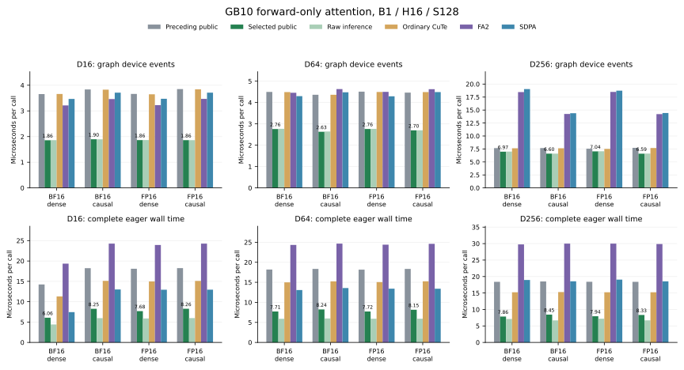

# GB10 short forward-only widths

The opt-in `gb10_attention` entry now selects its existing shared forward-only
kernel for B1/H16/S128 with head dimensions 16, 64 and 256, FP16 or BF16,
dense or causal, on the full 48-SM GB10. This extends the measured
[D128 inference family](gb10-inference.md). The default entry and all training
schedules retain their preceding selection.

The change expands two native eligibility guards. It adds no GPU kernel body,
tensor preparation or arithmetic policy. The selected M64/N64 schedule uses
one stage, shared Q and 128 threads. Forward products accumulate in FP32 and
retain the existing shifted-score and input-dtype rounding contract in
[the precision specification](precision.md).

Calls use the existing [installation boundary](gb10-shared.md#qualified-boundary).
Other sequence lengths for these widths, other batch/head counts, masks,
dropout, GQA, noncontiguous or unaligned storage, signed/zero/subnormal scales,
deterministic mode and compiled calls retain their prior paths. Pending negative
views retain the canonicalizing fallback. Requested input gradients in grad
mode retain training; forward-AD dual inputs produce the existing explicit
unsupported error. The BF16 dense D128/S512 normal-runner exception and
H4 FP16 S4096 causal training policy are preserved.

## Complete attention-call measurements

The same process measures the actual public entry, preceding public entry,
raw native inference, ordinary CuTe, standalone FA2 2.8.4 and default SDPA on
identical rounded inputs. The preceding control loads the pristine native
metadata bridge separately; it cannot accidentally use the expanded predicate.
The stack is full GB10 SM121, Linux ARM64, Python 3.13.18, PyTorch 2.15.0+cu132
and the qualified optional runtime.

A held-out seed follows the private width pilot. Thirteen rounds rotate method
order over 150 ms windows after completed compilation, allocation and execution
warmup. Eager wall time includes public selection, output allocation and launch.
Graph replay captures 32 real attention calls, and CUDA event time is divided
by that count. Reference checks, capture construction and profiling remain
outside timing. These are complete implementation comparisons; FA2 and SDPA
retain their own arithmetic policies.

| D / dtype / visibility | Previous graph / selected µs | Previous eager / selected µs | FA2 eager µs | SDPA eager µs |
| --- | ---: | ---: | ---: | ---: |
| 16 / BF16 / dense | 3.66 / 1.86 | 14.23 / 6.06 | 19.34 | 7.43 |
| 16 / BF16 / causal | 3.84 / 1.90 | 18.23 / 8.25 | 24.27 | 13.00 |
| 16 / FP16 / dense | 3.66 / 1.86 | 18.09 / 7.68 | 23.93 | 12.94 |
| 16 / FP16 / causal | 3.85 / 1.86 | 18.25 / 8.26 | 24.27 | 12.95 |
| 64 / BF16 / dense | 4.50 / 2.76 | 18.19 / 7.71 | 24.33 | 13.07 |
| 64 / BF16 / causal | 4.36 / 2.63 | 18.35 / 8.24 | 24.67 | 13.57 |
| 64 / FP16 / dense | 4.51 / 2.76 | 18.17 / 7.72 | 24.40 | 13.42 |
| 64 / FP16 / causal | 4.46 / 2.70 | 18.35 / 8.15 | 24.61 | 13.41 |
| 256 / BF16 / dense | 7.67 / 6.97 | 18.39 / 7.86 | 29.75 | 18.96 |
| 256 / BF16 / causal | 7.67 / 6.60 | 18.51 / 8.45 | 30.00 | 18.55 |
| 256 / FP16 / dense | 7.55 / 7.04 | 18.41 / 7.94 | 29.99 | 19.07 |
| 256 / FP16 / causal | 7.71 / 6.59 | 18.39 / 8.33 | 29.87 | 18.54 |
Production eager latency improves by 2.19–2.36× over the preceding public entry; graph latency improves by 1.07–2.07×. The selected public entry beats SDPA in 12 of twelve eager cases. Raw native latency remains in the data to expose public host costs.



All 24 graph/eager rows, thirteen samples per method, paired decisions,
per-head FP64 errors, kernel descriptors and source hashes are retained in
[the compact data](../results/gb10-short-forward.json). These are attention-call
measurements; they establish no complete-model or backward speedup.

## Qualification and deployed code

Actual public output checks use independent per-head FP64 norm limits of
1% for BF16 and 0.5% for FP16. All twelve shape/dtype/visibility cases include
three changed-input graph replays with poisoned outputs. Separate policy checks
exercise live grad flags, views, strides, alignment, scales, masks, GQA,
shape boundaries, forward AD and actual fullgraph compiler fallback. Independent
compiled cases reset Dynamo's cache between cases, preserving its production
recompile limit. Twelve random training cases check O/dQ/dK/dV against FP64
under the same per-head limits. Existing D128 metadata, initialization failure,
mode transitions and long H4 training checks are rerun.

All four Compute Sanitizer tools passed the twelve actual-public cases with
changed/poisoned graphs. The new policy adds 324 live decisions, twelve actual
compiled fallback cases and twelve forward-AD rejections; the existing 144-case
metadata suite also passes. CPU checks ran 376 tests, with 177 skipped and
199 executed, and all 24 publication-guard tests passed.

Every timed selected graph uses the exact same CUDA function handles as the
matched raw runner. Each call launches one kernel with a 2 × 16 CTA grid.
FA2 and SDPA use two kernels for D256: splitKV forward and combine, giving
64 nodes per 32-call replay versus 32 selected nodes. Both FA2 kernels are
captured separately, rather than assuming a single forward symbol.

Twelve selected and sixteen FA2 kernels are bound to their exact loaded cubins,
SASS and architecture-matched PTX entries. Selected cubin hashes match compiler
artifacts; FA2 records identify the mapped installed extension. PTX shows
`mma.sync.aligned.m16n8k16` with input-dtype operands and FP32 accumulation.
The selected SASS reports zero local stack and has no local load/store sites.
FA2 D64 reports a 128-byte dense / 88-byte causal local stack. This is deployed-code evidence, not a
runtime instruction-percentage measurement.

| Selected family | Registers/thread | Dynamic shared bytes/CTA | CUDA maximum CTAs/SM |
| --- | ---: | ---: | ---: |
| D16 dense / causal, both dtypes | 70 / 80 | 6,144 | 7 / 6 |
| D64 dense BF16 / FP16 | 163 / 126 | 24,576 | 3 / 4 |
| D64 causal, both dtypes | 168 | 24,576 | 3 |
| D256, both dtypes/visibilities | 254 | 98,304 | 1 |

The CUDA occupancy API queries the exact retained cubins with the actual block
and dynamic-shared configuration; it launches no kernels. Device limits are
102,400 shared bytes, 65,536 registers, 1,536 threads and 24 CTAs per SM.
These resource capacities do not establish achieved occupancy or explain the
speedup. Driver static-shared attributes report zero for selected functions,
while `cuobjdump` reports `SHARED:1024`; both readings remain in the data.

The qualifier and actual graph/eager process mappings identify the same current
host library by SHA. Both current and preceding library bytes, inode-checked
mappings and exact build files are retained. Both use C++20, `-O2`, and the same
PyTorch, TVM FFI/DLPack, Triton NVIDIA and Python headers. Hardware counters
remain unavailable from the earlier retained GB10 attempt; no stall or
bandwidth-ceiling claim is made.

Source snapshots and exact commands precede launch. Actual operands, loaded
host libraries, build configurations, process maps, cubins, PTX and SASS remain
outside the tracked tree, verified against complete file inventories and SHA-256.
The original compiled-case recompile-limit failure and the capture adapter's
incorrect single-kernel FA2 assumption and native-library import-order failure
are preserved. None is reported as a
successful stage. The first pilot's memcheck API-version reporting warnings are
also retained; subsequent kernel checks use `--report-api-errors no` and still
treat kernel memory errors as failures.

## Reproduce

Use the qualified optional runtime and an artifact directory outside this
checkout. Prepare the preceding control directly from its revision:

```sh
mkdir -p "$ARTIFACT_DIR/parent"
git show 1d4e183:src/kohakufa_cute/native.py > "$ARTIFACT_DIR/parent/parent_native.py"
git show 1d4e183:src/kohakufa_cute/native.cpp > "$ARTIFACT_DIR/parent/parent_native.cpp"
git show 1d4e183:src/kohakufa_cute/fa4_sm80/gb10.py > "$ARTIFACT_DIR/parent/parent_gb10.py"
python -m benchmarks.validate_gb10_short_widths --public \
  --seed 262139 --output "$ARTIFACT_DIR/qualification.json"
python -m benchmarks.validate_gb10_width_policy \
  --output "$ARTIFACT_DIR/policy.json"
python -m benchmarks.validate_gb10_native_metadata \
  --output "$ARTIFACT_DIR/legacy.json"
for tool in memcheck racecheck synccheck initcheck; do
  compute-sanitizer --tool "$tool" --report-api-errors no --error-exitcode 88 \
    python -m benchmarks.validate_gb10_short_widths --public \
    --seed 262141 --output "$ARTIFACT_DIR/$tool.json"
done
python -m benchmarks.gb10_short_widths --parent-source "$ARTIFACT_DIR/parent" \
  --seq 128 --dim 16 64 256 --seed 262151 --graph \
  --output "$ARTIFACT_DIR/graph.json"
python -m benchmarks.gb10_short_widths --parent-source "$ARTIFACT_DIR/parent" \
  --seq 128 --dim 16 64 256 --seed 262151 \
  --output "$ARTIFACT_DIR/eager.json"
python -m benchmarks.plot_gb10_short_widths
```
