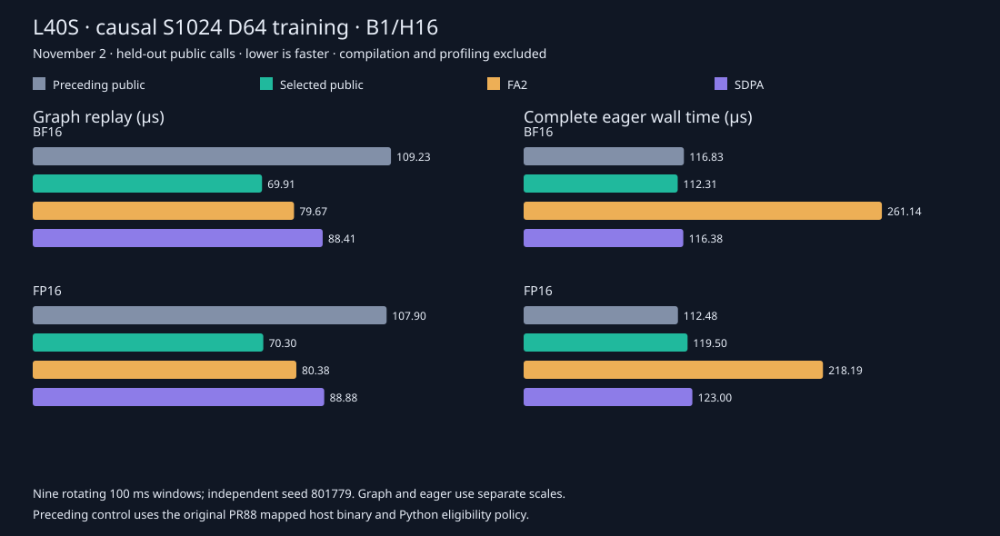

# L40S medium causal training

The bounded public L40S selector now includes causal B1/H16/S1024/D64
training in BF16 and FP16. It keeps the existing positive normal FP32 scale,
aligned contiguous MHA, full 142-SM device and live gradient guards. Masks,
intervening lengths, inference, unsupported scales and other geometries retain
their previous handling. At least one Q/K/V operand must require gradients.

The selected geometry is forward M128/N64 and backward M64/N64,
score/KV/dQ warp factors 2/4/4, resident V and causal head group 16. Query
stages are two for BF16 and one for FP16; dO has one stage. All other public
presets, including the independent short-kernel flags, remain unchanged.



The [compact data](../results/l40s-medium-causal.json) and generator retain
paired samples, exact source/binary hashes, numerical gates and measured scope.
Graph and complete eager measurements are separate. These are attention calls,
with compilation, allocation and capture warmed before measurement.

## Held-out public measurements

Complete forward + backward, microseconds; graph medians use CUDA events and
eager medians use wall time. Nine rotating 100 ms windows follow 500 ms warmup,
with held-out seed 801779.

| Dtype | Mode | Preceding public | Selected public | FA2 | SDPA |
| --- | --- | ---: | ---: | ---: | ---: |
| BF16 | Graph | 109.23 | 69.91 | 79.67 | 88.41 |
| FP16 | Graph | 107.90 | 70.30 | 80.38 | 88.88 |
| BF16 | Eager | 116.83 | 112.31 | 261.14 | 116.38 |
| FP16 | Eager | 112.48 | 119.50 | 218.19 | 123.00 |

Graph training latency falls 35–36% against the preceding public route and
12–13% against FA2. Eager results are variable: BF16's separate median improves
3.9%, while FP16's increases 6.2% (+7.02 microseconds). Six of nine paired eager
rounds favor the selected route in each dtype; median round differences are
−10.03 and −13.90 microseconds, despite FP16's higher separate median.
Individual selected eager windows range from 83 to 216 microseconds in BF16
and 83 to 219 in FP16. These results do not establish a stable general eager
speedup. The chart uses the predeclared separate medians and retains every
window; paired differences are additional variability diagnostics.

A separate five-round existing-family matrix with seed 801783 retained graph
medians of 69.67/69.68 microseconds for this family. Its FP16 eager medians
were 112.64 versus 112.42 microseconds, again supporting an explicitly mixed
eager claim. Other family graph medians differed by −0.28% to +0.38%; eager
controls varied more. Those samples remain separate from the primary chart.

## Selection evidence

The first matched N64/N128 × Q1/Q2 factorial kept forward M128 and G1.
N128 won there: BF16 Q2 and FP16 Q1 gave graph training medians of 81.88 and
79.71 microseconds, compared with 108.03 and 106.75 for the preceding public
path. This did not establish that N64 could never win: its 256 CTAs occupy at
least two resource-capacity waves on 142 SMs, and causal tiles have different
amounts of query work.

The independent matched follow-up held each dtype's query-stage choice fixed.
Changing N64 G1 to G16 reduced backward graph time from 61.69 to 46.25
microseconds in BF16 and 61.07 to 45.60 in FP16. Complete graph calls fell from
82.91 to 70.08 and 82.89 to 70.31. The separate N128 forward M64 control saved
only about 0.1–0.3 microseconds in forward; the released candidate keeps M128
rather than combining unmeasured factors.

Actual initial G1 code used 255 registers and 74752 shared bytes for N128,
182 registers and 50176 bytes for N64/Q2, and 130 BF16 or 183 FP16 registers
with 41984 bytes for N64/Q1. All had zero local bytes and a driver-reported
capacity of one CTA per SM. The BF16 130-register case therefore did not qualify
for two CTAs merely because its shared-memory allocation was small. These are
resource limits, not measured occupancy or stall percentages.

The final graph-bound G16 backward code uses 188 BF16 or 195 FP16 registers,
50176 or 41984 shared bytes, zero local bytes and the same one-CTA capacity.
Against its matched N64 G1 code, the selected function retains 80 static HMMA,
60 LDSM, 16 LDGSTS, 12 scalar LDS and 32 STS instructions. BAR counts remain
eight for BF16/Q2 and nine for FP16/Q1; DEPBAR remains three. These are
whole-function static counts in the exact loaded SM89 SASS, not executed
instruction totals or runtime percentages. Grouping changes CTA ordering; the
measurement does not establish an occupancy increase or a particular cache
hit-rate improvement.

## Arithmetic and validation

The shared [precision contract](precision.md) is unchanged: separate raw maxima
and logarithmic normalization, one input-dtype conversion of reconstructed P
before dS, one conversion of dS, FP32 products/accumulation, delta from actual
rounded O and late dQ/dK scaling. Each output and gradient retains independent
per-head FP64 norm limits of 1% BF16 and 0.5% FP16, with directed rounded
references for negative common offsets and sharp attention.

The public qualification checks all four entrypoints, partial Q/K/V gradient
requirements, live metadata and Tensor Parameters, unsupported scales and
lengths, inference fallback, saved statistics, changed-input graph replay and
poisoned output/gradient buffers. Memory, race, synchronization and initialization
checks instrument the selected GPU implementation with unchanged CPU reference
equations outside instrumentation. The initial memcheck run reported 14
unsupported driver API-version capability queries (13041 requested versus
13040 supported), while all six numerical smoke rows completed. Its log and
exit 86 are retained. An immutable, source-identical continuation disables
CUDA API-error reporting explicitly while retaining device memory, race,
synchronization and initialization instrumentation. Strict graph-to-loaded-code bindings retain
public and FA2 forward/backward binaries and PTX/SASS where available.

The preceding control loads the actual archived PR88 host shared object and its
original Python namespace. Its metadata rejects this family. Using the old
Python namespace with the new C++ eligibility predicate would contaminate that
control. Actual mapped old/new host binaries are copied by the processes that
execute the timing calls. Profiling and sanitizer samples are excluded from
performance medians.

The final evidence includes ten public arithmetic/statistics/poison rows,
32 entrypoint/partial-gradient calls, three additional live-object test methods,
six numerical smoke rows under each of four device tools, eight strict loaded
public/FA2 code bindings, twelve held-out timing rows, four inference rows and
32 existing-family timing rows. The 154-file initial and 52-file continuation
archives total 122276546 bytes and passed physical SHA verification, including
all operands and mapped host binaries. The matched G1 code control has its own
211-file SHA-verified archive. CPU checks ran 400 tests with 191 expected CUDA
skips; all 24 publication guard tests passed.

## Reproduction

```sh
python -m benchmarks.validate_l40s_medium_public --output qualification.json
python -m benchmarks.compare_attention_variants \
  --operations '[{"label":"public","backend":"cute"},{"label":"fa2","backend":"fa2"},{"label":"sdpa","backend":"sdpa"}]' \
  --seq 1024 --dim 64 --heads 16 --dtype bf16 fp16 --visibility causal \
  --phases forward backward joint --warmup-ms 500 --window-ms 100 \
  --repeats 9 --seed 801779 --output measurements.json
```

The retained preceding-binary control additionally requires its archived source
namespace and SHA-verified native object. Source snapshots, launch commands,
operands, complete reports, profiler exports and loaded code are retained outside
the tracked tree. The historical 60-case cross-device chart has not been
remeasured by this two-shape update.
