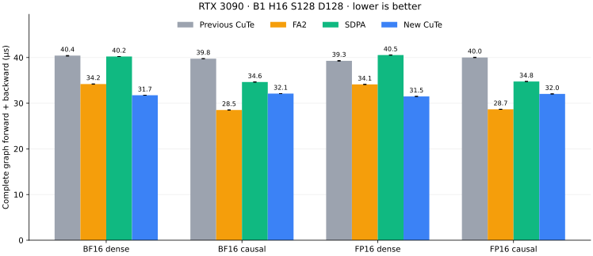

# RTX 3090 short D128 attention

The explicit `rtx3090_attention` entry selects this path for square B1 H16
S128 D128 FP16/BF16 training on a full ordinary 82-SM RTX 3090. Dense and causal
visibility are supported. Other shapes retain their existing routes. See
[installation and fallback scope](rtx3090-optin.md).

```python
from kohakufa_cute import rtx3090_attention

out = rtx3090_attention(q, k, v, is_causal=True)
```

## Complete-call comparison

Independent evaluation uses seed 130397 and seven rotating 100-ms windows.
Graph values below are microseconds. All four cases improve 19–22% over the
preceding explicit entry and beat this run's SDPA backend. Dense is 1.08× faster
than FA2; causal remains 12–13% slower than FA2 and is a continuing tuning target.



| Dtype | Visibility | Previous F+B | FA2 F+B | SDPA F+B | New F+B | New forward | New backward |
| --- | --- | ---: | ---: | ---: | ---: | ---: | ---: |
| BF16 | Dense | 40.427 | 34.193 | 40.228 | 31.745 | 8.943 | 23.150 |
| BF16 | Causal | 39.751 | 28.511 | 34.639 | 32.106 | 8.874 | 23.205 |
| FP16 | Dense | 39.279 | 34.120 | 40.544 | 31.484 | 8.947 | 23.190 |
| FP16 | Causal | 40.008 | 28.661 | 34.753 | 32.033 | 8.829 | 23.179 |

Separately measured forward and backward medians need not sum to the combined
median. Eager samples include host gaps and are retained separately; these
graph improvements are not presented as universal serving speedups.

## Forward: share the row reciprocal

The selected CuTe and FA2 forward kernels use 64-query, 64-key tiles with four
warps, 49,152 shared bytes and 32 blocks for this workload. Their different
latencies required inspecting actual loaded code. The preceding CuTe PTX
contained 64 `div.rn.f32` output-normalization sites per thread: two query rows,
each with 32 output features. FA2's packaged PTX uses two row reciprocals and
multiplies the output features. Its actual loaded SASS confirms that reuse.

A controlled experiment retained the preceding dynamic sequence/aligned-stride
argument policy and changed only normalization to one FP32 reciprocal per row.
Its false control produced byte-identical forward cubins to the qualified
preceding implementation. It passed the unchanged directed/random accuracy
checks and all four safety tools. A separate static-shape implementation also
passed and was faster. Both experiments and their timing samples are retained
in the [comparison data](../results/rtx3090-short-d128.json).

The released forward owner uses that static-shape specialization under the
fixed S128/D128 host guard. It reuses the existing copy, matrix-product,
online-softmax and output-store helpers, with one FP32 reciprocal shared by
each row's output coordinates. It keeps separate unscaled score maxima and
logarithmic normalization. The generic forward implementation is unchanged.
FP32 normalization order changes from coordinate division to multiplication
by the FP32 row reciprocal; the maintained low-precision contract and
acceptance limits are preserved. Backward uses the actual rounded output.

Static instruction counts describe code structure. The preceding CuTe SASS
has 65 reciprocal sites; FA2 has three, including an indexing reciprocal and
two predicated normalization reciprocals. The reciprocal experiment has six
sites including compiler-generated exceptional paths. FA2 also has separate
first/masked/unmasked bodies, so its larger whole-function tensor-instruction
count does not establish more executed matrix work. These counts do not
measure stall fractions or runtime shares.

## Backward: two key owners and cooperative delta

Two 256-thread blocks per head each own 64 key rows. They process 64-query
tiles, accumulate dK/dV in FP32 registers, and store those rows directly.
Each block writes a separate FP32 dQ partial. One final kernel adds the two
partials, applies the attention scale and performs the single input-dtype
output conversion. There are no gradient atomics or separate delta kernels.

Four lanes cooperate on each actual rounded O/dO row to compute FP32 delta.
The causal owner skips query tiles that are wholly hidden by its key offset.
The dQ reducer reads a second partial only when its query row can see that key
tile, preserving initialized-read ownership. A block barrier releases
Q/dO/P/dS staging before the next query tile reuses it. K/V remain immutable.

P is reconstructed from the full sequence's saved statistics and converted
once to the input dtype before dS; dS is converted once. Matrix products and
gradient accumulation remain FP32, with late dQ/dK scaling. The
[precision contract](precision.md), including expected rounding, underflow
and actual-output delta, remains the acceptance target.

The one-owner D128 experiment was correct but used 472 reported local bytes
per thread and lost badly to FA2. Feature ownership repeated score products
and still lost. Key splitting removed most of that resource pressure;
cooperative delta and causal skipping improved it further. Sources, failing
preflight attempts, successful checks and negative timing results are retained
off-host. Reported local bytes alone do not measure runtime spill costs.

## Measurement and qualification

The complete graph has three kernels: forward, key-owner backward and dQ
reduction. The matched comparison retains graph and synchronized eager
forward/backward/combined samples separately. Graph allocation and capture
precede timing; eager calls include required allocation and host work.
Standalone FA2 and SDPA include their own arithmetic and preparation, and
SDPA's selected kernels are retained in the dataset.

Systems captures of the qualified backward owner contain exactly 20 main and
20 reduction kernels. Their instrumented means are 21.984 and 2.245 µs in
combined replay. FA2's main, preprocessing and reduction means are 16.330,
2.906 and 2.752 µs. The reducer is already a small part of the candidate path;
the main kernel remains a better tuning target. Profiling durations are
separate from uninstrumented benchmark medians.

Final public qualification passed 18 finite cases and the separate overflow
diagnostic, six fallback cases, eight existing long D64/D128 cases and 24
paired graph/eager timing rows. Memcheck, racecheck, synccheck and initcheck each
passed 12 public calls with zero reported errors. All eight CuTe compilation
units retain PTX/cubins/SASS, with every cubin byte-bound to an actual loaded
image. The four backward cubins are also identical to the qualified combined
prototype. Every forward unit has two `rcp.rn.f32` sites. The final public
archive verifies 680 entries (88.6 MB). CPU checks ran 388 tests: 203 passed
and 185 were skipped.

The forward uses 168–211 registers/thread and 49,152 shared bytes. Dense
reports eight local bytes/thread; causal reports zero. Backward uses 240–252
registers/thread, zero local bytes and 82,688 shared bytes. These resource
values accompany the timing evidence and do not measure runtime stall costs.

Qualification checks independent per-head mathematical and declared rounded
references, saved statistics, negative maxima, sharp attention, cancellation,
operand underflow, changed/poisoned graphs and negative views. The expected
final-FP16-overflow fixture remains a separate diagnostic with exact infinity
mask/sign and representable-coordinate checks; a distinct dO/8 fixture checks
all four finite components. The original dense underflow fixture remains
unchanged. The maintained output and per-gradient limits remain 1% BF16 and
0.5% FP16, with the qualified rounded-equation limits for directed cases.

```sh
capture_dir=$(mktemp -d)
python -m benchmarks.validate_rtx3090_short_d128 --compare-reference-devices --output "$capture_dir/qualification.json"
python -m benchmarks.compare_attention_variants --operations '[{"label":"public","factory":"benchmarks.validate_rtx3090_short_d128:make_attention"},{"label":"native","backend":"cute"},{"label":"fa2","backend":"fa2"},{"label":"sdpa","backend":"sdpa"}]' --seq 128 --dim 128 --heads 16 --dtype bf16 fp16 --visibility dense causal --phases forward backward joint --warmup-ms 1000 --window-ms 100 --repeats 7 --seed 130397 --source-revision "$(git rev-parse HEAD)" --output "$capture_dir/comparison/report.json"
```

Regenerate the comparison chart from the retained samples with:

```sh
python -m benchmarks.plot_short_comparison --input results/rtx3090-short-d128.json --output results/rtx3090-short-d128.svg
```
