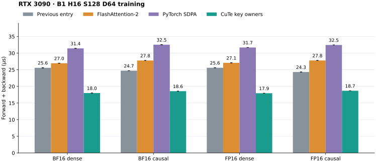

# RTX 3090 short attention backward

The explicit `rtx3090_attention` entry selects a fused backward kernel for
square B1 H16 S128 D16/D64 FP16/BF16 training on a full, ordinary 82-SM RTX 3090.
Dense and causal attention are supported. The ordinary training forward and
its saved unscaled maximum/logarithmic normalization remain unchanged.
Default attention dispatch does not change; the existing long D64/D128 opt-in
schedules remain available. See [installation and fallback scope](rtx3090-optin.md).

```python
from kohakufa_cute import rtx3090_attention

out = rtx3090_attention(q, k, v, is_causal=True)
```

## D64 key ownership

D64 uses four 32-key owners per head. Each 256-thread block processes both
64-query tiles, carries its complete dK/dV in FP32 registers, and writes those
32 key rows directly. The four blocks write separate FP32 dQ partials. One
final kernel combines them pairwise in FP32, applies the attention scale, and
converts dQ once to the input dtype. There are no gradient atomics or separate
delta/preprocessing kernels. Forward remains the ordinary training forward.

Global query and key offsets determine causal visibility. Saved score maxima
and logarithmic normalization describe the full key sequence; they are not
recomputed independently for each key tile. Delta uses all features of the
actual rounded forward O and dO. Each block reconstructs its score/derivative
pairs once and converts P and dS at the maintained boundaries. A CTA barrier
protects Q/dO/P/dS staging before each query-tile reuse. All four dQ partials
are written, including zero contributions from hidden tiles, before reduction.

The selected D64 main kernel uses 33,536 shared bytes, 215–218 registers per
thread and zero reported local bytes. Its grid has 64 blocks instead of the
original owner's 16. Register allocation limits resident blocks per SM, so
this is a change in available independent work rather than a claim of high
occupancy or utilization. The complete graph has three kernels: unchanged
forward, the key-owner backward, and dQ reduction. Graph timing includes scratch
writes and reduction; allocation and capture precede graph timing. Complete eager calls include allocation and host work.

This design follows a measured resource repair. Owning all 128 keys in one
block was correct but D128 used 472 local bytes/thread and lost badly to FA2.
Splitting output features reduced some register pressure but repeated QK/dP
and still lost. Two 64-key owners improved D64; four 32-key owners improved
its complete call further. These experiments and the D128 measurements are
retained as negative results. The new selector applies only to D64; D128
keeps its existing route.

The independent public evaluation used seed 94329, separate from the prototype's
seed 61103. Complete graph F+B fell 23–30% versus the preceding explicit entry and
was 1.49–1.51× faster than FA2 across all four cases. Values below are microseconds.



| Dtype | Visibility | Previous F+B | FA2 F+B | SDPA F+B | New F+B | New backward |
| --- | --- | ---: | ---: | ---: | ---: | ---: |
| BF16 | Dense | 25.590 | 26.970 | 31.429 | 18.005 | 11.567 |
| BF16 | Causal | 24.726 | 27.793 | 32.542 | 18.563 | 11.980 |
| FP16 | Dense | 25.601 | 27.086 | 31.697 | 17.945 | 11.552 |
| FP16 | Causal | 24.329 | 27.806 | 32.452 | 18.690 | 12.127 |

Eager joint medians also improved in this run, by roughly 6–8% against the parent,
but host overhead varies strongly between cases and backends. All 24 forward,
backward and joint graph/eager rows, with seven samples per implementation, remain
in the [compact D64 data](../results/rtx3090-short-d64.json). These comparisons
include each implementation's required math and preparation.

The final public source passed 18 finite directed cases, one expected final-cast
overflow diagnostic, changed/poisoned graph and negative-view checks, six fallback
cases and eight legacy D16 cases. All eight public CuTe compilation units have
identical PTX and cubins to their corresponding qualified N32 prototype, with
every public cubin matched to an actual loaded image. The four retained sanitizer
runs each covered 24 prototype cases, including 12 D64 calls; none reported a
device error. The public archive has 654 verified entries (82.9 MB), alongside
714 verified N32 prototype entries (119.5 MB). The CPU suite ran 378 tests with
177 skipped and no failures; all 24 publication guard tests passed.

Reproduce D64 qualification and a matched device/eager comparison with:

```sh
capture_dir=$(mktemp -d)
python -m benchmarks.validate_rtx3090_short_d64 --compare-reference-devices --output "$capture_dir/qualification.json"
python -m benchmarks.compare_attention_variants --operations '[{"label":"public","factory":"benchmarks.validate_rtx3090_short_d64:make_attention"},{"label":"native","backend":"cute"},{"label":"fa2","backend":"fa2"},{"label":"sdpa","backend":"sdpa"}]' --seq 128 --dim 64 --heads 16 --dtype bf16 fp16 --visibility dense causal --phases forward backward joint --warmup-ms 1000 --window-ms 100 --repeats 7 --seed 94329 --source-revision "$(git rev-parse HEAD)" --output "$capture_dir/comparison/report.json"
```

## D16 ownership and arithmetic

One 256-thread CTA per head owns every query and key row. It reconstructs QK
and dP once, computes delta from the actual rounded forward O and dO, and
writes all three gradients directly. Unlike ordinary CuTe's separate query
and key/value backward kernels, this specialization shares that reconstruction.
Unlike FA2's generic backward path, it needs no separate delta preprocessing,
global dQ scratch initialization/accumulation, or dQ conversion launch. This
is possible because a single CTA owns the complete query/key tile.

The [normal precision contract](precision.md) is unchanged: input-dtype P
before dS, one input-dtype dS conversion, FP32 matrix-product accumulation,
and late dQ/dK scaling. There are no residual products or higher-precision
compensation. Exclusive ownership changes scheduling and storage rather than
the declared arithmetic.

Shared memory contains four 128×32 padded input tiles (32,768 bytes), separate
128×128 P and dS tiles (65,536 bytes), and three FP32 row-statistic arrays
(1,536 bytes): **99,840 bytes**, below this device's 101,376-byte opt-in limit.
Inputs remain distinct from P/dS; CTA barriers separate async input production,
row-statistic production and the gradient readers. Every gradient coordinate
has one writer. The native backward route allocates only its three result
tensors and aliases unused fixed-ABI workspace descriptors to read-only saved
statistics. The static compiler mode uses no global Python compiler patch.

The actual selected SM86 backward uses 128–174 registers/thread and zero reported
local bytes across the four dtype/visibility cases. The matched FA2 main kernel
uses 255 registers/thread, 48–80 local bytes and 98,304 shared bytes. These resource values do not establish runtime
spill costs or stall fractions. Loaded-code inspection confirms tensor-core
products and direct stores, with no gradient atomics in the specialized kernel.
The graph contains two kernels (unchanged forward plus fused backward), versus
four for ordinary CuTe and FA2, and six for this run's PyTorch Flash backend
including two input-copy kernels.

## Measured short-call latency

These are independent evaluation medians in microseconds, with seven rotating
100-ms graph windows per implementation. Every row uses B1 H16 S128 D16.

| Dtype | Visibility | Previous CuTe F+B | FA2 F+B | SDPA F+B | New F+B | New backward |
| --- | --- | ---: | ---: | ---: | ---: | ---: |
| BF16 | Dense | 19.076 | 19.929 | 24.276 | 13.864 | 8.619 |
| BF16 | Causal | 18.774 | 20.407 | 24.688 | 12.670 | 7.239 |
| FP16 | Dense | 18.727 | 19.891 | 24.277 | 13.110 | 7.828 |
| FP16 | Causal | 18.145 | 20.404 | 24.697 | 12.548 | 7.182 |

Combined graph latency falls 27–33% against the preceding entry and is
1.44–1.63× faster than FA2 in these four cases. Forward is an unchanged control.
The held-out seed differs from the prototype selection run. Eager medians
also improved in this run, but ranged widely with host overhead; all samples
are retained instead of presenting those ratios as a general serving gain.

## Qualification and measurement

The retained [comparison data](../results/rtx3090-short.json) separates graph
replay from synchronized complete eager calls, and retains each timing sample.
It compares the exact preceding public entry, ordinary CuTe, standalone FA2,
PyTorch SDPA and the new public entry in one process. Graph speedups describe
the resident device path; host dispatch and autograd gaps make eager results
platform-dependent. Standalone FA2 and SDPA use their own arithmetic and
preparation, so those are complete implementation comparisons.

The runtime is Python 3.13, PyTorch 2.15.0/CUDA 13.2, CuTe DSL 4.8.1 and Triton
3.9. FA2 is official revision `4616f5116d33e3ba3cbb71d582caffcfcb49649c`,
with its SM80 binary running on the real SM86 device. The source and loaded
library identities, selected resources and artifact hashes are retained in
the dataset. No RTX 3090 Ti, Ada, Blackwell or partition performance is implied.

The public validator checks independent per-head mathematical and declared
rounded references, saved statistics, common negative score offsets, sharp
attention, cancellation, expected operand underflow, negative tensor views,
and replay after inputs change and output buffers are poisoned. CPU and CUDA
reference agreement is checked outside sanitizer instrumentation. Memcheck,
racecheck, synccheck and initcheck each check 12 public training calls using
the same CPU-reference equations and limits. The normal output/dQ/dK/dV
limits remain 1% BF16 and 0.5% FP16; directed fixtures retain their qualified
rounded-equation limits.

Making the existing dense FP16 underflow fixture causal produces a declared
dV value above the final FP16 range. The original input and first finite-gate
failure are retained. This case is a separate overflow diagnostic, checking
the exact final-cast infinity mask/sign and each head's representable output
and gradient coordinates; it is not counted as a finite-case pass or timing
result. A distinct causal input with dO divided by eight checks all four
finite components at the unchanged limits. The original dense fixture stays
unchanged.

```sh
capture_dir=$(mktemp -d)
python -m benchmarks.validate_rtx3090_short --compare-reference-devices --output "$capture_dir/qualification.json"
python -m benchmarks.compare_attention_variants --operations '[{"label":"public","factory":"benchmarks.validate_rtx3090_short:make_attention"},{"label":"fa2","backend":"fa2"},{"label":"sdpa","backend":"sdpa"}]' --seq 128 --dim 16 --heads 16 --dtype bf16 fp16 --visibility dense causal --phases forward backward joint --warmup-ms 1000 --window-ms 100 --repeats 7 --seed 81273 --source-revision "$(git rev-parse HEAD)" --output "$capture_dir/comparison/report.json"
```

Raw captures, failures, loaded binaries, compiler PTX/cubins and nonempty
SASS are archived outside the tracked tree. All eight CuTe compilation units
from the four dtype/visibility cases have retained PTX/cubins; each cubin is
byte-matched to an actual loaded module image. Four safety tools and the
unchanged-code capture are retained separately from uninstrumented timings.

The integration with the merged A40 and GB10 paths retains their guards and the
identical short-kernel, native Python bridge and RTX 3090 selector. The rebuilt
C++ bridge passed all 18 finite cases, the expected overflow diagnostic and six
fallback cases again; its loaded library and build configuration were retained.
The integration CPU suite ran 377 tests with 177 skipped and no failures;
24 publication-guard tests passed. Original timing samples retain their original
source hashes in the result file.
