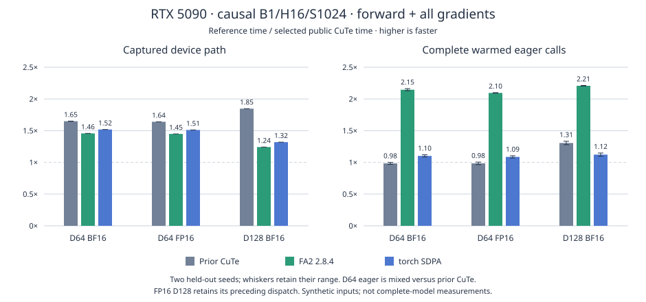

# RTX 5090 configured training schedule

The pinned optional installation selects a warp-MMA path on a full 170-SM RTX 5090 for contiguous `[1,16,4096,64]` and `[1,16,4096,128]` FP16/BF16 Q/K/V, for dense or causal training. It also selects causal S1024 calls for D64 FP16/BF16 and D128 BF16. FP16 D128 at S1024 retains its preceding dispatch because complete eager results were inconsistent. All three inputs must require gradients and gradient recording must be enabled. Selection requires equal Q/K/V shapes, no mask or dropout, and a positive normal FP32 scale. Inference, compiled calls, views, unlisted lengths and other devices retain their existing dispatch.

Use the [pinned optional installation](a100-sm80-fa4.md#installation-and-selection). Measurements use Python 3.13, Torch 2.15.0+cu132, CuTe DSL 4.8.1, TVM FFI 0.1.15.post0 and Quack 0.6.5, on a full device with a 600 W power limit. The dependency gate retains this qualified stack to compare matching compilation and arithmetic policies. The optional CuTe dependency is pinned to FlashAttention revision `4616f5116d33e3ba3cbb71d582caffcfcb49649c`. Standalone FA2 2.8.4 was built for SM120; its actual loaded-extension hash is retained in the results.

The schedule uses shared V, M64/N64 backward tiles, two query stages, one output-gradient stage, 256 threads and 4/2/2 MMA warp layouts. Forward uses M128/N64 for D64 and M64/N64 for D128. The configured C++ host supplies fresh descriptors and streams. The [default arithmetic contract](precision.md), including operand conversions, normalization statistics and gradient-scale placement, is unchanged.

Causal calls interleave key tiles across groups of 16 heads. Later key tiles have fewer visible query tiles; remapping their assignment spreads that unequal work across heads. The logical tiles, products, tail predicates and per-CTA synchronization remain the same. Dense calls retain group one. This uses the existing [causal head-group control](causal-head-groups.md), qualified separately on SM120.

## S1024 causal training

The existing Q2/G16 GPU schedule also benefits these shorter calls. Live tensor metadata is checked in C++, with immutable device classification cached. Shape, dtype, strides, pointer alignment, current device and gradient requirements remain live checks; mask, scale, dropout, compilation and deterministic-mode policies remain enforced. The configured C++ runner was already in use before this update. The kernel arithmetic and buffer ownership are unchanged.



B1/H16, complete forward plus all gradients. Ratios are reference time divided by selected public CuTe time; each range retains the two independent held-out seed medians:

| D / dtype | Graph / prior CuTe | Graph / FA2 | Graph / SDPA | Eager / prior CuTe | Eager / FA2 | Eager / SDPA |
| --- | ---: | ---: | ---: | ---: | ---: | ---: |
| 64 / BF16 | 1.65× | 1.46× | 1.52× | 0.97–1.00× | 2.13–2.16× | 1.08–1.12× |
| 64 / FP16 | 1.64× | 1.45× | 1.51× | 0.97–1.00× | 2.09–2.10× | 1.07–1.10× |
| 128 / BF16 | 1.85× | 1.24× | 1.32× | 1.28–1.33× | 2.20–2.21× | 1.10–1.15× |

D64 eager performance is near parity with the preceding CuTe path, including a 3.3–3.6% regression in one holdout. Its larger captured-device gain does not become a comparable eager gain: submission and autograd work remain significant. BF16 D128 improves both boundaries. The selected joint calls beat the measured FA2 and SDPA implementations at both boundaries; this does not claim a universal eager improvement over preceding CuTe. Vendor comparisons include their own host wrappers and arithmetic policies.

The [compact evidence](../results/rtx5090-medium-causal.json) retains all 48 final forward/backward/joint rows, 15 timing samples per backend, two selection-seed matrices, and the original inconsistent eager results. Final evaluation uses seeds separate from selection, randomized 23 ms windows after 500 ms warmup, and independent eager/graph processes. Each captured replay contains 32 real calls; timings are normalized per call. Backward reuses its retained forward, while joint includes a new forward and all gradients. The direct-runner control is a host-cost diagnostic, not an advertised API speedup.

Earlier seven-window 100 ms runs contained substantial eager variability, including regressions; they remain visible rather than being replaced by the newer protocol. A separate in-process attribution study recorded zero CPU quota-throttling events across 3,888 measured windows and both complete processes. Its instrumented Systems traces show the largest inter-kernel gap between forward and backward preparation in all three compared paths. Neither observation establishes the cause of the earlier variability or a hardware performance ceiling.

The final bounded source passed 84 live-policy cases, nine actual public-frontdoor frames with 18 changed-data/poisoned replays, independent output/dQ/dK/dV and literal-statistic checks, CPU/GPU reference agreement, and actual selected/fallback graph checks. Its frozen CPU tree ran 379 tests total, with 180 skips and no failures; executable hook permissions were restored and checked. All four sanitizer passes and 16 pipeline-code bindings were retained for the unchanged wider GPU implementation. Three final main-kernel bindings, including FP16 D64, passed after narrowing eligibility. Loaded ELF, compiler ELF, PTX/SASS and actual host-library bytes were verified off-host. Public and direct-runner forward, preparation, main and conversion binaries match for both BF16 dimensions.

## S4096 complete-call comparison

B1/H16/S4096; median complete warmed eager forward plus all three gradients, in milliseconds:

| D | Dtype | Visibility | Configured G1 control | Selected public CuTe | FA2 | Selected SDPA |
| ---: | --- | --- | ---: | ---: | ---: | ---: |
| 64 | BF16 | dense | 1.341 | 1.343 | 1.405 | 1.447 |
| 64 | BF16 | causal | 0.751 | 0.686 | 0.798 | 0.803 |
| 64 | FP16 | dense | 1.373 | 1.371 | 1.421 | 1.463 |
| 64 | FP16 | causal | 0.759 | 0.701 | 0.809 | 0.811 |
| 128 | BF16 | dense | 2.500 | 2.492 | 2.612 | 2.662 |
| 128 | BF16 | causal | 1.364 | 1.223 | 1.401 | 1.442 |
| 128 | FP16 | dense | 2.548 | 2.536 | 2.640 | 2.685 |
| 128 | FP16 | causal | 1.385 | 1.244 | 1.416 | 1.451 |

Across the four causal calls, the actual public path is 1.08–1.12× the G1 control for combined forward/backward and 1.15–1.18× for backward. Combined causal calls are 1.14–1.16× standalone FA2 and 1.16–1.18× default SDPA. Dense scheduling remains G1. The G1 control uses the same configured C++ entry directly, excluding public selection overhead. FA2 and SDPA retain their own arithmetic policies; their results compare complete implementations.

[Current compact results](../results/rtx5090-causal-g16.json) retain all 32 backward/combined eager/graph rows, seven samples per backend, source hashes, runtime versions and eight selected-code bindings. Each mode uses a one-second sustained warmup, rotates backend order and measures approximately 100 ms windows after compilation and allocation. Backward reuses a retained forward; combined includes forward and all gradients. Profiling and sanitizer runs are separate from timing. The [initial Q2 host comparison](../results/rtx5090-configured-host.json) retains the preceding generic-entry comparison and S1024 calibration. Those earlier S1024 measurements motivated the separate host and selection qualification above; the S4096 matrix itself is retained unchanged.

The BF16 causal main kernels use 160 registers and 58,368 shared bytes for D64, and 218 registers and 99,328 shared bytes for D128, with zero local allocation. G1 uses 165 and 216 registers respectively. These are compiled resources, not measured occupancy or stall percentages. Exact captured graph symbols were matched to loaded cubins, compiler-returned ELF for CuTe, and selected PTX/SASS for both CuTe and FA2. CuTe PTX declares ISA 9.4 and `sm_120a`; the numeric CUDA function architecture attributes are recorded separately.

Qualified resident-V, larger-tile and K-fragment controls remain experimental. The transferred Ada M32/N128 preset was slower here. A D64 Q2/shared-V G1 K-residency control reduced steady-loop LDSM sites from 60 to 52 at equal 80 HMMA sites, but increased non-padding instruction sites from 528 to 634 and registers from 165 to 178. Long backward latency increased by 2.7–5.5%. These static counts exclude known always-false predicate sites and do not establish runtime stall fractions.

These are synthetic aligned MHA inputs, not a complete model or serving benchmark. Separate source-derived BSHD and fused-QKV view experiments also passed correctness and sanitizer checks; this selection does not enable their experimental strided constructor.

## Qualification

G2/G4/G16 controls passed 96 strong fixtures plus 48 batch/head/partial-tile cases per group, changed/poisoned graphs, and all four sanitizer tools. The actual public G16 path then passed its matrix/frontdoor, changed-graph and selection/fallback methods, all four tools, 32 timing rows and six exact selected-code bindings.

After integrating onto current main, three public GPU methods, independent output/dQ/dK/dV and literal-statistic checks, CPU/GPU reference agreement, bounded partial-tile runs under memcheck/racecheck/synccheck/initcheck, the 32-row comparison and two new public-code bindings passed again. The existing long public sanitizer passes were retained for the unchanged backward implementation. Reference equations run on exact CPU copies under sanitizers; GPU kernels, graph replay and poisoned storage remain instrumented. The per-head mathematical norm gates remain 1% for BF16 and 0.5% for FP16, with the existing rounded directed checks. That earlier S4096 integration ran 342 CPU-discovery tests total with 177 GPU/runtime skips and no failures; the final S1024 qualification is recorded above.

```sh
PYTHONPATH=src python3 -m unittest tests.test_sm120_public_host -v
PYTHONPATH=src python3 -m benchmarks.compare_attention_variants \
  --operations '[{"label":"public","backend":"cute"},{"label":"g1","factory":"benchmarks.sm120_group_controls:make_attention","kwargs":{"implementation":"configured-g1"}},{"label":"g16","factory":"benchmarks.sm120_group_controls:make_attention","kwargs":{"implementation":"configured-g16"}},{"label":"fa2","backend":"fa2"},{"label":"sdpa","backend":"sdpa"}]' \
  --seq 4096 --dim 64 128 --heads 16 --dtype bf16 fp16 \
  --visibility dense causal --phases backward joint --repeats 7 \
  --warmup-ms 1000 --window-ms 100 --output rtx5090-groups.json
```

Full raw machine captures, source snapshots, failed harnesses and exploratory variants remain outside the tracked tree.

## Retained pipeline experiments

Two additional controls passed the same rounded-computation fixtures, changing-data/poisoned graphs, four sanitizer tools and exact loaded-code binding. Neither improved long backward latency sufficiently to select it. [Compact results](../results/rtx5090-pipeline-controls.json) retain source revisions, timing samples, resources and code hashes; [reproduction controls](../benchmarks/experiments/README.md) use the existing comparison driver. Full prototypes and raw captures remain outside the tracked tree.

For D64, adding a second output-gradient stage increased shared storage from 58,368 to 66,560 bytes. Long backward latency increased by 0.7–8.9%. Registers fell, but the dense steady loop grew from 528 to 606 non-padding instruction sites, with the same 80 HMMA, 60 LDSM, four barrier and two dependency-wait sites. Lower register allocation and deeper buffering did not establish better overlap.

Prefetching the saved FP32 unscaled maximum alongside each query stage removed two late global-load sites, adding two shared reads and one asynchronous-copy site. Actual shared storage rose by 1,024 bytes; operand conversions, matrix work and synchronization counts remained unchanged. The D64 dense loop grew from 528 to 566 sites, including 34 to 51 IMAD sites. Long backward latency increased by approximately 0.6–5.5% across D64/D128. This rejects the measured prototype as a dispatch choice; it does not establish a general limit for maximum staging.

Compute counter access was denied. Static instruction counts and instrumented Systems timelines therefore support comparisons of code structure and launch order, without assigning stall percentages or claiming a hardware ceiling.
