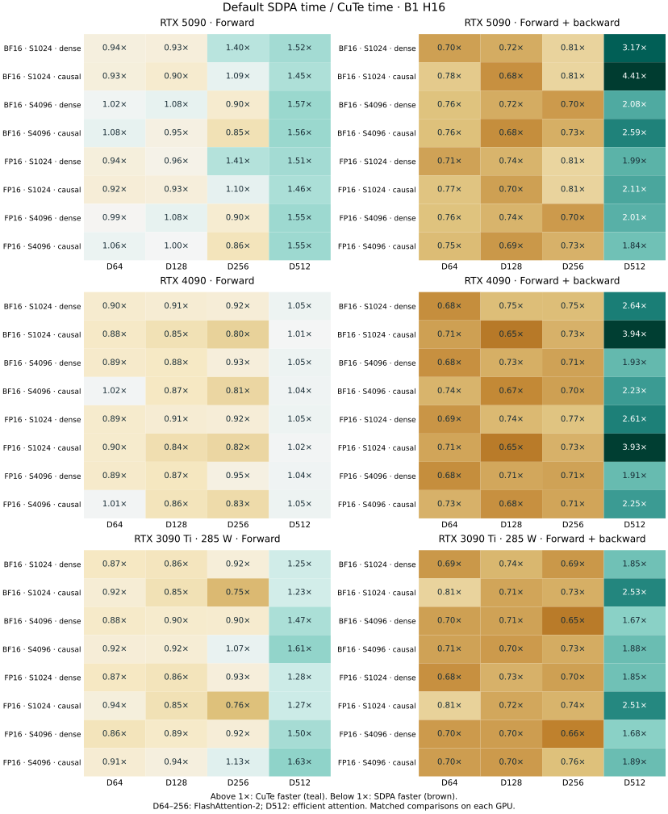

# Performance guide

[rtx5090.json](rtx5090.json), [rtx4090.json](rtx4090.json), [rtx3090ti.json](rtx3090ti.json), and [l40s.json](l40s.json) retain the latest four GPU grids, timing samples, source hashes, independent FP64 checks, and software/hardware metadata. The chart reads these reports directly. The current full-device native matrices are in [h100-pcie.json](h100-pcie.json) and [b300.json](b300.json). The October 22 grids in [performance.json](performance.json) are superseded; that file also retains the explicit-mask, B300 MIG, H100 and model comparisons. [gb10.json](gb10.json) retains the GB10 comparison separately.

The four plotted GPUs now cover the same 60 cases, including D16 and S128. Each panel labels its date, PyTorch version and measured power limit. The [RTX 4090 analysis](../docs/rtx4090-tuning.md) details its scheduling changes and remaining backward gap; all four new runs qualify the restored baseline arithmetic on their own devices.

Times are median milliseconds per attention call unless a table explicitly specifies microseconds. **Forward + backward includes forward.** Timings use CUDA events around CUDA-graph replay, exclude compilation, and rotate backend order. Profiling measurements are excluded from these tables. Compare backends within a row: hosts, software, and replay counts differ between datasets. Full-model throughput and first-use compilation cost require separate measurements.

## Standalone FlashAttention comparisons

The retained grids below compare default PyTorch SDPA. Use the explicit standalone
adapter to measure the installed FA2, FA3 or FA4 implementation separately:

```bash
# Set CAPTURE_DIR to a directory outside this checkout.
python -m benchmarks.compare_flashattention --backends cute fa2 sdpa \
  --seq 128 1024 4096 --dim 16 64 128 256 512 --dtype bf16 fp16 \
  --repeats 5 --window-ms 100 --output "$CAPTURE_DIR/comparison.json" \
  --export-code "$CAPTURE_DIR/code"
```

Select `fa3` or `fa4` for their qualified target architectures. Install the chosen
backend from its [official source](https://github.com/Dao-AILab/flash-attention)
first; an import, launch or unsupported-shape failure is recorded, without
selecting another implementation. `--flash-revision` records the source revision
verified by the installer; loaded adapter and runtime source hashes are retained
separately. Inspect each backend and phase status before interpreting a median.
FA2 does not support D512. This driver uses square causal attention because the
APIs differ in rectangular causal alignment.

The timing boundary includes the BHSD API call, backend preparation, and output
view. Backward retains its forward; joint includes both. Five rotating CUDA-graph
rounds retain samples, actual launched kernel symbols/resources, independent
per-head FP64 checks, and diagnostics against the rounded backward equations.
Short single-operation replay loops can include CPU submission gaps.
Standalone FlashAttention retains its own arithmetic policy, which can differ
from this project's single-rounded P/dS contract; these are complete attention
implementation comparisons.

Profile warmed execution separately from timing:

```bash
nsys profile --capture-range=cudaProfilerApi --capture-range-end=stop \
  --trace=cuda,nvtx --cuda-graph-trace=node -o "$CAPTURE_DIR/fa2-backward" \
  python -m benchmarks.profile_nsight --backend fa2 --phase backward \
  --seq 4096 --dim 128 --heads 16
```

Use `--eager` to inspect ordinary launches. Explicit experiments can be selected
with `--candidate module:factory --candidate-kwargs '{}'`, or a CuTe dispatch
context with `--context module:context_factory`; these do not change default
dispatch. Compiler-returned PTX/cubin files are retained by content hash to avoid
automatic filename collisions. Exact instruction comparisons additionally need
an unambiguous binding to the loaded graph function; a matching symbol alone
can be insufficient across variants. Retain raw captures outside the tracked tree.

## A40 opt-in

The explicit [A40 entry](../docs/a40-native-predicate.md) selects dense D128 and
causal D64/D128 with [paired public API measurements](a40-native-predicate.json),
including the preceding Python guard, native metadata guard, direct runners,
ordinary CuTe, FA2 and SDPA. The [scheduling study](../docs/a40-causal-grouped.md)
retains the grouped/ungrouped controls.
The [initial D128 study](../docs/a40-d128-shared.md) retains the dense geometry
comparison and its qualification.

## B200 D512 backward

The [B200 analysis](../docs/b200-wide-backward.md) and [compact measurements](b200-wide-backward.json) cover the bounded BF16 D512 backward selector, paired complete-call timings against the preceding CuTe owner and SDPA, arithmetic checks, and the remaining profiler/sanitizer limitations. The selected cases are batch 1 with 16 heads at 512–1024 tokens, or 8 heads at 1024 tokens.

## GB10 (DGX / RTX Spark)

The timings and qualification below describe the recorded pre-removal revision.
SM121 was unavailable for this precision-removal campaign; these figures do not
qualify its changed default backward arithmetic.

The newer [D256 query-owner comparison](../docs/gb10-query-ownership.md) measures
the maintained arithmetic against the previous owner and direct FA2 on a full
GB10. It records focused qualification and known full-suite failures separately;
the historical tables below are unchanged.

GB10 supports FP16/BF16 forward and centered backward on Linux ARM64. Use the [GB10 installation instructions](../README.md#install); `CUTE_DSL_ARCH=sm_121a` and the CUDA 13 DSL libraries were used for validation. Automatic selection checks compatibility rather than predicted speed, so benchmark the intended shapes.

### Short-sequence comparisons

B=1, H=4, S=128, contiguous BHSD self-attention, default scale. **These short-sequence tables use microseconds**, unlike the millisecond tables elsewhere. Dense means noncausal without an explicit mask; causal means implicit token-causal attention. All five head dimensions are shown, including controls that receive no new short-forward kernel. Ratios above one favor CuTe; D16/D64 forward differences are within measurement noise and are treated as ties.

Forward retains gradients. BF16 forward, microseconds:

| Head dim | Dense SDPA | Dense CuTe | SDPA / CuTe | Causal SDPA | Causal CuTe | SDPA / CuTe |
| ---: | ---: | ---: | ---: | ---: | ---: | ---: |
| 16 | 6.15 | 6.15 | 1.00× | 6.15 | 6.15 | 1.00× |
| 64 | 6.15 | 6.15 | 1.00× | 6.15 | 6.15 | 1.00× |
| 128 | 10.24 | 8.20 | 1.25× | 10.24 | 8.20 | 1.25× |
| 256 | 12.07 | 6.15 | 1.96× | 11.32 | 6.15 | 1.84× |
| 512 | 14.34 | 8.20 | 1.75× | 14.34 | 8.20 | 1.75× |

FP16 forward, microseconds:

| Head dim | Dense SDPA | Dense CuTe | SDPA / CuTe | Causal SDPA | Causal CuTe | SDPA / CuTe |
| ---: | ---: | ---: | ---: | ---: | ---: | ---: |
| 16 | 6.15 | 6.15 | 1.00× | 6.15 | 6.15 | 1.00× |
| 64 | 6.15 | 6.15 | 1.00× | 6.15 | 6.15 | 1.00× |
| 128 | 10.25 | 8.20 | 1.25× | 10.24 | 8.20 | 1.25× |
| 256 | 12.02 | 6.15 | 1.96× | 11.33 | 6.15 | 1.84× |
| 512 | 14.34 | 8.20 | 1.75× | 14.34 | 8.20 | 1.75× |

BF16 forward + backward, microseconds; these times include forward:

| Head dim | Dense SDPA | Dense CuTe | SDPA / CuTe | Causal SDPA | Causal CuTe | SDPA / CuTe |
| ---: | ---: | ---: | ---: | ---: | ---: | ---: |
| 16 | 18.43 | 16.38 | 1.13× | 18.44 | 15.03 | 1.23× |
| 64 | 20.49 | 18.44 | 1.11× | 21.30 | 18.44 | 1.15× |
| 128 | 26.65 | 26.65 | 1.00× | 27.57 | 25.83 | 1.07× |
| 256 | 36.04 | 28.67 | 1.26× | 35.70 | 29.57 | 1.21× |
| 512 | 198.56 | 38.39 | 5.17× | 197.51 | 36.87 | 5.36× |

FP16 forward + backward, microseconds:

| Head dim | Dense SDPA | Dense CuTe | SDPA / CuTe | Causal SDPA | Causal CuTe | SDPA / CuTe |
| ---: | ---: | ---: | ---: | ---: | ---: | ---: |
| 16 | 17.38 | 16.04 | 1.08× | 18.44 | 14.74 | 1.25× |
| 64 | 20.50 | 18.46 | 1.11× | 21.49 | 18.44 | 1.17× |
| 128 | 27.80 | 26.92 | 1.03× | 27.90 | 26.63 | 1.05× |
| 256 | 34.85 | 28.82 | 1.21× | 35.61 | 28.76 | 1.24× |
| 512 | 116.50 | 38.91 | 2.99× | 116.69 | 37.30 | 3.13× |

The large D512 complete-call advantage includes the existing centered backward implementation; it is not a speedup attributable solely to the new forward kernel. At S128/B1/H4, the new BF16 D256 forward drops from 14.30 to 6.15 µs and D512 from 16.39 to 8.20 µs against the paired preceding CuTe implementation. D16/D64/D128 retain their existing dispatch.

### Longer sequences and scope

BF16, B=1/H=4, dense attention; milliseconds:

| Tokens | Head dim | SDPA forward | CuTe forward | SDPA F+B | CuTe F+B |
| ---: | ---: | ---: | ---: | ---: | ---: |
| 512 | 256 | 0.0328 | 0.0337 | 0.1444 | 0.1712 |
| 512 | 512 | 0.1081 | 0.0876 | 1.0782 | 0.3699 |
| 1024 | 256 | 0.1118 | 0.1118 | 0.3758 | 0.5150 |
| 1024 | 512 | 0.3485 | 0.2391 | 5.4171 | 1.5651 |

D512 benefits at longer lengths from sharing QK and backward score work across output features. D256 full-call latency still trails SDPA at S512/S1024; short-sequence wins do not establish a general GB10 advantage. These are attention-call measurements, not whole-model or generation throughput. Explicit masks use the existing fallback and are outside this timing matrix.

The short-forward path is restricted to SM121, FP16/BF16, eligible aligned D256/D512 layouts, no explicit boolean mask, and both query/key lengths at most 128. Other calls use the existing attention program. A runtime length check preserves compiled-cache reuse across either 128/129 boundary. Query/output tiles depend on batch × heads; performance should be rechecked for the intended geometry.

### Kernel design and profiling

- D512 uses four-warp full-width tiles to share QK/dP work across output columns. This avoids repeated score work and removes the observed dQ stack traffic from the initial GB10 layout.
- Short forward streams Q/K feature chunks through two shared stages while retaining the full active key score tile in FP32. S128 needs one softmax update rather than four 32-key updates.
- Once QK finishes, shared storage is reused for probabilities and double-buffered V stripes. V transfers overlap softmax; one FP32 reciprocal per row is reused across output stripes. Eligible async copies use the L1-bypassing `cp.async.cg` policy.
- Warp-local reductions avoid cross-warp scratch when each warp owns complete rows. The selected 32-head causal D256 layout omits unreachable keys for the first query block.

Nsight Systems and the actual selected PyTorch kernels informed these choices. At D512, default SDPA selects memory-efficient CUTLASS; D256 selects PyTorch FlashAttention, sometimes with split-KV/combine. The selected D512 wheel SASS was inspected. Its matching forward PTX was absent from the wheel, so the exact template was rebuilt from the installed PyTorch headers and matching CUTLASS revision for SM121. That PTX is source-matched reconstruction, not captured driver output or a byte-identical wheel rebuild. PyTorch source revision: `70d99e998b4955e0049d13a98d77ae1b14db1f45`; CUTLASS revision: `0d2b201e8c1c4a03efa6e9c468161916e2334725`.

The B1/H4 D512 short kernel uses 68 registers/thread and 68.5 KiB dynamic shared memory, versus 254 registers and 96.5 KiB for the preceding wide CuTe path. CUDA's occupancy API permits one CTA/SM for that layout; larger-head D512 uses 40.5 KiB and permits two. A narrow D256 layout uses 32 KiB and permits three. These are resource bounds, not measured achieved utilization. Nsight Compute counters were blocked by `ERR_NVGPUCTRPERM`; no measured stall, cache, tensor-utilization or bandwidth percentages are claimed.

### Measurement and validation

Measured October 28, 2026 UTC on a 48-SM GB10 with 128 GB unified memory, Linux ARM64, driver 610.57.04, Python 3.13.18, PyTorch 2.11.0+cu130, CUDA toolkit 13.0.1 and CUTLASS DSL 4.8.1. CuTe's bundled NVVM 13.4.59 emits PTX 9.4; source-matched SDPA PTX reconstruction used NVCC 13.0. Nsight Systems/Compute were 2026.3.2/2026.3.1.

Each backend sample warms and measures 300 single-operation CUDA graph replays using CUDA events. Nine repetitions rotate SDPA, preceding CuTe and new CuTe; compilation is excluded and clocks are not locked. A separate grouped-graph experiment reduces launch overhead, but its numbers are not mixed into these tables. The preceding CuTe control uses the `5014578` forward algorithm and the same centered backward as the new path. The final kernel snapshot is `8940028`; [gb10.json](gb10.json) records its source hashes, medians, all timing samples and output/Q/K/V FP64 errors, including the full 52-case S128 matrix and four longer-sequence controls. The additional S128 geometries are B1/H1, B1/H16, B1/H32 and B4/H16 at D256/D512, both dtypes and modes. D16 was a separate follow-up on the same device/source with the same protocol.

All 52 S128 cases pass independent FP64 checks for output and each gradient, using norm-relative limits of 1% for BF16 and 0.5% for FP16. The timing driver checks graph outputs/gradients against eager execution. Focused GPU tests additionally cover changed-input graph replay, both cache length boundaries, GQA, projection strides, saved statistics, partial tiles, negative maxima, signed/zero scales and tiny gradients. The 92-case precision regression matrix has zero CuTe failures, the six-test adversarial suite passes, and Compute Sanitizer racecheck reports zero hazards for the final causal-prefix and narrow-output layouts. Larger-length comparisons preserve the previous forward path within run-to-run variation.

### Reproduce on GB10

After installing the ARM64 CUDA stack, compare all five dimensions in both modes:

```bash
python -m benchmarks.speed --heads 4 --dtype bf16 --seq 128 \
  --dim 16 64 128 256 512 --backends sdpa cute \
  --iterations 300 --repeats 9 --output ../gb10-dense.json
python -m benchmarks.speed --heads 4 --dtype bf16 --seq 128 --causal \
  --dim 16 64 128 256 512 --backends sdpa cute \
  --iterations 300 --repeats 9 --output ../gb10-causal.json
# Repeat with --dtype fp16. Add --seq 512 1024 for longer-length controls.
python -m unittest tests.test_kernels -v
python -m benchmarks.cudnn_regressions --backends kohakufa-cute math \
  --output ../gb10-precision.json
# Capture warmed ranges separately from timing, keeping reports outside the tree.
nsys profile --capture-range=cudaProfilerApi --capture-range-end=stop \
  --trace=cuda,nvtx --cuda-graph-trace=node -o ../gb10-cute-forward \
  python -m benchmarks.profile_nsight --backend cute --phase forward --seq 128
```

The public speed command compares installed CuTe with default SDPA; it does not recreate the internal previous-CuTe control or exactly the random-input sequence of the retained paired run. It uses SDPA for its numerical control; the FP64 regression command and GPU tests provide independent accuracy checks. Repeat the profiler command with `--backend sdpa` to inspect actual dispatch; use `--phase joint` for forward plus backward or `--phase backward` for a retained-forward backward range.

## RTX cards and L40S

The refreshed grids use **B=1/H=16**, contiguous BHSD, S128/S1024/S4096,
D16/64/128/256/512, FP16/BF16 and dense/implicit causal visibility. All four
panels were measured after removing the automatic compensated arithmetic policy.



Ratios above one favor CuTe. Counts compare observed medians; consult the retained
samples for near-ties. These are attention calls, not whole-model speedups.
Actual default SDPA symbols and resources are retained per graph in each report;
these runs do not measure the standalone `flash-attn` package.

| GPU | Forward wins | Backward wins | F+B wins | Long D512 SDPA / CuTe F+B |
| --- | ---: | ---: | ---: | ---: |
| RTX 5090 | 45/60 | 36/60 | 36/60 | 1.96–4.71× |
| RTX 4090 | 46/60 | 36/60 | 36/60 | 2.17–4.57× |
| RTX 3090 Ti | 36/60 | 36/60 | 36/60 | 1.69–2.85× |
| L40S | 35/60 | 33/60 | 33/60 | 2.80–4.80× |

Representative **BF16 S4096 dense forward + backward**, milliseconds:

| GPU | Head dim | CuTe F+B | Default SDPA F+B | SDPA / CuTe |
| --- | ---: | ---: | ---: | ---: |
| RTX 5090 | 16 | 0.543 | 0.787 | 1.45× |
| RTX 5090 | 128 | 3.320 | 2.674 | 0.81× |
| RTX 5090 | 256 | 8.147 | 6.153 | 0.76× |
| RTX 5090 | 512 | 22.354 | 50.147 | 2.24× |
| RTX 4090 | 16 | 0.654 | 0.886 | 1.35× |
| RTX 4090 | 128 | 3.881 | 3.163 | 0.81× |
| RTX 4090 | 256 | 10.537 | 7.781 | 0.74× |
| RTX 4090 | 512 | 31.159 | 67.562 | 2.17× |
| RTX 3090 Ti | 16 | 1.325 | 2.055 | 1.55× |
| RTX 3090 Ti | 128 | 8.875 | 6.880 | 0.78× |
| RTX 3090 Ti | 256 | 21.539 | 14.531 | 0.67× |
| RTX 3090 Ti | 512 | 61.916 | 104.654 | 1.69× |
| L40S | 16 | 0.732 | 0.752 | 1.03× |
| L40S | 128 | 3.132 | 2.663 | 0.85× |
| L40S | 256 | 8.258 | 7.088 | 0.86× |
| L40S | 512 | 24.781 | 71.017 | 2.87× |

### What changed and what is compared

Default dispatch uses single-rounded FP16/BF16 P and dS operands with FP32
accumulation. It omits the extra weighted-key dQ GEMM, row correction, residual
P/dS products and the final compensated-owner replacement. It retains the
architecture schedules, separate unscaled softmax statistics, masks and tail
predicates. See the [arithmetic and model-shape audit](../docs/baseline-precision.md).

The three backends are measured in the same process and stack:

- **CuTe:** current default arithmetic and architecture schedules.
- **Previous:** pre-change arithmetic reconstructed on this compiler. Separate
  processes check exact numerical equality against the preceding checkout before its timings
  are interpreted.
- **SDPA:** default PyTorch selection, identified by the captured graph symbols.

Previous/CuTe compares complete implementations with different arithmetic policies;
it does not isolate a pipeline scheduling change. The compensated implementation
can be more accurate on deliberately cancelled coordinates and FP16 probability
underflow. Its stronger coordinate targets are no longer the default contract.
The retained [device investigations](../docs/rtx4090-tuning.md) describe their own
historical revisions; their compensated-accuracy claims do not qualify this policy.

Previous backward time / current backward time, across the 60-case grid:

| GPU | Median ratio | Observed range |
| --- | ---: | ---: |
| RTX 5090 | 1.26× | 1.00–1.52× |
| RTX 4090 | 1.10× | 0.89–1.30× |
| RTX 3090 Ti | 1.22× | 1.03–1.65× |
| L40S | 1.17× | 0.88–1.47× |

A ratio below one is a slowdown; deleting work does not guarantee a faster
schedule. Short-call variation and remaining long smaller-head gaps are visible
in the per-case samples rather than hidden by these summaries.

### Hardware and measurement

| GPU | SMs | Power limit | Driver | Measured UTC |
| --- | ---: | ---: | --- | --- |
| RTX 5090 | 170 | 575 W | 610.57.04 | 2026-10-31 |
| RTX 4090 | 128 | 450 W | 615.71.09 | 2026-10-31 |
| RTX 3090 Ti | 84 | 450 W | 595.71.05 | 2026-10-31 |
| L40S | 142 | 350 W | 615.71.09 | 2026-10-31 |

Python 3.13.18, PyTorch 2.15.0+cu132, CuTe DSL 4.8.1 and Triton 3.9.0.
Each report retains runtime and benchmark source hashes, loaded library basenames,
exact graph functions/resources, five timing samples per phase/backend and board
telemetry before/after the campaign. The base revision identifies the preceding
checkout; source hashes identify the measured edits.

Five rotating rounds target 100 ms per phase with at least 16 warmed graph
replays. CUDA events cover replay loops, excluding compilation and profiling;
short calls can include submission gaps. Separate forward and backward medians
need not add to the complete-call median. Each GPU runs one campaign at a time.

All **240 current grid cases** check output/dQ/dK/dV independently against
mathematical FP64 equations on identical rounded inputs, with per-head norm limits
of 1% BF16 / 0.5% FP16. Reports also retain errors against the declared rounded
arithmetic, conditioned on actual O for backward delta. Directed tests cover
operator rounding, masks, GQA, strides, partial tiles, negative maxima,
signed/zero scales, cache reuse and changed/poisoned graph storage. The
[precision-removal report](../docs/baseline-precision.md) records qualification
and limitations separately from mathematical diagnostics.

The [older dataset](performance.json) retains explicit-mask timings and other
hardware separately. New correctness checks do not requalify those historical
timings after the arithmetic change.

## Native H100 PCIe and B300

The current precision-policy comparison additionally measures 16 BF16 cases on
each full device: B1/H16, S128/S4096, D64/128/256/512, dense/causal. The
[H100 PCIe report](h100-pcie.json) is a 114-SM/80-GB device at 350 W;
[B300 SXM6 AC](b300.json) is 148 SMs at 1,100 W. The stack and five-round
100-ms protocol match the refreshed RTX grids. These hosts differ from the
historical H100 SXM and B300 MIG measurements below.

Native-device examples, BF16 B1/H16/S4096 dense, milliseconds:

| GPU | Head dim | Previous backward | Default backward | Previous / default | Default F+B | SDPA F+B |
| --- | ---: | ---: | ---: | ---: | ---: | ---: |
| H100 PCIe | 128 | 1.5870 | 1.5327 | 1.04× | 2.0835 | 1.4002 |
| H100 PCIe | 512 | 72.4444 | 61.7925 | 1.17× | 80.0319 | 63.5586 |
| B300 SXM6 AC | 128 | 0.5812 | 0.5595 | 1.04× | 0.7248 | 0.4289 |
| B300 SXM6 AC | 512 | 3.2565 | 2.8314 | 1.15× | 3.4699 | 32.3734 |


Previous/CuTe compares different arithmetic policies on the same machine/compiler.
B300 D64 backward is 5–8% slower after the removal at S4096; removing operations
is not a universal speedup. Smaller native shapes still trail SDPA. The
[precision report](../docs/baseline-precision.md) records zero-tolerance control checks,
matched PTX/SASS, mathematical tradeoffs, model-shape overlaps and sanitizer
qualification, including B300 racecheck reports also present before the change.
SM100 and GB10 were unavailable for requalification.

## B300 MIG versus KohakuFA Gluon

This retained partition comparison predates the default arithmetic removal. It
does not describe the newly measured full B300 or its current precision policy.

**B300 MIG 1g.34gb, 18 SMs**, BF16 D512, B=1/H=16. Gluon is upstream KohakuFA `0c5ede6859307bedc0c6089523c16b1ca51b7da9`, unmodified and supplied with the measured device tuning tables. CuTe retains its centered FP32 correction. This compares complete attention calls on the same partition.

| Tokens | Visibility | CuTe F+B | Gluon F+B |
| ---: | --- | ---: | ---: |
| 512 | Causal | 0.486 | 0.420 |
| 1024 | Causal | 1.293 | 1.147 |
| 2048 | Causal | 4.020 | 3.682 |
| 4096 | Causal | 13.649 | 13.703 |
| 8192 | Causal | 50.766 | 51.276 |
| 512 | Dense | 0.612 | 0.512 |
| 4096 | Dense | 24.963 | 24.941 |

The largest causal cases are approximately at parity (within 1% at S4096/S8192); smaller shapes still favor Gluon. The full JSON includes 18 cases, including FP16, D256, and different batch/head counts. It retains the published medians; individual replay samples for this dataset are in the external profiling evidence, rather than duplicated here.

Measured October 21, 2026 with PyTorch 2.12.0+cu130, CUDA 13.0, and CuTe DSL 4.8.1. Four rotated rounds of 20 CUDA-graph replays, with output/gradient comparisons and eager/graph checks. Source hashes identify the final vector-staging implementation. These are partition measurements. The new full-device B300 matrix is reported above; B200 performance after these changes remains unmeasured.

## H100

### Clef 27B text inference

The non-Flash [Clef 27B](https://huggingface.co/Cloudflare/clef) snapshot `a30162b99d68a481d8bd75d38df069a0cf83df40` uses causal D256 GQA24/4 in 16 backbone layers. These forward comparisons use its actual BF16 projection tensors and strides, captured from synthetic three/64-question records with 256 state words. Its 48 linear-attention layers and native MHA fastpaths retain their implementations. The schema head uses dense D64 attention with 16 query/KV heads.

Median milliseconds per attention call on a 132-SM/80-GB H100 at its 700 W limit. Each row compares all backends on the same GPU in one process. “Prior CuTe” uses the pre-Hopper device kernels. Default SDPA selects cuDNN's generated Hopper WGMMA kernel; forced FlashAttention uses PyTorch's FlashAttention-2 backend.

| Backbone tokens | Prior CuTe | Tuned CuTe | Default SDPA | Forced FlashAttention | SDPA / tuned |
| ---: | ---: | ---: | ---: | ---: | ---: |
| 787 | 0.068326 | 0.027910 | 0.034655 | 0.051895 | 1.242× |
| 9835 | 3.183050 | 1.890106 | 1.945790 | 4.015904 | 1.029× |

Tuned CuTe beats cuDNN on **both captured shapes in all 15 paired rounds**. Latency falls **59.2% and 40.6% versus prior CuTe**, and **19.5% and 2.9% versus cuDNN**. A separate H100 reproduces both wins over 12 balanced rounds. This covers BF16, unmasked causal D256 GQA24/4 forward attention; it does not establish a general Hopper or backward speedup.

A broader ten-case grid covers B1/S128–16384 and two rectangular B1/B2 cases. It improves prior CuTe throughout and beats default SDPA in **7/10** cases. **S128/S256/S512 still favor default SDPA**, with SDPA/CuTe ratios of 0.883/0.922/0.933. An existing serial M64/N128 alternative was measured and rejected on all three. CuTe beats forced FlashAttention on all eight square cases; PyTorch's forced FlashAttention backend rejects the two rectangular causal shapes. The JSON retains each grid case's samples and protocol.

| Schema query × key tokens | Prior CuTe | Tuned CuTe | Default SDPA | Forced FlashAttention |
| --- | ---: | ---: | ---: | ---: |
| 12 × 787 | 0.016118 | 0.006596 | 0.013772 | 0.010478 |
| 3 × 787 | 0.016379 | 0.006185 | 0.013694 | 0.010389 |
| 256 × 9835 | 0.114041 | 0.061661 | 0.099247 | 0.046007 |
| 64 × 9835 | 0.113677 | 0.023108 | 0.098930 | 0.024376 |

The unchanged split-forward schema path beats default cuDNN by **1.61–4.28×**, including its FP32 partial-output merge. Forced FlashAttention wins the 256-query case. Hopper uses 64-row/128-column tiles above 32 queries. These schema measurements use seven rotating rounds with 100-ms backend windows; they have a separate protocol from the backbone table.

#### What the cuDNN comparison changed

Nsight Systems 2025.3.2 identifies actual loaded kernels; Nsight Compute 2025.3.1 supplies instruction counts, resources and sampled stalls. Native loaded SASS and CuTe PTX/cubins are retained; native PTX was unavailable. Profiling runs separately from timing, with unfixed clocks. These observations led to four changes:

- **128-key tiles:** two 64-query WGMMA consumer groups share independent 64-KiB K and V buffers. Separate producer warps refill K after QK and V after PV, instead of coupling their reuse. This keeps the payload within the earlier 192-KiB shared-memory budget.
- **Softmax overlap:** synchronization orders the groups' softmax sections so one can perform scalar work while the other issues tensor operations. Every consumer warp contributes to the phase token; memory and race checks caught and eliminated a faster but unsafe single-warp handoff prototype.
- **Less scalar work:** positive/default-scale selection moves outside the tile loop, and denominator reductions move to the epilogue. The default scale folds two FP32 multiplies into one before `exp2`; an exhaustive device check found zero probability differences over all 2,139,095,040 finite FP32 bit patterns with their sign bit set, including negative zero and subnormals. Other scales retain the general expression. The compensated FP32 reciprocal epilogue preserves infinity/NaN propagation.
- **Earlier long blocks:** the grid schedules heads before reversed causal query tiles, bringing the longest blocks into the first scheduling wave. Device timestamps confirmed that this reduces the short input's execution tail. Persistence alone and several lower-instruction-count variants regressed and were rejected.

Long captured call, dynamic warp instruction totals unless stated otherwise:

| Measurement | Tuned CuTe | cuDNN |
| --- | ---: | ---: |
| HGMMA | 13,837,824 | 13,837,824 |
| FMUL | 113,748,096 | 113,749,152 |
| SHFL | 2,365,440 | 2,385,240 |
| Compute (SM) throughput | 78.77% | 75.48% |
| Launch registers per thread | 168 | 168 |
| Dynamic shared memory per block | 197,632 B | 232,448 B |
| Spilling requests | 0 | 0 |

CuTe still executes more handoff/polling instructions: 18.94 million SYNCS versus 3.42 million, and 7.74 million NANOSLEEP versus 0.36 million. It launches 1,848 blocks versus cuDNN's 132 persistent blocks. These are remaining design differences, **not percentages of time**. Extra producer warps parked at the final barrier also inflate active-warp counters, so those counters alone cannot establish productive occupancy.

#### Correctness and model limits

All **65,261,568 actual backbone output values** pass the unchanged BF16 `.02/.02` absolute/relative bounds against a chunked FP64 oracle. Captured graphs match eager results and respond to changed inputs. Four Hopper tests pass: 21 serial-control output/gradient/statistics configurations, strict FP64 outputs and all gradients over six signed/zero/tiny scales, changed Q/K/V graphs, and infinity/NaN propagation. Denominator reassociation can change BF16 rounding ties; the new kernel is not bitwise equivalent to prior CuTe.

Compute Sanitizer memcheck and racecheck both pass 15 signed/zero-scale tail configurations with zero errors, hazards or warnings. CPU discovery passes 116 tests with 65 device skips. Full GPU discovery retains one extreme-logit FP16 dQ/dK tolerance failure, reproduced bitwise on prior CuTe; 20 setup errors from missing Git and test support files were resolved before those tests were rerun successfully. An expanded FP64 stress check also finds one BF16 dK tolerance violation at Sq257/Sk129/scale −0.125 in both the new and serial64/serial128 controls. These failures and exact inputs remain recorded; bounds were not relaxed.

**Whole-model compatibility has not passed.** Against prior CuTe, short/long-record maximum logit differences are 0.02734/0.42578, and the long record changes one decision. Both fail the unchanged model logit gate, so no new whole-model timing or speedup is claimed. Small attention rounding differences accumulate through the BF16 backbone.

A separate reference replaces all 22 explicit SDPA calls per record with FP64 QK/softmax/PV, rounding attention outputs back to BF16. Weights, linear attention and native MHA remain unchanged. On the long record, native SDPA and prior CuTe each disagree with three reference decisions, versus two for tuned CuTe; tuned CuTe also has the larger maximum logit error (0.49219 versus 0.26172/0.27734). These mixed results on unlabeled records do not establish better task accuracy. Schema-only replacement retains its earlier six-record validation: all attention/logit bounds pass, with one changed decision among 201 on a native BF16 tie; prior and tuned schema logits agree in that case.

PyTorch 2.11.0+cu130, CUDA 13.0, CuTe DSL 4.8.1, TVM FFI 0.1.15.post0, driver 595.71.05. Backbone timing uses 15 rotating rounds, balanced across five backend positions, 32 calls per CUDA graph, at least 500-ms backend windows, and at least five seconds of preheating after correctness checks. Compilation, profilers and task-owned telemetry are excluded from timed windows. Source identifiers, every timing round, numerical gates and external evidence hashes are retained in the JSON.

### Retained training comparison

Last published dense BF16 results, B=1/H=16/S=4096; the JSON also covers S1024. These training cases favor native SDPA; CuTe provides the stronger backward calculation described in the [precision guide](../docs/precision.md).

| GPU | Head dim | CuTe F+B | Default SDPA F+B |
| --- | ---: | ---: | ---: |
| H100 | 64 | 0.866 | 0.574 |
| H100 | 128 | 1.300 | 0.927 |
| H100 | 256 | 4.710 | 2.469 |

Six rotating rounds of 100 graph replays, PyTorch 2.11.0+cu128. The original reports did not identify the default SDPA backend, so no FlashAttention-specific claim is made for these rows.

## Reproduce

Install the [CUDA dependencies](../README.md#install), then run on the target GPU:

```bash
# Matched default SDPA and CuTe, including separate forward and F+B times.
python -m benchmarks.speed --dtype bf16 --seq 1024 4096 --dim 64 128 256 512 \
  --backends sdpa cute --iterations 100 --repeats 6 --output speed.json
# Repeat with --dtype fp16 and/or --causal for those input families.
python -m benchmarks.speed --dtype bf16 --causal --seq 1024 4096 --dim 512 \
  --backends sdpa cute --iterations 100 --repeats 6 --output causal-speed.json
# With upstream KohakuFA installed on a supported device:
python -m benchmarks.speed --dtype bf16 --seq 1024 4096 --dim 512 \
  --backends sdpa cute kohakufa --output upstream-speed.json
python -m benchmarks.precision --dtype bf16 --seq 256 --dim 128 \
  --backends auto kohakufa-cute --output precision.json
# Regenerate the figure from the four per-device JSON reports in results/.
python -m pip install '.[plots]'
python -m benchmarks.plot_performance
```

These commands rerun the general timing/precision protocol on the installed stack; they do not recreate every historical host or the specialized explicit-mask driver. Check actual SDPA dispatch with `benchmarks.profile_attention` when interpreting a new result. GPU captures, PTX/SASS, rental records, and exploratory reports belong outside the package; the repository keeps the usage comparisons above.

### Reproduce the current RTX and L40S grids

Run from a source checkout with the CUDA extras installed. Defaults cover all 60
cases with five alternating 100-ms rounds; keep raw compiler output outside the
tracked tree.

```bash
python -m benchmarks.qualify_baseline_precision --compare-previous \
  --export-code ../precision-code --output ../precision-comparison.json
```

First validate the previous-policy control against its preceding checkout using
[the control verifier](../benchmarks/verify_previous_precision.py); see the
[precision report](../docs/baseline-precision.md) for the two-process procedure.
The older device-specific comparison drivers describe earlier arithmetic controls.

### Clef 27B captures and replay

Download the pinned model snapshot outside the source tree. Its model loader additionally requires Transformers 5.12.1, flash-linear-attention 0.5.2, causal-conv1d 1.7.0, Accelerate, Pillow, Hugging Face Hub and Safetensors. The CUDA extensions must support the installed PyTorch/CUDA stack.

Use the pinned Clef 27B snapshot and explicit model metadata. Unmodified BF16 weights occupy about 54 GB before activations; the measured device has 80 GB.

```bash
hf download Cloudflare/clef \
  --revision a30162b99d68a481d8bd75d38df069a0cf83df40 \
  --local-dir ../clef-27b-weights
python -m benchmarks.clef_forward --model ../clef-27b-weights \
  --model-id Cloudflare/clef --revision a30162b99d68a481d8bd75d38df069a0cf83df40 \
  --output ../clef-27b-captures --state-words 256 --questions 3 64 \
  --backends native --capture-tensors --rounds 1 --repeat 1
python -m benchmarks.clef_forward --captures ../clef-27b-captures \
  --output ../clef-27b-head --attention-dim 64 --rounds 7 \
  --calls-per-graph 32 --window-ms 100
python -m benchmarks.clef_forward --captures ../clef-27b-captures \
  --output ../clef-27b-backbone --attention-dim 256 --rounds 15 \
  --calls-per-graph 32 --window-ms 500 --preheat-seconds 5
python -m benchmarks.clef_forward --model ../clef-27b-weights \
  --model-id Cloudflare/clef --revision a30162b99d68a481d8bd75d38df069a0cf83df40 \
  --output ../clef-27b-model-head --state-words 16 256 2048 --questions 3 64 \
  --backends native cute-head --rounds 3 --repeat 5
```

Use fresh output directories. Replay restores strides and storage offsets, validates every output against a chunked FP64 oracle, checks that captured graphs respond to changed values, and rotates native SDPA/CuTe timing windows. Add `--dtype fp16` for casts of the captures; this does not measure an FP16 model. Replay compares the installed CuTe version with SDPA; reproducing the old-main control requires a separate checkout of the recorded source. The model harness records numerical failures and excludes failed variants from timing rather than changing its correctness bounds.

The public replay uses default SDPA. To check its stronger FlashAttention alternative separately, run the SDPA call inside `torch.nn.attention.sdpa_kernel(torch.nn.attention.SDPBackend.FLASH_ATTENTION)` and verify the actual loaded kernel. The retained H100 comparisons include both backends.
