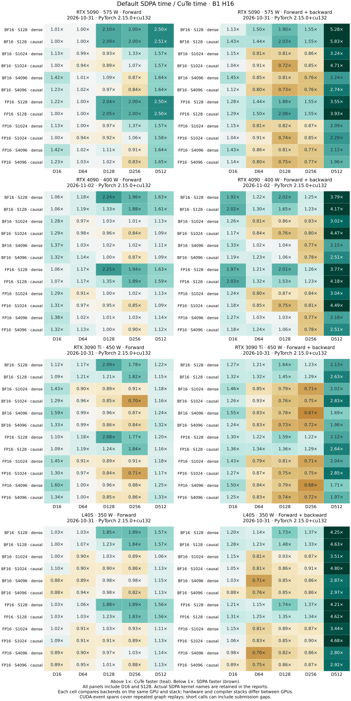

# Performance results

For the separate 2D operator, see [neighborhood evidence](neighborhood/README.md)
and the [current neighborhood guide](../docs/neighborhood/README.md).

[Performance across twelve GPU targets](performance.svg) reads the reports below.
There is one JSON file per target and one common figure. Measurements were retained
from existing measured runs with their qualification limits. No new GPU benchmarks
were run during this cleanup.

## GPU reports

| Target | Retained coverage | Entry / limits | Data |
| --- | --- | --- | --- |
| A100 | D64/D128 long and medium; bounded D256; graph/eager | [Pinned automatic schedules](../docs/backends/a100.md) | [a100.json](a100.json) |
| A40 | D64/D128 long; D256 short/long; graph/eager | [Explicit opt-in](../docs/backends/a40.md) | [a40.json](a40.json) |
| RTX 3090 | D16/64/128 short; D64/D128 long; graph/eager | [Explicit opt-in](../docs/backends/rtx3090.md) | [rtx3090.json](rtx3090.json) |
| RTX 3090 Ti | 60-case default graph grid | [Full 84-SM device](../docs/backends/rtx3090ti.md) | [rtx3090ti.json](rtx3090ti.json) |
| RTX 4090 | 60-case grid plus current short/S1024 studies | [Pinned automatic schedules](../docs/backends/rtx4090.md) | [rtx4090.json](rtx4090.json) |
| RTX 5090 | 60-case grid plus current D64/D128/D256 studies | [Pinned automatic schedules](../docs/backends/rtx5090.md) | [rtx5090.json](rtx5090.json) |
| L40S | 60-case grid plus current short/long/medium training | [Pinned automatic schedules](../docs/backends/l40s.md) | [l40s.json](l40s.json) |
| GB10 | Current shared/native comparisons and NoGrad; historical full-width F/F+B grid | [Opt-in and default scopes](../docs/backends/gb10.md) | [gb10.json](gb10.json) |
| H100 | Current 114-SM PCIe grid; historical SXM and captured inputs | [Native path](../docs/backends/hopper-blackwell.md) | [h100.json](h100.json) |
| H200 | D64/D128 FP16/BF16 versus FA3; experimental | [Explicit entry and unresolved initcheck](../docs/experimental/h200.md) | [h200.json](h200.json) |
| B200 | Current BF16 D512; historical D64–D512 FP16/BF16 | [Bounded wide backward](../docs/backends/hopper-blackwell.md#b200-wide-backward) | [b200.json](b200.json) |
| B300 | Current BF16 grid; historical FP16/BF16 and separate MIG comparisons | [Native path](../docs/backends/hopper-blackwell.md) | [b300.json](b300.json) |

The 60-case grids use B1/H16, S128/S1024/S4096, D16/64/128/256/512,
FP16/BF16, dense/causal. Other studies have their own bounds. Qualification applies
to the measured source and hardware, rather than every supported shape or GPU.
H200 is [experimental](../docs/experimental/h200.md), with unresolved initialization
checking. It is displayed separately from current supported-path measurements.

## Read the chart

Values are **named reference backend time / selected CuTe time**: above one favors CuTe.
Each GPU panel names its reference: default SDPA where measured, FA2/FA3, Gluon,
or the preceding CuTe owner for specific controls.
Cells retain their same-process backend comparison; no timings are combined
across hosts or studies. Tables show retained measurements only.

Current-arithmetic training and NoGrad forward have separate sections. Historical
arithmetic/hardware, captured model inputs, experimental H200, and B300 MIG have
explicitly separate sections. Historical data do not requalify current dispatch.

**F** is forward with autograd,
**F+B** includes forward plus all three gradients, and **I** is NoGrad forward.
GPUs follow the report order in a single column sized for readable GitHub previews.
Headings and notes wrap within the image. Each GPU table groups rows that share
measured dimension/phase columns; unmeasured
columns and combinations are omitted. A focused D512 comparison therefore shows
D512 alone, while complete five-dimension grids remain complete.

Rows identify batch/head counts, length, dtype, and visibility. The chart shows
CUDA-event graph replay; eager wall time remains separately available in the JSON.

Hover a cell for its exact times, study ID, and evaluation run. For studies with
multiple independent runs, the first retained run is shown consistently; every
run remains in the report. This is a coverage chart, not an aggregate GPU ranking.

Latest measured studies replace overlapping workload cells. Unchanged shapes
retain their older cohort; data are not relabeled as remeasured on the latest
source. Some original grids therefore remain partly represented. Hardware,
power, runtime, preparation, and sample counts can differ even within one target.
For example, the RTX 5090 grid used 575 W and later tuned studies used 600 W.

Compilation, allocation warmup, and capture construction precede timing. Short
replay loops can contain submission gaps. Separate phase medians need not sum to
joint medians. Graph gains do not imply eager, model, or serving gains.
Default SDPA kernel selection is retained in each study; standalone FA2 is a
separate comparison and does not support D512.

## Report format

Reports use schema version 3:

- `target` and `label` identify the GPU family. `precision_contract` defines current
  arithmetic; it does not describe every historical series.
- Optional measurement `series` distinguishes `current` (the default), `historical`,
  `historical-mig`, `captured`, and `experimental`. `series_label` describes its
  hardware/policy; `reference_backend` overrides the usual named reference.
- `coverage_gaps` records missing timing evidence separately from numerical results.
- `measurements` contains the selected shape, dtype, visibility, phase, workload,
  graph/eager boundary, metric, backend label, run, and unmodified median values.
- Each measurement references a `study` and a `record` index into that study.
- `studies` contains original metadata and retained raw records, including samples,
  numerical checks, kernel resources, source/library hashes, and qualification.
- Study provenance records the original repository-relative path, Git revision,
  and SHA256. Those old paths identify versioned inputs, not current files.

A later study supersedes the same shape/dtype/visibility/phase/boundary/workload
within the same evidence series and reference backend,
while its independent evaluation runs remain separate. Unsuccessful backends stay
explicit in raw records and do not acquire timing cells. Some compact GB10 studies
published only sample counts and ranges; missing raw samples are not reconstructed.

Regenerate the chart with `python -m benchmarks.reporting.plot_performance`.
[Benchmarking](../docs/benchmarking.md) documents new measurements. The one-time
migration is reproducible with `python tools/consolidate_results.py --output DIR`;
it reads the frozen pre-cleanup Git tree without changing the checkout.

## Accuracy and diagnostics

The `current` series uses the [default precision contract](../docs/precision.md).
Historical timings preserve their older arithmetic and hardware; they are not
precision-equivalent replacements for missing current results.
Independent representative-matrix limits are 1% BF16 and 0.5% FP16 per head,
separately for output and each gradient. Directed rounded-equation checks and
known broader-suite failures retain their original scope. See
[validation](../docs/validation.md) for the distinction.

Unresolved initialization findings remain in [diagnostics](../benchmarks/diagnostics/README.md).
Negative tuning controls and whole-model compatibility studies live with
[explicit experiments](../benchmarks/experiments/README.md). Captured attention
timings do not imply a passed whole-model logit gate or a model speedup.

## Remaining coverage gaps

A displayed forward pass can retain autograd; it is not automatically a NoGrad
inference result. Missing measurements require new runs on the actual target.

| Family | Retained evidence | Missing evidence |
| --- | --- | --- |
| A100 D512 | Aggregate 60-case qualification summary | Per-case latency samples |
| A40 D512 | Generic architecture support | Per-case latency samples |
| Ordinary RTX 3090 D256/D512 | Generic support; separate Ti results | Timings on the 82-SM ordinary card |
| RTX 3090/3090 Ti/5090, H100, H200, B200/B300 NoGrad | Training-forward data; H100 additionally has historical captured inputs | Current synthetic NoGrad grids |

The audit checked the pre-cleanup reports, earlier versioned results, and local
project archives. It found no recoverable timing values for the families above.
Aggregate win counts, another GPU's results, and training-forward timings are not
used to manufacture those values.
