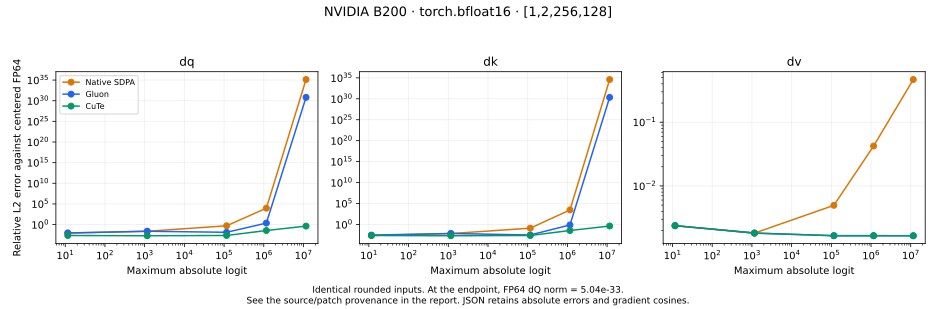
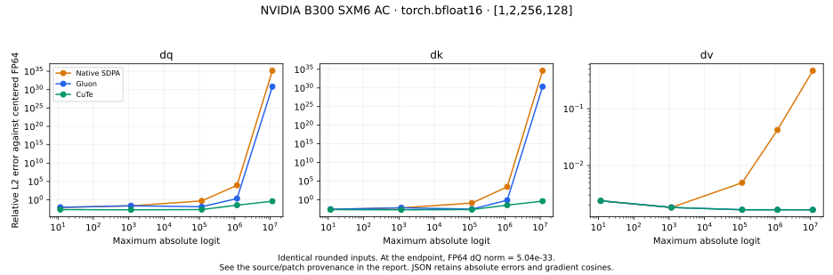

# Measurements

[RTX 5090 full-width D512 tiles](sm120-wide-tiles/README.md) records paired main/SDPA timings, shared score work, assembly comparisons, scheduling controls, and FP64 qualification.

[RTX 5090 pipeline profiling](sm120-pipeline-profiling/README.md) records Nsight captures, fitting D256 TMA stages, rejected pipeline schedules, and dense/causal qualification.

[Blackwell probability overlap from latency interventions](blackwell-intervention-profiling/README.md) records controlled role delays, shorter dV register lifetimes, early FP32 probability reconstruction, and dense/causal qualification.

[Register-resident Blackwell backward auxiliary](blackwell-readout-profiling/README.md) records the wider causal BF16 path, verified PTX/SASS register redistribution, paired native comparisons, and readout ablations.

[B300 wider backward dispatch](sm103-wide-backward/README.md) records the 128-column default, threshold/precision regressions and unmodified production benchmark.

[Blackwell probability-tile profiling](blackwell-probability-tiles/README.md) records the October 20 B300 MIG paired comparisons, exact-gradient checks and before/after matrix-warp wait instrumentation.

This directory contains source measurements and summaries for the README tables.

Upstream KohakuFA values are attributed to its published B300 results at revision
`efd5b72622ce04fcafbe6ca3e368649d8b7b9527`. H100/L40S measurements use this project's
CuTe implementation and compare with the native PyTorch implementations on each GPU.

```bash
python -m benchmarks.precision --dtype bf16 --seq 256 --dim 128 \
  --backends auto cudnn kohakufa-cute --output results/precision.json
python -m benchmarks.speed --dtype bf16 --seq 1024 4096 --dim 64 128 256 \
  --iterations 100 --repeats 6 --output results/speed.json
```

`forward_backward_ms` includes the forward pass. CUDA-graph timing excludes compilation
and rotates backend order each repetition. Precision references use identical rounded
inputs and an analytically centered FP64 backward. Relative errors near saturation
must be read with the reference norm and cosine, which are retained in the JSON.

The SimpleTuner block table measures complete compiled, checkpointed LoRA optimizer
steps on H100. Its source is retained in `simpletuner-training-blocks.json`. These
measurements use production block dimensions, random weights, and learning rate zero.

## Precision across sequence lengths

[Upstream's October 3 results](https://github.com/KohakuBlueleaf/KohakuFA/commit/041ac512ac474709ad910e505c545a1ab94853c2)
showed length-dependent FlexAttention gradient errors on B300: multiples of its
128-token block selected a less accurate path than the unaligned lengths tested.
Those measurements depend on the GPU and software versions. Run the comparison
locally to check CuTe against statically compiled FlexAttention and cuDNN:

```bash
python -m benchmarks.length_precision --dtypes fp16 bf16 \
  --seq 256 257 261 1000 1024 1029 4096 4100 \
  --modes dense causal padding --backends flex cudnn kohakufa-cute \
  --output results/length-precision.json
```

The JSON records device and PyTorch/CUDA/cuDNN versions, the actual maximum logit,
and output/dQ/dK/dV error, reference norms, and cosine against centered FP64 on the
same rounded inputs. Each backend receives identical inputs for a given case;
unsupported backends are recorded as errors. This is a precision experiment rather
than a timing benchmark. The default logit scale is `1e5`.

Generate the precision figure from these measurements:

```bash
python -m pip install '.[plots]'
python -m benchmarks.plot
```

Whole-tensor error can hide rows with much larger relative errors. To reproduce
the per-row view highlighted in [upstream's October 5 precision documentation](https://github.com/KohakuBlueleaf/KohakuFA/commit/0c5ede6859307bedc0c6089523c16b1ca51b7da9),
collect a new report and render its distributions:

```bash
python -m benchmarks.precision --dtype bf16 --seq 256 --dim 128 \
  --scales 100,100000,10000000 --backends auto cudnn kohakufa-cute \
  --row-errors --output results/precision-rows.json
python -m benchmarks.plot_rows --input results/precision-rows.json \
  --output results/precision-rows.svg
```

`--row-errors` adds per-row reference norms, relative errors, logarithmic relative
errors, maximum absolute errors, and finiteness to the existing JSON. dQ uses query
rows; dK/dV use key rows. Arrays flatten batch/head/sequence order, with the original
row shape retained. The flag defaults off to keep ordinary reports compact.

Violins show log10 relative L2 error. Exact zero errors and undefined ratios (zero
reference norm or nonfinite values) are counted separately and omitted from the
violins. Finite logarithmic errors remain available even when a ratio overflows.
The existing committed H100/L40S reports have aggregate metrics only and must be
rerun with the flag to produce these plots.

`validation.json` records the kernel regression suite and the API/reference/training
suite separately. All 37 tests are covered on H100 and L40S, with the MPS-only test
skipped on CUDA machines. Local Apple validation also covers MPS native output and
gradient parity.

## RTX 5090 (sm_120)

Measured on October 19, 2026: RTX 5090, 32 GB VRAM, 600 W default power limit,
PyTorch 2.11.0+cu130, CUDA 13.0, cuDNN 9.19, CUTLASS DSL 4.8.1, TVM FFI 0.1.15,
and Triton 3.6.0. [Environment](rtx5090-environment.json) records the full versions,
GPU properties, and host configuration. The Vast.ai rental cost $1.055/hour with
80 GB storage and free network transfer; it was destroyed after measurements were archived.

The baseline is `8dfecf2`. Its experimental sm_120 path produced four failure reports
in the 53-test suite: compiled saturated backward, the long saturated lookup, and
wide-head cancellation in FP16 and BF16. Centered backward, the sm_120 correction
reload, and versioned compiled operators resolve those failures. The current suite passes 53 of 54 tests; the sole
skip requires MPS. [Validation](rtx5090-validation.json) retains phase outcomes and
source hashes. The Apple CPU/MPS run passes 21 tests and skips 33 CUDA-only tests.

Compiled operators use versioned names because enabling centered sm_120 backward
changes the tensors saved for autograd. Without a new operator identity, persistent
AOTAutograd caches can reuse the old backward graph without its saved forward output.
The compiled mask tests passed with the existing disk cache retained.

### Tile selection

[The tuning report](rtx5090-tuning.json) retains 218 accuracy-checked configurations
for head dimensions 64, 128, 256, and 512, using BF16, 16 heads, and sequence lengths
1024 and 4096. Each trial checks ordinary forward/Q/K/V gradients against centered
FP64 and a saturated lookup with a nonzero tiny derivative before it is timed.
Forward, query backward, and key/value backward are selected in sequence. Scores use
the geometric mean of median graph timings over both lengths; a candidate must
improve the current winner by 2% to replace it.

The first 167 trials used three samples of 50 timed replays. The resumed search
retained those records and used three samples with 5–50 replays targeting roughly
10 ms for slow kernels; per-case counts and probes are recorded. The final before/
after speed reports both use three repetitions and 50 timed replays, with backend
order rotated between repetitions. The baseline speed checks and all final phases
completed successfully.

RTX uses warp MMA with TMA for eligible unmasked/implicit-causal layouts. Explicit
boolean masks retain the generic tile-skipping path. TMA requires supported head
dimensions, aligned pointers, a contiguous last axis, and positive aligned outer
strides; other layouts use the generic kernels. Ada/Hopper configurations are retained.
The 512-dimensional forward and query kernels use different warp/tile shapes to fit
within sm_120's 99 KiB per-block shared-memory limit.

```bash
python -m benchmarks.tune_sm120 --dim 64 128 256 512 --seq 1024 4096 \
  --output results/rtx5090-tuning.json
# Resume the same device/shape search without repeating completed trials:
python -m benchmarks.tune_sm120 --resume --output results/rtx5090-tuning.json
python -m benchmarks.speed --seq 1024 4096 --dim 64 128 256 512 \
  --iterations 50 --repeats 3 --output results/rtx5090-speed.json
python -m benchmarks.speed --seq 1024 4096 --dim 64 128 256 --causal \
  --iterations 50 --repeats 3 --output results/rtx5090-causal-speed.json
python -m unittest discover -v -f
```

The tuner searches the installed defaults. The original search started from the
centered implementation at `2566fbc`, before the measured lookup table was applied.
The same kernel snapshot is available at `d809e2a` after rebasing onto the package
version bump; the reports preserve both revisions.
Raw before/after dense times are in [baseline speed](rtx5090-baseline-speed.json)
and [centered/tuned speed](rtx5090-speed.json); [causal timings](rtx5090-causal-speed.json)
compare the final implementation with native SDPA.

### Precision

BF16, `[1, 2, 256, 128]`, maximum absolute logit `1.16e7`, identical rounded inputs.
Relative L2 errors against centered FP64:

| Kernel | dQ | dK | dV |
| --- | ---: | ---: | ---: |
| Native SDPA | 1.13e31 | 3.93e30 | 0.934 |
| cuDNN | 7.02e30 | 2.38e30 | 0.310 |
| CuTe before | 1.406 | 0.770 | 0.00165 |
| CuTe centered/tuned | 0.432 | 0.432 | 0.00165 |

The reference dQ norm is `5.04e-33`. Centered CuTe retains a nonzero gradient with
cosine `0.9999987`; its relative error remains `0.432`. Automatic CuTe selection
matches the strict implementation. At the FP16 endpoint the reference dQ norm is
`2.48e-132`, below FP16's representable range: CuTe's dQ/dK are zero, reported as
relative error 1 with undefined cosine.

The complete sweeps retain reference norms, norm ratios, cosines, maximum absolute
errors, and finiteness: [before BF16](rtx5090-baseline-precision.json),
[centered BF16](rtx5090-precision-bf16.json), [centered FP16](rtx5090-precision-fp16.json).
These committed reports omit per-row arrays; regenerate with `--row-errors` for
violin plots. Both strict and automatic CuTe are measured:

```bash
python -m benchmarks.precision --dtype bf16 --seq 256 --dim 128 \
  --backends auto cudnn kohakufa-cute kohakufa-cute-auto \
  --output results/rtx5090-precision-bf16.json
```


## B200 (sm_100)

Measured on October 19, 2026: one B200, 148 SMs, 183359 MiB reported VRAM,
1000 W default power limit, PyTorch 2.12.0+cu130, CUDA 13.0, cuDNN 9.20,
CUTLASS DSL 4.8.1, TVM FFI 0.1.15, and Triton 3.7.0.
The [environment](b200-environment.json) records the host and software details.

### Sources and selection

The initial port enables centered backward and the Blackwell correction reload on
sm_100; main previously rejected this architecture. The calibration kernel snapshot
is `fdbfb7d`. The [tuning report](b200-tuning.json) contains 303 trials across forward,
query backward, and key/value backward for D=64/128/256/512. Each candidate must
pass ordinary FP64 output/gradient checks and a saturated lookup retaining a nonzero
tiny derivative before timing. Scores use the geometric mean over S=1024/4096,
three samples per length, and 5–50 replays targeting 10 ms; a replacement needs a
2% improvement. Stages are selected sequentially, so the query/key-value scores
include the previously selected stages rather than isolated kernel times.

The search includes a native tcgen05 score-product implementation, loading its
TMEM accumulator into shared memory and then the existing warp-MMA register layout.
None of those first-pass candidates wins. The first-pass winners use warp MMA with TMA for eligible D=64/128/256 layouts;
D=512 initially uses warp MMA with asynchronous shared loads. A second pass evaluates
the larger shared-memory budget available on B200: double-buffered TMA for D=256
and single/double-buffered TMA for D=512, starting from those measured defaults.
Its 149 additional trials and source provenance are retained separately in
[b200-wide-tuning.json](b200-wide-tuning.json). This pass selects double-buffered
TMA for the 256-wide forward stage and native tcgen05 scores with double-buffered
TMA for the 512-wide forward stage. The remaining stages retain first-pass defaults.
A separate TMEM query-accumulator prototype passed normal/tiny-gradient checks but
was slower and is not included in the package. This run tunes the existing centered
algorithm; a fully pipelined native-TMEM attention implementation remains future work.

Gluon is pinned to upstream revision
[`0c5ede6`](https://github.com/KohakuBlueleaf/KohakuFA/commit/0c5ede6859307bedc0c6089523c16b1ca51b7da9).
On this software stack its unmodified forward kernel fails B200 compilation because
`tcgen05.ld.red` is
unavailable on sm_100a. The [compatibility patch](b200-upstream-sm100.patch) retains
that instruction on B300 and uses an ordinary TMEM load followed by a register
maximum on B200. Every reported Gluon measurement uses this patch.

`benchmarks.tune_kohakufa` uses upstream's planner, candidate families, shortlist,
and interleaved minimum-of-five-rounds timing. Its input factory is changed to
BF16 contiguous BHSD to match this comparison rather than upstream's default FP16
BSHD tensors. It tunes all 32 combinations of D=64/128/256/512, S=1024/4096,
dense/causal, and forward/backward. The committed device tables record the choices.
Both projects' BF16 selections are reused for FP16 measurements. Upstream's
shipped tables are B300-specific, so Gluon defaults on B200 uses its planner
fallback; Gluon tuned uses the measured sm_100 tables. The S=256 precision sweep
uses upstream's nearest-bucket fallback to the S=1024 tuning choices, with actual
forward/backward configurations retained per row.

### Paired timing protocol

Each report uses identical seeded B=1, H=16 inputs, six repetitions and 50 timed
CUDA-graph replays. Six backends rotate through every position: native SDPA,
forced cuDNN, CuTe initial configurations, CuTe tuned, Gluon shipped defaults,
and Gluon tuned. Initial CuTe configurations come from the first trial per stage
in the tuning report and run with the final arithmetic implementation; they are
not a replay of an older checkout. The earlier baseline reports are separate
three-repetition measurements and are not used to calculate the paired gains.

Outputs and Q/K/V gradients are checked against native SDPA before timing every
repetition. Captured graph outputs and gradients are also compared with eager
execution. Native and Gluon configuration caches are cleared/restored around
before/after comparisons, and selected configurations are retained per row.
Forward-plus-backward includes forward. Compilation and first-use setup are excluded.
Unsupported cuDNN shapes are recorded explicitly.

```bash
# Install the pinned upstream checkout separately and apply b200-upstream-sm100.patch.
python -m benchmarks.tune_kohakufa --output artifacts/b200-upstream
python -m benchmarks.tune_sm100 --output artifacts/b200-tuning.json
python -m benchmarks.speed --dtype bf16 --seq 1024 4096 --dim 64 128 256 512 \
  --iterations 50 --repeats 6 \
  --backends sdpa cudnn cute-initial cute kohakufa-default kohakufa \
  --initial-cute-configurations results/b200-tuning.json \
  --kohakufa-tuning results/b200-gluon-d64.json results/b200-gluon-d128.json \
    results/b200-gluon-d256.json results/b200-gluon-d512.json \
  --output artifacts/b200-speed.json
python -m benchmarks.precision --dtype bf16 --seq 256 --dim 128 \
  --backends auto cudnn kohakufa-cute kohakufa \
  --kohakufa-tuning results/b200-gluon-d128.json --row-errors \
  --output artifacts/b200-precision.json
python -m benchmarks.plot_comparison --speed results/b200-speed-bf16.json \
  --precision results/b200-precision-bf16-d128.json --output-prefix artifacts/b200
python -m unittest discover -v -f
```

The calibration report starts from the generic centered port. Re-running the tuner
from the measured production table starts with those defaults and can select different
winners because of its 2% replacement rule; check out `fdbfb7d` to reproduce the
original starting point. GPU/software differences and timing noise also affect choices.

### Results

Dense BF16 milliseconds for forward plus backward (including forward), B=1/H=16:

| Sequence | Head dim | Native SDPA | CuTe initial | CuTe tuned | Gluon default/planner | Gluon tuned |
| ---: | ---: | ---: | ---: | ---: | ---: | ---: |
| 1024 | 64 | 0.0411 | 0.135 | 0.112 | 0.0533 | 0.0472 |
| 1024 | 128 | 0.0504 | 0.207 | 0.195 | 0.0636 | 0.0622 |
| 1024 | 256 | 0.269 | 0.529 | 0.435 | 0.121 | 0.116 |
| 1024 | 512 | 3.17 | 3.59 | 1.85 | 0.298 | 0.288 |
| 4096 | 64 | 0.318 | 1.83 | 1.42 | 0.353 | 0.344 |
| 4096 | 128 | 0.426 | 3.07 | 2.52 | 0.564 | 0.568 |
| 4096 | 256 | 3.23 | 7.02 | 5.76 | 1.32 | 1.31 |
| 4096 | 512 | 33.1 | 54.6 | 27.7 | 3.82 | 3.71 |

Geometric mean CuTe gains over the initial configurations across all eight shapes:

| Dtype / visibility | Forward | Forward plus backward |
| --- | ---: | ---: |
| BF16 / dense | 1.506× | 1.356× |
| BF16 / causal | 1.411× | 1.228× |
| FP16 / dense | 1.365× | 1.267× |
| FP16 / causal | 1.420× | 1.211× |

All paired samples check output and Q/K/V gradients against native SDPA before
capture and graph replay against eager afterward. The initial/default comparisons
share the same run and rotating backend order. Detailed samples, selected stage
configurations and unsupported cuDNN shapes are retained in
[BF16 dense](b200-speed-bf16.json), [BF16 causal](b200-speed-bf16-causal.json),
[FP16 dense](b200-speed-fp16.json), and [FP16 causal](b200-speed-fp16-causal.json).

### Precision and validation

BF16 S=256 stress endpoints; relative dQ errors against centered FP64 on identical
rounded inputs. Absolute errors and dK/dV metrics are retained in each report.

| Head dim | FP64 dQ norm | CuTe initial dQ error | CuTe tuned dQ error | Gluon dQ error | CuTe tuned dQ cosine |
| ---: | ---: | ---: | ---: | ---: | ---: |
| 64 | 9.1e-260 | 1 | 1 | 1.89e+257 | undefined |
| 128 | 5.04e-33 | 0.432 | 0.432 | 6.43e+30 | 0.9999987 |
| 256 | 4.7e-132 | 1 | 1 | 1.63e+130 | undefined |
| 512 | 0 | undefined | undefined | undefined | undefined |

These are synthetic saturation endpoints. A tiny reference norm makes spurious
nonzero gradients produce enormous relative errors; it does not imply ordinary
training gradients have those errors. BF16 D=64/256 endpoint references are below
BF16 storage range, so CuTe dQ/dK are zero. At the D=512 endpoint the FP64 dQ/dK
reference is zero, so relative errors and cosines are undefined. At the preceding
BF16 point the FP64 dQ norm is about 3.09e-42, below BF16's smallest nonzero
storage value, and CuTe's stored dQ/dK are zero. At the D=128 FP16 endpoint the reference dQ
norm is 2.48e-132, below FP16's range. CuTe returns zero dQ/dK,
with relative error one and undefined cosine. The BF16 D=128 nonzero derivative
has relative error 0.432 and cosine 0.9999987; it is not exact.



The final GPU suite passes 55 of 56 tests; the sole skip requires MPS. It includes
18 forced native-score dtype/TMA/mask combinations and 10 additional wide-head
singleton/layout/signed-scale cases, plus compiled training, checkpointed LoRA,
streams, changed-mask graph replay, and saturated tiny gradients. The Apple run
passes 21 tests with 35 CUDA-only skips. [Validation](b200-validation.json) records
phase outcomes, the baseline/first-pass/wide-pass/final source hashes, the exact
upstream patch hash, and the rejected query prototype measurements.

Committed precision reports retain aggregate metrics; full per-row arrays, logs,
source snapshots, and rejected experiments are in the local raw archive. Inputs
are reproducible through the seeded benchmark scripts.

### Rental and archive

The on-demand Vast.ai instance cost $6.270833/hour including 80 GB storage.
It was destroyed after the full raw file manifest matched the local copy. A
conservative compute/storage estimate from the first deployment attempt through
confirmed deletion is $13.83, below the $25 cap; transfer charges are separate.
The estimate includes stopped setup time and is not an invoice. Quoted transfer
rates are $0.000122/GB incoming and $0.003662/GB outgoing.

All 120 raw files, the tested source snapshots, and experimental scripts are retained
in `KohakuFA-CuTe-sm100-artifacts/kohakufa-b200-raw-and-source.tar.gz` beside the
local worktree. Its SHA-256 is recorded in the committed validation report.
The temporary SSH key was deleted and the budget watchdog stopped after deletion was confirmed.


## B300 (sm_103)

Measured October 19–20, 2026 (UTC), on one NVIDIA B300 SXM6 AC, 148 SMs,
275040 MiB reported VRAM and a 1100 W power limit. PyTorch 2.12.0+cu130,
CUDA 13.0, cuDNN 9.20, CUTLASS DSL 4.8.1, TVM FFI 0.1.15, and Triton 3.7.0.
[Environment](b300-environment.json) records the GPU, host and software details.

### Implementation and calibration

The initial port enables centered backward and its Blackwell correction reload on
sm_103; main at `655d871` previously rejected strict B300 calls and used native
SDPA under automatic selection. Calibration starts at `402428a`, before the B300
lookup table was applied.

The dedicated path issues native tcgen05 score and value/gradient products.
64-row tiles use two lanes per row, combining the column halves after hardware
TMEM max/min loads; 128-row tiles assign one row to each lane. Softmax maxima
remain unscaled. Centered backward retains the FP32 residual correction and late
gradient scaling. An auxiliary-register variant reuses consumed score TMEM for
block products, keeping the auxiliary mean/value accumulation in FP32 registers;
this reduces the TMEM allocation and permits wider output tiles.

[PTX documents](https://docs.nvidia.com/cuda/archive/12.9.2/parallel-thread-execution/index.html#tcgen05-instructions-tcgen05-ld)
the load-reduction instructions available on sm_103. The code uses explicit
before/after synchronization fences for ordering TMEM operations. Representative
PTX and instruction checks are retained in the raw archive.

The [primary sweep](b300-tuning.json) evaluates 755 candidates.
Candidates pass ordinary FP64 output/gradient checks, a constructed nonzero tiny
gradient, and a random-valued saturated lookup before timing. Scores use the
geometric mean over S=1024/4096, three repetitions, and adaptive 5–50 replays
(target 10 ms). A candidate must improve the current winner by 2%. Forward,
query backward and key/value backward are selected sequentially.

Eight 128-row wide-output probes were rejected by the single-load repetition
limit. Tiling regular TMEM reads into 128-value chunks resolves this; all eight
pass BF16 and FP16 normal checks plus graph verification in the
[wide-load pass](b300-wide-copy-tuning.json). Its 10 trials include
baseline remeasurements. The [auxiliary-register pass](b300-native-aux-tuning.json)
contains 52 trials, including FP16 causal/GQA/signed-scale checks.
Its key/value trials use the selected query configuration. Complete source hashes,
phase results and status counts are in [validation](b300-validation.json).

The selected B300 stage implementations are:

| Head dim | Forward | Query backward | Key/value backward |
| ---: | --- | --- | --- |
| 64 | Warp MMA | Warp MMA | Warp MMA |
| 128 | Native 64-row TMEM | Native 64-row TMEM, auxiliary registers | Native 64-row TMEM, auxiliary registers |
| 256 | Warp MMA | Native 64-row TMEM, auxiliary registers | Warp MMA |
| 512 | tcgen05 scores, warp-MMA values | Native 64-row TMEM, auxiliary registers | Warp MMA |

128-row native layouts remain available to the tuner and regression suite.

### Comparison protocol

Upstream is pinned to
[`0c5ede6`](https://github.com/KohakuBlueleaf/KohakuFA/commit/0c5ede6859307bedc0c6089523c16b1ca51b7da9),
with no compatibility patch. Gluon defaults use its shipped B300 tables. Dense
Gluon retuning uses its planner, shortlist and interleaved minimum-of-five-rounds
measurements, with the input factory set to BF16 BHSD and B=1/H=16. It tunes
forward/backward at both lengths and all four dimensions. Causal Gluon uses the
shipped B300 causal tables. S=256 precision uses the available shipped S=512 bucket;
each row records the actual upstream configurations. Both projects reuse their
BF16 selections for FP16.

Each timing report uses identical seeded inputs, six rotating-order backend
repetitions and 50 timed CUDA-graph replays. Initial CuTe configurations come from
the first trial per stage and run with final arithmetic; they represent the
initial centered port, rather than an older checkout. Outputs and Q/K/V gradients
are checked against native SDPA before every repetition. Captured graph results
are checked against eager execution. Compilation and setup are excluded.
Initial/final precision sweeps may overlap after all timed comparisons finish;
they collect no performance timings.

### Timing results

Dense BF16 milliseconds, forward plus backward including forward:

| Sequence | Head dim | Native SDPA | CuTe initial | CuTe tuned | Gluon shipped | Gluon dense tuned |
| ---: | ---: | ---: | ---: | ---: | ---: | ---: |
| 1024 | 64 | 0.038 | 0.127 | 0.1 | 0.0473 | 0.0437 |
| 1024 | 128 | 0.0472 | 0.195 | 0.155 | 0.0574 | 0.0574 |
| 1024 | 256 | 0.258 | 0.509 | 0.356 | 0.11 | 0.111 |
| 1024 | 512 | 3.08 | 3.56 | 1.62 | 0.273 | 0.273 |
| 4096 | 64 | 0.304 | 1.76 | 1.23 | 0.291 | 0.291 |
| 4096 | 128 | 0.401 | 2.94 | 2.1 | 0.493 | 0.493 |
| 4096 | 256 | 3.11 | 6.77 | 4.65 | 1.21 | 1.2 |
| 4096 | 512 | 32.1 | 54 | 22.1 | 3.44 | 3.5 |

Geometric mean gains over the initial CuTe configurations:

| Dtype / visibility | Forward | Forward plus backward |
| --- | ---: | ---: |
| BF16 / dense | 1.585× | 1.564× |
| BF16 / causal | 1.453× | 1.438× |
| FP16 / dense | 1.423× | 1.487× |
| FP16 / causal | 1.512× | 1.432× |

Full samples and stage configurations: [BF16 dense](b300-speed-bf16.json),
[BF16 causal](b300-speed-bf16-causal.json), [FP16 dense](b300-speed-fp16.json),
and [FP16 causal](b300-speed-fp16-causal.json). Unsupported cuDNN shapes are recorded.

### Precision and regression checks

BF16 S=256 stress endpoints, compared with centered FP64 on identical rounded inputs:

| Head dim | FP64 dQ norm | CuTe initial dQ error | CuTe tuned dQ error | Gluon dQ error | CuTe dQ cosine |
| ---: | ---: | ---: | ---: | ---: | ---: |
| 64 | 9.1e-260 | 1 | 1 | 1.89e+257 | undefined |
| 128 | 5.04e-33 | 0.432 | 0.432 | 6.43e+30 | 1 |
| 256 | 4.7e-132 | 1 | 1 | 1.63e+130 | undefined |
| 512 | 0 | undefined | undefined | undefined | undefined |

At D=128 BF16, CuTe retains a nonzero dQ derivative with reference norm
5.04e-33, relative error 0.432,
and cosine 0.999999. These synthetic saturation errors
must be read with their reference norms. At the FP16 endpoint, the reference dQ
norm 2.48e-132 is below FP16 storage range; CuTe's stored
dQ/dK are zero. BF16 D=64/256 endpoint references are below BF16 storage range.
At the D=512 endpoint the FP64 reference is zero, so ratios and cosines are undefined.
JSON retains absolute errors, reference norms and cosines throughout each sweep.



The final GPU suite passes 55 of
58 tests, with 3 skips for MPS, sm_100-only coverage and optional plotting.
It covers ordinary and compiled backward, checkpointed training, both native TMEM
row layouts, wide reads, auxiliary registers, GQA, singletons, tails, signed/zero
scales, masks, streams, graph replay with changed inputs and saturated gradients.
The suite resumed after its changed-input graph test exposed NaNs in the default
fused SDPA reference for negative scale. CuTe eager and graph outputs remained
finite; that test now selects SDPA MATH explicitly. The prior 37 completed tests,
including all 140 native layout cases, are preserved in the initial log, and the
remaining 21 tests run with the corrected reference. Production kernels and policy
remain identical to `668eb78`; validation records both runs.
The Apple CPU/MPS run passes 21 tests and skips 37 CUDA-only tests.
Committed precision files retain aggregate metrics; per-row arrays, logs, source
snapshots and rejected experiments are preserved in the local raw archive.

```bash
python -m benchmarks.tune_sm103 --output artifacts/b300-tuning.json
python -m benchmarks.tune_kohakufa --modes dense --output artifacts/b300-gluon
python -m benchmarks.speed --seq 1024 4096 --dim 64 128 256 512 \
  --iterations 50 --repeats 6 \
  --backends sdpa cudnn cute-initial cute kohakufa-default kohakufa \
  --initial-cute-configurations results/b300-tuning.json \
  --kohakufa-tuning results/b300-gluon-d64.json results/b300-gluon-d128.json \
    results/b300-gluon-d256.json results/b300-gluon-d512.json \
  --output artifacts/b300-speed.json
python -m benchmarks.precision --dtype bf16 --seq 256 --dim 128 \
  --backends auto cudnn kohakufa-cute kohakufa-cute-auto kohakufa \
  --kohakufa-tuning results/b300-gluon-d64.json results/b300-gluon-d128.json \
    results/b300-gluon-d256.json results/b300-gluon-d512.json \
  --row-errors --output artifacts/b300-precision.json
python -m unittest discover -v -f
```

The final tuner includes the follow-up variants. Starting from production defaults
can select different winners under the 2% replacement rule; the archived calibration
sources and reports preserve the original search and follow-up contexts.

### Shared Blackwell pipeline profiling

Develop the common pipeline on B200 (sm_100), then validate and tune it on B300
(sm_103). Both support the tcgen05/TMEM/TMA machinery needed for overlapping
loads, matrix products and softmax. The shared implementation must use ordinary
TMEM loads with software reductions on sm_100; sm_103 can additionally select
hardware TMEM load reductions. Keep those operations behind architecture-specific
helpers so B300 instructions cannot reach a B200 compilation.

The profiler accepts either architecture. For B200, install upstream with the
recorded [sm_100 compatibility patch](b200-upstream-sm100.patch), then use its
measured B200 tables:

```bash
python -m benchmarks.profile_attention --seq 4096 --dim 512 \
  --backends cute kohakufa --iterations 5 --warmup 3 \
  --kohakufa-tuning results/b200-gluon-d64.json results/b200-gluon-d128.json \
    results/b200-gluon-d256.json results/b200-gluon-d512.json \
  --trace-dir artifacts/b200-traces --output artifacts/b200-profile.json
```

Start with D=128 and D=512 to distinguish the general pipeline bottleneck from
wide-output slicing. Use launch attribution and, where available, hardware-counter
profiles before choosing which stage to rewrite. Validate each candidate's normal
and saturated gradients before timing it. Successful common changes must then pass
both architectures' regression suites and paired timing grids; B300-specific
reductions and tile choices follow that shared baseline.

The previous runs are useful baselines, rather than a controlled hardware-only
comparison: they used different tuned configurations and drivers, and Gluon needs
the compatibility patch on B200. On the S=4096 BF16 grid, tuned Gluon is 6–18%
faster on B300, while our separately tuned CuTe implementations differ by 15–25%.
That does not explain either GPU's multi-fold CuTe/Gluon gap.

The existing D=512/S=4096 BF16 report measures CuTe forward at 3.453 ms and
Gluon forward at 0.620 ms. Subtracting the separately measured forward medians
from forward-plus-backward gives approximate backward costs of 18.647 ms and
2.884 ms. These differences are estimates, not isolated backward measurements.

Upstream's pinned [forward kernel](https://github.com/KohakuBlueleaf/KohakuFA/blob/0c5ede6859307bedc0c6089523c16b1ca51b7da9/src/kohakufa/sm100/fwd.py)
overlaps TMA, matrix products, softmax and output correction in separate warp
partitions. Its [backward kernel](https://github.com/KohakuBlueleaf/KohakuFA/blob/0c5ede6859307bedc0c6089523c16b1ca51b7da9/src/kohakufa/sm100/bwd.py)
reuses scores and probability derivatives for all three gradients. The pre-pipeline
CuTe query and key/value passes computed these intermediates separately, with
CTA-wide waits between native products. The [producer/consumer port](blackwell-pipeline/README.md)
now overlaps those products with loading and softmax; query and key/value passes remain separate. This source comparison
identifies optimization candidates; hardware profiles must establish their cost.
Centered residual corrections remain part of the CuTe precision contract.

The profiler below validates outputs and gradients, then records forward and
backward in separate sessions. Backward reuses one retained forward graph, so
its trace excludes forward computation. Ordered launch slots distinguish stages
even when their kernel names match. For the current contiguous B300 path, the
backward launch order is output/dO centering, query gradients, then key/value
gradients. Profiling overhead affects durations; use `benchmarks.speed` for
final performance comparisons.

```bash
python -m benchmarks.profile_attention --seq 4096 --dim 512 \
  --backends cute kohakufa --iterations 5 --warmup 3 \
  --kohakufa-tuning results/b300-gluon-d64.json results/b300-gluon-d128.json \
    results/b300-gluon-d256.json results/b300-gluon-d512.json \
  --trace-dir artifacts/b300-traces --output artifacts/b300-profile.json
```

For external Nsight Compute collection, `--profiler nvtx` disables the PyTorch
profiler and emits `cute_forward` / `cute_backward` push/pop ranges. For example:

```bash
ncu --clock-control none --kernel-name-base demangled \
  --kernel-name 'regex:.*blackwell_pipeline(Query|KeyValue).*' \
  --launch-skip 8 --launch-count 2 --set full \
  -o artifacts/b300-backward \
  python -m benchmarks.profile_attention --seq 4096 --dim 512 \
    --backends cute --profiler nvtx --iterations 1 --warmup 3 \
    --output artifacts/b300-nvtx.json
```

Backward CUDA launches occur on the autograd worker thread, outside the main
thread's NVTX range, so use the verified kernel-name filter above. Its skip count
excludes validation and the three warmup backward calls. Counter collection also
requires host permission. Fresh [B300 MIG profiling](attention-diagnostics/b300-mig/README.md)
records successful Systems captures and the Compute permission failure.


## Blackwell backward register pressure

The [backward register report](blackwell-backward-registers/README.md) compares
32-column output windows, delayed V reads and later probability packing against
merged main `e44d114`. All 32 B300 MIG paired cases have 2.0–8.0% lower median
forward-plus-backward latency, with all 128 candidate samples matching main
bitwise. It includes fresh emitted-code and Nsight evidence, plus the slower
query-owned fused prototypes and their timing instrumentation.

## Blackwell transfer and scheduling follow-up

The [slice scheduling report](blackwell-slice-scheduling/README.md) records the
D512 adjacent-gradient-slice launch policy. The subsequent
[transfer and scheduling report](blackwell-transfer-scheduling/README.md)
compares wider D512 forward boxes, paired output rescaling, compact backward
loader loops, and causal query ordering against that scheduling baseline.
On the 18-SM B300 MIG, D512 BF16 S4096 forward plus backward falls from
30.9804 to 29.5940 ms dense and 18.9109 to 16.8667 ms causal. All 72 candidate
samples match baseline bitwise; Gluon remains faster overall.

## Earlier Blackwell code generation and tensor-memory dS

The [code generation report](blackwell-codegen/README.md) compares current main
with paired FP32 arithmetic, resident D128 wider products, streamed tensor-memory
dS, and forward row-inverse reuse on the 18-SM B300 MIG. All 18 paired cases
improve by 7.8–15.5%. It includes raw comparison data, precision gates, complete
assembly summaries, Nsight timelines, and rejected experiments.

## Producer/consumer pipeline results

The [shared Blackwell pipeline report](blackwell-pipeline/README.md) records the
follow-up port of the original KohakuFA scheduling architecture into CuTe, with
paired B200/B300 before/after timings and FP64 precision checks. The earlier
calibration reports above remain historical measurements of the previous stage tables.
