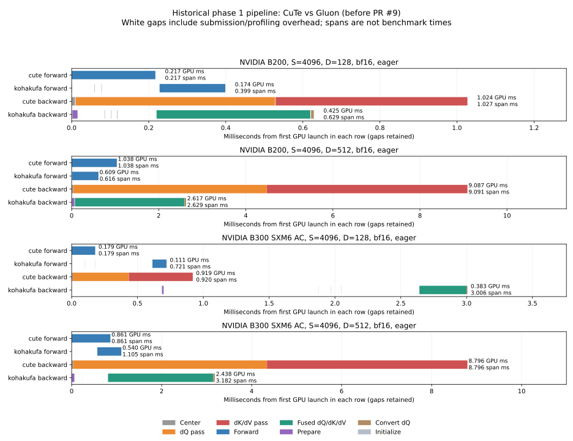

# Attention scheduling audit

[Later probability-tile measurements](../blackwell-probability-tiles/README.md) include before/after matrix-warp barrier timers, bitwise gradient checks, four new Nsight Systems captures and the measured bounds-check optimization.

Fresh B300 MIG traces, Nsight Systems reports and graph timings are recorded in
[the MIG report](b300-mig/README.md). The current B200 CuTe path still loses to Gluon. CuTe DSL does not by itself
remove repeated arithmetic or guarantee a better schedule than Gluon. The earlier
launch profiles established expensive stages, but did not establish whether
individual warps are waiting on TMA, tensor cores, TMEM, registers or barriers.

## What was actually profiled

The four [phase 1 reports](../blackwell-pipeline/) contain ordered CUPTI launch
names, GPU start timestamps and durations on B200 and B300, D128 and D512.
No Chrome trace, Nsight Systems report or hardware counter report was archived.
These profiles precede the 128-column B200 backward change in PR #9. They must not
be presented as isolated-stage measurements of that final kernel.

The archived Nsight Compute attempts report:

```text
ERR_NVGPUCTRPERM - The user does not have permission to access NVIDIA GPU Performance Counters on the target device 0.
```

They also attempted a nested PyTorch CUPTI session, which failed with
`CUPTI_ERROR_MULTIPLE_SUBSCRIBERS_NOT_SUPPORTED`. New external-tool captures must
use `--profiler nvtx` to avoid nesting profilers. A denied counter session does
not establish that CUDA activity tracing with Nsight Systems is unavailable.

## Visual comparison of saved launches



The plot retains real GPU timestamps and gaps from one actual iteration per row.
It chooses the iteration nearest median summed kernel duration, rather than
joining unrelated per-slot medians. Every row starts at its own first GPU launch;
rows are independent captures and cannot establish concurrency between backends.
The accompanying [JSON](phase1-launches.json) records the selected iteration,
source hashes, busy union, elapsed span, idle duration and every displayed event.
White gaps include eager CPU submission and profiling overhead. Large Gluon gaps
in these traces are absent from the CUDA-graph benchmark protocol, so elapsed
spans are not comparative performance results. The traces establish launch
sequence, not overlap between warps inside a kernel.

Historical B200 D512 median launch durations (ms, eager with profiling overhead):

| Phase | CuTe | Gluon |
| --- | ---: | ---: |
| Forward main kernel | 1.038 | 0.603 |
| Backward centering / prepare | 0.031 | 0.060 |
| Backward dQ | 4.449 | Included in fused kernel |
| Backward dK/dV | 4.606 | Included in fused kernel |
| Backward fused main kernel | — | 2.516 |
| Backward convert dQ | — | 0.035 |

CuTe has fewer launches. Reducing CPU call count alone cannot explain the
multi-millisecond difference in summed GPU kernel time. The main compute kernels
are the priority.

## What remains in the latest B200 measurements

[PR #9 measurements](../blackwell-fused-backward/phase2-final-speed-bf16.json),
B1/H16/S4096 BF16, milliseconds, CUDA graphs:

| D | CuTe forward | Gluon forward | CuTe forward + backward | Gluon forward + backward |
| --- | ---: | ---: | ---: | ---: |
| 64 | 0.1830 | 0.1131 | 0.8476 | 0.3412 |
| 128 | 0.2031 | 0.1577 | 0.9999 | 0.5567 |
| 256 | 0.2970 | 0.2017 | 2.0751 | 1.1528 |
| 512 | 1.0022 | 0.6287 | 6.3333 | 3.6711 |

The latest D512 difference is 2.6622 ms overall, of which only 0.3735 ms is
forward. Subtracting separately measured medians suggests about 86% of the
remaining difference is backward; this is an estimate, not an isolated backward
profile. The latest individual dQ/dK/dV durations have not been captured.

## Direct source comparison

CuTe source: [backward producer/consumer kernel](../../src/kohakufa_cute/blackwell_pipeline.py).
Upstream is pinned to
[`0c5ede6` backward](https://github.com/KohakuBlueleaf/KohakuFA/blob/0c5ede6859307bedc0c6089523c16b1ca51b7da9/src/kohakufa/sm100/bwd.py)
and [forward](https://github.com/KohakuBlueleaf/KohakuFA/blob/0c5ede6859307bedc0c6089523c16b1ca51b7da9/src/kohakufa/sm100/fwd.py).
B200 comparisons apply the same recorded [compatibility patch](../b200-upstream-sm100.patch).

| Work | Current CuTe | Original Gluon | Consequence to investigate |
| --- | --- | --- | --- |
| Backward ownership | Separate dQ and dK/dV passes | One key-tile owner computes dK/dV and reduce-adds dQ partials | CuTe repeats QK, dO·V, probability reconstruction and operand traffic across passes |
| Gradient precision | dQ also accumulates P·K and subtracts rounded-dS-sum × P·K; preserves FP32 centering residual for dK | Output/dO delta, three gradient products | CuTe has additional useful arithmetic and a dependency from query to key/value pass |
| D128 backward | Both CuTe passes have 128×128 tiles after PR #9 | 128×128, one output slice | Tile-width mismatch is fixed; fusion and centering work remain |
| D512 backward | Four 128-column output slices in each pass | Four 128-column output slices in its fused pass | Both repeat scores across output slices; attributing all slicing overhead uniquely to CuTe would be wrong |
| Forward ownership | One query tile per CTA; D512 output slices are separate CTAs | Persistent grid; can share K/V across two query halves and split output within CTA | Potential repeated QK/softmax and K/V traffic in CuTe |
| Register allocation | 12 launched warps including two padding warps, current compiler allocation | Explicit warp partitions and register budgets, separate reduction workers | Register pressure/occupancy is an open measurement question; no spill counts obtained |
| Backward buffering | D128 has one dS slot, aliased S/P and dP handshake | Its own alias ordering and early operand-release protocol | Compare barrier wait distributions, not just buffer counts |

At D128, counting equal-sized matrix products per query/key tile pair gives
CuTe eight products: QK, dO·V, P·K and dS·K in the query pass; QK, dO·V, Pᵀ·dO
and dSᵀ·Q in the key/value pass. Gluon performs five: QK, dO·V and the three
gradient products. This is 1.6× arithmetic before SFU work, traffic and
synchronization. It is a source-derived work count, not measured tensor-core
utilization or a prediction that removing products gives exactly 1.6× speedup.
Transposes/orientations differ but these D128 products have matching dimensions.
The simple eight/five count must not be applied to wide heads without accounting
for output slicing in both implementations.

A faithful fused-gradient redesign must retain the centered precision behavior.
Replacing CuTe's centering with Gluon's rounded output delta changes numerical
behavior at large logits. Fusion is an optimization target, not permission to
remove the existing tiny-gradient checks.

## H100 and L40S audit

Both still use [the older generic kernel](../../src/kohakufa_cute/kernels.py):

* H100 uses WGMMA on selected widths, two-buffer TMA loading at D64/D128,
  and WGMMA/pointwise overlap in centered backward with output width 128.
  `pointwise_overlap`, `pipeline_step`, `dot_hopper` and `product_hopper` show
  those mechanisms directly. Many product helpers still commit and wait for
  completion, and the query/key-value split repeats intermediates.
* L40S uses warp MMA and cooperative copies. Its selected paths have no
  `pipelined` TMA mode; `load_pair` issues copies, waits for group zero and
  synchronizes before consumption. A deeper cp.async producer/consumer schedule
  is a concrete candidate. Blackwell tcgen05/TMEM operations cannot be copied
  to this architecture.

The existing H100/L40S results compare CuTe against PyTorch backends, rather than
paired Gluon kernels on those GPUs. No saved intra-kernel profile establishes
how much additional overlap either GPU would gain. These are source findings,
not measured regressions or a claim of a particular speedup.

## Next capture and decision criteria

Run the latest production sources and the pinned Gluon source on the same GPU,
with identical inputs, tuning tables, dtype, causal mode and warmup. Capture
D128 and D512 in eager and CUDA-graph modes. The helper validates output and all
gradients before profiling and checks profiled results against SDPA afterwards;
it fingerprints CuTe source files and upstream source/tuning. It exports CPU/CUDA
Chrome traces for Perfetto as well as ordered launch attribution.

```bash
python -m benchmarks.profile_attention --seq 4096 --dim 128 \
  --backends cute kohakufa --execution graph --iterations 5 --warmup 3 \
  --kohakufa-tuning results/b200-gluon-d128.json \
  --trace-dir artifacts/d128-graph \
  --output artifacts/d128-graph.json
```

Repeat with D512 and its tuning table, and with `--execution eager`. Graph-mode profiling and the changed-input replay test now pass on the B300 MIG
slice. A second GPU regression ensures projected user annotations are excluded
from summed kernel time. See [the MIG report](b300-mig/README.md) for the fresh captures.

For Nsight Systems, disable CPU sampling/context switches and the nested Torch
profiler. CUDA/NVTX tracing establishes CPU submission, GPU kernel order, graph
nodes and gaps; it cannot reveal individual worker-barrier waits within a kernel.

```bash
nsys profile --trace=cuda,nvtx --sample=none --cpuctxsw=none \
  --cuda-graph-trace=node --force-overwrite=true \
  -o artifacts/d128-systems \
  python -m benchmarks.profile_attention --seq 4096 --dim 128 \
    --backends cute kohakufa --execution graph --profiler nvtx \
    --iterations 5 --warmup 3 \
    --kohakufa-tuning results/b200-gluon-d128.json \
    --output artifacts/d128-nvtx.json
nsys stats --report cuda_gpu_trace,cuda_gpu_kern_sum \
  artifacts/d128-systems.nsys-rep
```

If the host permits counters, collect each backend separately with Nsight
Compute (never run profiling/timing workloads concurrently):

```bash
ncu --clock-control none --kernel-name-base demangled \
  --kernel-name 'regex:.*blackwell_pipeline(Query|KeyValue).*' \
  --launch-skip 8 --launch-count 2 --set full \
  --force-overwrite -o artifacts/d128-cute-compute \
  python -m benchmarks.profile_attention --seq 4096 --dim 128 \
    --backends cute --profiler nvtx --iterations 1 --warmup 3 \
    --output artifacts/d128-cute-nvtx.json
```

Autograd launches backward kernels on its worker thread, outside the main
thread's NVTX push/pop range. The old NVTX include example selected no kernels.
The example above skips validation plus three warmup backward calls (two matching
kernels per call), then selects the measured dQ and dK/dV kernels. For Gluon use
`--kernel-name 'regex:.*attention_bwd_kernel.*' --launch-skip 4 --launch-count 1`
with its tuning table. These selections were verified to reach collection on the
MIG host, which then denied counters with `ERR_NVGPUCTRPERM`.
Compare tensor-core activity, memory traffic, occupancy/registers, local-memory
spill traffic and source-correlated stall sampling before changing the schedule.
If counters remain denied, use a separately compiled instrumented prototype to
measure selected producer/consumer barrier intervals. Do not treat a CPU flame
graph or the outer CUDA timeline as a measurement of warp-level overlap.

See NVIDIA's [Systems trace analysis](https://docs.nvidia.com/nsight-systems/AnalysisGuide/)
and [Compute profiling guide](https://docs.nvidia.com/nsight-compute/ProfilingGuide/index.html)
for the scope of each measurement. Stall samples identify the waiting consumer;
source context is needed to identify its producer.

At the time of this initial audit, no GPU was rented. The completed run's estimated upper spend was $32.95
of the $50 cap, leaving about $17.05. At the October 20 availability check, only
four/eight-GPU B200 bundles were rentable, starting at $28.51/hour interruptible;
no rental was made above the authorized hourly limit. Live availability must be
checked again before capture.

## Validation of this diagnostic tooling

The initial local CPU suite discovered 67 tests (23 passed, 44 skipped).
The final local suite discovers 68 tests (23 passed, 45 skipped).
The expanded four-test profiler suite passes on the MIG GPU, including
changed-input graph replay and projected-annotation filtering.
Formatting/import ordering and package build pass. Production kernel files are
unchanged. Historical timeline rendering completes for all four archived reports.
