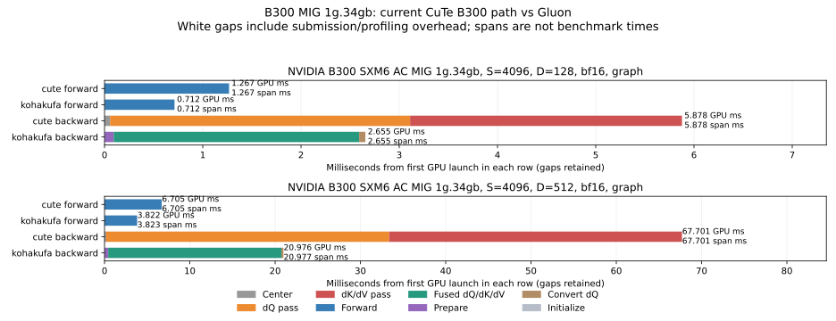
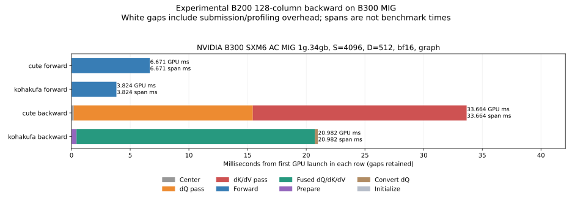

# Fresh B300 MIG profiling

Measured October 20, 2026 on Runpod's NVIDIA B300 SXM6 AC MIG 1g.34gb:
18 SMs, 32,749,125,632 usable bytes, compute capability 10.3. This is a partition,
not a full B300. Results compare both backends on the same partition; do not
extrapolate their milliseconds or tuning choices to the full GPU.

The isolated environment uses PyTorch 2.12.0+cu130, Triton 3.7.0 and CuTe DSL
4.8.1. The pod's original PyTorch 2.8 environment is retained. KohakuFA is pinned
to `0c5ede6859307bedc0c6089523c16b1ca51b7da9`, unpatched on sm_103, with the
recorded B300 tuning tables. CuTe kernels match the source already validated in
PR #9; its production sm_103 dispatch still selects the preceding 64-column
backward configuration. The 128-column B200 configuration is tested separately
below as an explicit process-local override.

## Actual CUDA timeline

These are actual representative CUDA-graph iterations, with launch order and
GPU gaps retained. The annotations give both union GPU time and elapsed span.
Forward and backward use separate captures; backward reuses one retained forward
graph. Every report validates output and all gradients against SDPA before
profiling and checks results afterwards. Five iterations follow three warmups.

At S4096/D128, summed kernel time is 1.2688 ms forward / 5.8795 ms backward for
CuTe and 0.7123 / 2.6556 ms for Gluon. At D512 it is 6.7088 / 67.7036 ms versus
3.8206 / 20.9771 ms. Eager captures give nearly identical kernel durations.
CPU submission gaps therefore do not explain the main GPU compute difference.

The D512 query kernel alone takes about 33.20 ms, and key/value takes 34.32 ms;
Gluon's fused main backward kernel takes about 20.30 ms. The small centering,
initialization, preparation and conversion kernels cannot account for that gap.
These profiler durations include overhead; use the paired graph timings below
for comparative performance.

Raw reports: [D128 eager](d128-eager.json), [D128 graph](d128-graph.json),
[D512 eager](d512-eager.json), [D512 graph](d512-graph.json).

Nsight Systems 2026.3.2 also successfully captures both backends at both head
widths. The raw `.nsys-rep`, SQLite exports, and per-phase CPU/CUDA Chrome traces
for Perfetto are preserved in the local artifact archive, rather than committed
as binary data. Systems was run with `--trace=cuda,nvtx --sample=none
--cpuctxsw=none --cuda-graph-trace=node:host-only`; the Python helper used
`--profiler nvtx --execution graph`, so there is no nested CUPTI subscriber.

## Measured launch resources

Extracted from `CUPTI_ACTIVITY_KIND_KERNEL` in the Systems SQLite exports:

| D | Main kernel | Registers/thread | Threads/block | Dynamic shared bytes | Local bytes/thread |
| --- | --- | ---: | ---: | ---: | ---: |
| 128 | CuTe forward | 168 | 384 | 117760 | 0 |
| 128 | CuTe query | 168 | 384 | 183296 | 0 |
| 128 | CuTe key/value | 168 | 384 | 183296 | 0 |
| 128 | Gluon forward | 168 | 384 | 201328 | 0 |
| 128 | Gluon fused backward | 128 | 512 | 216840 | 0 |
| 512 | CuTe forward | 168 | 384 | 216064 | 0 |
| 512 | CuTe query | 168 | 384 | 232448 | 0 |
| 512 | CuTe key/value | 168 | 384 | 232448 | 0 |
| 512 | Gluon forward | 168 | 384 | 225936 | 0 |
| 512 | Gluon fused backward | 128 | 512 | 216888 | 0 |

The backward kernels' shared allocations permit only one block per SM. This
rules out the simple claim that Gluon wins by fitting multiple such blocks on
an SM. The driver reports no local-memory allocation for these launches; that
is static launch metadata, not a measurement of spill traffic. Gluon's register
redistribution between roles also means its launch-level register number is not
a complete description of the registers held by each worker group.
[Raw resources](nsys-launch-resources.json) retain grid dimensions and counts.

## Hardware-counter access and tool corrections

Nsight Compute 2026.3.1 initially selected no kernels with the main-thread NVTX
range: backward launches happen on the autograd worker thread. A zero CLI exit
code is insufficient proof of collection. Kernel-name filters with verified
warmup skip counts reached collection, which then failed for both backends and
both widths with `ERR_NVGPUCTRPERM`. Launch-only metric collection was also
refused. [Status](ncu-kernel-selection-status.json) and the
[CuTe](d128-cute-kernel-selected.log) / [Gluon](d128-kohakufa-kernel-selected.log)
logs preserve the evidence. No tensor utilization, bandwidth, stall, occupancy
counter or spill-traffic values are claimed. Clocks were not modified.

Two GPU regressions corrected the new profiler before these reports were
accepted: forward/backward capture now uses one stream throughout warmup and
capture, and projected CUDA user annotations are excluded from summed kernel
time. The initial bad attribution reports are marked invalid and retained only
in the archive. The final [four profiler tests](profiler-tests.log) pass. Both
[existing pipeline tests](pipeline-regressions.log) also pass: ordinary/tail/GQA
checks and changed-input graph replay, including signed scales.

## B200 backward configuration on sm_103

The experiment replaces the B300 stage table in one Python process with the
128-column B200 table. Kernel source and production dispatch are unchanged.
Both baseline and candidate use the same forward configuration. Four constructed
nonzero saturated-gradient cases (D128/D512, FP16/BF16, GQA 4:2, Q17/K19) pass
against FP64 before any timing; BF16 preserves dQ components down to about
3.47e-20. See [preflight](fused-sm103-precision-preflight.json).

The [paired report](fused-sm103-paired-speed.json) rotates baseline, candidate
and Gluon through four rounds of 20 CUDA-graph replays, with output and all
Q/K/V gradients checked against SDPA and captured results checked against eager:

| S | D | Current sm_103 CuTe | B200 configuration | Gluon | CuTe time reduction |
| --- | --- | ---: | ---: | ---: | ---: |
| 1024 | 128 | 0.6383 ms | 0.6130 ms | 0.2946 ms | 4.0% |
| 1024 | 512 | 5.1747 ms | 3.1860 ms | 1.6256 ms | 38.4% |
| 4096 | 128 | 7.1500 ms | 6.5814 ms | 3.3730 ms | 8.0% |
| 4096 | 512 | 74.3033 ms | 40.2735 ms | 24.8024 ms | 45.8% |

All figures are forward plus backward, including forward. The separate
[two-backend production baseline](paired-speed.json) agrees with the baseline
in this three-backend comparison. This verifies that the existing B200 change
helps the partition's sm_103 path; it does not establish full-B300 performance
or enable the candidate in production.

The candidate also has a fresh [graph attribution report](fused-sm103-d512-graph.json)
and a separate Nsight Systems capture. At S4096/D512 its measured backward kernel
sum is 33.651 ms versus Gluon's 20.991 ms. Its dynamic shared allocation falls
from 232448 to 201728 bytes per backward block while registers remain 168/thread.

## Rejected 10-warp experiment

A separate frozen source removes the two padding warps, leaving the eight
consumer warps, matrix warp and loader warp. It launches 320 threads and adjusts
the TMEM allocation barrier accordingly. All four saturated-gradient checks pass.
A second [paired comparison](ten-warps-paired-speed.json) uses the 384-thread
128-column kernel as baseline. Improvements are only 0.27%, 0.49% and 0.29% for
S1024/D128, S1024/D512 and S4096/D128; S4096/D512 is 0.16% slower.
The separate Systems capture confirms 320 launched threads but still 168
registers/thread and 201728 shared bytes at D512. It provides no material gain
and is not promoted. [Resource records](candidate-launch-resources.json) retain
both candidates. This experiment changes no production source or dispatch.

## Validation and provenance

The [validation record](validation.json) checks 128 graph-verified timing samples
across the three paired reports and eight FP64 saturated-gradient cases, in
addition to the four profiler tests and two existing pipeline methods. Local
CPU discovery finds 68 tests: 23 pass and 45 skip. Package build, formatting,
import ordering and diff checks pass.

[Provenance](provenance.json) records the 652-file raw archive, its SHA-256 and
32 runtime source files verified byte for byte against the profiler reference.
The local archive is
`KohakuFA-CuTe-artifacts/2026-10-20-b300-mig-diagnostics/b300-mig-diagnostics.tar.gz`.
It includes raw Systems reports/SQLite, Chrome traces, invalidated initial
attribution reports, the failed original 10-warp harness and the corrected,
verified isolated-source harness. No invalid attribution is used in these tables.

## What the evidence supports next

The source-derived work comparison in the [audit](../README.md) remains:
separate query and key/value passes repeat scores, dP and probability work;
centered dQ additionally accumulates P·K. Wider backward tiles remove substantial
scheduling/operand overhead but retain that repeated arithmetic. The remaining
D512 difference after the configuration port is 1.62× in total time on this
partition. That is consistent with extra work being material; without counters
or instrumented worker timelines it is not a quantified attribution to specific
barrier waits, SFUs or memory stalls.

A fused-gradient implementation preserving the centering residual remains the
main architectural candidate. H100 and L40S still need their own paired GPU
profiles; this sm_103 run supplies no performance measurements for those GPUs.
