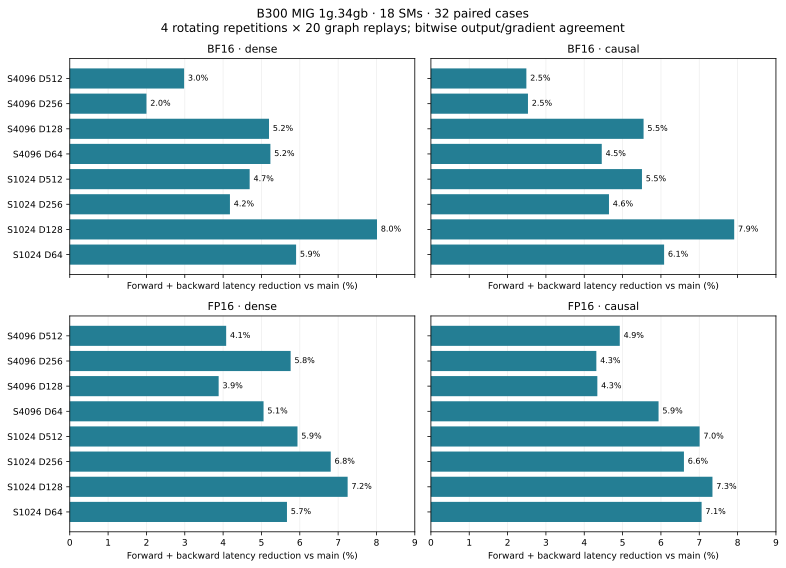
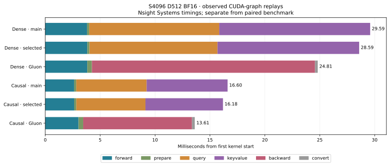
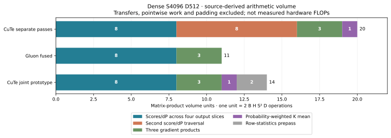

# Blackwell backward register pressure

The 128-column backward workers previously loaded both 64-column output
accumulators into registers together. At the CTA's register limit, this produced
local-memory spills. The selected implementation reads each accumulator in
32-column windows, and the key/value epilogue reads V after storing K.
Packed probabilities are constructed after the raw-score barrier in two
16-column windows instead of remaining live during reconstruction.

The implementation retains FP32 probabilities for dS, the full centered
correction, single-owner gradients, and the existing workspace and dispatch.
The 64-column backward path retains its preceding packing and epilogue.

## Paired timings and precision

Baseline is merged main `e44d114bd1db64eabadd3e8ca5fe419d82d58fff` (PR #16).
Device is the existing **B300 MIG 1g.34gb, 18 SMs**. B=1/H=16,
S=1024/4096, D=64/128/256/512, FP16/BF16, dense and token-causal.
Each case rotates main, candidate and pinned Gluon for four repetitions of
20 CUDA-graph replays. Compilation is excluded. Times below are milliseconds
for **forward plus backward**, including forward.

All **32 cases** have lower median total latency, by **2.0–8.0%**.
All **384 samples** check SDPA and verify captured outputs/gradients against
eager execution. All **128 candidate samples** match main outputs and all three
gradients at zero tolerance. The separate tail/GQA/signed-scale probe checks
both input types against FP64 and requires bitwise main agreement.

| Format | Tokens | D | Causal | Main | Selected | Gluon | Lower latency |
| --- | ---: | ---: | :---: | ---: | ---: | ---: | ---: |
| BF16 | 4096 | 64 | no | 3.7699 | 3.5726 | 1.9779 | 5.2% |
| BF16 | 4096 | 128 | no | 4.7204 | 4.4751 | 3.3706 | 5.2% |
| BF16 | 4096 | 256 | no | 9.9434 | 9.7445 | 7.7442 | 2.0% |
| BF16 | 4096 | 512 | no | 29.6360 | 28.7521 | 24.8142 | 3.0% |
| BF16 | 4096 | 64 | yes | 2.3161 | 2.2129 | 1.1429 | 4.5% |
| BF16 | 4096 | 128 | yes | 2.9668 | 2.8022 | 2.1067 | 5.5% |
| BF16 | 4096 | 256 | yes | 5.9776 | 5.8262 | 4.8676 | 2.5% |
| BF16 | 4096 | 512 | yes | 16.8629 | 16.4429 | 13.6534 | 2.5% |

[BF16 dense](paired-bf16-dense.json), [BF16 causal](paired-bf16-causal.json),
[FP16 dense](paired-fp16-dense.json), [FP16 causal](paired-fp16-causal.json),
[all medians](comparison-summary.json), [FP64 tail/GQA probe](tails-gqa-signed-probe.json).

Gluon remains faster overall. These measurements do not establish full-device
B200/B300 performance. The B200 common-backward PTX is checked by offline
assembly; there is no physical B200 execution or performance claim.



## Emitted code and profiling

The [assembly summary](assembly-summary.json) records per-dimension PTX sites,
cubin resources and SASS local-load/store sites. Complete PTX, cubins and SASS
for both implementations, plus pinned Gluon D512 assembly, are in the raw archive.
Static instruction sites and stack allocation are compiler observations;
they are not dynamic memory-traffic or stall measurements.

BF16 S4096 compiled backward resources. Stack sizes are bytes; registers are per thread.

| D | dQ stack, main → selected | dK/dV stack | dQ registers | dK/dV registers |
| ---: | ---: | ---: | ---: | ---: |
| 64 | 80 → 0 | 128 → 0 | 168 → 156 | 168 → 136 |
| 128 | 208 → 0 | 328 → 0 | 168 → 160 | 168 → 160 |
| 256 | 224 → 0 | 192 → 0 | 168 → 168 | 168 → 148 |
| 512 | 240 → 0 | 264 → 0 | 168 → 162 | 168 → 150 |

All eight selected backward entries have zero SASS local-load/store instruction
sites. All four common-backward modules assemble for SM100 offline.

Fresh [Nsight Systems timelines](kernel-timeline.json) compare dense and causal
D512 graph replays with main and Gluon. These are separately profiled timings,
not additional samples of the unprofiled paired benchmark.
[Barrier summaries](barrier-summary.json) use a separately generated kernel
with matrix-warp clock timers. Those intervals include instrumentation overhead
and do not measure whole-kernel utilization. Hardware counters are unavailable
on this host.

| Kernel | Dense main | Dense selected | Causal main | Causal selected |
| --- | ---: | ---: | ---: | ---: |
| dQ | 11.9147 | 11.6630 | 6.4064 | 6.3001 |
| dK/dV | 13.4264 | 12.6894 | 7.3709 | 7.0587 |

Gluon's fused gradient kernel takes 20.3142 ms dense and
9.9454 ms causal in these separate Nsight captures.



## Fused backward experiments

The query-owned joint prototype computes scores and dP for all gradients in one
traversal, with a separate centered-row statistics pass and linear FP32 dK/dV
reduction workspace. Its previous backward-only time was 59.25 ms. Overlapping
16 KiB TMA reduction staging lowers that to 54.95 ms. Streaming output Q/dO
slices frees shared memory for a four-slot operand ring, reducing it further
to **39.90 ms**. The selected separate passes take about **24.99 ms** in the
same direct backward-only probe, so the joint path is excluded from production.
These joint pilots check random BF16 dense D512 results and graph replay
against SDPA; they have not passed the precision regression suite. Its captured
gradient entry also has zero compiled stack allocation; raw joint PTX/cubin/SASS
are retained in the archive. The query-owned prototype globally reduces both
dK and dV for each query tile; Gluon keeps dK/dV within the CTA and globally
reduces dQ partials.

A separate [joint Nsight profile](joint-profile-summary.json) locates the row
statistics, fused gradient and conversion stages. The
[instrumented joint probe](joint-streamed4-timers.json) records substantial
matrix-role waits for operands and for gradient partials to be read out before
reusing their TMEM storage. For the first output slice, median clock intervals
are 208,218 cycles for operand readiness, 157,825 for partial readout, and
76,008 for pointwise readiness, within a 576,632-cycle matrix-role interval.
These instrumented intervals cannot be treated as hardware stall percentages.

Gluon's key-owned schedule is directly available in
[upstream sm100/bwd.py](https://github.com/KohakuBlueleaf/KohakuFA/blob/0c5ede6859307bedc0c6089523c16b1ca51b7da9/src/kohakufa/sm100/bwd.py).
It shares scores/dP across dQ, dK and dV and reduces FP32 dQ partials.

[Analytical matrix-product accounting](work-counts.json) makes the remaining
work-sharing difference explicit for dense S4096/D512. One unit is a complete
`2 B H S² D` product volume; padding, pointwise work and transfers are excluded.
The selected separate passes perform 20 units, Gluon's fused schedule performs
11, and the query-owned joint prototype performs 14 including its row-statistics
prepass. Of the selected path's nine extra units relative to Gluon, eight are
recomputed QK/dP products and one is the probability-weighted K mean. This is
source-derived arithmetic volume, not measured hardware FLOPs.



Other controls are retained in [the trial index](exploratory-trials.json):

- Delaying packed P gives a further 0.15–0.53% reduction over the narrow output
  windows in four D512 isolation cases; [dense](packlate-isolation-dense.json)
  and [causal](packlate-isolation-causal.json) retain every sample.
- Caching the query pass's output K slice gives a small pilot change and requires
  more shared memory. It is excluded.
- 128-wide backward transfers, shared-memory dS, and removing padding warps do
  not improve the selected path. They are excluded.
- A first 32-wide transfer trial used an undersized output staging tile and
  failed correctness. Its separately frozen corrected variant passes bitwise
  checks but takes 40.90 ms, so it is excluded.
- Wider joint reduction windows regress or fail register allocation. Only the
  executed, correctness-passing timings above are used as performance evidence.

## Validation and reproduction

[Validation](validation.json) records the CPU checks, six GPU regression methods,
source hashes and offline [SM100 backward assembly checks](sm100-legality.json).
The GPU methods exercise FP16/BF16, GQA, tails, negative/zero scales, saturated
softmax, changed graph inputs, checked probability reconstruction, cancellation
and zero covariance. [GPU log](gpu-tests.log), [CPU log](cpu-tests.log).

Torch 2.12.0+cu130, Triton 3.7.0, CuTe DSL 4.8.1. Upstream KohakuFA is pinned
at `0c5ede6859307bedc0c6089523c16b1ca51b7da9`; the saved per-dimension B300
[tuning tables](../blackwell-codegen/tuning) are used. [Runtime source](source.json).

```bash
git show e44d114:src/kohakufa_cute/blackwell_pipeline.py > artifacts/main-blackwell.py
python -m benchmarks.compare_blackwell_codegen \
  --baseline-source artifacts/main-blackwell.py \
  --kohakufa-tuning results/blackwell-codegen/tuning/b300-gluon-d64.json \
    results/blackwell-codegen/tuning/b300-gluon-d128.json \
    results/blackwell-codegen/tuning/b300-gluon-d256.json \
    results/blackwell-codegen/tuning/b300-gluon-d512.json \
  --dtype bf16 --bitwise --output artifacts/backward-bf16-dense.json
```

Repeat for FP16 and with `--causal`. The benchmark checks graph outputs against
eager execution and main, as well as SDPA.

The [artifact receipt](artifact-receipt.json) records the downloaded raw archive
and its manifest verification. `selected-source` is the measured implementation;
`selected` contains final measurements, regressions, complete emitted code and
Nsight captures. Pilot source snapshots, timers, drivers and rejected results
are retained separately. The selected source matches this checkout byte for byte.
