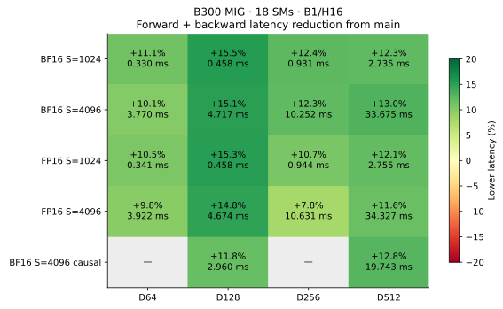
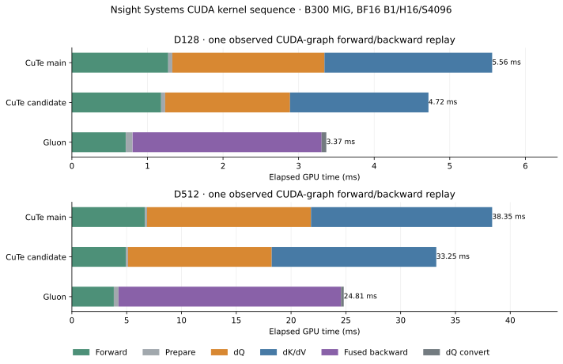

# Blackwell code generation and tensor-memory dS

The production implementation reduces forward-plus-backward latency in all 18
paired cases by **7.8–15.5%** against main `3a398da`. Measurements use the existing
B300 MIG 1g.34gb: **18 SMs**, BF16/FP16, B=1/H=16, S=1024/4096, and
D=64/128/256/512. Two additional BF16 cases use token-causal S=4096 at D128/D512.
These are partition measurements; no full-device B200/B300 timing is claimed.

Runtime source byte-matches `6b331c6`. Gluon is unmodified KohakuFA
`0c5ede6859307bedc0c6089523c16b1ca51b7da9`, using the saved device-specific
[tuning tables](tuning). The environment is Torch 2.12.0+cu130, Triton 3.7.0,
and CuTe DSL 4.8.1.

## Changes

- Probability reconstruction and the fused consumers' dS arithmetic use paired
  FP32 operations. The scalar rounding order and FP32 probabilities are retained.
- Resident D128 backward uses 128-wide operand chunks and gradient products on
  128-column tiles. The epilogue still reads and stores 64 columns at a time.
  Streamed heads retain 64-wide transfers.
- Streamed 128-column, 128-wide backward packs rounded dS over the consumed dP
  allocation in tensor memory. The gradient product runs before the next dP
  overwrites that allocation; the loader follows the same operand order. This
  removes the 32 KiB shared dS buffer and permits six transfer slots instead of
  five, at the same **201,728 dynamic shared bytes** per CTA.
- Forward reuses one FP32 row reciprocal instead of dividing every output
  element. Wide forward output slices also use paired probability arithmetic.
  Reusing the reciprocal can change final output rounding; it does not replace
  the reciprocal with a lower-precision approximation.

The query centering residual, rounded-dS correction, and separate ownership of
dQ and dK/dV are retained. Explicit register redistribution is excluded: the
tested budgets either failed assembly or increased latency.

## Paired measurements

Rotate baseline, candidate, and Gluon on identical seeded inputs for four
repetitions, with 20 CUDA-graph replays per measurement. Every output and gradient
is checked against SDPA, and graph results are checked against eager execution.
The host wrapper and dispatch table are shared between baseline and candidate;
the baseline imports the pinned Blackwell source and retains its 64-wide
resident operands.

BF16 B=1/H=16/S=4096, milliseconds including forward:

| D | Main | Candidate | Lower latency | Gluon |
| --- | ---: | ---: | ---: | ---: |
| 64 | 4.1924 | 3.7701 | 10.1% | 1.9808 |
| 128 | 5.5563 | 4.7166 | 15.1% | 3.3701 |
| 256 | 11.6911 | 10.2516 | 12.3% | 7.8095 |
| 512 | 38.7051 | 33.6753 | 13.0% | 24.9089 |

D512 forward alone falls from 6.6313 to 4.8902 ms. Gluon remains faster overall;
this change reduces the gap without dropping the centered backward calculation.



Primary reports: [BF16](paired-bf16.json), [FP16](paired-fp16.json),
[BF16 causal](paired-bf16-causal.json), and the
[compact comparison](comparison-summary.json). There are **216 graph-verified
paired samples** across the 18 cases.

## Generated code and Nsight evidence

Complete PTX, cubins, SASS, and resource dumps were captured for **baseline,
candidate, and Gluon**, including forward and every backward component, at D128
and D512. All six captures passed output/gradient validation. The archive
contains 24 kernel entry points.

The [assembly summary](assembly-summary.json) confirms:

- D128 Query and KeyValue each have 48 static `tcgen05.mma` sites, down from 64,
  with the wider products. These are emitted sites, not dynamic work counts.
- Paired FP32 operations appear in both backward kernels. D512 forward also
  gains paired exponent arithmetic.
- The 128/D512 forward kernels' 128/256 static per-element `div.rn.f32` sites
  disappear after row-inverse reuse.
- Streamed backward emits an additional packed TMEM store for dS. Its shared dS
  stores are removed; shared stores for statistics and output staging remain.

Nsight Systems confirms the same 384-thread CTAs, 168-register launch allocation,
and 201,728-byte dynamic shared allocation for both backward variants. The
[kernel activity records](kernel-timeline.json) show lower dQ and dK/dV durations,
in addition to the forward improvement. The diagram uses one actual replay
closest to the median observed span, rather than assembling a synthetic timeline
from independently measured stage medians. Profiling timings are separate from
the unprofiled paired benchmark above.



Stack accesses remain in SASS. For example, D512 Query's cubin frame grows from
176 to 256 bytes even though its measured latency falls. Static local-byte
metadata, frame sizes, and instruction-site counts do not measure executed spill
traffic or its cost. No hardware-counter stall or bandwidth attribution is made.

Both captured backward PTX modules also
[assemble for sm_100a offline](sm100-legality.json). That checks instruction
legality, not B200 execution or performance.

## Precision and validation

Four parametrized GPU regression methods passed in **484.589 seconds**, covering
BF16/FP16, causal attention, tails, GQA, signed/zero scales, saturated nonzero
gradients, changed CUDA-graph inputs, and checked-reconstruction equivalence.
[Test log](tests.log).

With forward held at its baseline source, the new backward matches baseline
outputs and all gradients at zero tolerance for BF16/FP16 D128/D512 at S=4096.
These four cases add 12 graph-verified control samples:
[BF16](bitwise-bf16.json), [FP16](bitwise-fp16.json).
Whole-implementation bitwise agreement is not claimed after changing forward's
normalization rounding. The full implementation passes the existing FP64
precision and saturation gates. [Validation record](validation.json).

The pinned Gluon implementation was also run on this repository's saturated
fixture. At D128 and D512, it produces negative dQ where the centered FP64
reference is positive, for both BF16 and FP16. For example, BF16 minimum dQ is
`-3.47284e-20` versus `+3.47175e-20`; FP16 is `-5.73397e-5` versus
`+0.00163173`. [Raw comparison](gluon-saturation.json).
This fixture explains why the direct upstream dS calculation cannot replace
the centered path under the current precision gates. It does not invalidate
the random-input speed measurements or establish an irreducible performance gap.

## Excluded experiments

The [exploratory records](exploratory-trials.json) and raw archive preserve all
executed sources, drivers, samples, profiles, and failures. None of the following
is enabled in production:

- Direct `setmaxnreg` budgets: 232/32 and 216/64 failed assembly. Feasible
  208/88 and 200/104 budgets increased D128 forward/backward from about 5.56 ms
  to 7.88/6.80 ms and also regressed D512.
- Chunking probability and dP work together reduced live state but raised D128
  latency to about 6.40 ms and D512 to 43.30 ms.
- A SIMT output/dO row-dot preparation kernel was slower than the existing
  tensor-core preparation.
- 128-wide streamed transfers and products regressed D512 to about 49.24 ms;
  the wider operand policy is restricted to resident D128.
- Wider forward transfers and caching a K output slice for both query products
  were slower than the selected variants. With tensor-memory dS on both
  backward kernels, K caching raised D512 from about 35.39 to 36.25 ms.

These results are why matching Gluon's register counts or a single buffer size
is not used as the acceptance criterion. The selected dataflow is measured with
the production source and its precision contract.

## Reproduction and artifacts

Place the pinned upstream repository on `PYTHONPATH`, alongside this project's
`src`, then export the baseline source:

```bash
git show 3a398da:src/kohakufa_cute/blackwell_pipeline.py > artifacts/blackwell-baseline.py
python -m benchmarks.compare_blackwell_codegen \
  --baseline-source artifacts/blackwell-baseline.py \
  --kohakufa-tuning results/blackwell-codegen/tuning/b300-gluon-d64.json \
    results/blackwell-codegen/tuning/b300-gluon-d128.json \
    results/blackwell-codegen/tuning/b300-gluon-d256.json \
    results/blackwell-codegen/tuning/b300-gluon-d512.json \
  --dtype bf16 --output artifacts/paired-bf16.json
python -m benchmarks.dump_blackwell_assembly \
  --backend cute --dim 512 --output artifacts/cute-d512
python -m benchmarks.dump_blackwell_assembly \
  --backend gluon --dim 512 \
  --kohakufa-tuning results/blackwell-codegen/tuning/b300-gluon-d512.json \
  --output artifacts/gluon-d512
```

The capture tool creates the dump directory before compilation and validates
actual PTX/ELF payloads, rather than accepting missing artifact-path strings.
Add `--baseline-source` to capture the baseline CuTe implementation.

The verified raw archive is
`KohakuFA-CuTe-artifacts/2026-10-20-blackwell-codegen/kohakufa-blackwell-codegen-20261020.tar.gz`:
**6,455,569 bytes**, SHA256
`4aac645595fcbcd470fbf04a2e1522afcc087328a720e4a59769521746fd6aa2`.
All **393 files** were checked locally; all nine runtime source files also
byte-match the runtime commit. [Provenance and published-file hashes](provenance.json).
