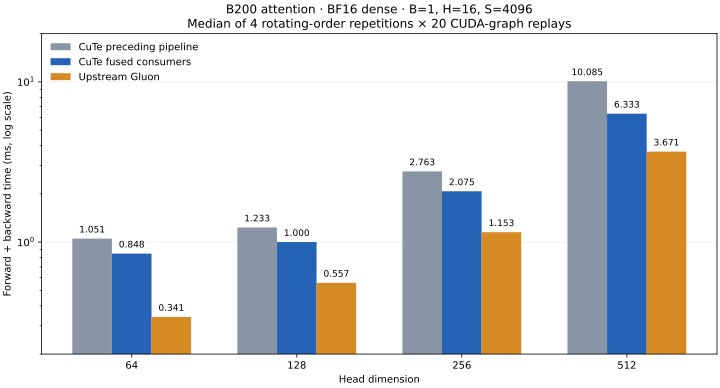

# B200 fused 128-column backward

This extends the [shared Blackwell pipeline](../blackwell-pipeline/README.md)
with KohakuFA's 128-column ALIAS worker arrangement. The architectural reference
is upstream [backward.py](https://github.com/KohakuBlueleaf/KohakuFA/blob/0c5ede6859307bedc0c6089523c16b1ca51b7da9/src/kohakufa/sm100/bwd.py),
pinned to the same revision as the preceding measurements.

## Implementation

Two four-warp consumer groups each own 64 columns of a 128-by-128 score tile.
Each computes both probabilities and dS, keeping its probabilities in FP32
registers until dS is finished. Packed P aliases consumed S in TMEM; both groups
must finish reading S before either writes packed P. The matrix warp waits for
the final P product before issuing the next score into the aliased storage.

D64/D128 retain resident stationary operands. The wider B operand requires five
paired streaming slots for D256/D512. A single dS slot and, for resident D128,
a single secondary operand slot keep the wider tile within shared-memory limits.
Final staging reuses consumed storage. Each consumer reads dP in two 32-column
chunks, converts each result to the
shared dS operand, and accumulates FP32 and rounded dS sums before releasing dP.
This reduces live FP32 intermediates while retaining all 64 probabilities until
used. The query pass combines both consumer partials before applying its FP32
centering and rounded-dS correction.

Only sm_100 defaults select this implementation. B300 retains the preceding
validated 64-column backward configuration. Forward, explicit-mask fallbacks,
small-sequence thresholds and other architectures retain their preceding choices.
The mathematical centering base and residual remain separate, and P stays FP32
for dS. This change does not replace the correction with a rounded-output delta.

## Measurements

B=1, H=16; S=1024/4096; D=64/128/256/512; BF16 and FP16; dense and token-causal.
Each of the four grids rotates three backends across four repetitions of 20
CUDA-graph replays. Outputs and gradients are checked before timing, and captured
results are checked against eager execution. Compilation is excluded; forward
plus backward includes forward.

`cute-initial` forces the preceding 64-column producer/consumer table on the
same arithmetic helpers and host. It is a paired configuration comparison.
Gluon uses the pinned upstream source, B200 compatibility patch, and existing
per-dimension tuning files recorded in the preceding report. Every sample and
selected configuration is retained in JSON.

Dense BF16, S=4096, forward plus backward milliseconds:

| Head dim | Previous pipeline | Fused consumers | Gluon | Less CuTe time |
| --- | ---: | ---: | ---: | ---: |
| 64 | 1.051 | 0.848 | 0.341 | 19.4% |
| 128 | 1.233 | 1.000 | 0.557 | 18.9% |
| 256 | 2.763 | 2.075 | 1.153 | 24.9% |
| 512 | 10.085 | 6.333 | 3.671 | 37.2% |

All 32 paired cases have lower median total time, by 4.6–41.2%. Gluon remains faster overall.



The short-sequence experiment in `n128-fused-crossover.json` compares forced
pipeline configurations, including below the production crossover. It does not
justify moving the production threshold, where the actual baseline may be the
legacy stage table.

## Precision and validation

All 40 S=1024/H=2 precision cases produce finite outputs and gradients: two input
dtypes, four dimensions and five logit scales from 10 to 1e7. The preceding
pipeline reports use identical rounded inputs: maximum logits and FP64 reference
norms match exactly. Across outputs and Q/K/V gradients, the largest increase in
relative error is 9.56e-08. The complete comparison is in
`precision-comparison.json`. The preceding report's limitations at extreme
logits still apply; these are not exact FP64 score calculations.

The final full GPU suite contains 64 tests, including a new forced-fused
saturated-gradient regression for all four dimensions and both input dtypes.
Regression tests force both the preceding and fused pipelines. They cover
FP16/BF16, GQA, tails that cross ring phases, positive/negative/zero scales,
changed inputs and dO during graph replay, dynamic-length dispatch, compiled
backward, saturated gradients and training.

The final full GPU suite passed: 60 passed and four skipped (MPS, two B300-only
checks and the optional plot test). Local CPU tests passed: 21 passed and 43
skipped. Package builds and GitHub CPU/package CI pass. `validation.json` and the
unabridged GPU test log record the results. All 18 tracked runtime/test source
files match the frozen kernel/test reference byte for byte.

## Experiments and remaining gap

A direct 128-column port that kept all P/dS values in one worker raised register
pressure and ran slower. Chunking P and dP reduced that overhead, but the fused
64-column consumer groups produced the measured improvement. A separate forward
experiment read softmax values in 32-column chunks and used three score slots
for narrow heads. Its extra TMEM traffic did not give a consistent forward win;
`fwd-stream-speed.json` records it, and it is excluded from production defaults.
The final dP experiment additionally streamed each consumer's dP in two
32-column chunks. All eight dense BF16 cases improved against full-width dP
loads; this behavior is included in the final kernel. Its controlled comparison
is in `phase2-chunked-dp-speed.json`, with both variants' selected configurations
and every repetition retained. Final reports use the production implementation,
which publishes completed dP reads and dS stores after the same consumer barrier.
Dynamic register redistribution either failed ptxas allocation checks or stalled
at runtime; those trials were stopped and are excluded from the measured path.

A six-slot query stream, made to fit by shrinking the query-only statistics
buffer, passed BF16 normal/saturated checks and FP16/BF16 GQA tails. Six rotating
repetitions of 30 graph replays found less than 0.5% benefit at S=4096 in dense
attention and essentially no change in causal D256. The five-slot layout remains
selected. `phase2-deeper-query-speed.json` keeps the separate compile caches,
per-repetition samples and graph checks for that comparison.

The remaining source-level differences include Gluon's persistent forward grid,
K/V reuse across two query halves and fused Q/K/V backward products with FP32 dQ
partial reductions. CuTe still runs separate query and key/value passes and
retains its additional centered residual correction. These differences guide
further work; this host denied hardware-counter access, so no counter-based
bottleneck claim is made.

## Reproduction

```bash
python -m benchmarks.speed --dtype bf16 --seq 1024 4096 --dim 64 128 256 512 \
  --iterations 20 --repeats 4 --backends cute-initial cute kohakufa \
  --initial-cute-configurations results/blackwell-fused-backward/phase2-initial-configurations.json \
  --kohakufa-tuning results/b200-gluon-d64.json results/b200-gluon-d128.json \
    results/b200-gluon-d256.json results/b200-gluon-d512.json \
  --output artifacts/b200-fused-speed.json
python -m benchmarks.precision --dtype bf16 --seq 1024 --dim 128 \
  --backends kohakufa-cute --output artifacts/b200-fused-precision.json
```

Repeat with `--dtype fp16` and/or `--causal` for the other timing grids.
`provenance.json` records runtime source fingerprints and the archived experiment
sources and measurements. Experimental reports are evidence for their individual
variants, not additional samples of the production candidate.
