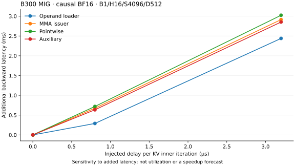
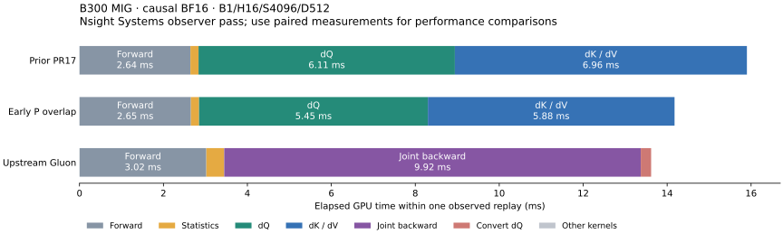
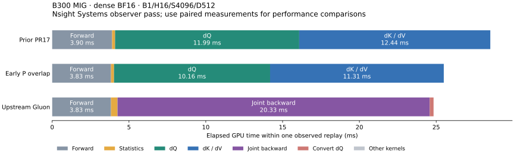
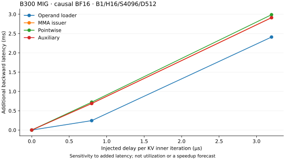

# Probability overlap from controlled latency interventions

Follow-up: [vectorized gradient staging and shorter-length dispatch](../blackwell-vector-readout-profiling/README.md) remove the remaining selected backward spills.

The selected implementation measures **9.1–11.9% lower forward-plus-backward
latency** in all 12 targeted dense/causal BF16 D512 cases versus PR17 `cbd83c8`.
At B1/H16/S8192 causal, CuTe takes **51.85042 ms**, versus **51.28219 ms** for
Gluon: a **1.1% end-to-end gap**. Smaller shapes retain larger gaps.

Measured on October 21 UTC, using the existing **18-SM B300 MIG 1g.34gb**.
These results do not establish physical B200 or full-device B300 performance.
[Sources and versions](source.json) pin unmodified upstream KohakuFA
`0c5ede6859307bedc0c6089523c16b1ca51b7da9`, executed tuning configurations and
all ten runtime file hashes.

## A different profiling method

Instead of summing barrier waits, this experiment adds controlled latency at
four KV handoffs. A device tensor supplies 0/800/3200 ns to a busy wait, so each
role uses **the same compiled graph at every delay level**. One leader waits per
iteration at the following sites:

* Operand loader: before the first paired transfer of an inner iteration.
* MMA issuer: after prior auxiliary release, before the first QK chunk.
* Pointwise: immediately before signaling that P/dS operands are ready.
* Auxiliary: each half's leader, immediately before releasing its TMEM partial.

Every gradient must remain bitwise equal to production before and after timing.
Five rotated repeats of twenty replays give 65 samples per source snapshot.
A sampled device timer confirms the requested waits; it does not measure every
CTA. Each role's zero-delay timing is its control. Added reads, timer instructions,
branches and register lifetimes affect code generation even at zero delay.

| Role | Extra backward ms at 800 ns | At 3200 ns | Zero-delay change vs original |
|---|---:|---:|---:|
| Operand loader | 0.28962 | 2.43905 | −0.22% |
| MMA issuer | 0.67516 | 2.91438 | +0.57% |
| Pointwise | 0.71886 | 3.02403 | −0.60% |
| Auxiliary | 0.63493 | 2.85326 | +2.97% |



The loader hides more added latency at this site. Late pointwise completion and
auxiliary release are much more exposed. These are **sensitivity measurements at
specific handoffs**, not payload durations, accelerator utilization, hardware stall
percentages, or a forecast that removing 800 ns will save the same time.
[Before measurements](sensitivity-before.json).

## Two changes that the measurements led to

**Shorten dV's register lifetime.** SASS inspection places most of the original
KV spills in the auxiliary consumer region. Its epilogue keeps all 128 FP32 dV
values live while loading/storing dK. Export dV first, then read out dK, allowing
those registers to die earlier. The first native pilot improves **15.85568 →
15.61734 ms F+B**, with bitwise-equal results. Its stack frame drops from
**264 to 24 bytes**, and static spill sites from **153 LDL / 88 STL to 12 / 11**.

**Reconstruct all P while dP runs.** Previously, only the first 16-column P window
ran before waiting for dP; the other seven windows followed that wait. Reconstruct
the complete P tile into the consumed score area of TMEM first. After dP completes,
reread **FP32 P** to construct dS. The separately rounded shared P remains the
matrix operand. This adds an on-chip TMEM round trip without a global P workspace.
It preserves the full centered/P-weighted-key correction and the order of row sums.

The selected implementation retains explicit TMEM store completion before the
subsequent loads, following the non-pipelined store/load synchronization pattern
in the [NVIDIA PTX specification](https://docs.nvidia.com/cuda/parallel-thread-execution/).
The source and emitted PTX/SASS are retained in the archive.

Applying the overlap first to KV and then to both passes gives successive pilot
improvements. Register-budget sweeps and a deferred-store-wait variant offer no
reliable additional gain over **80/184/64 registers** with the existing per-window
store waits. Those original budgets and waits are retained. A 144-register
prototype failed with an illegal instruction; its restoration used the wrong
register-change direction. The incomplete run is excluded from timing evidence.
[Complete pilot comparisons](pilot-summary.json).

## Paired production measurements

Identical inputs; rotated previous-runtime/current-runtime/Gluon order; four
repeats of twenty CUDA-graph replays. All outputs and gradients are checked
against SDPA; graph results are checked against eager. Times include **forward
and backward**, in milliseconds. All selected rows use BF16 D512.

| Mask | B | H | S | Prior PR17 | Current | Gluon | Latency lower |
|---|---:|---:|---:|---:|---:|---:|---:|
| causal | 1 | 16 | 2048 | 4.68975 | 4.20496 | 3.67834 | 10.34% |
| causal | 1 | 16 | 4096 | 15.86420 | 14.14381 | 13.67092 | 10.84% |
| causal | 1 | 16 | 8192 | 57.87034 | 51.85042 | 51.28219 | 10.40% |
| causal | 1 | 8 | 2048 | 2.39218 | 2.14312 | 1.85061 | 10.41% |
| causal | 1 | 8 | 4096 | 7.97813 | 7.11331 | 6.76605 | 10.84% |
| causal | 2 | 8 | 2048 | 4.69654 | 4.21641 | 3.67786 | 10.22% |
| dense | 1 | 16 | 2048 | 7.62555 | 6.71527 | 5.87357 | 11.94% |
| dense | 1 | 16 | 4096 | 28.52068 | 25.64700 | 24.91182 | 10.08% |
| dense | 1 | 16 | 8192 | 115.34927 | 102.94912 | 99.35748 | 10.75% |
| dense | 1 | 8 | 2048 | 3.90540 | 3.47896 | 3.00161 | 10.92% |
| dense | 1 | 8 | 4096 | 14.34830 | 13.04154 | 12.46699 | 9.11% |
| dense | 2 | 8 | 2048 | 7.62710 | 6.72646 | 5.87260 | 11.81% |

[All 20 cases](comparison-summary.json) include S1024 and six D256/FP16 controls.
The eight unchanged-path cases vary by at most 0.19%. The comparison driver now
accepts a frozen auxiliary module as well as frozen kernels: replacing just the
kernel factory would otherwise share the modified auxiliary with the baseline.

The improved wide kernel now qualifies for **dense as well as causal** attention:
SM103, unmasked BF16 D512 MHA, at least eight batch-heads, equal sequence lengths
≥2048, and default configurations. Runtime checks retain cache reuse across
lengths and projection strides. Shorter/unequal lengths, GQA, FP16, other head
dimensions and SM100 retain their existing paths; explicit profiling sources are
still honored.

The causal predecessor already used 12 source-derived matrix-product units, so
its gain comes from scheduling/lifetime changes. Dense previously used the
20-unit narrow path; its gain includes enabling the improved 12-unit path.
Gluon uses 11 units. This accounting excludes pointwise work, transfers and
padding. Earlier PR17 gains and these separate comparisons should not be added.

## Fresh timelines and remaining costs





Separate Nsight Systems observer passes give the following median kernel times:

| Mask | Kernel | Prior PR17 ms | Current ms |
|---|---|---:|---:|
| causal | dQ | 6.10413 | 5.45539 |
| causal | dK/dV | 6.95852 | 5.87531 |
| dense | dQ | 11.98965 | 10.15573 |
| dense | dK/dV | 12.44749 | 11.30771 |

Gluon's joint backward takes **9.90843 ms causal** and **20.32941 ms dense**.
CuTe's two causal backward kernels still total about **11.33 ms** here; its
forward and Gluon's preparation/conversion also affect the end-to-end comparison.
These observer-pass medians are not the paired performance results above.
The diagrams choose one observed replay per backend and retain every graph
kernel, including initialization. Gaps do not establish accelerator idle time.
[Full timelines and resources](kernel-timeline.json).

The selected dQ has zero stack and zero static LDL/STL sites. KV retains
**24 stack bytes and 10/10 LDL/STL sites causal**, and **80 bytes and 16/22 sites
dense**. The entry allocation is 128 registers; role-local allocations differ.
Ten PTX register requests still emit ten SASS register-change instructions.
Dynamic shared memory stays at 232448 bytes per wide CTA.
[Compiled resources](assembly-summary.json).

Repeating the delay experiment on the selected runtime gives an extra
**0.24394 ms loader / 0.68818 ms MMA / 0.72223 ms pointwise / 0.68773 ms auxiliary**
at 800 ns. Zero-delay overhead now ranges from +0.16% to +3.10%, reported
separately. Late handoffs remain exposed, while the loader hides more delay.
These probes guide subsequent experiments without assigning remaining time to
unmeasured hardware stalls. [After measurements](sensitivity-after.json).



## Validation and artifacts

* **240 graph-verified paired samples** across 20 cases, including 52 enforced
  bitwise candidate evaluations. All causal output/gradient evaluations in this
  comparison are bitwise equal to the preceding runtime.
* **12 centered-FP64 precision cases**, dense/causal H8/S2048/D512 BF16, seeds
  0/21 and logit scales 10/1e3/1e6. Relative L2 and per-row p99 errors stay within
  5% plus 1e-6 of the control; finite and representable nonzero gradients remain.
  Dense accumulation order differs from its former narrow path; causal remains
  bitwise equal. [Errors, norms and counts](precision.json).
* Three expanded GPU regression methods pass in both mask modes: cache reuse
  across S512/1024/2048/2049, unequal lengths and projection strides; changed-input
  graph replay against FP64; and exact zero covariance with signed/zero scales.
* 25 CPU checks: 23 pass, two skip. Python syntax, Black/isort, wheel/sdist builds
  and runtime byte checks pass. [Validation records](validation.json).
* Common backward PTX assembles offline for SM100 in both mask modes. SM100
  dispatch is unchanged, with no physical B200 measurement. [Legality](sm100-legality.json).

GPU jobs ran serially against frozen sources. The manifest-verified raw archive
`KohakuFA-CuTe-artifacts/2026-10-21-intervention/kohakufa-intervention-evidence-20261021.tar.gz`
contains successful and failed pilots, exact runtime/test/profiler sources,
before/after dynamic-delay samples, paired/FP64 reports, PTX/cubins/SASS and raw
NSYS/SQLite captures. [Verified archive receipt](artifact-receipt.json).

## Reproduce

With CUDA dependencies installed and the pinned upstream checkout on `PYTHONPATH`:

```bash
git show cbd83c8:src/kohakufa_cute/kernels.py > artifacts/pr17-kernels.py
git show cbd83c8:src/kohakufa_cute/blackwell_register_aux.py > artifacts/pr17-aux.py
python -m benchmarks.compare_blackwell_native \
  --baseline-kernels artifacts/pr17-kernels.py --baseline-register-aux artifacts/pr17-aux.py \
  --kohakufa-tuning results/blackwell-codegen/tuning/b300-gluon-d512.json \
  --seq 1024 2048 4096 8192 --dim 512 --causal --bitwise --output artifacts/paired.json
python -m benchmarks.instrument_blackwell_delay \
  --source src/kohakufa_cute/blackwell_register_aux.py --output artifacts/role-probe
python -m benchmarks.measure_blackwell_sensitivity \
  --source artifacts/delay-{loader,mma,pointwise,auxiliary}.py \
  --output artifacts/sensitivity.json
```

Generated delay modules are diagnostics for the profiler's workspace argument;
they must not replace production kernels. Freeze each source before execution.
The archive retains session wrappers that reuse a byte-identical native extension
build. The initial raw prototype recorded a stale timer field on baseline rows;
that field is marked N/A in the published before report. Timing samples are
unchanged; the reusable driver clears the field and records N/A correctly.
