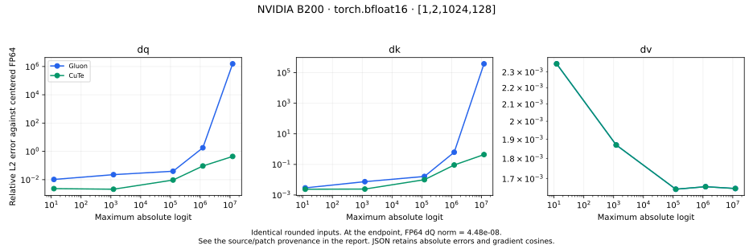
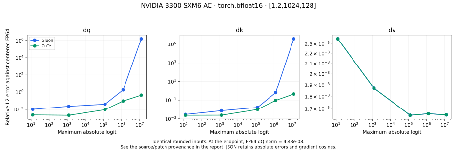

# Shared Blackwell producer/consumer pipeline

This CuTe port takes its scheduling architecture from the original KohakuFA
[forward](https://github.com/KohakuBlueleaf/KohakuFA/blob/0c5ede6859307bedc0c6089523c16b1ca51b7da9/src/kohakufa/sm100/fwd.py)
and [backward](https://github.com/KohakuBlueleaf/KohakuFA/blob/0c5ede6859307bedc0c6089523c16b1ca51b7da9/src/kohakufa/sm100/bwd.py)
kernels. Both references are pinned to `0c5ede6859307bedc0c6089523c16b1ca51b7da9`.
The comparison installs that checkout separately, using the recorded
[B200 compatibility patch](../b200-upstream-sm100.patch) on sm_100 and unmodified
upstream source on sm_103. Each GPU uses its previously measured Gluon tables.

## What was ported

A CTA has separate four-warp softmax/P and correction/dS workers, one TMA loader
warp, and one matrix warp. Two padding warps complete the third warp group.
Mbarriers coordinate ownership; shared operand slots are released by tensor-core
completion rather than by a CTA-wide wait between every product.

Forward writes packed probabilities over consumed score slots in tensor memory.
PV consumes P directly from TMEM, and output correction works on 64-column chunks.
A two-slot score stream overlaps QK, softmax, PV and rescaling. Q remains resident;
64-column K/V boxes move through a four-slot shared-memory ring.

Backward overlaps P and dS workers with native tensor-core products. D64/D128
keep stationary operands resident. D256/D512 stream paired A/B operand boxes
through eight slots; final output staging aliases the drained A ring. FP32 P
remains available for centered dS, alongside the packed tensor-core operand.
The query pass retains both the FP32 dS sum and the sum of rounded dS used by the
matrix products, then applies the centered correction after accumulation.

B200 uses ordinary TMEM loads and software row maxima. B300 uses its native
TMEM load/reduction instructions for full forward tiles. Explicit boolean masks
and layouts that cannot use TMA retain their previous paths. Short sequences
retain the previous stage table: the pipeline starts when the larger of the
query/key lengths reaches 1024 for D64, 512 for D128, and 256 for D256/D512.
Both compiled-program cache keys include this class, so dynamic lengths can cross
it without reusing the wrong stage selection.

## Remaining architectural differences

| Detail | Original Gluon | Current CuTe pipeline |
| --- | --- | --- |
| Forward grid | Persistent, can share K/V across two query halves | One 128-row query tile per CTA |
| Backward products | 128 × 128 tiles | 128 × 64 tiles |
| Gradient reuse | Fused dQ/dK/dV, global FP32 dQ partial reductions | Separate query and key/value passes with one owner per output tile |
| Softmax correction | Uses the output/dO delta | Keeps the centering base and FP32 residual separate, then corrects dQ after accumulation |

These are source-level optimization candidates. The timings below establish the
remaining performance gap; the available host denied Nsight Compute hardware
counter access, so no counter-based bottleneck claim is made.

## Measurement protocol

Paired reports use B=1/H=16, S=1024/4096, D=64/128/256/512, BF16 and FP16,
dense and token-causal attention. Each has four repetitions of 20 timed CUDA-graph
replays, with the three backends rotating through the execution order. Outputs
and all gradients are checked against SDPA before timing. Captured outputs and
gradients are checked against eager execution. Separate regression tests mutate
inputs and dO between graph replays and compare output and gradients with FP64.

The `cute-initial` backend runs the previous production stage table on the same
final arithmetic helpers and hardware. It is a configuration comparison, not a
replay of an older checkout. Timing excludes compilation; forward plus backward
includes forward. Raw reports retain every sample and selected configuration.
Small-sequence crossover reports use three repetitions of 30 replays.

Precision reports use identical rounded inputs, a centered analytical FP64
reference, and logit scales from 10 through 1e7. Always read tiny-gradient relative
errors together with the reference norm, absolute error and cosine retained in
JSON. A large relative error against an almost-zero norm is not an ordinary-logit
accuracy result.

## Paired dense BF16 results

S=4096, B=1/H=16, forward plus backward milliseconds, including forward:

| GPU | Head dim | Previous CuTe | Pipeline | Gluon | CuTe speedup |
| --- | ---: | ---: | ---: | ---: | ---: |
| B200 | 64 | 1.420 | 1.055 | 0.342 | 1.35× |
| B200 | 128 | 2.516 | 1.237 | 0.555 | 2.03× |
| B200 | 256 | 5.727 | 2.740 | 1.145 | 2.09× |
| B200 | 512 | 27.623 | 10.098 | 3.648 | 2.74× |
| B300 | 64 | 1.228 | 0.925 | 0.292 | 1.33× |
| B300 | 128 | 2.104 | 1.103 | 0.493 | 1.91× |
| B300 | 256 | 4.654 | 2.482 | 1.074 | 1.88× |
| B300 | 512 | 22.145 | 9.658 | 3.400 | 2.29× |


Every case in the four timing reports per GPU improves over the previous CuTe
stage table. The raw JSON records forward separately and includes S=1024, FP16,
and causal measurements. Gluon still wins the overall forward/backward comparison.

## Precision and validation

The 40 CuTe precision cases per GPU (two dtypes, four head widths, five logit
scales) and 40 matching Gluon cases all produce finite outputs and gradients.
Additional BF16 D128/D256/D512 reports run the previous CuTe stage table on the
same seeded S=1024 inputs. Their FP64 reference norms and maximum logits match;
at scales 1e6 and 1e7 the new pipeline's dQ/dK error metrics match the previous
CuTe metrics exactly. The maximum increase in dQ/dK relative error anywhere in
these before/after grids is below 2.4e-6.

These results preserve the previous precision behavior, including its limits.
For example, BF16 D256 at the largest scale has dQ reference norm 1.80e-13 and
relative error 1.086, with cosine above 0.999998 and maximum absolute error
5.27e-14. The corresponding Gluon relative error is about 8.97e11. Keeping the
centering residual prevents much larger spurious gradients; it does not make
FP32 score accumulation exact at arbitrarily large logits.





B200 accounts for all 61 discovered tests: 57 passed and four skipped. Its full
suite reached the 900-second supervisor limit during training checks; a separate
invocation completed all four training tests successfully. B300 completed all 61
in one run: 58 passed and three skipped. The validation JSON records these counts
and the B200 continuation. Coverage includes normal and saturated gradients,
FP16/BF16, aligned projection layouts, tails, GQA, signed/zero scales, masks,
mutable CUDA graphs, dynamic-length cache classes, compilation and training.

Dynamic register-redistribution experiments were excluded after ptxas C7600
allocation failures, including at the 255-register target. The published pipeline
uses its validated register allocation. Failed experiments and the invalidated
initial live-source test invocation remain in the full archives; they are not
performance or correctness evidence for this result set.

## Reproduction and provenance

`b200-initial-configurations.json` and `b300-initial-configurations.json` record
previous stage choices. Install the pinned upstream checkout and apply its
compatibility patch only for B200, then run, for example:

```bash
python -m benchmarks.speed --dtype bf16 --seq 1024 4096 --dim 64 128 256 512 \
  --iterations 20 --repeats 4 --backends cute-initial cute kohakufa \
  --initial-cute-configurations results/blackwell-pipeline/b200-initial-configurations.json \
  --kohakufa-tuning results/b200-gluon-d64.json results/b200-gluon-d128.json \
    results/b200-gluon-d256.json results/b200-gluon-d512.json \
  --output artifacts/b200-pipeline-speed.json
python -m benchmarks.precision --dtype bf16 --seq 1024 --dim 128 \
  --backends kohakufa-cute kohakufa --kohakufa-tuning results/b200-gluon-d128.json \
  --output artifacts/b200-pipeline-precision.json
python -m benchmarks.plot_comparison \
  --speed results/blackwell-pipeline/b200-speed-bf16.json \
  --precision results/blackwell-pipeline/b200-precision-bf16-d128.json \
  --output-prefix artifacts/b200-pipeline
```

Repeat speed with `--dtype fp16` and/or `--causal`. Use the corresponding B300
initial choices and tuning files for sm_103. Precision sweeps default to scales
10, 1e3, 1e5, 1e6 and 1e7. The before/after precision experiment overrides
`kernels.kernel_configuration` with the recorded previous table; its wrapper is
retained in the archives.

Environment, frozen kernel/test hashes, raw samples, upstream source fingerprints,
selected configurations and ordered launch profiles are included alongside the
reports. `provenance.json` records the exact kernel/test reference revisions,
full-archive checksums and per-file result hashes. Timings are controlled paired
comparisons on each host, rather than an isolated hardware comparison between GPUs.
