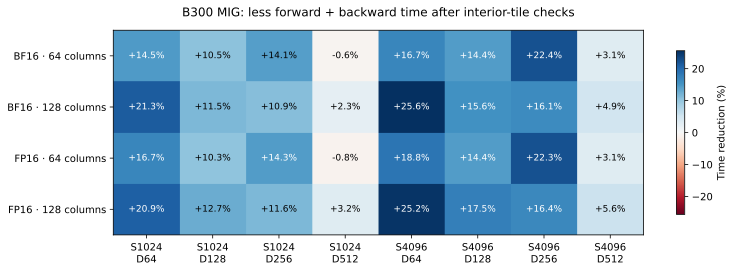
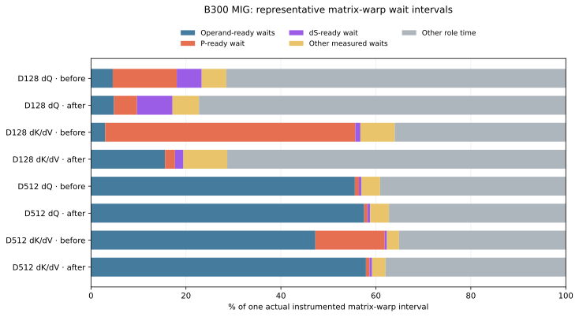

# Blackwell backward probability tiles

Measured October 20, 2026 on a Runpod B300 SXM6 AC MIG 1g.34gb: 18 SMs,
32,749,125,632 usable bytes, sm_103. These are partition measurements; they do
not establish full-B200 or full-B300 speed. The implementation applies to both
Blackwell producer/consumer paths. PyTorch is 2.12.0+cu130, CuTe DSL 4.8.1 and
Triton 3.7.0. Upstream Gluon is unpatched at `0c5ede6859307bedc0c6089523c16b1ca51b7da9`,
using the recorded B300 tuning tables.

## Change

Backward previously checked query/key bounds and causal visibility inside every
probability reconstruction. Classify the whole score tile once. Fully visible
interior tiles use a loop without those per-element predicates; tails and
causal boundaries use the preceding checks. Both the 64-column and 128-column
consumer arrangements share the helper. The FP32 exponent formula, probability
precision, packed operands, centering base/residual, gradient products, buffer
layout, and dispatch tables are unchanged in this optimization.

## Paired performance

B=1/H=16, contiguous BHSD, CUDA graph event milliseconds. The driver rotates
five backends on identical inputs: original/new 64-column table, original/new
128-column table, and Gluon. Each uses four rounds of 20 timed replays, after
warmup. Every round checks output and all gradients against SDPA; each candidate
also matches its own baseline **bit for bit**. Captured outputs/gradients are
checked against eager execution. Separate compilation caches prevent one
variant from reusing another variant's compiled kernel.

BF16 S4096, forward plus backward (including forward), 128-column table on the MIG:

| D | Original CuTe | New CuTe | Gluon | Less CuTe time |
| --- | ---: | ---: | ---: | ---: |
| 64 | 5.6374 | 4.1928 | 1.9761 | 25.6% |
| 128 | 6.5813 | 5.5562 | 3.3707 | 15.6% |
| 256 | 13.7632 | 11.5494 | 7.7511 | 16.1% |
| 512 | 40.3273 | 38.3358 | 24.8099 | 4.9% |

All 18 comparisons with 128-column tiles improve: 16 dense cases across
BF16/FP16, S1024/S4096 and D64/D128/D256/D512 improve by 2.3–25.6%; the two
BF16 S4096 causal cases improve by 7.0–13.6%. Gluon remains faster.

Of the 18 comparisons with the 64-column table, 16 improve. Dense S1024/D512
regresses by 0.62% in BF16 and 0.84% in FP16; this is retained in the reports.
There is no claim that every configuration improves.



Raw paired reports: [BF16](paired-bf16.json), [FP16](paired-fp16.json), and
[BF16 causal](paired-bf16-causal.json). Together they contain 360 graph-verified
timing samples and 144 candidate-versus-baseline bitwise comparisons. Forward
configuration and arithmetic are the same between each original/new pair.

## Measured matrix-warp waits

This host denies Nsight Compute counters (`ERR_NVGPUCTRPERM`, documented in
[the preceding run](../attention-diagnostics/b300-mig/README.md)). The separate
instrumented source times the matrix warp immediately around named mbarrier
wait calls using the SM clock. It does not require performance-counter access.
Both instrumented variants validate output and all gradients against SDPA.
Each capture has four samples; the first is discarded as warmup. D128 has 512
CTAs per backward pass; D512 has 2048.

For D128 dK/dV, median matrix-warp interval falls from 202,703 to 126,413 cycles.
The median fraction inside the P-ready wait falls from 52.3% to 2.2% (105,998
to 2,840 median cycles). The corresponding dQ wait fraction falls from 13.3%
to 4.2%. This directly measures the schedule interval affected by the change;
it is not a measurement of SFU utilization or a hardware stall percentage.

At D512, operand-ready waits remain substantial: about 51.5% of the instrumented
dQ interval and 57.4% of dK/dV after this change. A ready wait includes producer
scheduling, buffer reuse and transfer completion; it does not establish HBM
bandwidth saturation. These intervals guide the next operand-reuse experiments.



The figure uses one actual CTA interval nearest median total time for each row,
with its original component intervals. It never joins unrelated per-field
medians. [Plot data](plot-data.json) records the exact sample/head/tile selection
and raw source-report hashes; [summary](barrier-summary.json) records all median
fields and raw report hashes. Raw per-CTA samples remain in the verified local
artifact archive. Instrumentation changes code and includes timer overhead;
only the uninstrumented paired graph reports above are performance comparisons.

## Nsight Systems and rejected variants

Four Nsight Systems 2026.3.2 captures record original/new kernels at D128/D512,
including Gluon in each capture. CUDA/NVTX graph-node tracing ran without a
nested Torch CUPTI profiler. Raw `.nsys-rep` and SQLite exports are archived.
[Launch-resource records](nsys-launch-resources.json) show 168 registers/thread,
384 threads/block and 201728 dynamic shared bytes for both CuTe backward kernels
before and after at both widths. Static local allocation is zero; this does not
measure spill traffic. The improvement does not depend on reducing launch
resources or changing the number of gradient passes.

The [exploratory records](exploratory-trials.json) preserve all accepted trial
samples and source hashes. Full stationary-operand caches, 32-wide operand
chunks, a separate shared-memory probability buffer, precombined normalization
terms and partial stationary-operand caches were rejected. For example,
S4096/D512 after the bounds change takes 38.25 ms in its exploratory control,
42.57 ms with one output-slice cache, and 54.94 ms with two. Before the bounds
change, a full one-operand cache at 64-wide chunks takes 72.84 ms versus the
39.90 ms control. A separate probability buffer takes 42.78 ms. These series
validate precision and rotate each variant against Gluon; they are exploratory
series, rather than the final five-backend paired protocol above. Failed
compilations are archived as failures and supply no accepted timings. An explicit
TMA-election proposal was withdrawn after checking CuTe's implicit election and
was never timed. None of these rejected variants changes production source.

## Correctness

The [two new GPU regressions](probability-tests.log) pass. One forces the checked
helper and requires exact output/dQ/dK/dV equality against the tile dispatcher
across D128/D512, both tile widths, both dtypes, GQA and causal boundaries.
The other changes Q/K/V/dO under CUDA graph replay, alternating ordinary and
saturated inputs, checks all outputs/gradients against centered FP64, and requires
nonzero saturated dQ. The paired driver additionally requires exact equality
against the original source, rather than just the refactored checked helper.

The two existing pipeline regression methods also [pass](pipeline-tests.log),
covering tails, GQA, signed/zero scales, dynamic sequence lengths and changed
captured inputs. [Validation](validation.json) records the four passing GPU
methods and all paired sample counts. CPU/package CI and the package build pass.

[Provenance](provenance.json) records the downloaded archive SHA-256, all 729
verified files, 35 runtime sources checked byte for byte against merged commit
`ed0b54195847354a6c11110a6eda6cef550b7213`, and eight public raw reports verified
against the archive. The archive includes the pinned upstream source, successful
and rejected prototypes, compiler failures, all traces, every instrumentation
sample and the reproduction drivers. Kernel/test code matches the merged
probability-tile change; the plots were rendered separately from the measured
sources.

## Reproduction

Export the original source before running the paired comparison:

```bash
git show 3316a3e:src/kohakufa_cute/blackwell_pipeline.py > artifacts/blackwell-before.py
python -m benchmarks.compare_blackwell_probabilities \
  --baseline-source artifacts/blackwell-before.py --dtype bf16 \
  --kohakufa-tuning results/b300-gluon-d64.json results/b300-gluon-d128.json \
    results/b300-gluon-d256.json results/b300-gluon-d512.json \
  --output artifacts/paired-bf16.json
```

Repeat with FP16, and with `--causal --seq 4096 --dim 128 512`. The table labels
are deliberately independent of production dispatch: 64 means the preceding
sm_103 pipeline table; 128 means the sm_100 tile table on the actual device.

Generate instrumentation into a separate source, then load that file explicitly:

```bash
python -m benchmarks.instrument_blackwell_barriers \
  --source artifacts/blackwell-before.py --output artifacts/blackwell-before-instrumented.py
python -m benchmarks.measure_blackwell_barriers \
  --instrumented-source artifacts/blackwell-before-instrumented.py \
  --output artifacts/barriers-before.json
python -m benchmarks.instrument_blackwell_barriers \
  --source src/kohakufa_cute/blackwell_pipeline.py \
  --output artifacts/blackwell-after-instrumented.py
python -m benchmarks.measure_blackwell_barriers \
  --instrumented-source artifacts/blackwell-after-instrumented.py \
  --output artifacts/barriers-after.json
python -m benchmarks.plot_blackwell_probabilities \
  --bf16 artifacts/paired-bf16.json --fp16 artifacts/paired-fp16.json \
  --before artifacts/barriers-before.json --after artifacts/barriers-after.json \
  --output-dir artifacts/probability-plots
```

The timed sources are separate from the normal kernel; do not use them for
performance comparisons. Existing Nsight Systems graph/NVTX tooling remains
available for launch timelines and static launch-resource records.
