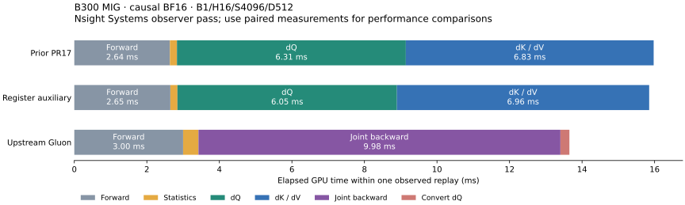

# Wider backward accumulators with a register-resident auxiliary

The [subsequent overlap experiment](../blackwell-intervention-profiling/README.md)
improves this kernel and extends its measured selection to dense attention.
The results below describe the preceding `cbd83c8` implementation.

The new causal BF16 D512 path measures **1.3–3.0% lower forward-plus-backward
latency** in six selected cases versus PR17 `1dcaebe`. It retains FP32 probability
construction and the full centered/P-weighted-key correction. Gluon remains faster.
These measurements use the existing **18-SM B300 MIG 1g.34gb**, not a full B300
or physical B200. Sources, versions and the unmodified pinned upstream revision
`0c5ede6859307bedc0c6089523c16b1ca51b7da9` are recorded in [source.json](source.json).

## Production change

[RegisterAux](../../src/kohakufa_cute/blackwell_register_aux.py) keeps the
P-weighted-key mean (query pass) or dV sum (KV pass) in FP32 registers. This frees
half of TMEM for a persistent **256-column dQ/dK accumulator**. D512 needs two
output slices instead of four. Source-derived matrix-product volume falls from
**20 to 12 units**, versus Gluon's 11: QK/dP volume is now eight units in both
schedules; CuTe retains the additional P-weighted-key mean product. This accounting
excludes pointwise work, transfers and padding. [Work accounting](work-counts.json).

Each CTA has 512 threads: one 80-register pointwise group, two 184-register
auxiliary groups and one 64-register producer group. It uses 512 TMEM columns,
five paired operand-transfer slots and **232448 bytes of dynamic shared memory**.
Auxiliary partials leave TMEM in 16-column windows. The first probability window
overlaps the outstanding dP product; score-product loops remain compact.
The kernel preserves single-owner gradient tiles and adds no quadratic workspace.

Selection requires SM103, unmasked implicit causal BF16 D512, equal query/KV
heads, at least eight batch-heads, and the default query/KV configurations. A
runtime length check uses the wide path only for equal sequence lengths ≥2048;
shorter or unequal lengths reuse the original backward within the same native
cache entry. Explicit pipeline sources supplied by profiling/tuning tools retain
their requested implementation. Dense, FP16, GQA, other head dimensions and SM100
retain their existing paths. The new dense pilot was slower and is not selected.

## Paired performance

Identical rounded inputs, rotated baseline/candidate/Gluon order, four repeats of
20 CUDA-graph replays. Compilation is excluded. Forward and all gradients are
checked against SDPA; graph outputs are checked against eager. Times include
**forward and backward**, in milliseconds. All rows use causal BF16 D512.

| B | H | S | Prior PR17 | Register auxiliary | Gluon | Latency lower |
|---:|---:|---:|---:|---:|---:|---:|
| 1 | 16 | 2048 | 4.83515 | 4.69207 | 3.68086 | 2.96% |
| 1 | 16 | 4096 | 16.32509 | 15.85964 | 13.67087 | 2.85% |
| 1 | 16 | 8192 | 59.41116 | 57.89662 | 51.24243 | 2.55% |
| 1 | 8 | 2048 | 2.42637 | 2.39403 | 1.84975 | 1.33% |
| 1 | 8 | 4096 | 8.19512 | 7.97948 | 6.75678 | 2.63% |
| 2 | 8 | 2048 | 4.79231 | 4.69896 | 3.67676 | 1.95% |

[All 15 cases](comparison-summary.json) include S1024 and eight BF16 dense/FP16
causal controls at D256/D512. The eight controls are bitwise equal to the baseline
and their median timing changes stay within 0.12%. S1024 also falls back and its
0.24% timing change is noise. These gains are additional to the earlier PR17
register-window and independent-statistics changes; their separate percentages
should not be added to estimate a combined gain.

## PTX requests were disappearing in SASS

The initial prototype contained ten `setmaxnreg` PTX requests but **zero
`USETMAXREG` SASS instructions**. Verbose reassembly reproduced:

```text
(C7508) Potential Performance Loss: 'setmaxnreg' ignored; unable to determine register count at entry.
```

Adding `min_blocks_per_mp=1` supplies the entry launch bound. Register changes
also belong inside their role branches, and all roles must join before restoring
their original budgets. The launch bound alone was insufficient for performance;
an unjoined restoration trial stalled and was terminated, with no valid timing.
The selected backward has **ten PTX request sites and ten SASS instructions**.
[Compiler diagnostic](compiler-budget-diagnostic.json).
The assembly dumper now flags requests with no emitted instruction; site counts
need not generally match after compiler optimization.

The selected dQ has zero stack and zero static LDL/STL sites. The selected KV has
a **264-byte stack frame, 153 LDL sites and 88 STL sites**. These are static
instruction sites, not dynamic memory traffic. The entry register allocation is
128; role-local budgets differ. The original fallback remains spill-free in this
capture. [Per-entry assembly/resources](assembly-summary.json).

## What the timeline says, and what remains



A separate Nsight Systems pass measures median dQ **6.30660 → 6.05460 ms** and
dK/dV **6.83166 → 6.95502 ms**, with Gluon's joint backward at **9.99397 ms**.
The diagram uses one observed replay per backend; the values above are medians
over six launches. This observer pass is not the paired performance experiment,
and its stage medians must not be summed to infer unprofiled latency.
[Raw sequence and launch resources](kernel-timeline.json).

This profile motivated a new-dQ/old-KV hybrid. Six rotated repeats at each of
S2048/S4096 gave **3.79945/13.27163 ms backward-only** for that hybrid versus
**3.79290/13.24967 ms** for the selected path in the same run. It did not earn
selection. [Hybrid comparison](hybrid-native.json).

The large matrix-work difference is now closed for these selected shapes, but
the schedules still differ. CuTe transfers auxiliary products from TMEM and
accumulates them in registers every inner iteration, carries more shared memory
and threads, and the KV path still spills. It also constructs dS from FP32 P and
retains the additional full correction. Those costs are omitted from matrix-work
accounting. Their individual contribution is not established by this trace;
hardware performance counters remain unavailable on this MIG. Further work should
target KV register lifetimes and auxiliary readout/accumulation before assuming
the remaining gap is just one extra matrix product.

## Readout ablations that led to this design

The older query-owned fused prototype must export dK/dV partials before reusing
aliased TMEM. End-to-end ablations remove parts of that dependency. The following
are **backward-only**, B1/H16/S4096/D512 dense BF16:

| Fused variant | Backward ms | Valid gradients |
|---|---:|---|
| Original four-slot prototype | 40.06688 | dQ/dK/dV |
| Ordinary stores instead of reduce-add | 36.56352 | dQ only |
| TMEM reads retained, global writes replaced by checksums | 28.84303 | dQ only |
| Five slots, shared-memory union | 38.26808 | dQ/dK/dV |
| Five slots, independent TMEM/shared release | 37.50365 | dQ/dK/dV |

Removing global readout changes end-to-end time by 11.22 ms; replacing atomic
reduction changes it by 3.51 ms. These are counterfactual differences, not isolated
TMA duration, accelerator stall percentages or additive stage timings. DQ-only
ablations cannot qualify a backward implementation. Workspace zeroing, statistics,
gradient kernels and final conversion are included. All valid gradients and graph
outputs were checked. Four rotated repeats of twenty replays were used.

Independent TMEM/shared-staging release improves the complete fused prototype by
6.4%, but it remains slower than the existing two-pass dense backward (~24.5 ms).
It is not selected. [Ablation](ablation-v2.json), [early release](early-readout.json).

Other rejected experiments are retained: dual reducers (43.91 ms); a corrected
M64 complementary-half resident reference (12.598 versus 10.694 ms, not attention);
N64/192-wide output (45.98 ms F+B, 43.97 ms with register probability consumers,
versus 28.33 ms); seven query-transfer slots (30.91 ms); and split operand loaders
(~0.2%, insufficient evidence). A six-GEMM materialized-weight reference takes
24.470 ms backward with **4.30 GB** explicit workspace; bounding that workspace to
318 MB increases time to 86.693 ms. Those alternatives are not production paths.
Failed allocation, alignment, graph-check and synchronization trials are preserved
as failures, not included as timing evidence. All frozen sources are in the archives.

## Validation

* 180 graph-verified paired samples across 15 cases; 32 explicitly enforced bitwise
  control evaluations (128 output/gradient tensors).
* Six selected-path FP64 precision cases: H8/S2048/D512 BF16 causal, seeds 0/21,
  logit scales 10/1e3/1e6. Aggregate relative L2 and per-row p99 error stay within
  5% plus 1e-6 of the prior implementation; finite results and representable nonzero
  control gradients are retained. [Full errors and norms](precision.json).
* Nine GPU regression methods pass: three new dispatch/changed-input graph/
  zero-covariance tests and six existing pipeline/precision/cancellation methods.
  The final cache test also covers a 2049-token tail, unequal lengths, and a
  projection-stride layout while retaining two compile calls/cache entries.
* Signed scales −0.125/0/1 and changed graph inputs are checked against FP64;
  zero covariance retains exact zero dQ on the expected rows.
* 25 CPU checks: 23 pass, two skip. Explicit pipeline-source capture remains on
  the original kernels. Final runtime hashes match every measured snapshot.
* Wheel and sdist build successfully; all ten runtime files byte-match the tested
  source in both packages. The sdist also retains the new drivers, tests and report.
* Common backward PTX assembles offline for SM100. This is a legality check only;
  SM100 dispatch is unchanged. [Offline check](sm100-legality.json).

[Validation records and log hashes](validation.json). New KV spills are disclosed
above; the earlier PR17 report's zero-spill claim applies to its original kernels.

## Reproduce and artifacts

Freeze source snapshots first and run GPU jobs serially. With CUDA dependencies
installed and pinned upstream on `PYTHONPATH`:

```bash
git show 1dcaebe:src/kohakufa_cute/kernels.py > artifacts/pr17-kernels.py
python -m benchmarks.compare_blackwell_native \
  --baseline-kernels artifacts/pr17-kernels.py \
  --kohakufa-tuning results/blackwell-codegen/tuning/b300-gluon-d512.json \
  --seq 1024 2048 4096 8192 --dim 512 --dtype bf16 --causal \
  --output artifacts/paired-causal.json
python -m benchmarks.dump_blackwell_assembly \
  --backend cute --dim 512 --seq 4096 --causal --output artifacts/assembly
python -m benchmarks.plot_blackwell_readout \
  --input results/blackwell-readout-profiling/kernel-timeline.json \
  --output artifacts/kernel-timeline.svg
```

[The readout driver](../../benchmarks/measure_blackwell_readout.py) accepts frozen
prototype modules and explicit `--dq-only-source` diagnostics. It times workspace
zeroing and retains graph arguments throughout their lifetime. Full native
comparisons use the separate driver above so fake-tensor compilation and C++ cache
dispatch are exercised. The raw archive includes session wrappers that reuse a
byte-identical native extension build, tuning files, and the pinned upstream source.

Locally verified archives under `KohakuFA-CuTe-artifacts/2026-10-21-readout/`:

* `kohakufa-joint-readout-20261021.tar.gz`: **4,661,889 bytes**, 598 verified files,
  SHA256 `d04859480b538d20df4631ebdec7bc38fc6adb8e52d676e86b5145fc02d3992a`.
  [Receipt](artifact-receipt.json).
* `kohakufa-register-aux-evidence-20261021.tar.gz`: **23,054,307 bytes**, 888 verified
  files, SHA256 `40c578e0cefd26f4dc0e4572fbf8795ef4cd26c09cef848dbd89fa13582ec148`.
  [Receipt](register-aux-artifact-receipt.json). Includes raw NSYS/SQLite,
  PTX/cubins/SASS, successful and failed experiment logs and frozen sources.

Every manifest entry was hash-checked after retrieval. All ten runtime files and
the latest cache-test source byte-match this worktree. The temporary Runpod host
outage recovered; no archive retrieval remains blocked.
