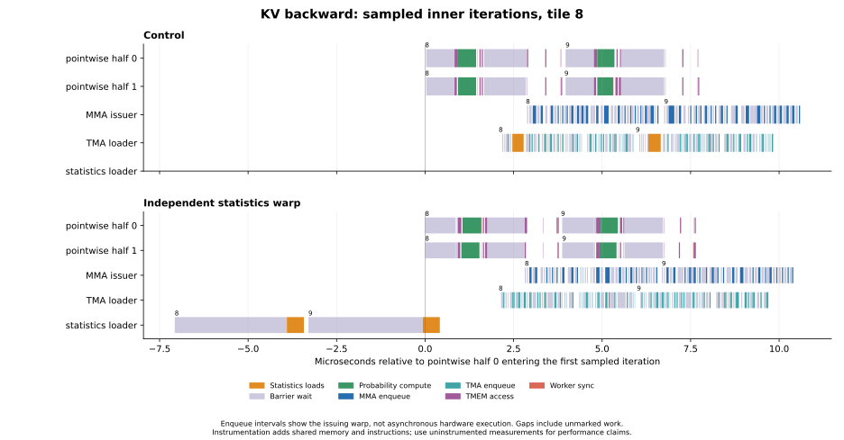
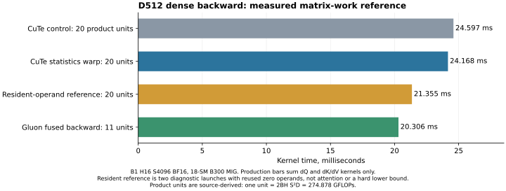

# Blackwell role profiling and independent statistics loading

The streamed KV loader stopped to load the next query tile's four row statistics
before issuing its QK operands. A sampled timeline made this visible across the
loader, matrix issuer and pointwise groups. Moving statistics to previously idle
warp 10 removes that interruption. Both pointwise groups wait on a separate
statistics-ready barrier; their existing two-slot release protocol prevents early
reuse. Launch size, shared-memory footprint, workspace and arithmetic are unchanged.
The 64-column fallback also waits for this independent producer before reading stats.

On the existing **18-SM B300 MIG 1g.34gb**, all 16 D256/D512 FP16/BF16 dense/causal
cases have **1.3–2.9% lower forward-plus-backward latency** than PR17 commit
`b766019408dea3d0a83f74976b8cf0ee13054afc`. D64/D128 controls vary by at most
0.26%. These are additional gains over the earlier register-window change.
Gluon remains faster overall.

## Different profiling methods

The previous matrix-warp wait sums could not distinguish useful overlap from
whole-accelerator idle time. This experiment uses two complementary measurements:

* **Resident-operand reference:** the same 2048-CTA grid, 384 threads, 512 TMEM
  columns, 201728 shared bytes and 32 iterations of the same 8+8+2+2 SS/TS matrix
  chunks as one production backward pass. Operands are reused zeroes in shared
  memory; TMA and pointwise work are removed. Shared initialization and a small
  output read remain timed. Five samples of 20 graph replays give **10.6777 ms**
  per pass, versus **11.8130 ms** dQ and **12.7835 ms**
  dK/dV in a separate, fresh Nsight Systems profile. Forcing completion after each
  operand chunk raises the reference to **15.5609 ms**. Zero outputs are checked
  before and after graph replay. This diagnostic is **not attention, a utilization
  counter, or a hard lower bound**: dependency order, operands and register use differ.
  An equal-FLOP operand-geometry ablation gives **10.6779 ms** with 64-wide/six-slot
  operands versus **10.6533 ms** with 128-wide/three-slot operands, only **0.23%** lower.
  The corresponding per-iteration chunk counts are 8+8+2+2 and 4+4+1+1.
  [Geometry measurements](operand-geometry.json).
* **Cross-role timestamps:** `globaltimer` timestamps from leaders of both
  pointwise groups, the MMA issuer, operand loader, and independent statistics
  loader. Each selected CTA records inner iterations 8 and 9 into 20 KiB of shared
  memory and exports records after the final join. Head 0/output slice 0 is sampled
  at row tiles 0, 8, 16 and 24; four samples are retained, first treated as warmup.
  The heavy initial global-store tracer doubled runtime and was rejected for
  timing attribution. Shared-buffered traces report their remaining observer
  overhead explicitly. Enqueue intervals measure issuing-thread time, **not**
  completion or tensor-core execution. No hardware stall percentages are inferred.



The row-statistics payload moves off the TMA loader. The new warp can prepare
statistics while operands and matrix work advance. Probability reconstruction and
dS work already overlap matrix work; their barrier waits do not represent an equal
amount of accelerator idle time. [Sampled records](selected-roles.json),
[control records](baseline-roles.json), [Chrome/Perfetto trace](selected-roles.chrome.json)
and [observer-overhead measurements](role-summary.json) are retained.
The instrumented statistics payload medians are 352 ns on the old loader and
512 ns on the independent warp; the new consumers' statistics-ready wait is
32 ns median (48 intervals, first sample excluded). The work is hidden despite
its longer observed payload interval. These are sampled thread intervals,
including scheduling and instrumentation, rather than isolated memory latency.
[Payload measurements](role-payload-summary.json).



The repeated matrix products remain the larger target. At D512, the two CuTe
passes execute **20 source-derived product units**, versus **11** for the pinned
Gluon key-owned schedule: **eight** extra units are repeated QK/dP across the two
passes; one is the full P-weighted-key correction. One unit is
`2 * B * H * S² * D = 274,877,906,944` floating-point operations for this shape.
The reference gives an experimental scale for the cost of retaining these products;
it does not prove that every remaining millisecond is unavoidable. This work keeps
FP32 probabilities and the full centered correction. It does not substitute Gluon's
rounded-P arithmetic or an anchor correction.

## Paired performance

Identical inputs; rotated control/candidate/Gluon order; four repeats of 20 graph
replays. Out and all gradients checked against SDPA; 128 candidate eager evaluations
are bitwise equal to the control. Graph results are verified against eager with
precision-appropriate tolerances. Times below include forward and backward.

| Precision | Mask | S | D | Control ms | Candidate ms | Latency lower |
|---|---|---:|---:|---:|---:|---:|
| BF16 | dense | 1024 | 256 | 0.86529 | 0.84797 | 2.00% |
| BF16 | dense | 1024 | 512 | 2.19851 | 2.16440 | 1.55% |
| BF16 | dense | 4096 | 256 | 9.76629 | 9.63883 | 1.31% |
| BF16 | dense | 4096 | 512 | 28.78339 | 28.32751 | 1.58% |
| BF16 | causal | 1024 | 256 | 0.67050 | 0.66176 | 1.30% |
| BF16 | causal | 1024 | 512 | 1.61709 | 1.59412 | 1.42% |
| BF16 | causal | 4096 | 256 | 5.88226 | 5.78308 | 1.69% |
| BF16 | causal | 4096 | 512 | 16.45499 | 16.23154 | 1.36% |
| FP16 | dense | 1024 | 256 | 0.87493 | 0.84978 | 2.87% |
| FP16 | dense | 1024 | 512 | 2.22090 | 2.18078 | 1.81% |
| FP16 | dense | 4096 | 256 | 9.99042 | 9.73480 | 2.56% |
| FP16 | dense | 4096 | 512 | 29.40381 | 28.81374 | 2.01% |
| FP16 | causal | 1024 | 256 | 0.66955 | 0.66067 | 1.33% |
| FP16 | causal | 1024 | 512 | 1.61333 | 1.59221 | 1.31% |
| FP16 | causal | 4096 | 256 | 5.96705 | 5.82395 | 2.40% |
| FP16 | causal | 4096 | 512 | 16.57514 | 16.35319 | 1.34% |

All 32 cases and Gluon medians are in [comparison-summary.json](comparison-summary.json).
Fresh per-kernel Nsight measurements are in [kernel-timeline.json](kernel-timeline.json).
The pinned upstream source is unmodified revision
`0c5ede6859307bedc0c6089523c16b1ca51b7da9`; the executed tuning and all runtime hashes
are recorded in [source.json](source.json).

## Validation and limits

* 384 graph-verified paired samples and 128 bitwise control comparisons.
* Eight GPU regression methods, including the 64-column fallback, saturated gradients,
  changed graph inputs, GQA/tails, zero covariance and wide-head cancellation.
* Signed-scale, unequal-tail/GQA outputs and gradients checked against FP64 and an
  earlier main control; [probe provenance](validation.json) identifies that control.
* 25 CPU checks (23 pass, two skips); wheel/sdist builds and runtime byte checks.
* D256/D512 compiled backward kernels retain zero stack allocation and zero static
  SASS LDL/STL sites. [Assembly summary](assembly-summary.json).
* Common backward PTX assembles offline for SM100 at D256/D512.
  [Legality checks](sm100-legality.json). Physical B200 and full-device B300 execution
  and performance remain unmeasured; these results describe this MIG slice.

The initial statistics-reorder trial and rejected heavy instrumentation are retained
in the raw archive. The selected runtime contains only the independent statistics
producer; instrumentation lives in separate generated sources.

## Reproduce

Freeze the runtime checkout and each generated source before launching a GPU job.
Run GPU experiments serially. Preserve a file containing PR17's `b766019` pipeline
as the uninstrumented control. With the CUDA extras installed:

```bash
python -m benchmarks.instrument_blackwell_roles \
  --source /path/to/control/blackwell_pipeline.py \
  --output /path/to/frozen/control-instrumented.py
python -m benchmarks.measure_blackwell_roles \
  --instrumented-source /path/to/frozen/control-instrumented.py \
  --baseline-source /path/to/control/blackwell_pipeline.py \
  --output /path/to/control-roles.json
python -m benchmarks.measure_blackwell_mma_reference --output /path/to/mma-reference.json
```

Generate and measure the candidate instrumentation separately, then run
`benchmarks.plot_blackwell_roles` with both JSON files to produce an SVG and optional
Chrome/Perfetto trace. The role profiler currently supports dense BF16 D512 on
SM100/SM103; it reports graph-based observer overhead and checks traced gradients
bitwise against its uninstrumented source.

The full traces, NSYS reports/databases, PTX/cubins/SASS, frozen sources and drivers,
all paired samples and logs are in the archive identified by
[artifact-receipt.json](artifact-receipt.json). Its manifest is checked against every
archived file and the selected runtime against the committed source.
