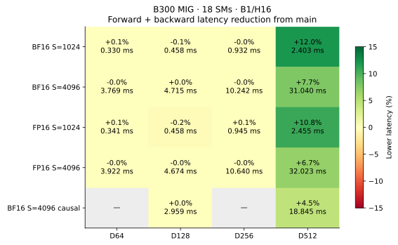
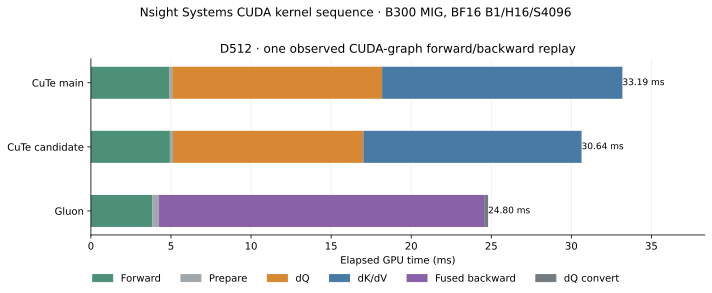

# Blackwell D512 backward slice scheduling

The D512 query and key/value kernels now schedule output slices of one row tile
adjacently. Previously the entire row/head grid ran for one output slice before
the next slice. Each CTA still owns its gradient output; its arithmetic,
centering residuals, tensor-memory layout, barriers, and shared memory are unchanged.
There is no new workspace or reduction.

The selected policy applies to D512. An exploratory policy covering every head
dimension also changed smaller-head scheduling without a consistent benefit.
Forward keeps its existing launch order.

## Measurements

Rotate baseline/candidate/Gluon for four repetitions, with 20 CUDA-graph replays
per measurement. Every output and Q/K/V gradient is checked against SDPA; graph
outputs and gradients are checked against eager execution. All **72 candidate
samples** match main at **zero tolerance**, across **216 graph-verified samples**
and 18 cases.

D512, B=1/H=16, forward plus backward in milliseconds:

| Format | Tokens | Causal | Main | Selected | Lower latency | Gluon |
| --- | ---: | :---: | ---: | ---: | ---: | ---: |
| BF16 | 1024 | no | 2.7305 | 2.4026 | 12.0% | 1.6272 |
| BF16 | 4096 | no | 33.6456 | 31.0401 | 7.7% | 24.8234 |
| FP16 | 1024 | no | 2.7516 | 2.4555 | 10.8% | 1.6277 |
| FP16 | 4096 | no | 34.3212 | 32.0234 | 6.7% | 25.2262 |
| BF16 | 4096 | yes | 19.7435 | 18.8455 | 4.5% | 13.6606 |



Raw reports: [BF16](paired-bf16.json), [FP16](paired-fp16.json),
[BF16 causal](paired-bf16-causal.json), and
[all case medians](comparison-summary.json). Smaller head dimensions retain their
previous launch order; their paired timings are controls. All runtime source
files byte-match the fingerprints recorded in the selected reports.

Measurements use the existing **B300 MIG 1g.34gb, 18 SMs**, Torch 2.12.0+cu130,
Triton 3.7.0, and CuTe DSL 4.8.1. Baseline is main `e0f430a`.
Gluon is KohakuFA `0c5ede6859307bedc0c6089523c16b1ca51b7da9` with the
saved tuning tables in [the previous code-generation report](../blackwell-codegen/tuning).
Full-device B200/B300 performance remains unmeasured for this change.

## Validation and profiling

Five GPU regression methods passed in the
[initial run](gpu-tests-initial.log): fused pipeline/tails/GQA/signed scales,
saturation, changed graph inputs, checked probability reconstruction, and
zero covariance. The existing D256 FP16 cancellation fixture then failed on
both main and the candidate with identical results.

The [range check](cancellation-range.json) establishes that its FP64 Q/K gradient
components are at most `1.31e-12`; every component rounds to zero in FP16, as both
implementations return. The fixture now explicitly requires zeros for that
underflow case. A new `1e5`-logit FP16 case has representable gradients and retains
the original relative-error `<0.3` and cosine `>0.995` gates. Its measured relative
Q/K errors are about `0.0090/0.0091`. The `1e6`-logit BF16 case is retained.
The corrected cancellation test and zero-covariance test both passed in a
[57.4-second follow-up](gpu-cancellation-tests.log).
[Baseline control](cancellation-control.json).

The [anchor negative control](anchor-negative-control.json) independently rejects
the shortcut: on symmetric keys, true dQ and main's dQ are zero, while the
shortcut produces 514 nonzero values in each format (maximum `0.00032544` FP16,
`0.00260925` BF16). The earlier underflow fixture failure was not evidence for
that rejection.

The [CPU checks](cpu-tests.log) ran 25 tests, with 23 passing and two skipped.

[Nsight Systems](kernel-timeline.json) records query-kernel median duration falling
from **13.0994 to 11.8879 ms**, and key/value from **15.0034 to 13.6300 ms**.
Both retain 384 threads, 168 registers per thread, and 201,728 dynamic shared bytes
per CTA. The grid changes from `(32,16,4)` to `(128,16,1)`, retaining 2,048 CTAs.
The diagram shows one actual graph replay closest to the median observed span
for each backend. Profiling timings are separate from the unprofiled benchmark.



[PTX/SASS capture](assembly-summary.json) contains all four candidate kernel entry
points. The same backward PTX also [assembles for sm_100a](sm100-legality.json)
offline; this checks instruction legality and does not measure B200 performance.

The scheduling change is intended to improve input reuse between related CTAs.
Hardware-counter access remains denied on this host, so cache-hit rates, actual
memory traffic, and warp stall percentages are unmeasured. Nsight Systems provides
kernel durations and launch resources.

## Rejected structural experiments

The raw archive preserves the frozen sources, drivers, validation failures,
unprofiled samples, and Nsight captures. None of these prototypes is dispatched:

- Query-owned joint backward with shared score/P/dP work and global dK/dV
  reduction: the fastest measured version took about 59.3 ms **backward only**
  versus approximately 28.7 ms for main. TMA reduction and smaller working chunks
  improved the prototype, but it remained slower.
- Persistent query groups and key-owned joint backward also regressed. The
  key-owned prototype took 46.9 ms backward only. These measurements reject the
  implemented schedules; they do not establish a lower bound for joint backward.
- A maximum-score key anchor initially improved random-input timing, but gives
  nonzero dQ on the zero-covariance fixture. Applying the complete centering
  residual to one key instead of the probability-weighted key mean is incorrect.
  The earlier FP16 cancellation failure also occurs on main and is a fixture
  underflow issue, described above; it does not diagnose the anchor shortcut.
- Separating raw dQ from its exact P@K correction retained bitwise agreement in
  the BF16 paired trials and reduced D512 S4096 forward plus backward from about 33.6 to 32.6 ms. It added
  a large FP32 workspace and an extra kernel, regressed short sequences, and was
  rejected in favor of the simpler scheduling change.
- Keeping the correction accumulator in registers allowed a 256-column query
  output without that workspace, but took 38.8 ms forward plus backward.
- A compact 256-column TMEM query kernel targeting two resident CTAs passed
  bitwise validation but took about 151.6 ms forward plus backward. Earlier
  three-warpgroup variants failed assembly at 104/112 consumer registers.
- Matching Gluon's 32-wide forward transfers increased forward from 4.89 to
  8.28 ms. Matching a buffer or register count alone did not reproduce its speed.

## Reproduction

Export the baseline source and put pinned upstream KohakuFA on `PYTHONPATH`:

```bash
git show e0f430a:src/kohakufa_cute/blackwell_pipeline.py > artifacts/blackwell-baseline.py
python -m benchmarks.compare_blackwell_codegen \
  --baseline-source artifacts/blackwell-baseline.py \
  --kohakufa-tuning results/blackwell-codegen/tuning/b300-gluon-d64.json \
    results/blackwell-codegen/tuning/b300-gluon-d128.json \
    results/blackwell-codegen/tuning/b300-gluon-d256.json \
    results/blackwell-codegen/tuning/b300-gluon-d512.json \
  --dtype bf16 --bitwise --output artifacts/paired-bf16.json
```

Repeat with `--dtype fp16`, and with `--seq 4096 --dim 128 512 --causal`
for the BF16 causal controls. The source fingerprint in every selected report
must match the checked-out runtime source.

The raw archive was downloaded and every one of its **2,370 manifest files**
verified. All runtime sources and the final test source match this checkout.
The earlier main assembly capture also matches the pinned baseline runtime.
[Verification receipt](artifact-receipt.json).

Local archive:
`2026-10-20-joint-backward/kohakufa-joint-backward-20261020.tar.gz`

SHA-256: `23d53dcbc7a818d620f5d4d71888b2b585425fe7d29adcf2f20ca07569dd7caf`.
[Exploratory run index](exploratory-trials.json). The archive's `slices-final`
contains the measured runtime; `precision-final/tests` contains the final tests.
The original failing fixture run and its baseline/range controls are retained.
