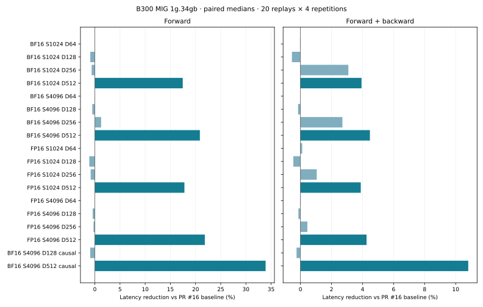
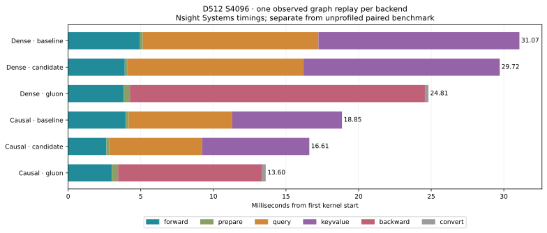

# Blackwell transfer and scheduling follow-up

This change stacks on `8a6c561`, the D512 adjacent-slice scheduling change in
[the preceding report](../blackwell-slice-scheduling/README.md).
It retains FP32 probabilities, the complete probability-weighted centering
correction, independent gradient ownership, and the existing global workspace.

The selected changes are:

- D512 forward transfers 128-column boxes through three shared slots. Final
  output staging reuses resident Q after its last matrix read, making room for
  those larger boxes. Other dimensions keep 64-column boxes and four slots.
- Forward rescales and normalizes output with paired FP32 multiplies in
  64-column register windows, retaining those narrow windows with wider matrix boxes.
- Backward keeps chunk loops compact in the loader and removes redundant
  handoffs in the streamed fused path. Packed-P readiness follows both raw-score
  reads, so P's product completion also releases S. The next dP product waits
  for the preceding dS product through `dp_free`; its completion therefore
  already establishes that dS storage is free. Required aliasing barriers remain.
- D512 causal query tiles run longest first, reducing work in the last wave.

## Paired measurements

B=1, H=16 on the existing **B300 MIG 1g.34gb, 18 SMs**. Rotate baseline,
candidate, and pinned Gluon for four repetitions, each with 20 CUDA-graph replays.
Baseline is `8a6c561`; it already includes adjacent D512 gradient slices.
Forward plus backward times in milliseconds:

| Format | Tokens | D | Causal | Baseline | Selected | Lower latency | Gluon |
| --- | ---: | ---: | :---: | ---: | ---: | ---: | ---: |
| BF16 | 1024 | 256 | no | 0.9316 | 0.9028 | 3.1% | 0.6411 |
| BF16 | 4096 | 256 | no | 10.2445 | 9.9677 | 2.7% | 7.7479 |
| FP16 | 1024 | 256 | no | 0.9451 | 0.9352 | 1.0% | 0.6292 |
| FP16 | 4096 | 256 | no | 10.6412 | 10.5937 | 0.4% | 7.6496 |
| BF16 | 1024 | 512 | no | 2.4028 | 2.3083 | 3.9% | 1.6276 |
| BF16 | 4096 | 512 | no | 30.9804 | 29.5940 | 4.5% | 24.8158 |
| FP16 | 1024 | 512 | no | 2.4545 | 2.3592 | 3.9% | 1.6288 |
| FP16 | 4096 | 512 | no | 32.0141 | 30.6506 | 4.3% | 25.2410 |
| BF16 | 4096 | 512 | yes | 18.9109 | 16.8667 | 10.8% | 13.6344 |

D512 BF16 S4096 forward falls from **4.8861 to 3.8671 ms** dense and
**3.9859 to 2.6344 ms** causal. Gluon takes
**3.8868/3.0043 ms** respectively. These forward medians
approximately tie Gluon for dense forward (0.5% lower median),
while causal forward has 12.3% lower latency. Gluon still leads forward plus backward.
D64/D128 forward-plus-backward controls stay within 0.6% of baseline. Their raw
samples include small regressions; this is not an across-the-board speedup.



[BF16](paired-bf16.json), [FP16](paired-fp16.json),
[BF16 causal](paired-bf16-causal.json), [all medians](comparison-summary.json).
All **72 candidate samples** match baseline outputs and Q/K/V gradients at zero
tolerance. All **216 samples** check SDPA and verify graph results against eager.
The separate [tail/GQA/signed-scale probe](tails-gqa-signed-probe.json) checks
BF16 and FP16 against FP64 and requires bitwise baseline agreement.

Torch 2.12.0+cu130, Triton 3.7.0, CuTe DSL 4.8.1. Upstream is KohakuFA
`0c5ede6859307bedc0c6089523c16b1ca51b7da9`, with the saved
[B300 tuning tables](../blackwell-codegen/tuning).
[Runtime fingerprints and policy](source.json).

## Validation and emitted code

Six GPU regression methods cover tails/GQA/signed scales, saturated gradients,
changed graph inputs, checked probability reconstruction, zero covariance,
and wide-head cancellation. The corrected FP16 underflow fixture from the
preceding report is retained. The [CPU checks](cpu-tests.log) run 25 tests,
with two skips. Full validation status is recorded in [validation.json](validation.json).

[PTX/SASS and resources](assembly-summary.json) compare the emitted candidate
with a [fingerprint-verified baseline capture](baseline-assembly-provenance.json).
[Nsight Systems timelines](kernel-timeline.json) provide dense and causal graph
replays and launch resources, separately from unprofiled timings.
Static D512 BF16 instruction sites (not dynamic execution counts):

| Kernel | MMA, baseline → selected | TMA load | Barrier wait |
| --- | ---: | ---: | ---: |
| Forward | 96 → 80 | 28 → 28 | 50 → 30 |
| Query | 160 → 160 | 68 → 12 | 81 → 51 |
| Key/value | 160 → 160 | 68 → 12 | 83 → 53 |

The wider forward boxes still lower to 28 static TMA-load sites; their benefit
includes fewer matrix issues and handoff waits. The
[correction-window control](wide-correction-control.json) records the intermediate
forward stack of 624 bytes with 213/166 local-load/store sites, versus **64 bytes
and 16/16 sites** after restoring narrow windows. A separate verbose assembler
run confirms register spilling in the intermediate. These are compiler/static
observations, not measured memory traffic.

Nsight kernel medians in milliseconds, collected separately from paired timings:

| Kernel | Dense baseline | Dense selected | Causal baseline | Causal selected |
| --- | ---: | ---: | ---: | ---: |
| Forward | 4.9531 | 3.8874 | 3.9999 | 2.6362 |
| Query | 12.1101 | 12.1022 | 7.1028 | 6.4035 |
| Key/value | 13.8360 | 13.5267 | 7.5756 | 7.3716 |

All three retain 384 threads and 168 registers per thread. Forward dynamic shared
memory rises from 216,064 to 232,448 bytes, with zero static shared bytes;
backward remains at 201,728 bytes. The wider forward allocation fits the
[documented B200 per-block limit](https://docs.nvidia.com/cuda/archive/12.9.0/blackwell-tuning-guide/index.html)
of 227 KiB. This does not measure B200 performance.

The [sm_100a assembly checks](sm100-legality.json) check instruction legality only.
Full-device B200/B300 performance remains unmeasured. Hardware counters are
unavailable on this host, so no cache-hit, traffic, or stall-percentage claim is made.

The [software-reduction probe](software-reduction-probe.json) executes the B200
forward policy on this B300 MIG, checking FP64 and bitwise baseline agreement.
Its separately captured forward PTX and the common backward PTX assemble for
`sm_100a`. An initial attempt to retarget B300's hardware-reduction forward was
rejected for `tcgen05.ld.red`; the rejection is retained as a negative control.
B200 dispatch already disables hardware reductions, matching the
[NVIDIA PTX feature table](https://docs.nvidia.com/cuda/archive/12.9.0/hopper-tuning-guide/parallel-thread-execution/index.html).



## Selection controls

[Executed pilots](exploratory-trials.json) retain frozen sources and measurements.
Correctness-passing variants were excluded when they were slower:

- Splitting next dP into two half-width products: approximately 42–43 ms
  forward plus backward, versus the 31 ms baseline.
- Shared-P query overlap: 32.7 ms; resident-Q query cache: 36.7 ms.
- Smaller/larger stream rings, bit-masked cursor state, and register redistribution
  also failed to improve the selected implementation.
- Widening D256 forward boxes increased its S1024 forward latency from about
  0.148 to 0.174 ms. That first matrix was stopped; the final selection widens
  D512 only. Its partial logs remain in the archive.
- `chunk128-v1` changed the backward operand policy on both sides through the
  host wrapper. Its comparison is invalid and excluded from performance claims.
- Skipping output rescaling for unchanged warps did not improve the paired
  rescaling variant, so the conditional path is excluded.
- The intermediate wider forward path passed the complete matrix and six GPU
  regression methods, but SASS revealed a larger stack and more local load/store
  sites. Keeping its matrix boxes wide while restoring 64-column correction
  windows improved the paired pilot again. That intermediate's complete evidence
  remains under `selected-source-v2`, `selected-v2`, and `measurements-v2`.

## Reproduction and raw artifacts

With pinned upstream KohakuFA available on `PYTHONPATH`:

```bash
git show 8a6c561:src/kohakufa_cute/blackwell_pipeline.py > artifacts/blackwell-baseline.py
python -m benchmarks.compare_blackwell_codegen \
  --baseline-source artifacts/blackwell-baseline.py \
  --kohakufa-tuning results/blackwell-codegen/tuning/b300-gluon-d64.json \
    results/blackwell-codegen/tuning/b300-gluon-d128.json \
    results/blackwell-codegen/tuning/b300-gluon-d256.json \
    results/blackwell-codegen/tuning/b300-gluon-d512.json \
  --dtype bf16 --bitwise --output artifacts/paired-bf16.json
```

Repeat for FP16, and for BF16 with `--seq 4096 --dim 128 512 --causal`.
The comparison adapter removes the new forward head-dimension hint when loading
older source; the baseline therefore keeps its original operand policy.

The [raw archive receipt](artifact-receipt.json) records the download and manifest
verification. Its `selected-source-v3` is the measured runtime and tests;
`selected-v3` contains selected comparisons, regression logs, complete PTX/cubin/SASS,
and Nsight captures. Earlier selections and rejected pilots remain separate.

All **11,178 manifest files** were downloaded and verified. All nine selected
runtime files, all nine baseline runtime files, the benchmark adapter, test source,
selected reports, metadata, and plots match the recorded archive. Its SHA-256 is
`bc0b166990759803d2bebd7829bf5a8d917f1efd9713705a73c8384d44980603`.
