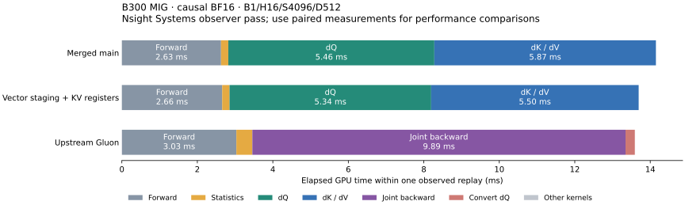
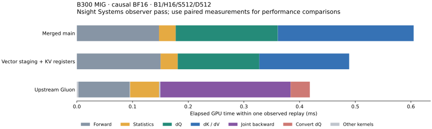

# Vectorized Blackwell gradient staging

The final implementation takes **14.6–19.5% less forward-plus-backward time**
in the newly selected short cases and **2.0–4.6% less** in the retested long cases,
compared with merged PR17 (`2e44865`, also the runtime in main `dee9d84`).
Both selected backward kernels now have **zero stack and zero static LDL/STL
sites**, in dense and causal compilations.

Measured October 21 UTC on the existing **18-SM B300 MIG 1g.34gb**. Physical B200
and full-device B300 performance are not established by these measurements.
[Source hashes and versions](source.json) pin unmodified upstream KohakuFA
`0c5ede6859307bedc0c6089523c16b1ca51b7da9` and its executed tuning configurations.

## What the assembly exposed

The wide backward kept narrow FP32 readout windows, but exported their values
with scalar assignments into swizzled shared memory. That generated many scalar
16-bit stores, packing/address instructions, and extended register lifetimes.

Use the existing TMEM-compatible copy layout for **128-bit shared stores** in
16-column windows, for dV and dQ/dK staging. The final dV export still precedes
dK readout. KV's auxiliary region changes from **256 STS.U16 sites to 32 STS.128
sites**; dQ changes from **128 to 16**. The element conversion, scale, FP32 P and
full centered/P-weighted-key correction are preserved.

Vector stores eliminate dense KV's spills and causal KV's auxiliary spills.
Causal KV still had six pointwise LDL/STL sites. Giving **only causal KV**
96 pointwise registers and 176 registers per auxiliary consumer removes those,
while retaining 64 producer registers. The other kernels retain 80/184/64.
Each split uses the same total register pool; launch bounds, joins and restoration
remain in place. The native causal pilot measures **13.78129 → 13.64523 ms F+B**
against the vector-only stage, with bitwise-equal outputs and gradients.

| Mask | Kernel | Stack bytes | LDL/STL sites | Main auxiliary-region instruction sites |
|---|---|---:|---:|---:|
| dense | dQ | 0 → 0 | 0/0 → 0/0 | 1437 → 903 |
| dense | dK/dV | 80 → 0 | 16/22 → 0/0 | 1779 → 1020 |
| causal | dQ | 0 → 0 | 0/0 → 0/0 | 1439 → 903 |
| causal | dK/dV | 24 → 0 | 10/10 → 0/0 | 1873 → 1018 |

These are static instruction sites, not dynamic traffic, stall percentages or
payload durations. The lexical auxiliary region includes its loop and epilogue;
out-of-line barrier polling blocks are excluded from that region count, while
function-wide spill counts include every block. [Assembly comparison](assembly-diff.json).
The final captures retain all ten emitted register-change sites and 232448 bytes
of dynamic shared memory per selected CTA. [Full resources](assembly-summary.json).

## Enable the improved path at shorter lengths

The earlier wide kernel was selected only at S≥2048. Rechecking the improved
pipeline shows that it also beats the narrow fallback at S512 and S1024.
Selection now starts at **S512**, retaining SM103, unmasked BF16 D512 MHA, equal
sequence lengths, at least eight batch-heads, and default configurations.
Runtime length checks retain native cache reuse. Other input families retain
their existing paths.

The first threshold pilot, before vector stores, reduced F+B by about 7.5–13% at
S512/S1024. The vector-only intermediate was then qualified in **29 cases / 348
graph-verified samples**, with 36 FP64 cases. Its 16 new short cases improved
12.3–18.5%, and eight long cases improved 1.6–3.6%.
[Intermediate comparison](vector-stage-comparison.json),
[source](vector-stage-source.json), [validation](vector-stage-validation.json).
Those measurements describe that source snapshot; they are separate from the
final timings below. The final dense kernels and causal dQ have identical instruction encodings to that intermediate.
[Machine-code comparison](vector-stage-code-comparison.json).

## Final paired measurements

Identical inputs; rotated merged-main/final/Gluon order; four repeats of twenty
CUDA-graph replays. Outputs and gradients are checked against SDPA and graph
results against eager. Times are **forward plus backward in milliseconds**.
The following rows use B1/H16/D512 BF16.

| Mask | S | Merged main | Final | Gluon | Latency lower vs main |
|---|---:|---:|---:|---:|---:|
| causal | 512 | 0.60358 | 0.48603 | 0.42011 | 19.47% |
| causal | 513 | 0.83123 | 0.68793 | 0.66869 | 17.24% |
| causal | 1024 | 1.59215 | 1.29304 | 1.14680 | 18.79% |
| causal | 1025 | 1.99332 | 1.66701 | 1.90690 | 16.37% |
| causal | 2048 | 4.20707 | 4.02031 | 3.68233 | 4.44% |
| causal | 4096 | 14.13843 | 13.64930 | 13.70286 | 3.46% |
| causal | 8192 | 51.79107 | 50.76605 | 51.27579 | 1.98% |
| dense | 512 | 0.71731 | 0.61248 | 0.51191 | 14.61% |
| dense | 4096 | 25.52344 | 24.96297 | 24.94108 | 2.20% |

[All 18 final cases](comparison-summary.json) include H8, B2/H8, S511 and three
other unchanged-path controls. Fourteen cases select the improved kernel; the
four controls vary by at most 0.15%. Final S4096/S8192 causal show small
end-to-end CuTe leads; dense S4096 is effectively tied. These are case-specific
MIG results, not a general claim that CuTe beats Gluon. Earlier-stage percentage
improvements should not be added.

## Fresh timelines and the remaining gap





Separate Nsight Systems passes capture **S512, S1024 and S4096** in both mask
modes, with all graph kernels retained, including initialization. The table gives
median kernel times from six observed replays per backend/case. CuTe backward
core is dQ+dK/dV; Gluon backward core is its joint kernel. Preparation and Gluon's
dQ conversion are additional launches, visible in the full timelines.

| Mask | S | CuTe forward ms | Gluon forward ms | CuTe backward core ms | Gluon joint backward ms |
|---|---:|---:|---:|---:|---:|
| causal | 512 | 0.14997 | 0.09290 | 0.30765 | 0.23354 |
| causal | 1024 | 0.34498 | 0.24888 | 0.89929 | 0.71585 |
| causal | 4096 | 2.64989 | 3.02212 | 10.84229 | 9.90532 |
| dense | 512 | 0.14255 | 0.09186 | 0.44111 | 0.32421 |
| dense | 1024 | 0.35663 | 0.26832 | 1.44723 | 1.17756 |
| dense | 4096 | 3.82686 | 3.83240 | 20.79904 | 20.33707 |

The short forward remains a substantial source of the remaining gap. At S4096,
CuTe's backward core still trails Gluon's joint kernel even where F+B approaches
parity. The backward retains the preceding 12-unit matrix-work decomposition
versus Gluon's 11; this change improves staging and register lifetimes rather
than reducing that count. Counts alone do not predict latency. The next profiling
targets are short forward startup and the exposed backward schedule.

Observer medians are separate from the paired performance results. Full replay
diagrams choose one observed replay per backend; blank gaps do not establish
accelerator idle time. [Long profiles](kernel-timeline.json),
[short profiles](short-kernel-timeline.json). Additional diagrams:
[dense S4096](kernel-timeline-dense.svg), [dense S512](kernel-timeline-dense-s512.svg),
[dense S1024](kernel-timeline-dense-s1024.svg), [causal S1024](kernel-timeline-causal-s1024.svg).

## Trials retained and rejected

* Increasing pointwise budgets in both passes before vectorization regressed the
  dense pilots. The final shift changes only causal KV after vectorization.
* Eight-column auxiliary reads and packed FP32 adds alone did not beat vector
  staging. Combining packed adds with the 96-register KV pointwise variant was
  slower than that register variant alone.
* Reducing causal KV's producer budget to 48 while increasing pointwise to 96
  created an 88-byte stack and regressed the pilot. The producer stays at 64.

The complete frozen pilots, source hashes and rotated samples are retained.
[Summary](pilot-summary.json). None of these rejected variants is dispatched.

## Validation and artifacts

* **216 graph-verified paired samples** across 18 final cases; **24 enforced
  bitwise candidate evaluations**, including every paired long causal result.
* **36 final FP64 cases**, S512/S1024/S2048, dense/causal, seeds 0/21 and logit
  scales 10/1e3/1e6. Relative L2 and per-row p99 errors stay within 5% plus 1e-6
  of merged main; finite and representable nonzero gradients remain. At existing
  selected lengths, both modes remain bitwise equal. Newly selected lengths can
  differ because the wide auxiliary accumulation order differs from the narrow
  fallback. [Precision](precision.json).
* Three GPU regression methods pass: dispatch/cache reuse across
  S511/512/513/1024/1025/2048/2049, unequal lengths and projection strides;
  changed-input graph replay at S512/S2048; exact zero covariance with signed/zero
  scales at S513/S2049. Every method covers dense and causal.
* 25 CPU checks: 23 pass, two skip. Formatting, Python compilation, wheel/sdist
  builds and package runtime-byte checks pass. [Validation](validation.json).
* Common backward PTX assembles offline for SM100 in both mask modes; SM100
  dispatch remains unchanged. [Legality checks](sm100-legality.json).

GPU experiments ran serially against frozen sources. The locally verified raw
archive `KohakuFA-CuTe-artifacts/2026-10-21-vector-readout/kohakufa-vector-evidence-20261021.tar.gz`
contains initial and final runtimes, successful/rejected pilots, all raw paired
and FP64 reports, PTX/cubins/SASS, long/short NSYS/SQLite captures, executed
profiling/analysis sources and upstream/tuning provenance.
[Archive receipt](artifact-receipt.json).

## Reproduce

With CUDA dependencies installed and the pinned upstream checkout on PYTHONPATH:

```bash
git show 2e44865:src/kohakufa_cute/kernels.py > artifacts/pr17-kernels.py
git show 2e44865:src/kohakufa_cute/blackwell_register_aux.py > artifacts/pr17-aux.py
python -m benchmarks.compare_blackwell_native \
  --baseline-kernels artifacts/pr17-kernels.py --baseline-register-aux artifacts/pr17-aux.py \
  --kohakufa-tuning results/blackwell-codegen/tuning/b300-gluon-d512.json \
  --seq 512 1024 2048 4096 8192 --dim 512 --causal --output artifacts/paired.json
```

Add `--bitwise` for a comparison restricted to previously selected long lengths.
The archive retains session wrappers that reused a byte-identical native extension
build; those absolute session paths are not part of the repository tools.
