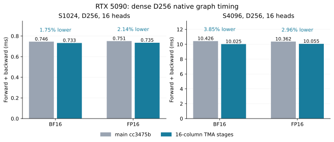
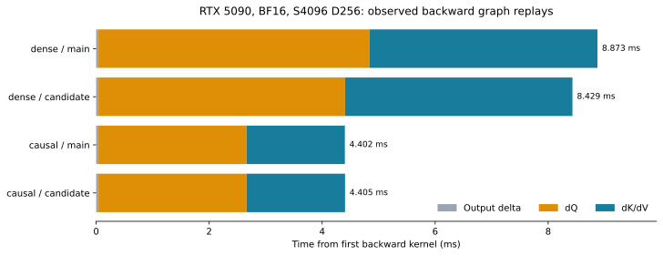

# RTX 5090 pipeline profiling

Dense D256 backward now uses two 16-column TMA stages for dQ. The measured
change lowers complete forward/backward latency by **1.75–3.85%** across the
qualified BF16/FP16 S1024/S4096 cases. The query kernel's 40-byte stack frame
and its static local-memory instructions disappear. Causal attention retains
its previous configuration, following measured regressions from this change.



## Measurement scope

October 21, 2026; RTX 5090, 170 SMs, 32 GB, 600 W limit; PyTorch 2.11.0+cu130,
Triton 3.6.0, CuTe DSL 4.8.1, driver 580.178.04, Nsight Systems 2025.3.2.
[Environment](environment.json) retains the complete versions and device properties.
The control is main `cc3475b`, including PR18. GPU jobs ran serially on one Vast
instance, with each runtime and driver frozen before execution.

[Paired results](paired-summary.json) cover 32 cases: D64/128/256/512,
S1024/S4096, BF16/FP16, dense/causal, B1 H16. Each case rotates baseline and
candidate over five repetitions of 30 CUDA graph replays. All 320 samples
check normal outputs/gradients against SDPA and captured results against eager
execution. Forward/backward includes forward; compilation and profiling are
excluded from these event timings.

| Dense D256 | Main F+B ms | Candidate F+B ms | Latency reduction |
| --- | ---: | ---: | ---: |
| BF16 S1024 | 0.74565 | 0.73262 | 1.75% |
| BF16 S4096 | 10.42598 | 10.02457 | 3.85% |
| FP16 S1024 | 0.75087 | 0.73481 | 2.14% |
| FP16 S4096 | 10.36185 | 10.05536 | 2.96% |

The recorded final-repeat output/gradient comparisons are bitwise equal for
all 28 unchanged control cases. The driver overwrites these differences each
repetition; it does not retain 140 separate bitwise checks. Their largest
median F+B timing difference
is 0.81%. Shorter dense probes at S128/256/512 and H2/8/16 were neutral or
faster, so selection adds no sequence threshold or cache class.

## What the captures establish

[Nsight summaries](nsys-summary.json) associate five labeled graph replays
with GPU kernels through CUDA GraphLaunch correlation IDs. Each plotted row
is one observed replay nearest its capture's median elapsed duration. Kernel
medians below are computed independently across the five observations.



BF16 B1 H16 S4096 D256 query kernel: **4794.53 → 4366.50 us**, or 8.93% lower.
KV medians are 4031.23 → 4015.81 us; the causal query medians are
2622.30 → 2625.56 us. These are observer measurements and should not replace
the unprofiled paired table above. Forward and backward were captured as
separate graphs; the figure shows only complete backward graphs.

The broader baseline capture includes dense and causal D64/128/256/512 at
S1024. Dense D512 spends 1967.65 us in dQ and 1347.30 us in dK/dV out of
3330.33 us elapsed backward. The recorded spacing between its three kernels
is about 0.7 us. That makes internal kernel work the useful target for these
shapes. Nsight Systems does not measure per-warp stalls or prove internal
pipeline utilization; blank gaps and static spill sites are not such metrics.

## Selected schedule and assembly

The dense query configuration changes from
`(32,128,4,False,True,False,False)` to
`(16,128,4,False,True,True,True)`: columns, output width, warps, WGMMA,
centered correction, TMA, double buffering. Query rows remain 64 and the
output grid stays fixed. The next paired K/V transfer is issued before the
current tile's warp-MMA and pointwise consumers finish. Existing barriers
protect reuse of the two slots.

[Assembly evidence](assembly-summary.json) verifies actual `UTMALDG.3D`
instructions and zero `LDL`/`STL` in the selected query. Its registers change
255 → 244; stack bytes change 40 → 0; dynamic shared memory changes
98304 → 99328 bytes, plus 1024 static bytes. The total 100352 bytes fits the
101376-byte opt-in limit. KV assembly remains unchanged. Static counts do
not quantify dynamic local-memory traffic.

Selection requires SM120, dense attention, D256, FP16/BF16, the original
query configuration, and the existing aligned TMA-compatible layouts.
Explicit configurations, boolean masks, ineligible layouts, causal attention,
and other architectures retain their paths. The numerical implementation,
FP32 probability calculations, and full centered correction code are unchanged.
`backward_query_configuration` exposes the resolved selection to the native
factory and benchmark metadata. Archived initial comparisons and tuning
trials bypass automatic substitution, then restore both configuration helpers.
The tuner now searches fitting D256 double buffers; its previous filter had
excluded that family before timing it.

## Counterfactuals retained without selection

[Experiments](experiments.json) and the raw archive retain complete sources,
paired samples and checks for these alternatives:

- D256 query-only staging wins in dense attention, while causal staging
  regresses about 2–4%. Combining it with a two-warp staged KV kernel also
  loses. Four-warp KV staging exceeds the shared limit once its two shared
  score/probability tiles are counted.
- Generic D512 double buffering needs smaller tiles to fit shared memory.
  F+B rises from 3.75 ms to 7.31 ms with 128-wide query output, and to
  12.88 ms with 256-wide output. The latter emits a 2784-byte stack frame;
  the 128-wide version has no spills and still loses. Overlap alone does
  not compensate for this grid/occupancy tradeoff.
- Early next-V prefetch into its consumed query buffer adds no shared
  storage. It improves D512 S4096 about 2%, but regresses S1024 and D256;
  it is not selected.
- Interleaving independent QK/dOV warp-MMA chains changes actual SASS
  scheduling and preserves outputs/gradients bitwise. D128 query still
  emits 128 HMMA and 64 LDSM sites; local loads increase 3 → 8 and stack
  bytes 24 → 32. Improvements stay below 1%, with regressions elsewhere.

The pinned upstream revision is `0c5ede6859307bedc0c6089523c16b1ca51b7da9`.
Its comparison failed on the installed Triton 3.6 stack because
`tensor_memory_descriptor.load_max` is missing. The archive retains the full
exception chain. This does **not** establish an SM120 instruction rejection,
and no RTX Gluon timing or speed ratio is reported.

## Numerical and cache validation

[Precision evidence](precision.json) records 28 centered FP64 cases across
both dtypes: clustered logits at 10/1e3/1e6 with seeds 0/21; exact-zero
covariance with negative, zero and unit scales; projection strides with GQA;
unequal tails; and unchanged unaligned, boolean-mask, causal and D128 controls.
Relative L2 error must remain within the control's error × 1.05 + 1e-6.
Zero-reference outputs are required to stay exact zero. All cases pass.

Seven GPU regression methods pass, including new dense/causal warm-cache
reuse and changed-input graph replay tests for both dtypes, wide cancellation,
tails/masks/GQA/strides, singleton TMA, signed/zero scales, and compiled
projection backward. A pre-existing cancellation fixture incorrectly assumed
that one FP16 reference always rounds entirely to zero. Unmodified main
reproduces its failure on this host, with 249 nonzero rounded FP64 values.
The test now classifies underflow from the actual reference and otherwise
retains its existing nonzero, relative-error < 0.3 and cosine > 0.995 checks.
Both original failures and the successful revised run are archived.

The final CPU/tool suite passes 24 tests and skips the MPS and optional-plot fixtures.
[Dispatch provenance](dispatch-provenance.json) asserts real dense/causal/mask
configuration choices, explicit override preservation, exact equality of
qualified/review runtime files, and the production candidate source hash.

## Raw artifacts and reproduction

[Artifact receipt](artifact-receipt.json) identifies the downloaded archive:
`kohakufa-sm120-nsys-evidence-20261021.tar.gz`, 15,235,839 bytes, 585 verified
manifest files, SHA256
`c75a357f847b3b6ab3a9d69aa8b28d001d3d0e1ebfc3e919134b1b09242b08aa`.
It includes raw `.nsys-rep`/SQLite captures, PTX/cubins/SASS, exact sources and
drivers, paired samples, precision, regression logs and failed experiments.
Local storage: `KohakuFA-CuTe-artifacts/2026-10-21-sm120-pipeline` beside the repo.

The first rental failed NVIDIA container initialization and was destroyed.
The replacement cost $1.06815/hour including 80 GB storage, with free transfers,
and was destroyed after every archived file was verified locally. Estimated
rate × wall time for both attempts totals **$0.795**, below the $5 session cap;
Vast reports no remaining instances.

On an SM120 machine with the recorded software stack:

```bash
python -m benchmarks.speed --dim 256 --seq 1024 4096 --dtype bf16 \
  --iterations 30 --repeats 5 --backends cute --output dense.json
python -m benchmarks.profile_attention --dim 256 --seq 4096 --backends cute \
  --execution graph --profiler nvtx --iterations 5 --output launches.json
python -m unittest -v tests.test_tune_sm120 \
  tests.test_kernels.CuTeAttentionTests.test_sm120_dense_d256_pipeline_reuses_warm_programs \
  tests.test_kernels.CuTeAttentionTests.test_sm120_dense_d256_pipeline_reads_changed_graph_inputs
python -m benchmarks.plot_sm120_pipeline
```

The raw `experiment_v3.py`, final qualification scripts and archive manifest
reproduce the exact baseline/candidate protocol. NVIDIA documents the
[capture CLI](https://docs.nvidia.com/nsight-systems/UserGuide/index.html)
and [installation](https://docs.nvidia.com/nsight-systems/InstallationGuide/index.html);
Vast documents the live [offer API](https://docs.vast.ai/api-reference/search/search-offers).
