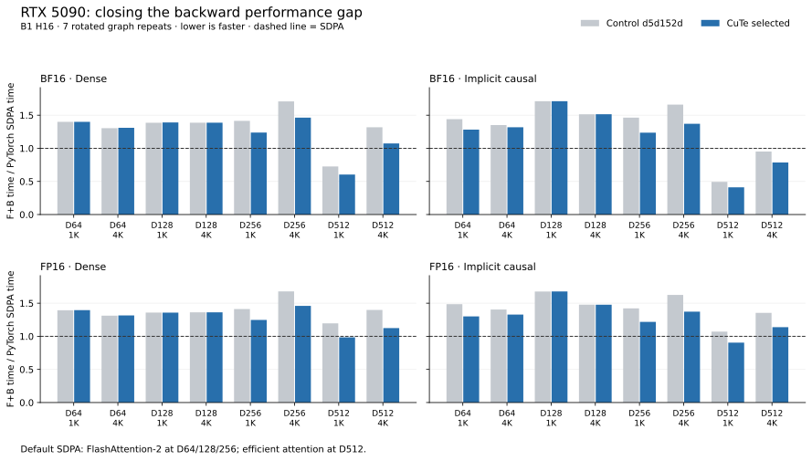

# RTX 5090: actual SDPA backends, PTX exports, and full-width backward queries

Measurements use one RTX 5090 (170 SMs, 32 GB), Torch 2.11.0+cu130, CUDA 13.0 / nvcc 13.0.88, CuTe DSL 4.8.1, driver 580.178.04. The control is the fixed commit `d5d152d527a944ff5542acf68ee9c727e08306d0` (the earlier PR #20 snapshot). Raw backend keys named `pr20` keep that meaning even when PR #20 is updated. Source snapshots and drivers were frozen separately for each experiment. The final production snapshot passes the checks below. The completed archive contains 1,783 independently verified files plus the frozen source manifest; see [artifact receipt](artifact-receipt.json). The GPU remains running for the requested continuation.

## The fast comparison kernel depends on the mask

The 192-attempt initial matrix covers D64/128/256/512, S1024/4096, BF16/FP16, dense and implicit causal attention. All 32 default Torch cases and all 32 native CuTe cases pass eager/graph checks. Actual dispatched ATen operations and Nsight kernel symbols establish:

| Input | Actual default Torch backend |
| --- | --- |
| Dense or `is_causal=True`, D64/128/256 | Built-in FlashAttention-2 |
| Dense or `is_causal=True`, D512 | CUTLASS efficient attention |
| Explicit boolean causal mask, D128/256/512 | CUTLASS efficient attention |

The explicit-mask extension has 72 attempts, with all 12 default cases passing. Unsupported forced Flash/cuDNN calls remain recorded; they do not imply architectural impossibility.

The implicit causal and explicit boolean causal masks describe the same triangle but take different execution paths. At BF16 B1 H16 S4096 D128, five rotated unprofiled CUDA-graph samples give:

| Mask | Default Torch F+B | d5d152d control CuTe F+B |
| --- | ---: | ---: |
| Implicit causal | 1.387 ms | 2.103 ms |
| Explicit boolean causal | 10.050 ms | 2.318 ms |
| Explicit all-true boolean | 10.067 ms | 4.041 ms |

CuTe can skip fully masked cells; explicit-mask efficient attention receives an additive bias without the implicit causal trimming flag. The all-true control still favors CuTe, so triangle skipping explains part of the difference. This does not establish a result for arbitrary masks.

Nsight includes mask preparation: the D128 triangular-mask Torch forward spends about 0.032 ms in fill/where preparation and 1.960 ms in efficient attention; backward spends about 0.038 ms in copy/fill and 7.997 ms in attention. CuTe spends 0.0218 ms packing the mask plus 0.5249 ms in forward, and 0.0124 + 0.8405 + 0.9204 ms in delta/dQ/dKV backward. Preparation is included in graph F+B timings.

## Final combined result

The production snapshot combines full-width D256/D512 dQ with shared row-statistics staging for causal D64 and dense D256. It keeps explicit boolean masks on the prior layouts. All 32 shapes were measured in the same rotated round against the fixed control and actual default Torch: 672 checked CUDA-graph samples. The 20 selected cases improve **2.49–19.62%**; the 12 unchanged controls move by at most **0.474%** in F+B. [Paired timing plot](paired-speed.svg).

Representative B1 H16 S4096 F+B medians:

| Head | Dtype | Mask | Fixed control | Final CuTe | Default Torch |
| --- | --- | --- | ---: | ---: | ---: |
| D128 | BF16 | Dense | 3.609 ms | 3.608 ms | 2.601 ms |
| D256 | BF16 | Dense | 10.036 ms | 8.596 ms | 5.873 ms |
| D512 | BF16 | Dense | 63.741 ms | 51.905 ms | 48.351 ms |
| D64 | BF16 | Causal | 1.090 ms | 1.063 ms | 0.806 ms |
| D128 | BF16 | Causal | 2.111 ms | 2.113 ms | 1.395 ms |
| D256 | BF16 | Causal | 5.332 ms | 4.405 ms | 3.213 ms |
| D512 | BF16 | Causal | 28.188 ms | 23.298 ms | 29.622 ms |
| D128 | FP16 | Dense | 3.581 ms | 3.581 ms | 2.629 ms |
| D256 | FP16 | Dense | 10.040 ms | 8.732 ms | 5.980 ms |
| D512 | FP16 | Dense | 64.876 ms | 52.148 ms | 46.388 ms |
| D64 | FP16 | Causal | 1.140 ms | 1.079 ms | 0.812 ms |
| D128 | FP16 | Causal | 2.080 ms | 2.079 ms | 1.408 ms |
| D256 | FP16 | Causal | 5.266 ms | 4.447 ms | 3.240 ms |
| D512 | FP16 | Causal | 28.329 ms | 23.817 ms | 20.922 ms |

FA2 still wins the D128/D256 cases. D512 uses efficient attention: the remaining dense gap is 7.35% for BF16 and 12.42% for FP16. FP16 D512 causal S4096 remains 13.8% slower than Torch; the BF16 causal result must not be generalized to both dtypes. This change narrows the gap while preserving the centered arithmetic contract.

Final qualification has **96 FP64 cases / 384 output-gradient records** across D64/D256/D512. Absolute L2/cosine, rounded zero/nonzero, and main-relative total-L2/p99 bounds pass. Actual native compilation records verify all six query/options classes. Five GPU regression methods cover warm caches, tails/projection strides, changed-input graphs, wide cancellation, fallback/GQA shapes and boolean-mask graph reclassification; an additional 12 aligned GQA cases exercise the newly selected heads. CPU discovery passes 22 tests with 56 CUDA tests skipped. The benchmark-only archived-table replay fix separately passes three CPU layout/restoration checks and 16 native GPU graph cases for old/new D256/D512 tables. Runtime source remains the frozen v5 snapshot; benchmark replay is the separate v6 snapshot.

The export recipe is preserved in [export-recipe.json](export-recipe.json); compact measurements and provenance are in [summary.json](summary.json).

## Export provenance

The measured wheel is Torch commit `70d99e998b4955e0049d13a98d77ae1b14db1f45`. Its pinned FlashAttention submodule is `e2743ab5b3803bb672b16437ba98a3b1d4576c50`; CUTLASS is `0d2b201e8c1c4a03efa6e9c468161916e2334725`.

`cuobjdump --list-ptx`, including `--all-fatbin`, confirms that `libtorch_cuda.so` contains no embedded PTX. Exact native **sm120** cubins, SASS, resources, library hashes, runtime symbols and launch metadata were exported. The `sm80` suffix in efficient-kernel names is an algorithm template tag, not the architecture of these extracted cubins.

Seven targeted matching-source PTX exports cover FA2 D128/D256 forward/backward and efficient D128 backward / D256-D512 forward/backward. These are **source-regenerated PTX**, not PTX extracted from the wheel. Explicit template instantiations avoid a full Torch build. Source revisions, instantiation units, compiler commands and license provenance are recorded. Known Flash definitions include `FLASH_NAMESPACE=pytorch_flash`, `FLASHATTENTION_DISABLE_ALIBI`, `FLASHATTENTION_DISABLE_SOFTCAP`, and `UNFUSE_FMA`. Full original wheel per-translation-unit compiler invocations are unavailable.

All seven selected regenerated functions produce identical complete normalized SASS instruction streams and register/stack/shared/local resource counts to the corresponding native wheel functions. Torch reports a Release build; adding `-DNDEBUG` removes CUTLASS device assertion paths and makes the three efficient exports match. The initial assertion-enabled exports and their differences are preserved separately. The comparison removes instruction address/encoding comments and collapses whitespace while retaining predicates (including uniform UP predicates), registers, immediates, branch operands and original order. Encoded instruction/control-word streams also agree. Earlier histogram-only counts omitted UP-predicated instructions; the preserved canonical comparison includes them. Full ELF module identity, recovered original PTX, and dynamic instruction counts are not claimed.

Unpacked exports and the machine-readable index live at:

`2026-10-21-sm120-sdpa-ptx/exports/ptx-export-index.json`

The index maps each PTX entry to actual runtime shape/backend, exact native SASS/cubin provenance, source revisions and recorded toolchain. Raw PTX is kept outside Git.

## Removing duplicated dQ score work

The old D256 query path emits two output-slice CTAs for each query tile. Both recompute full QK and dO·V. The new path distributes the complete 256-wide output across column warps, stages DS/P in shared memory, and combines row corrections across those warps. FP32 probability pointwise arithmetic, centered DS, rounded-DS row sums and the P-weighted-K correction remain present.

The first frozen candidate uses four warps, M32/N32/W256. The second uses eight warps, M32/N64/W256, and reuses consumed V storage for DS/P behind a full CTA barrier. Both retain 2,048 total dQ CTAs at S4096/B1H16, compared with the old grid 64×16×2: the new grid is 128×16×1. Eliminating duplicated QK/dP work explains the change; static HMMA counts across differently unrolled tiles are not a throughput measurement.

Native BF16 S4096 backward captures isolate the effect:

| Query path | Dense dQ | Causal dQ | Registers dense/causal | Stack dense/causal | Dynamic shared |
| --- | ---: | ---: | ---: | ---: | ---: |
| d5d152d control | 4.361 ms | 2.621 ms | 244 / 255 | 0 / 24 B | 99,328 / 98,304 B |
| Four-warp full-width | 3.486 ms | 1.763 ms | 253 / 243 | 0 / 0 B | 70,144 B |
| Eight-warp full-width | 3.273 ms | 1.682 ms | 169 / 128 | 0 / 0 B | 99,328 B |

`cuobjdump` additionally reports 1,024 B static shared. All selected allocations fit the 101,376 B opt-in limit. dKV is unchanged in these two candidates. The selected statistics-staging and D512 extensions are included in the final table and `summary.json`.

A normalized full-D product count gives context for the remaining FA2 gap: old D256 dQ+dKV performs about ten matrix-product equivalents; full-width dQ reduces that to eight. Standard joint FA2 performs five. Separate dQ/dKV recompute QK/dP, and centered CuTe adds the P-weighted-K product. This accounts for work, not a measured utilization explanation. Same-rounded-input FP64 comparisons quantify substantial large-logit gradient accuracy differences between these implementations; they do not replace pipeline/layout optimization.

## Validation and rejected paths

Both full-width candidates pass 32 FP64 cases (128 output/gradient metric records): BF16/FP16, dense/causal, normal and analytic zero covariance at negative/zero/positive scales, and clustered logits at 1e5/1e6. Rounded exact-zero and representable nonzero checks pass. Total relative L2 and row-L2 p99 stay within `1.05 × d5d152d control + 1e-6`, alongside the existing absolute bounds. Warm native cache, projection strides/tails, changed-input graph replay and wide-cancellation regressions pass. Every timed sample has eager and captured-graph checks.

An initial stricter per-element scale=1 smoke failure is preserved. The same failing dK element is identical on unchanged d5d152d control; aggregate FP64 error and the existing qualification bounds pass. No threshold was changed to hide the failure.

Earlier eight-warp D64/D128 double-buffer trials mostly regress despite compiling and matching controls. D128 dense S1024 has a small isolated gain; S4096 regresses. Those trials do not justify a new sequence threshold. Full frozen sources and results remain archived.

One superseded queue child overlapped a metric run. Its timing file is explicitly marked `overlap-invalid` and excluded. Clean rotated samples were rerun after all old children exited; subsequent GPU queues share a lock and record job inventories.

Nsight Systems establishes launch order, kernel resources and kernel durations. It does not reveal per-warp stalls or internal utilization. Nsight Compute hardware counters were checked once on this host and denied with `ERR_NVGPUCTRPERM`; no counter utilization claim is made.

## All same-round comparisons

[All 672 checked timing samples](paired-timings.json) include the 12 unchanged controls. Reproduce the figure with `python -m benchmarks.plot_sm120_sdpa` after installing the `plots` extra. Implicit causal calls use `is_causal=True`, without an explicit boolean mask.
