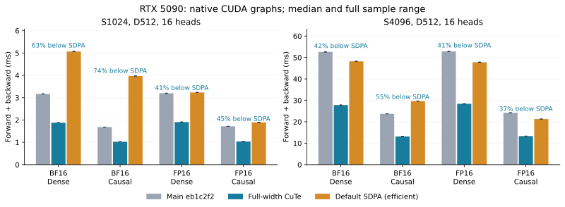
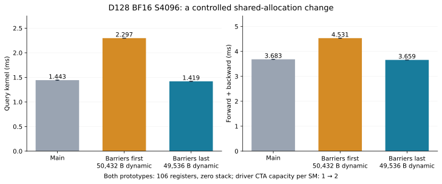

# RTX 5090: full-width D512 forward and backward

The full-width D512 kernels reduce complete forward/backward latency by
**38.85–47.15% versus main** and **37.48–74.10% versus default PyTorch SDPA**
across eight B1 H16 cases: S1024/S4096, BF16/FP16, dense/implicit causal.
The measured SDPA implementation is CUTLASS efficient attention in every case.
These results do not establish a win over FlashAttention-2 at smaller heads.



## Paired measurements

The fixed control is main `eb1c2f2`. Measurements use a 600 W RTX 5090 with
170 SMs and 32 GB, driver 595.71.05, PyTorch 2.11.0+cu130, Triton 3.6.0,
CuTe DSL 4.8.1, and TVM FFI 0.1.15.post0. The frozen GPU image uses Python
3.12.3 as a compatibility environment; CPU development checks use Python 3.13.
See [environment](environment.json).

| Sequence | Dtype | Mask | Main F+B ms | Full-width F+B ms | SDPA F+B ms |
| --- | --- | --- | ---: | ---: | ---: |
| 1024 | BF16 | Dense | 3.168 | 1.877 | 5.068 |
| 1024 | BF16 | Causal | 1.682 | 1.028 | 3.971 |
| 1024 | FP16 | Dense | 3.198 | 1.907 | 3.232 |
| 1024 | FP16 | Causal | 1.718 | 1.038 | 1.895 |
| 4096 | BF16 | Dense | 52.607 | 27.802 | 48.211 |
| 4096 | BF16 | Causal | 23.728 | 13.194 | 29.634 |
| 4096 | FP16 | Dense | 52.838 | 28.414 | 47.780 |
| 4096 | FP16 | Causal | 24.205 | 13.314 | 21.296 |

[Paired samples](paired-timings.json) retain all calibration, attempts, five
rotated rounds, actual SDPA kernel symbols, and source hashes. Each backend
uses native dispatch inside CUDA graphs. CUDA-event windows target 1 second
for F+B and 0.5 seconds for forward, with at least 32 replays. Graph results
are checked against eager execution before timing. SDPA's efficient backward
uses tolerance checks; candidate/control graph results require bitwise equality
to their own eager results. F+B includes forward. Compilation, profiler, and
telemetry collection are outside timed windows. No samples are discarded or
corrected for scheduling. The widest full-step sample range is under 0.69% of its
minimum. [Summary](paired-summary.json) includes full ranges and forward times.

## Removed duplicated work

The D512 forward previously launched two 256-wide output slices, each computing
the same QK. The new M32/N32/W512 four-warp tile computes QK once and shares
probabilities through consumed K storage. Two column-warp groups combine row
maxima and sums in separate shared planes before updating online softmax.
Both groups use the same rescaling factor and normalization; one publishes
the row statistics.

Both backward kernels now cover all 512 output columns in one CTA. Two warps
produce QK, dO·V, and FP32 probability/centered derivative values; all four
warps consume the rounded matrix operands. This removes the second output
slice's duplicated score products. Query reuses consumed V storage for DS/P
and keeps the full centered correction, rounded-DS row sums, and P-weighted-K
product. KV reuses V for DS/P after dP, then reloads V for the next query tile
under the existing asynchronous copy commit/wait/barrier. The extra V stream
costs less than the removed duplicated Q/dO stream. Unconditional CTA barriers
protect all operand lifetimes.

An otherwise redundant initial V copy is deliberately retained. Removing only
that copy changes the measured KV code from 250 registers and zero stack/local
bytes to 255 registers and a 184-byte stack. Static local-memory sites increase
from zero to 44 `LDL`, one `LDL.LU.64`, and 23 `STL.64`. Matched native captures
measure KV at 12.180 versus 15.036 ms and F+B at 27.652 versus 30.559 ms, with
stable control/SDPA times. The source-level copy count alone would have selected
the slower version. These assembly counts do not measure dynamic spill traffic.

Forward/query use 98,816 bytes dynamic shared memory; KV uses 98,304 bytes.
Selection requires SM120, D512, FP16/BF16, eligible aligned layouts, and the
original default configurations. Boolean masks and explicit alternative
configurations retain their existing paths. The tuning search counts aliased
source storage and separate row-reduction scratch before admitting these tiles.

## Profiling controls

The initial rental had recurring long GPU scheduling interruptions that affected
all backends. Removing all owned telemetry collectors did not eliminate them.
Nsight Systems GPU context-switch capture associated every stretched kernel
in one diagnostic capture with off-context intervals. Their underlying cause
is unproven. The [context timeline](context-timeline.svg) and
[query-only development capture](query-prototype-profile.json) preserve that
evidence. Subtracting context intervals is an attribution diagnostic only;
those adjusted durations are not the paired latencies above.

The throughput table was rerun on a second host with a stable control. The
[query-only prototype and cleaned helper](query-static-comparison.json) have identical
complete opcode histograms and 1,968 instructions. Twenty instructions differ
only in shared scratch addresses; both use 254 registers with zero local/stack
bytes. This checks that moving the query code into a helper retained its
generated schedule. [Profiling controls](profiling-controls.json) also retain
the D128 counterfactual: fewer registers did not increase driver-computed
potential active warps, and the tested eight-warp layouts lost performance.
Potential occupancy is not measured residency or utilization.

[Stable-host captures and resources](nsys-and-resources.json) tie actual native
dispatch, source hashes, kernel durations, SASS comparisons, and exact-cubin
driver occupancy together. D512 backward changes from one potential two-warp
CTA per SM to one four-warp CTA per SM. The query's 48 local bytes disappear;
the retained KV has zero local/stack bytes. The new host also denied one
Nsight Compute attempt with `ERR_NVGPUCTRPERM`; it was not retried. No hardware
counter utilization claim is made.

BF16 S4096 native-capture kernel medians (ms), separate from unprofiled timing:

| Stage | Main | Full-width |
| --- | ---: | ---: |
| Forward | 6.375 | 4.609 |
| Center auxiliary | 0.077 | 0.072 |
| dQ | 21.474 | 10.796 |
| dK/dV | 24.404 | 12.180 |

## D128 pipeline counterfactuals

The D128 two-stage producer/consumer prototypes compile and pass eager/graph
checks, but the first query and KV versions regress complete-call timing.
Fewer registers and explicit overlap alone do not select a faster implementation.

A controlled [allocation-order experiment](allocation-cliff.json) changes only
the position of six mbarriers relative to the aligned operands. Dynamic shared
memory falls from 50,432 to 49,536 bytes, with the same 106 registers and zero
stack. Driver-computed capacity changes from one six-warp CTA to two. Measured
query time falls from 2.297 to 1.419 ms; complete F+B improves from 4.531 to
3.659 ms. The latter is only about 0.6% ahead of main, so this prototype is
not selected. The graph checks are bitwise equal to main. Plotted error bars
show the complete per-range median sample range for query and event sample
range for F+B, rather than a confidence interval.



[All stable-host pipeline probes](experiments.json) retain 33 pilot cases,
seven matched profiles, exact-cubin potential occupancy, and sampled role
instrumentation. The sampled path changes register allocation from 198 to 178
and adds 5.31% timing overhead; its intervals describe that observer, not
baseline stall percentages. The muted control changes timing by about 0.02%.
SASS audits locate equal QK/dP HMMA counts inside their timer intervals and
separately record additional setup. Timers bracket issue, not scoreboard
completion.

Moving the next TMA issue between current dP and pointwise work is verified in
SASS and yields a small pilot gain. Whole-CTA double buffering, larger tiles,
different producer/consumer balances, KV storage aliases, and column-statistic
hoisting do not establish a sufficiently qualified broad improvement. Their
sources, resources, all samples, and graph checks are retained; none is selected.

For matched BF16 dense S4096 D128, CuTe forward is about 0.759 ms versus the
actual built-in FlashAttention-2 forward's 0.834 ms. CuTe backward query/KV
medians are 1.443/1.466 ms, plus 0.010 ms for the auxiliary kernel; Flash's
joint main kernel is 1.754 ms plus about 0.044 ms preparation/reduction. Large
host launch gaps do not explain this case. Separate CuTe query/KV evaluate
eight matrix-product families versus Flash's five: QK and dO·V are repeated,
and CuTe retains the P-weighted-K correction. This is work accounting, not
hardware utilization evidence or a claim that further optimization is impossible.

## Numerical qualification

[Precision evidence](precision.json) records 56 cases against same-input FP64
references: both dtypes, dense/causal, normal/analytic-zero/clustered logits
at 1e5 and 1e6, default/zero/negative scales, unequal tails, GQA, and BHSD/BSHD
layouts. All pass absolute error bounds and total-L2/row-p99 error bounds of
`1.05 * control + 1e-6`. Rounded-zero references require exact-zero results.
Representable clustered gradients retain relative L2 < 0.3 and cosine > 0.995.
Four changed-input CUDA-graph cases match fresh candidate eager results bitwise. Factory dispatch
records establish the actual forward/query/KV configurations and attributes.
FP32 probability pointwise arithmetic and the full centered correction remain
present. The existing wide-head cancellation regression now includes D512
on SM120. Eight GPU regression methods pass, covering warm native caches,
changed-input graphs, cancellation, tails/masks/GQA/strides, signed/zero scales,
singleton TMA, compiled projection backward, and streams. Python 3.13 CPU
discovery passes 46 tests and skips 54 GPU/platform fixtures; Black 24.8 and
isort 5.13 checks pass for the changed Python files. See [validation](validation.json).

## Reproduction

On the recorded SM120 stack:

```bash
python -m benchmarks.speed --dim 512 --seq 1024 4096 --dtype bf16 \
  --iterations 30 --repeats 5 --backends cute --output dense.json
python -m benchmarks.profile_attention --dim 512 --seq 4096 --backends cute \
  --execution graph --profiler nvtx --iterations 5 --output launches.json
python -m unittest -v tests.test_tune_sm120 \
  tests.test_kernels.CuTeAttentionTests.test_wide_head_gradient_cancellation
python -m benchmarks.plot_sm120_wide
```

The exact paired driver, frozen sources, complete assembly, profiler captures,
qualification drivers, failed probes, and manifests are retained in the
external evidence archives. [Artifact receipts](artifact-receipt.json) identify
all six verified archives. The stable-host archive contains 1,753 verified
manifest entries, is 29,535,118 bytes, and has SHA256
`8f9e3d3ea8329cb7cc966e61b974512069aa5deae36e8aae9a732cae5864025f`.
[Dispatch provenance](dispatch-provenance.json) verifies that published runtime,
test, and timing files match the archived qualified sources and measurements.

All three RTX rental attempts were destroyed after their evidence was retained.
The stable host cost about $1.15/hour including 80 GB storage, with free transfers,
and was absent from the instance list after termination. Estimated compute/storage
cost for the startup failure and both measurement hosts totals **$3.14**;
metered transfers on the earlier hosts are excluded. See [rental summary](rental-summary.json).
